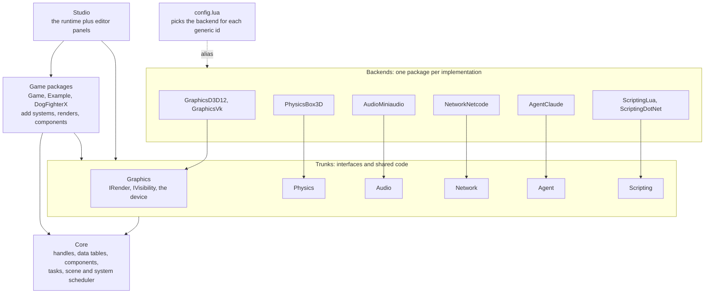

# Architecture

This page is the map of the engine: the large parts, how they connect, and the
five rules that decide where new code goes. [Philosophy](Philosophy.md) states
the bets behind these rules. [Component Architecture](Core/Components.md) shows
the mechanism in detail.

AI agents write most of Ceili's code, under the direction of one developer. The
rate is high: about 1.4 million lines touched in 35 weeks (see
[AI-Assisted Engine Development](CaseStudies/AI_Assisted_Engine_Development.md)).
At that rate, code with no fixed place to go becomes a tangle in weeks. The
architecture gives each change a known place, a boundary it cannot cross, and a
switch that compares it with the code it replaces. The same rules keep the
frame fast, because every boundary sits outside the hot loops.

<!-- MEDIA: the Studio Packages view (or a folder listing of Pkg/Engine) with the
trunk-and-backend pairs side by side: Graphics, GraphicsD3D12, GraphicsVk;
Physics, PhysicsBox3D; Audio, AudioMiniaudio; Network, NetworkNetcode; Agent,
AgentClaude. -->

---

## The map



Each solid arrow is a dependency, and each one points down toward Core. The
shape gives four constraints:

- **A backend depends on its trunk. A trunk never depends on a backend.** The
  trunk holds the interface and the code that all backends share. A backend
  package holds one implementation and nothing else.
- **Every trunk ships a null backend.** Graphics has `DeviceNull`, Physics has
  `PhysicsNull`, Audio has `AudioNull`, Network has a null transport, and Agent
  has `AgentNull`. So each trunk works alone: in a headless test, on a dedicated
  server, or in a build with no GPU backend linked.
- **No new dependency between packages without a question first.** The engine's
  agent instructions say so in bold. An agent finds the shortest path to a
  working change, and the shortest path often crosses a boundary.
- **Studio is the runtime with editor panels.** There is no separate tools
  build, so a game package that runs in the game also runs in the editor.

Calls between packages go through a C-style API that takes handles. A handle is
a small, typed id. The caller holds no pointer, and no object graph crosses the
boundary:

```cpp
// Core/Include/Scene/Scene.h
//-----------------------------------------------------------------------------
// Accessors
//-----------------------------------------------------------------------------
CE_API core::data::DatabaseId GetDatabase(const Handle hScene);
CE_API core::scope::Handle GetScope(const Handle hScene);
CE_API core::ConstStr GetName(const Handle hScene);
CE_API void           SetName(const Handle hScene, core::ConstStr Name);
CE_API Mode           GetMode(const Handle hScene);
CE_API void           SetMode(const Handle hScene, const Mode Mode);
```

An agent that reads this header learns the scene surface from one file. A call with a
dead handle fails with a named result (`failure::InvalidScene`), and the caller
sees the failure where it happens. See [Core](Core/Core.md) for the handle types
and the table store behind them.

## Minimal, swappable, pluggable, extensible, toggleable

Five words describe how the engine changes over time. Each word names a
different mechanism, with a different cost:

| Word | What it means | Examples |
|---|---|---|
| **Minimal** | An interface exposes only what its callers need. Types stay opaque. | Handles, forward-declared JSON types, a short list of handle operations |
| **Swappable** | One interface. One backend, picked at start-up through an alias. | D3D12 or Vulkan; Box3D or null physics; UDP, loopback or null transport |
| **Pluggable** | A new item joins by registering itself. No central list changes. | 50 `IRender` passes, scene systems, visibility providers |
| **Extensible** | New behaviour comes from outside the trunk. | Game packages, C# and Lua systems, Lua materials |
| **Toggleable** | Two paths stay built and live. A switch picks one at runtime. | Forward or Deferred, Blinn-Phong or PBR, the compare slider |

### Minimal: expose only what the caller needs

Every hook in an interface is a place where a later change must stop and check.
So each interface stays as small as its callers allow. A public header
forward-declares its types, and a type stays opaque unless the caller must read
its fields. The JSON API is one example:

```cpp
// Core/Include/Json.h
//-----------------------------------------------------------------------------
// Declarations
//-----------------------------------------------------------------------------
// Read-side (immutable) types -- alias yyjson_doc / yyjson_val internally.
struct Doc;
struct Val;
```

Callers hold a `Doc*` or a `Val*` and pass it back to functions such as
`Root` and `Get`. They never see a field. `Json.h` does not include the parser
library: only `Json.cpp` and the package's private third-party header do. A
change to the parser leaves every caller of `Json.h` as it is.

A handle applies the same rule to its own operations. The macro that makes a
handle type re-exports a short list of operations by name:

```cpp
// Core/Include/Macros/Core.h
public:                                                                       \
    using value_type = Weak;                                                  \
    using base::getValue;                                                     \
    using base::getGeneration;                                                \
    using base::isValid;                                                      \
    using base::invalidate;                                                   \
    using base::canRepresentIndex;                                            \
    using base::operator value_type;                                          \
    using base::operator==;                                                   \
                                                                              \
    static constexpr unsigned kGenBits = GenBits;                             \
```

The constructors are protected. A source file that must make a handle from a
raw number opts in with a separate macro, so the escape is easy to find in a
review. A small surface helps an agent too. The agent reads
one short header and knows the full contract, and a change behind an opaque type
has no callers to untangle.

### Swappable: one interface, a backend picked at start-up

A consumer asks for a generic component id, such as `CID_Physics`. An alias
decides which implementation answers. The trunk sets the alias to its null
backend. A backend package points the alias at itself when its library loads:

```cpp
// PhysicsBox3D/ModuleFactories.cpp
// Claim the generic alias: merely linking this DLL makes Box3D the active backend
// for any executable that does not run config.apply().  The trunk already aliased
// CID_Physics -> CID_PhysicsNull from its own Initializer; whichever runs last
// wins, which is exactly why config.lua carries a deterministic pin as well.
//
// This Initializer must NOT gate on the trunk's Init() having run - a module
// Initializer that depends on another module's initialisation is order-dependent
// and breaks differently per executable.  SetComponentAlias has no such gate.
component::SetComponentAlias(CID_Physics, CID_PhysicsBox3D);
```

`config.lua` then pins the alias, so the result does not depend on the order in
which libraries load. A command-line argument picks the graphics device. A swap
changes the configuration, and the calling code stays the same.

Tests use the same alias to remove the network from a network test. A guard
points the transport at an in-process loopback for the length of one test:

```cpp
// Example/Tests/BoidsSystemTests.cpp
// RAII: route the manager's generic CID_NetTransport at the in-process loopback backend for the test scope
// (deterministic, no sockets), restoring the original alias after -- the exact guard SessionManagerTests /
// PlayerNetSystemTests use so PublishScene works headlessly.
struct LoopbackTransportGuard
{
    core::component::ComponentId original;
    LoopbackTransportGuard()
        : original(core::component::GetComponentAlias(network::transport::CID_NetTransport))
    {
        core::component::SetComponentAlias(network::transport::CID_NetTransport, network::transport::CID_NetTransportLoopback);
    }
    ~LoopbackTransportGuard()
    {
        core::component::SetComponentAlias(network::transport::CID_NetTransport, original);
    }
};
```

The test needs no sockets, and its result is the same on every run. The same
shape swaps physics to Box3D for the door, ladder and trigger tests. See
[Component Architecture](Core/Components.md#the-trunk-and-backends-pattern) for
the three layers of alias.

### Pluggable: add an item by registering it

At start-up, the engine creates one instance of every factory registered under
an interface id. Renders register under `IID_Render`, and scene systems
register under `IID_System`. The engine runs each list in priority order. A
priority is a 64-bit value that packs a band and a FourCC tag:

```cpp
// Core/Include/Scene/System.h
// Ordering key: a uint64_t strong type packing a priority band (high 32 bits) +
// a FourCC (low 32 bits), sorted by value -- mirrors graphics::draw::pass::Type.
// scene::Update ticks a scene's registered systems in ascending Priority.  The
// engine bands + the engine system priorities (kLightUpdate, ...) are declared
// below, outside the range; a game can mint its own Priority value too.
CE_STRONG_TYPE(Priority, uint64_t) // band (high 32 bits) + FourCC (low 32 bits)
```

So a new system or a new render pass needs no central enum and no switch
statement. A package adds a factory, picks a band, and its item runs at that
point in the frame. The engine has 50 renders built this way: 49 in Graphics,
and one that the Ui package adds from its own start-up. Visibility uses the same
plan: each scene holds a set of providers in priority order. See
[Render Passes & Visibility](Rendering/RenderPasses.md).

### Extensible: new behaviour from outside the trunk

A game package adds behaviour with no change to the engine. The boids flock in
the Example package is a scene system. The engine creates it from the
`IID_System` list and ticks it like its own systems. C# and Lua implement the
same `ISystem` interface directly, through generated bindings. A material is a
Lua program with inline shaders (see [Materials](Rendering/Materials.md)).

Extension is safe because each system declares the data it touches. The
declaration is a type, and the compiler enforces it:

```cpp
// Core/Include/Scene/System.h
// A system's component-access contract: each type parameter is a component the
// system touches; a CONST-qualified parameter is a READ, a non-const parameter
// is a WRITE.  The same Contract drives scene::GetView<Contract>'s read<T>() /
// write<T>() accessors (a later phase) AND the scheduler's getReads() /
// getWrites() conflict inputs -- one source of truth, so an implementation can
// never touch a component it did not declare.  Example:
//
//   using C = Contract<const math::Transform, light::scene::Light>;
//   //                 ^read                  ^write (the component row)
//
// getReads() / getWrites() return Span<const Hash> (the existing ISystem shape),
// partitioned from the pack at compile time via core::types::IsConstV and the
// constexpr core::meta::TypeHash.
```

A system that asks its view for a component it did not declare does not
compile. The
scheduler builds its dependency graph from the same declaration, so a system
with correct declarations runs in parallel with no extra work. See
[Core](Core/Core.md#tasks-threading-and-the-fixed-tick-clock).

### Toggleable: both paths live, switched at runtime

A swap picks one backend for the life of the process. A toggle keeps two paths
built in the same process and lets you switch between them while the game runs.
The lighting path is one example. One call sets the switches that make up a
path, and touches nothing else:

```cpp
// Include/Display.h
// Which of the five the switches currently spell, or Custom.
CE_API LightingPathMode GetLightingPathMode();

// Stamp the four switches this mode OWNS, and touch nothing else - a mode is a lighting path, not a
// render-settings preset, so it must not disturb shadows, culling or the pass set around it.
// Custom is a no-op: it names the absence of a combination, so there is nothing to stamp.
CE_API void SetLightingPathMode(const LightingPathMode Mode);
```

The engine has five lighting paths, from plain forward to clustered deferred
(see [Lighting](Rendering/Lighting.md#one-frame-any-lighting-path)). The
lighting model is a second toggle: Blinn-Phong or PBR, from the same materials
(see [Materials](Rendering/Materials.md)). The Studio compare slider draws both
models in one frame, split by a divider.

## Why agent-written code holds its shape

An agent writes correct code quickly. The risk is code in the wrong place, or
code that changes something it did not mean to change. Each rule on this page
answers one of those risks.

**Each change has a known place.** Every package has the same layout, and a
feature has an obvious home: the trunk for shared code, a backend for one
implementation, a game package for game behaviour. The engine's agent
instructions state these patterns, so the agent puts code in the same places a
person would.

**A defect stays inside one implementation.** A new backend or a new render
sits behind an interface that other code already uses. If the new code is
wrong, the null backend and the other backends still run, and the defect is in
one package.

**A small surface means a small change.** An interface with few hooks has few
places where a change can spread. An agent that changes the code behind an
opaque type changes no caller, and the callers do not recompile.

**The compiler checks the boundary.** The `Contract` declaration stops a system
from touching data it did not declare. The C-style API stops a caller from
holding an object it does not own. Neither rule depends on a reviewer finding
the mistake.

**A toggle is a test that is always available.** A new path ships next to the
old one. You flip between them in the running editor, compare them on the same
frame, and measure both in the same process. When the new path wins, removing
the old one means deleting one implementation.

**The commit check runs both GPU backends.** The pre-commit script runs a
one-frame smoke test on Vulkan and on D3D12. A change that works on one device
and breaks the other fails the check before it is committed.

## What it costs in frame time

Each interface call sits at a coarse level: one call per device, per render per
view, or per system per tick. The number of calls grows with the number of
renders and views. It does not grow with the number of entities.

A render that does not apply to the current path stays registered and active.
It tests the view at the top of its own `process()` and returns. The deferred
lighting pass stands down this way when the merged renderer owns the view:

```cpp
// Render/DeferredLighting.cpp
Result process(const draw::ViewDesc& View) override
{
    CE_PROFILE

    // STAND DOWN for a view the merged renderer owns - it calls drawLighting itself inside the subpass
    // that can read the G-buffer. See DeferredAmbient.cpp for the whole reasoning; the grid clear below
    // still has to happen either way, so this gate sits after it.
    if (DeferredSubpassMergeResolves(View.flags, GetDeviceCaps().flags))
    {
        SetViewLightGrid(ViewLightGrid{});
        return core::results::success::Ok;
    }
    return drawLighting(View, false /*InsideMergedPass*/);
}
```

So a render that a toggle turns off costs one call and one test per view.

Inside a system, the work runs over flat data with no interface in the loop.
The boids system takes a typed view of two columns and reads each boid with one
load:

```cpp
// Src/Boids/BoidsSystem.cpp
// The typed two-column view IS the boid set (every boid carries both Velocity +
// Transform).  Its records are pre-resolved at construction (here, on this coordinator
// worker thread) into a flat slot array, so view[i].get<T>() is ONE load into the real
// backing slot AND the indexed access is read-only -- safe to call concurrently from the
// ParallelForRange slices below.  No per-frame gather array: the view already holds exactly
// that.  No structural work here either (the population system, kPreSim, already
// reconciled), so the boid tables stay single-block and the slots never relocate.
auto           view = core::data::GetView<Velocity, math::Position>(db);
const uint32_t n    = static_cast<uint32_t>(view.size());
```

The same loop then splits across the worker threads. This is how the engine
simulates and draws 100,000 boids inside the editor (see
[The Road to 100k Boids](CaseStudies/Performance_100kBoids.md)).

## Limits

- **A swap happens at start-up.** The alias resolves when the component is
  created. To change the graphics device, restart with a different argument.
- **A backend must return its alias before its library unloads.** The loader
  unloads a backend before its trunk. A trunk that still calls into the backend
  at shutdown calls into unmapped memory. So a backend such as `PhysicsBox3D`
  points the alias back at the null default first.
- **A toggle costs build time and test time.** Both paths stay compiled, and
  each path needs its own tests. The first frames after a switch compile the
  pipelines the new path needs.
- **A minimal API costs some convenience.** A caller that needs a value must
  ask a function for it. Data rows are the exception: they are public structs,
  because systems read their fields in the hot loops.
- **A null backend proves only that the calling code runs.** It draws nothing
  and simulates nothing. The one-frame smoke tests on real devices cover the
  rest.
- **Interfaces stay out of per-entity code.** When entities must behave
  differently, put the difference in their data rows, and let one system read
  it.
- **The rules are text.** The agent instructions state them, and an agent that
  ignores them can still add a dependency. The "ask first" rule turns that
  mistake into a question.

Next: [Component Architecture](Core/Components.md) for the mechanism,
[Philosophy](Philosophy.md) for the bets, or the [docs index](README.md).
