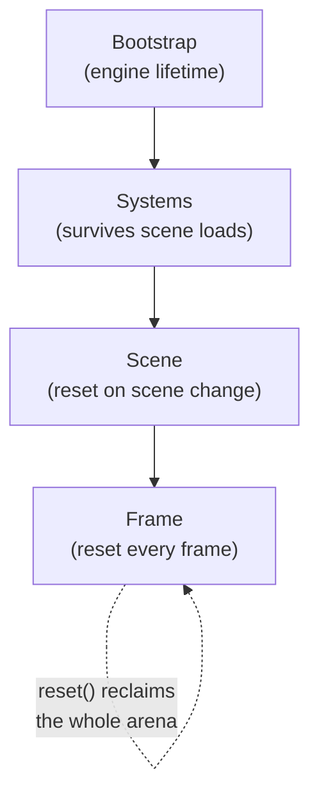
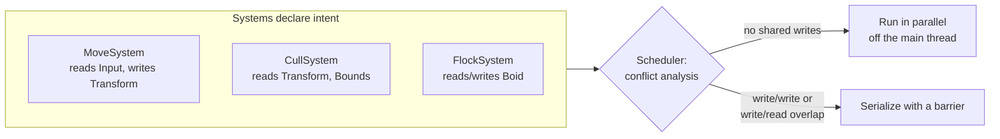

# Core

Core is the foundation every other package builds on. It is where the engine's
opinions about memory, data, error handling, and concurrency live. If
[Philosophy](Philosophy.md) is the set of bets, Core is where they are cashed in.

This is a long page, because Core is a lot of surface area and it rewards
understanding. It moves from the small primitives (containers, handles, results)
up to the two subsystems that most of the engine is really made of: the **data
table store** and the **task scheduler**.

---

## The no-STL bet, stated honestly

Ceili ships no STL. Its own containers, strings, and allocators stand in for
`std::vector`, `std::string`, and friends. This decision gets questioned often, so
here is the honest trade-off:

- **The con:** the STL is familiar. Every C++ programmer knows `std::vector`'s
  interface, its iterators, its guarantees. Rolling your own means new code to
  learn and new code to maintain.
- **The pro:** you control the runtime *and* compile-time cost. Engine hot paths
  care about exact allocation behaviour, contiguous layout, and growth policy;
  the STL's abstractions and header weight are not free on either axis.

Ceili resolves the tension by keeping the *interfaces* STL-shaped (containers
match STL method names and semantics where it helps, and a couple even alias
into a `std` namespace nested inside `ceili`, so familiar code in the engine
compiles) while owning the implementation. You get the muscle memory without
the baggage.

```cpp
// Containers/Array.h: the engine's vector, aliased so std-shaped code just works.
namespace std
{
// STL alias
template <typename T,
          size_t Size        = 0,
          typename size_type = size_t,
          typename allocator = ceili::core::Allocator<T>>
using vector = ceili::core::Array<T, Size, size_type, allocator>;
} // namespace std
```

---

## Containers: contiguous by default

The container set covers the usual shapes, and the default layout is always
**contiguous memory**, because linear scans over packed data are what modern CPUs
are fastest at.

| Ceili | Closest STL | Notes |
|-------|-------------|-------|
| `Array` | `std::vector` | Dynamic or fixed-size; contiguous on the heap allocator, linked-block under a scope allocator. |
| `String` | `std::string` | Owned, growable character string; contiguous storage, same allocator model as `Array`. |
| `SortedArray` | (none) | Sorted storage with O(log n) `find()`; backed by `Array`, so still contiguous. |
| `MapArray` | `std::map` | Sorted `Array<Pair<K,V>>`, keys and values interleaved, contiguous. |
| `FlatMap` | `std::flat_map` | Structure-of-arrays: separate contiguous key and value arrays. |
| `HashMap` | `std::unordered_map` | Open addressing for integer keys, one allocation for the whole table. |
| `ChunkArray` | (none) | Byte blocks addressed by runtime stride; varying types in one container. |
| `Pool` | (none) | `Array`-backed with an intrusive free list; push/pop without reallocation. |
| `Ring` | (none) | Fixed circular buffer over `Array<T, Size+1>`. |
| `Span` | `std::span` | Non-owning contiguous view. |

Two design choices are worth calling out because they show up all over the
codebase.

**Containers take a `size_type` template parameter.** You pick the index width at
declaration, so `size()` and `operator[]` return the right type and you never
scatter `static_cast`s at call sites (the build treats the `size_t`-to-narrower
narrowing warning as an error). An `Array<T, 0, uint16_t>` indexes with a
`uint16_t`, honestly.

**`SortedArray` lives on the struct it sorts.** When a type needs sorted, keyed
storage, the compare functions and the array alias are embedded in the type
itself, keeping them co-located with the data:

```cpp
// Component.cpp: a real example.
struct ComponentAlias
{
    ComponentId src;
    ComponentId dst;

    CE_INLINE bool operator<(const ComponentAlias& Rhs) const { return src < Rhs.src; }

    static int Compare(const ComponentAlias& Lhs,
                       const ComponentId&    Rhs)
    {
        return core::Compare(Lhs.src, Rhs);
    }

    using Array = SortedArray<ComponentAlias, ComponentId, Compare>;
};
```

`find()` is then a one-liner returning an iterator you compare against `end()`.
When your code looks like "accumulate, then sort at the end," the answer is
almost always to store a `SortedArray` and `insert` instead: lookups become
O(log n), iteration comes out in key order, and the manual sort pass disappears.

**`SortedArray` has a scale limit, and a measurement found it.** A sorted array
insert moves half the array, so filling one with random keys is quadratic. The
material registries hit that:

```cpp
// Containers/HashMap.h
// Unordered, unique-key map for INTEGER keys, usually keys that are already hashes (a name hash, a
// content hash). The interface follows std::unordered_map. Pick it over MapArray when the keys are
// effectively random, inserts are frequent and nothing needs ordered iteration: a MapArray insert
// moves half the array, so filling one with random keys is quadratic. Measured 2026-09-17 on the
// material registries: per-insert cost climbed from 1.9us to 11.8us between 8k and 32k entries.
//
// ONE heap allocation for the whole container, never one per item: a header followed by every slot
// inline. A rehash allocates one new block and frees the old one, which is why this is heap-backed
// rather than scope-backed (a scope allocator cannot free the old block).
```

`HashMap` is open addressing with linear probing, a power-of-two bucket count and
a load factor held at or below one half. Deletion shifts later cluster members
back rather than leaving tombstones, so lookups do not slow down with churn. The
whole object is one pointer, which is load-bearing rather than tidy: the Lua
binding writer emits every container field as a pointer, so a wider type would
silently shift every later field offset on the script side.

---

## Allocators and scope

Memory is arena-based. Rather than a general-purpose allocator servicing
individual `new`/`delete` calls, the engine binds a **scope** (a bump allocator
over chunked memory), and allocations flow into whichever scope is active. A
scope is reclaimed all at once by resetting it. There is no per-object free.

The scopes correspond to lifetimes:

```cpp
// Allocator.h
// Scope kind identifies the lifetime category of allocations.
// Each kind can have multiple instances (e.g. multiple scenes open in Studio).
enum class Kind : uint8_t
{
    Bootstrap = 0, // Engine lifetime -- component factories, core subsystem state
    Systems   = 1, // Long-lived shared resources -- survives scene transitions
    Scene     = 2, // Per-scene data -- entities, material instances (Scene is the term for levels)
    Frame     = 3, // Per-frame scratch -- reset every frame
    Studio    = 4, // Studio -- independent of scenes
    Ui        = 5, // UI assets -- font buffers, atlas-referenced data; isolated from Bootstrap
    Test      = 6, // Test-only singleton -- reserved for unit tests of the scope/create/destroy lifecycle so they never collide with a runtime-owned scope
    Count
};
```



The payoff is **fast startup and instant teardown**. Loading a scene allocates
into the Scene scope; unloading it resets that scope in one operation, no
destructor storm. The per-frame scratch scope is reset at the top of every frame,
which is how the engine took frame-scope allocation from roughly 13.9 GB/frame to
about 60 MB/frame: transient work stopped hitting the general heap and started
landing in an arena that is wiped for free each frame.

A container opts into a scope by naming it as its allocator. The adapter reports
that it cannot free individual allocations (its `deallocate()` does nothing) and
uses linked storage:

```cpp
// Allocator.h: the container-facing adapter for a scope.
// Static container allocator adapter. Routes allocations to a thread-local
// bound Allocator instance. Zero per-container storage -- the scope class
// is a constexpr template parameter.
template <Kind ScopeKind>
class Scope
{
public:
    static constexpr bool supports_dealloc   = false;
    static constexpr bool use_linked_storage = true;
```

That `use_linked_storage = true` line is where these arenas pull ahead of a naive
bump allocator. When a scope-backed container outgrows its current block, the
scope links a *new* block onto it instead of overflowing, asserting, or forcing a
relocation. A `reserve()` up front still gives you a single contiguous block for
the common case; exceeding it is graceful growth across a block boundary, not a
hard wall. Many arena and bump-allocator implementations treat the initial
reserve as a fixed ceiling that fails when crossed. Here it is a hint:
correctness never depends on sizing it perfectly, only performance does (a
container that spans multiple blocks trades its single-contiguous-run guarantee
for the ability to keep going).

Two subtleties the engine handles carefully, because they bite:

- **Scope memory is raw bytes.** Objects placement-new'd into a scope are *not*
  destructed when the scope is reset. Types that own a resource (a mutex, say)
  must be destructed explicitly, or held in a container whose destructor iterates.
- **File-scope globals that a startup step touches** are held in an
  `AlignedBuffer<T>` and explicitly constructed and destructed by an
  `Initializer` (a nifty counter). C++ static-init order is unordered against
  the subsystem initializers that read them, so the engine does not rely on it. The
  first `Initializer()` placement-news `g_`, and the last `~Initializer()`
  destructs it. Log.cpp, Data.cpp, Tasks.cpp and ten other Core files use the
  pattern:

```cpp
// Src/Core.cpp
struct Globals
{
    size_t      NumAllocations = 0;
    Event<void> ThreadSyncEvent;
};

types::AlignedBuffer<Globals> g_buffer;
Globals&                      g_ = reinterpret_cast<Globals&>(g_buffer);
```

---

## Strong types and handles

The engine leans hard on the type system to prevent mix-ups the compiler would
otherwise wave through. A **strong type** wraps a primitive so two logically
different `uint32_t`s cannot be swapped:

```cpp
// Macros/Core.h
#define CE_STRONG_TYPE(Strong, Weak) \
    struct Strong##_Tag              \
    {                                \
    };                               \
    using Strong = ceili::core::StrongType<Weak, Strong##_Tag>;
```

A **handle** is a strong type with a sentinel and optional generation bits. It is
the token the public APIs hand out instead of pointers (see
[Philosophy: Handles, not objects](Philosophy.md#handles-not-objects)):

```cpp
// Handle.h
template <typename T, typename Tag, unsigned GenerationBits = 0>
class CE_API Handle
{
public:
    using value_type = T;
    using pointer    = value_type*;
    using this_type  = Handle<T, Tag, GenerationBits>;

    // Layout traits derived from GenerationBits. Single source of truth so
    // CE_HANDLE_GET_FUNC's bit-pack and slot lifecycle helpers
    // (core::slot::*) pull from one place; switching the underlying type or
    // gen-bit count only requires changing the CE_HANDLE declaration. The
    // bit-fiddling traits use private if-constexpr helpers so non-integral
    // value_type (e.g. mutex::Handle's void*) discards the bitwise branch.
    static constexpr unsigned   kGenerationBits = GenerationBits;
    static constexpr unsigned   kIndexBits      = sizeof(T) * 8 - GenerationBits;
    static constexpr value_type kInvalid        = MaxValue<value_type>();
```

A real declaration, the audio sound handle, spends 8 of its 32 bits on the
generation:

```cpp
// Audio/Include/AudioTypes.h
//-----------------------------------------------------------------------------
// Handles
//-----------------------------------------------------------------------------
// 8 generation bits, so a handle outliving the sound it named resolves to nothing rather
// than to whatever recycled its slot.
CE_HANDLE(Handle, uint32_t, 8)
```

Generation bits catch use-after-free: when a slot is recycled its generation
increments, so a stale handle from the previous occupant no longer validates. A
plain integer token also crosses the C / C# / Lua boundary trivially, which a C++
object with a vtable does not; handles are what make the interop story
tractable.

`Result` is itself a strong type. Errors are values, not exceptions:

```cpp
// Result.h
using WeakResult_t = uint32_t; // Weak type is used for interop - can't use the strong type as it has a constructor
CE_STRONG_TYPE(Result, WeakResult_t)

//-----------------------------------------------------------------------------
// Functions
//-----------------------------------------------------------------------------
CE_API CE_INLINE bool Failed(const Result Result)
{
    // .get() -- StrongType's operator T() is explicit, so the failure bit is read through the one
    // deliberate accessor rather than an implicit decay to WeakResult_t.  This is THE place that
    // knows Result is a bitfield; callers stay on Failed() / Succeeded().
    return (Result.get() & 0x80000000u) == 0x80000000u;
}

CE_API CE_INLINE bool Succeeded(const Result Result)
{
    return !Failed(Result);
}
```

A result's value is a hash of its name with the top bit meaning failure, so
results are cheap to compare and self-describing. You declare them with a macro:

```cpp
// Result.h
CE_DECLARE_SUCCESS(Ok) /// Default success
CE_DECLARE_SUCCESS(Stop)
CE_DECLARE_SUCCESS(Default) /// Ask caller for default processing
CE_DECLARE_SUCCESS(False)   /// Graceful failure
CE_DECLARE_SUCCESS(ExitSystem)
CE_DECLARE_SUCCESS(EndOfFile) /// End of file reach.

CE_DECLARE_FAILURE(Error)            /// Default error
CE_DECLARE_FAILURE(Warning)          /// Default warning
CE_DECLARE_FAILURE(NotImplementated) /// Function not implemented
CE_DECLARE_FAILURE(InvalidParameter) /// Function was passed an invalid parameter
CE_DECLARE_FAILURE(CriticalError)    /// Default critical error
CE_DECLARE_FAILURE(OutOfMemory)      /// No more memory available
```

A caller tests a result with `Failed()` and returns it early:

```cpp
// Src/Platform/Win/ThreadWin.cpp
Result Join(const Handle hThread)
{
    const HANDLE h_thread  = static_cast<HANDLE>(hThread.getValue());
    const DWORD  thread_id = GetThreadId(h_thread);
    if (h_thread == nullptr || h_thread == INVALID_HANDLE_VALUE || thread_id == 0)
    {
        return core::results::failure::InvalidHandle;
    }

    Result ier = events::WaitForSingle(CreateWaitableHandle(reinterpret_cast<uintptr_t>(h_thread)));
    if (Failed(ier))
    {
        return ier;
    }

    DWORD ret;
    GetExitCodeThread(h_thread, &ret);
    return ret == 0 ? core::results::success::Ok : core::results::failure::Error;
}
```

---

## Hashing and type hashes

A single case-insensitive string hash (djb2) is used pervasively, for resource
names, material identity, result codes:

```cpp
// Hash.h
uint32_t constexpr Hash32(const char* Text, const size_t Length = UINT32_MAX)
{
    // return Length > 0 && *Text ? static_cast<uint32_t>(*Text) + 33 * Hash32(Text + 1, Length - 1) : 5381;
    uint32_t hash = 5381; // Initial hash value
    for (size_t i = 0; (Length == UINT32_MAX ? Text[i] != '\0' : i < Length); ++i)
    {
        unsigned char c = static_cast<unsigned char>(Text[i]);
        if (c >= 'A' && c <= 'Z')
        {
            c += 'a' - 'A';
        }
        hash = ((hash << 5) + hash) + static_cast<uint32_t>(c); // hash * 33 + c
    }

    return hash;
}
```

More interesting is the **compile-time type hash**. The engine derives a stable
id for any C++ type by hashing its compiler-spelled name, with no macros or
registration at the type's definition. `TypeName<T>()` reads that name out of
the compiler's function-signature string:

```cpp
// Core.h
using Hash = uint32_t;
template <typename T>
constexpr Hash TypeHash()
{
    const TypeNameStr type_name = TypeName<T>();
    return Hash(Hash32(type_name.start, type_name.len));
}
```

This is the quiet linchpin of the next section: a data table is keyed by
`TypeHash<T>()`, so a component *type* is its table id. No enum of component ids,
no manual registry. The type is the key.

---

## Extending without a central enum: FourCC ids

Type hashes turn a *type* into an id. `FourCC` turns a *four-character tag* into
one, and it is the tool the engine reaches for whenever a new kind of thing needs
a stable, orderable id that a downstream package (or a game) can mint without
editing an engine enum.

```cpp
// Core.h
template <typename T>
constexpr T FourCC(const int Byte0 = ' ', const int Byte1 = ' ', const int Byte2 = ' ', const int Byte3 = ' ')
{
    static_assert(types::IsUnderlyingTypeV<T, uint32_t>, "FourCC requires a uint32_t-based type");
    return T{static_cast<uint32_t>((((((Byte3 << 8) | Byte2) << 8) | Byte1) << 8) | Byte0)};
}

template <typename T>
constexpr T PriorityFourCC(const uint32_t Priority, const int Byte0 = ' ', const int Byte1 = ' ', const int Byte2 = ' ', const int Byte3 = ' ')
{
    static_assert(types::IsUnderlyingTypeV<T, uint64_t>, "PriorityFourCC requires a uint64_t-based type");
    return T{(static_cast<uint64_t>(Priority) << 32) | static_cast<uint64_t>(FourCC<uint32_t>(Byte0, Byte1, Byte2, Byte3))};
}
```

Two properties make this more than a packing trick. First, both are templated on
the strong type `T`, so a `serialize::Format` FourCC and a `draw::pass::Type`
FourCC are *different types* that cannot be compared or confused, even though both
are just packed bytes underneath. Second, `PriorityFourCC` puts the priority in
the high 32 bits. Sort a list of them and you have a pipeline order for free: the
priority decides the order, and the tag is a readable type id.

That is why several of the engine's "registries" are not enums at all, just lists
of `constexpr` FourCC ids that anyone can extend. A render pass is a priority band
plus a tag. Adding one is a single line, and its place in the frame's pipeline
comes from the packed value:

```cpp
// Graphics/Include/Graphics.h
constexpr Type kShadowMapDirectionalSkinned = PriorityFourCC<Type>(priority::kShadow, 'S', 'M', 'D', 'S');
constexpr Type kShadowMapPoint              = PriorityFourCC<Type>(priority::kShadow, 'S', 'M', 'P', 'T');
constexpr Type kShadowMapSpot               = PriorityFourCC<Type>(priority::kShadow, 'S', 'M', 'S', 'P');
constexpr Type kDepthPrePass                = PriorityFourCC<Type>(priority::kDepth, 'D', 'P', 'R', 'E');
// Instanced sibling of kDepthPrePass (see kDirectionalForwardInstanced below
// for the pattern): RenderPrePassIBL picks it for count>1 batches when the
// IBL material provides it, collapsing the prepass to one draw per batch.
constexpr Type kDepthPrePassInstanced = PriorityFourCC<Type>(priority::kDepth, 'D', 'P', 'R', 'I');
```

A serializer format is a plain FourCC (`kJson`, `kBin`), and the binary backend
writes `kBin` at the head of its stream. A system's scheduling priority is a band
plus a tag, and a game can mint its own without touching any engine code. Inside
a band, an explicit slot number sets the order:

```cpp
// Scene/System.h
namespace band
{
// ORDER WITHIN A BAND IS `band::kX + N`, NOT A CHOICE OF FourCC LETTERS.
//
// PriorityFourCC packs (Priority << 32) | FourCC, so the priority argument owns the high 32 bits
// and decides order outright; the FourCC is a readable TYPE ID and nothing more.  Bands are spaced
// 100 apart precisely so a band has ~99 explicit slots - use them, and leave a system at the bare
// band constant only when its position genuinely does not matter.
```

The system scheduler makes the intent explicit: two systems that conflict and
land on the same `Priority` trip an assertion telling you to give them distinct
FourCCs. The engine
ships a set of ids, but the *scheme* is open. A downstream package adds a render
pass, a serializer format, a spatial-index kind, or a game-system priority by
minting a new tag, never by editing a switch statement at the center.

---

## Delegates and events

A `Delegate` is a type-erased callable with 32 bytes of inline storage. It binds
any of the three C++ callable shapes (a free function, a lambda, or an object
plus a member function), and the callable is placement-constructed into that
inline buffer, so binding one never touches the heap:

```cpp
// Delegate.h: the free-function and lambda constructors.
DelegateBase(FuncPtrT pFunc)
{
    using DelegateType = DelegateFunc<RetType, A...>;
    m_Delegate         = new ((DelegateType*)(void*)m_DelegateBuffer) DelegateType(pFunc);
    m_Type             = Type::Function;
    m_Size             = sizeof(DelegateType(pFunc));
}

template <typename T>
DelegateBase(const T& Lambda)
{
    using DelegateType = DelegateLambda<T, RetType, A...>;
    static_assert(sizeof(DelegateType) <= Size);
    m_Delegate = new ((DelegateType*)(void*)m_DelegateBuffer) DelegateType(Lambda);
    m_Type     = Type::Lambda;
    m_Size     = sizeof(DelegateType(Lambda));
}
```

The `static_assert` stops a lambda whose captures do not fit the buffer at
compile time. `Delegate<RetType, Args...>` is `DelegateBase` with that buffer
fixed at `kDelegateMaxStackSize`, which is 32.

The distinctive part is the last mile: **a delegate can be backed by a script
function.** Because the `Delegate` layout is mirrored byte-for-byte across C++,
C#, and Lua, the script generator emits a small shim per delegate type, so any
`Delegate<...>` an engine API accepts can be satisfied by a Lua function or a C#
method. A Lua callback is `ffi.cast` to the delegate's signature (wrapped in a
`pcall`, so a script error is logged rather than crashing native code) and handed
across; a C# method is passed as an `[UnmanagedFunctionPointer]` and pinned so the
garbage collector cannot move it. Native C++ then invokes it exactly like a C++
callable, never knowing the implementation lives in a script.

That is the mechanism behind cross-language component and system implementations
(see [Component Architecture](Components.md) and [Script Generation](ScriptGeneration.md)):
a component written in C# or Lua registers its lifecycle as delegates, and the
engine calls them through the same 32-byte handle it would use for native code.

An `Event` is a priority-sorted list of delegates fired high-to-low.
`EventSingleFire` erases a delegate once it returns true, the shape you want for
"notify me once, then forget me" (shutdown hooks, one-shot load callbacks):

```cpp
// Event.h
template <typename RetType, typename... Args>
using Event = EventBase<RetType, size_t, kDelegateMaxStackSize, false, Args...>;

template <typename RetType, typename... Args>
using EventSingleFire = EventBase<RetType, size_t, kDelegateMaxStackSize, true, Args...>;
```

---

## Data: the table store the engine is made of

If one subsystem in Core deserves the most attention, it is `core::data`. It is a
columnar, archetype-style table store (the same family as the data-oriented ECS
stacks), and an enormous amount of the engine (scenes, serialization, undo/redo,
network replication) is really just this store viewed through different lenses.

The primitives: a **database** holds **tables**; a table holds **records** keyed
by a `Key` handle; each record's storage is a stride of raw items.

```cpp
// Data.h
using WeakTableId_t = uint32_t; // Index is in DataIndex.h

CE_STRONG_TYPE(DatabaseId, Index)
CE_STRONG_TYPE(TableId, WeakTableId_t)
CE_HANDLE(Key, Index)

constexpr Index      kInvalidIndex = MaxValue<Index>();
constexpr TableId    kInvalidTable{MaxValue<WeakTableId_t>()};
constexpr DatabaseId kInvalidDatabase{MaxValue<Index>()};
```

A `Record` holds a `pItems` pointer, an `itemIndex`, and an `itemCount`.

Tables are keyed by type. The typed API keys a table by `TypeHash<T>()`, so a
component type *is* its table:

```cpp
// Data.h: the ECS type -> table binding, no registry required.
template <typename T>
T& ReadRecordItem(const DatabaseId DatabaseId, const Key Key)
{
    constexpr TableId table_id = TableId(TypeHash<types::RemoveCvRefT<T>>());
    void*             p_item   = ReadRecordItem(DatabaseId, table_id, Key);
    return *reinterpret_cast<T*>(p_item);
}

template <typename T>
Span<T, DynamicExtent, Index> ReadTable(const DatabaseId DatabaseId)
{
    constexpr TableId table_id = TableId(TypeHash<types::RemoveCvRefT<T>>());
    Index             count    = 0;
    void*             p_table  = ReadTable(DatabaseId, table_id, &count);
    return {reinterpret_cast<T*>(p_table), count};
}
```

You read across tables with a **view**. `GetView<A, B>` returns rows that have all
of components A and B:

```cpp
// Data.h
template <typename... A>
auto GetView(const DatabaseId database_id, const Span<const TableId> FilterTables = {})
{
    constexpr size_t  num_typed = sizeof...(A);
    constexpr TableId typed_ids[num_typed]{TableId(TypeHash<types::RemoveCvRefT<A>>())...};

    constexpr size_t kMaxQueryTables = 64;
    CE_ASSERT(num_typed + FilterTables.size() <= kMaxQueryTables)
```

Each row's `get<T>()` is checked at compile time, so you cannot read a column the
view did not request:

```cpp
// Data.h
template <typename T>
T& get() &
{
    static_assert((types::IsSameV<T, A> || ...), "Type not in View");
    using type                   = typename types::RemoveCvRefT<T>;
    constexpr size_t table_index = getIndex<type>();
    return *reinterpret_cast<T*>(itemPtr(table_index));
}
```

Views hit an archetype fast path and a generation-validated thread-local cache,
so repeated per-frame iteration does not re-resolve membership.

Mutations are tracked. A table can opt into **dirty tracking**. Inserts and deletes
then queue their keys, an edit queues its key with `MarkRecordDirty`, and a
consumer drains the dirty set and rescans nothing else:

```cpp
// Data.h
// C++ only -- generic per-table DIRTY-KEY worklist, for consumers that want to DRAIN the keys that
// changed rather than full-scan a table on the off-chance something went dirty (the graphics surface
// reconcile). Opt-in per table: EnableDirtyTracking turns on the auto-enqueue (structural inserts AND
// deletes push their key: DeleteRecordItems, DeleteAllRecordItems, ClearTable) AND retroactively seeds every
// current key once, so enabling after rows already exist still captures them. A delete enqueues because a
// drain is the only way a consumer learns a row LEFT; a mark at each deleting call site kept being forgotten. MarkRecordDirty enqueues a key explicitly (for an edit, or to re-queue a key that needs
// another pass); DrainDirtyKeys appends the worklist to Out and clears it. MAIN-THREAD / load-owner-
// exclusive, exactly like FlushDenseViews -- no locking. Dups are allowed (drain consumers are expected to
// be idempotent). A drained key may have NO row (a delete, or insert-then-delete before a drain): every consumer
// must null-check via ReadRecordItem and treat that as "this key left", never as an edit.
CE_API void EnableDirtyTracking(const DatabaseId DatabaseId, const TableId TableId);
CE_API void MarkRecordDirty(const DatabaseId DatabaseId, const TableId TableId, const Key Key);
CE_API void DrainDirtyKeys(const DatabaseId DatabaseId, const TableId TableId, Array<Key, 0, Index>& Out);
```

That single "what changed?" primitive is the seam that undo/redo, the property
grid, serialization, and network replication all attach to. It is exactly the payoff
promised in [Philosophy](Philosophy.md): one metadata-and-data model, many
features. See [Metadata & Reflection](Metadata.md).

---

## Tasks, threading, and the fixed-tick clock

Work is expressed as tasks over a worker pool. The primitive is `Create`: give it
a delegate, a name, and how many worker threads to run it on. The body is a
`core::Delegate<Result, const Index>`: it takes its thread index and returns a
`Result`.

```cpp
// Tasks.h
CE_API Result CreateWorkerThreads(const Index NumWorkerThreads = 32_threads);
CE_API void   DestroyWorkerThreads();
CE_API Result CreatePool(const Index NumTasks = 256_tasks);
CE_API void   DestroyPool();
CE_API Handle Create(const Delegate& Delegate, ConstStr Name = nullptr, const Index NumRequestedThreads = 1_threads, const Flags Flags = Flags::None);
CE_API void   Destroy(const Handle Task);
CE_API Result BlockWait(const Handle Task);
```

One task on one worker, then join:

```cpp
const Handle h = tasks::Create(&DoWork, "DoWork");   // NumRequestedThreads defaults to 1
tasks::BlockWait(h);
```

Ask for more threads and the *same* body runs once per worker, each invocation
handed its own thread index, so a fan-out is just slicing the work by that index.
The count is capped at the number of worker threads. A unit test asks for eight:

```cpp
// Tests/TaskUnitTests.cpp
atomic::AtomicInt count = 0;
atomic::AtomicInt sum   = 0;
auto              task  = Create(
    [&count, &sum]([[maybe_unused]] const tasks::Index ThreadIndex) {
        count++;
        sum += ThreadIndex;
        return core::results::success::Ok;
    },
    "8 Threads Wait",
    8_threads);

BlockWait(task);
CEILI_CHECK(count == 8);
CEILI_CHECK(sum == 0 + 1 + 2 + 3 + 4 + 5 + 6 + 7);
```

(The `_threads` literal suffix just makes the count read as what it is.)

`ParallelFor` is the convenience you reach for most. Rather than compute a slice
from a thread index yourself, you hand it a total count and a body over a
half-open range `[Begin, End)`; it splits the range across the pool and joins for
you:

```cpp
// Tasks.h
// Body for ParallelFor: process the half-open index slice [Begin, End).  ONE call per
// task -- the body loops the slice itself (mirrors the per-task lambda in the engine's
// reference swarm system), so the per-item cost stays inside the loop, not the delegate.
using RangeDelegate = core::Delegate<Result, const Index /*Begin*/, const Index /*End*/>;

// Split [0, Count) into contiguous slices and run Body on each across the worker pool,
// then join.  NumTasks == 0 defaults to the worker count; it is clamped to the worker
// count and to Count (never more tasks than items).  The join PARTICIPATES on both the
// main thread and workers: on the main thread it also drains MainThread-affinity tasks;
// on a worker it steals shared-pool tasks (its own siblings included) so a nested
// ParallelFor from a worker fans out across the pool rather than serializing.  Idle
// workers are woken immediately via a semaphore when tasks are enqueued.  Slices run
// CONCURRENTLY: Body must touch only the rows of its own [Begin, End) slice (cross-slice
// reads are the caller's contract -- e.g. a flocker reading neighbours live).  Every slice
// records a profile zone named "ParallelFor <Name> Slice" in ProfileColor (zones dedupe on
// the name via profile::GetOrCreateZone), so slices show per-name in the timeline panel.
CE_API Result ParallelFor(const Index Count, const RangeDelegate& Body, ConstStr Name = nullptr, const Index NumTasks = 0, const color::ColorU32 ProfileColor = kModuleProfileColor);
```

A task `Index` is a `uint16_t`, so a count above 65535 goes through
`ParallelForRange`, which takes a 32-bit count.

Some work must run on the main thread only: script VMs, GPU submission. Tasks
carry an affinity flag, and the main thread drains those through a participating
wait (`WaitParticipating`):

```cpp
// Tasks.h
enum class Flags : uint8_t
{
    None                = 0,
    DestroyOnCompletion = 1 << 0,
    MainThread          = 1 << 1 // Run ONLY on the main thread (script VMs, GPU submission); never on a worker.
};
```

Above the raw pool sits the part that makes concurrency *safe by construction*.
Systems declare, in the type system, which data they read and which they write,
via a `Contract`: a `const` component is a read, a non-const component is a write.
The scheduler reads those sets and fans out systems whose reads and writes do not
conflict:

```cpp
// Scene/System.h: reads vs writes, partitioned at compile time.
// A system's component-access contract: each type parameter is a component the
// system touches; a CONST-qualified parameter is a READ, a non-const parameter
// is a WRITE.  The same Contract drives scene::GetView<Contract>'s read<T>() /
// write<T>() accessors (a later phase) AND the scheduler's getReads() /
// getWrites() conflict inputs -- one source of truth, so an implementation can
// never touch a component it did not declare.  Example:
//
//   using C = Contract<const math::Transform, light::scene::Light>;
//   //                 ^read                  ^write (the component row)
//
// getReads() / getWrites() return Span<const Hash> (the existing ISystem shape),
// partitioned from the pack at compile time via core::types::IsConstV and the
// constexpr core::meta::TypeHash.
template <typename... Ts>
struct Contract
{
    static constexpr size_t kCount     = sizeof...(Ts);
    static constexpr size_t kNumReads  = (size_t(0) + ... + (core::types::IsConstV<Ts> ? size_t(1) : size_t(0)));
    static constexpr size_t kNumWrites = kCount - kNumReads;
```



Simulation runs on a **fixed-tick clock** so behaviour is deterministic
regardless of frame rate, while presentation stays smooth via an interpolation
factor:

```cpp
// Scene/System.h
// The classic accumulator's per-frame decision: how many fixed sim sub-ticks to run this frame, and
// the residual render interpolation alpha.
struct FixedTickPlan
{
    uint32_t numSubTicks = 0;    // fixed sim ticks to run this frame (0..kMaxFixedCatchUpTicks)
    float    alpha       = 0.0f; // leftover accumulator / TickDt in [0,1) -- presentation blends prev/curr tick by this
};

// The fixed sim-tick rate (a global engine knob; the 60 Hz default matches the boids' tuning point).
// Set + read on the main thread only.  Hz of 0 restores the default.
CE_API void  SetFixedTickRate(const core::chrono::Hz Hz);
CE_API float GetFixedTickDelta(); // 1 / Hz
```

Sim-domain systems run `numSubTicks` times at a fixed `dt`; frame-domain systems
run once with `alpha`, which the renderer uses to blend between the last two
simulated states. This is what lets 100,000 boids simulate at a fixed rate and
still render buttery between ticks. See
[The Road to 100k Boids](Performance_100kBoids.md).

> One accuracy note for the curious: there is no `RegisterSystem` call. Systems
> are Bootstrap-scope components created once at startup by interface id and
> gathered by the scheduler; registration falls out of the component system,
> covered in [Component Architecture](Components.md).

---

## Three primitives a defect audit paid for

In September 2026 about 270 defect fixes from the previous month were read back
and sorted by shape. Three shapes were common enough to be worth a Core
primitive each. All three are small, and each one deletes a class of bug rather
than an instance.

### A degrade names itself

The largest single shape was a path that cannot do its work, takes a safe early
out, and reports success:

```cpp
// Include/Degrade.h
// A DEGRADE is a path that cannot do its work, takes a safe early out, and reports SUCCESS.
// The degrade itself is usually right -- missing geometry beats a scrambled model, an
// invalid handle beats a read from nowhere.  What is wrong is that it is INVISIBLE: the
// frame still renders, every other check passes, and the absent work shows only to someone
// looking at the right pixels.
//
// That shape accounts for ~36 of the ~270 defect fixes mined from 2026-08-26 to 2026-09-16.
// A Vulkan backend dropped an instanced draw and returned Ok (9b90d6bfe1).  The shadow bake
// dropped 1402 skinned casters and four reached the atlas (a6fe134009).  A full pool handed
// back slot 0 and spliced one map's data onto another (44f72be061).  Five exits shared one
// upload and only the closing brace had it (0d74babc0a).
```

A degrade now declares itself at its call site. `CE_DEGRADE` names it, counts it,
warns once, and prints a table at process exit. A site's default expectation is
`Never`, which means it also moves a gating total that the smoke roster, the
headless scene app and the unit-test app all fail on. **A new silent skip is
loud by construction**, rather than waiting for someone to remember to add a
counter. The engine hand-rolled that counter nine times before this existed.

`Tolerated` is the considered opt-out, and it owes a comment saying when the site
legitimately fires.

### A witness proves a path ran

The same table carries the opposite polarity, because it answers the same
question:

```cpp
// Include/Degrade.h
// A WITNESS site says a path RAN.  It exists because the mirror defect is the larger one: a
// check that passes because its input was empty, absent or unchanged rather than because the
// thing under test was correct.  A C# tier that invoked no managed code passed vacuously
// (95306c14e4); a drain that returned a hardcoded 0 gave its assertion no teeth (967c6bacca);
// an A/B pair whose "off" arm was still on measured the same thing twice and read as "shadows
// are free" (3831624752).  Claude_Smokes.ps1 says it outright: a gate that CANNOT FAIL is
// worse than no gate, because it reads as coverage.
```

The two polarities read opposite ways at exit: a degrade's count must be zero and
a witness's must be above zero. The expectation lives with the check rather than
with the site, and that split is forced rather than chosen: a witness that never
fires never registers, so the expectation is the only record that anyone ever
wanted it.

There is a third call for the case where a test exists to cause a fault.
`ExpectDegrade` stops a named site counting toward the gate for that run, and
still requires it to fire. A run where the fault does not happen fails on the
expectation instead, so it cannot be used to silence an intermittent problem.

### Work attached to the scope, not to a brace

```cpp
// Include/ScopeExit.h
// A function with several returns has several exits, and work written at the closing brace runs on
// exactly one of them.  That is not a hypothetical: draw::BuildBatches had FIVE exits with its
// instance upload on the last, so the steady-state path reused the structure and uploaded nothing,
// and every view kept the previous frame's instance handles (0d74babc0a).  It reported as three
// unrelated-looking symptoms - skinned models stuttering, the shadow atlas frozen, weapons flashing
// out of the camera view - because a stale handle is still a VALID handle and nothing counted it.
```

`CE_DEFER(statement)` runs its body when the enclosing scope ends, however it
ends. With no exceptions in the engine, "however it ends" means any return or a
fall through, which is the whole set. It is for work that belongs to the scope, a
release, a counter, a flag put back. A resource with an owner still wants that
owner's destructor.

### Per-scene state in one place

More than one scene renders in a frame: the edited scene, a material preview, a
thumbnail render, a second open document. State that belongs to one of them needs
a slot per scene, and five packages had each written that container:

```cpp
// Include/Scene/PerScene.h
// This existed FIVE times before it existed once: Draw.cpp's drawable-item map and world table,
// PosedBuffers' skinning cache, Physics' world slot and Studio's viewport camera - four packages,
// each with its own Find / Claim / Release triad, its own AddDestroyHook, and its own `constexpr
// uint16_t = 256`.  Every copy's comment cited another copy as "the pattern".  The defects this class
// produced are in the mined record: two scenes posing each other's models through a shared skinning
// cache (9c788b95e6), a fog decision keyed by a generation both compare halves shared (864fcbabb9),
// and a warmup that cleared every scene's baseline rather than the reloading one (76b14cbba0).
```

The container stamps the whole scene handle into the slot, so a recycled scene
index never reads the dead scene's value, and it derives its slot count from the
handle's index space rather than writing 256 out again. The five copies agreed by
luck, and a change to the handle's generation bits would have broken four of them
silently.

---

## The support cast: logging, profiling, time, hot reload

**Logging** is a macro over a lock-free ring buffer with pluggable sinks.
`CE_LOG(Type, Message, ...)` forwards to `log::WritePrintf` and adds the calling
function's name. The type is one of five levels:

```cpp
// Log.h
enum class Type : uint32_t
{
    Verbose = 0,
    Info,
    Warning,
    Error,
    Critical,
    _COUNT_,
};
```

A file sink writes every run to `<logs>/<AppPrefix>_<date>_<pid>.log`, flushed per
record. Paired with the on-crash minidump, this is the engine's standard
autonomous-debugging primitive (see [Debugging](Debugging.md)): the log shows what led up to a failure, the dump
shows the stack at it. Read both before asking anyone to reproduce.

**Profiling** is an RAII zone you drop at the top of a function: `CE_PROFILE`
makes a static zone record for the call site and a guard that times the scope. Each
build picks one profiler backend at compile time, and the zone compiles away
entirely when profiling is off:

```cpp
// Macros/Profile.h
// THE BACKEND: one profiler per build, chosen at compile time, so a marker costs nothing where its backend is off.  The
// markers keep their names at every call site; each backend block below says what they become.
//   - CE_PROFILER_TRACY: Tracy (3rdParty/ModuleTracy.lua), the Profile configuration's.  Zones cost nanoseconds and the
//     build is optimised, so it measures what Release runs.  Read it with the Tracy viewer, or headless with
//     Claude_TracyCapture.ps1.  The internal consumers read nothing here.
//   - CE_USE_PROFILE: the INTERNAL real-time profiler (core::profile), the Analytics window, RuntimeApp's stats, the
//     A/B harness's CPU zones.  Debug and RelDgbSym.
//   - none: every marker is empty.
```

Zone events go through a per-thread queue and are rebuilt into a tree on the main
thread, and the GPU has a second profiler of its own because its timestamps
arrive frames late. Both are [their own page](Profiling.md).

**Hot reload** closes the iteration loop. A file watcher notifies on change, and
per-type reloaders re-ingest the changed file, all drained at a single per-frame
point. A reloader implements `IReloader::onFileChanged(ConstStr FilePath)`, and a
stateless watcher can pass a callback instead:

```cpp
// Resources/HotReload.h
// Register an externally-owned IReloader for a (sourceDir, extensions[])
// tuple. Returns an invalid Handle on failure (Desc.pReloader null, watcher
// table full, file::watcher::Watch failure).
CE_API Handle Register(const RegisterDesc& Desc);

// Convenience for stateless watchers -- the dispatcher allocates an
// internal IReloader that forwards to Callback, and frees it on Unregister.
CE_API Handle RegisterCallback(const RegisterDesc& Desc, const ChangeCallback& Callback);

CE_API void Unregister(const Handle hHotReload);

// Single drain point for the frame. Polls file::watcher once, then
// dispatches drained events to every active reloader.
CE_API void UpdateAll();
```

Edit a `.material` or a `.lua` script, save, and the change is live in the running
editor next frame. Tight iteration is a first-class goal, not a nicety.

---

## How Core compounds

The primitives are unremarkable on their own: everyone has a vector and a hash.
The leverage is in how few ideas the rest of the engine needs:

- A **type** is an id (`TypeHash<T>()`), so a component is a table with no registry.
- A **table store** with dirty tracking is the one substrate that scenes,
  serialization, undo, and replication all read through.
- **Scopes** make lifetimes explicit and teardown free.
- **Contracts** turn "is this safe to parallelize?" into a compile-time question.
- **Degrades and witnesses** turn "did this run do what it claimed?" into an exit
  table a test can fail on.

Everything downstream ([Materials](Materials.md), [Metadata](Metadata.md),
[Studio](Studio.md), the [100k-boids](Performance_100kBoids.md) result) is these
Core pieces, composed.

Next: [Component Architecture](Components.md), or back to the
[documentation index](README.md).
