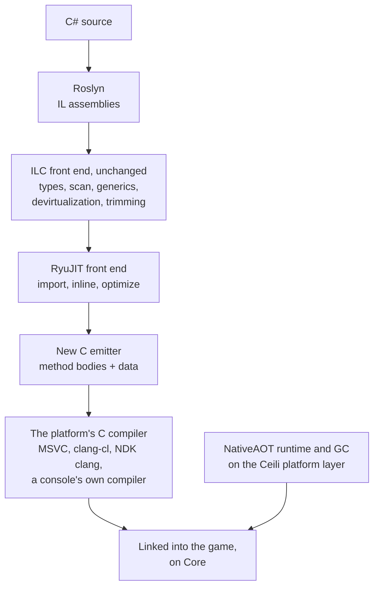
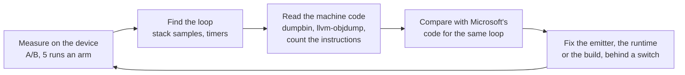

# The .NET Runtime on Core

Ceili's C# runs in two ways. On the desktop, the engine hosts the standard .NET
runtime, with hot reload. On Android and on the console devkits, the C# is
compiled ahead of time to C source, and that C runs on a .NET runtime and
garbage collector that are built on Ceili Core. The engine calls this path
Cpp64. It has been the Android default since 2026-10-25, and it is the only C#
runtime on a console.

On every platform where the two can be compared, Cpp64 runs the engine's C#
flock level with Microsoft's NativeAOT or faster. It did not start there. The
first measure, on 2026-10-22, had the flock 54% slower on Windows and 17% slower
on the Quest. Most of the gap closed through fixes found in the machine code.

This page covers why the path exists, how the compiler pipeline works, the rule
that the runtime depends on Core and nothing else, how the GC finds its roots,
the numbers on every platform, and the work that closed the gap.

<!-- MEDIA: a terminal clip of the gate script: the generated C building at 48
     jobs, then the smoke-test summary line, "150 of 150". -->

---

## Why compile C# to C

Some platforms run no JIT, so C# there must be compiled ahead of time. A
standard ahead-of-time compiler writes machine code into object files itself.
On a platform whose own compiler must build every instruction, that route is
closed. The route that stays open is source code: a tool translates the program
to C, and the platform's compiler compiles it like any other C.

That C is only half of a program. Managed code also needs a runtime under it:
the type system's data, exceptions, threads, finalizers and the GC. Ceili builds
that runtime once, on Core, so every platform that runs Core runs it.

## The pipeline

The compiler is the .NET ahead-of-time compiler, ILC, with its machine-code
backend replaced. ILC's front end stays as it is: the type system, the
dependency scan, generic instances, devirtualization and trimming. The new
backend prints C.



The base is the NativeAOT-LLVM branch of the .NET runtime lab, vendored at
commit `527a565752`. That branch already turns RyuJIT's lowered IR into LLVM IR.
The emitter prints C from the same IR. This keeps RyuJIT's inlining and
optimization, and its knowledge of which locals hold GC references, which the
GC's root tracking needs. The branch's two largest backend files, lowering and
the shadow-stack allocator, make no LLVM calls at all, so they carry over as
they are.

The generated code is C11. On Windows, the tests build it with MSVC and with
clang-cl, and MSVC is the Windows default. Android builds it with the
NDK's clang, and each console builds it with that console's own compiler. The
names in the source still say C++ (`DotNetCpp`, the `Cpp64` target), and the
files the emitter writes are C.

### One loop, from C# to C

The flock's neighbour loop shows what the emitter writes. This is the C#, from
the engine's `BoidsSystemNet`:

```csharp
// Example/DotNet/BoidsSystemNet.cs
Ceili.Math.Position* otherP = (Ceili.Math.Position*)pRecords[kj].pItems;
Ceili.Example.Boids.Velocity* otherV = (Ceili.Example.Boids.Velocity*)vRecords[kj].pItems;
if (otherP == null || otherV == null)
{
    continue;
}
float nx = otherP->value.x, ny = otherP->value.y, nz = otherP->value.z;
float dx = px - nx, dy = py - ny, dz = pz - nz;
float distSq = dx * dx + dy * dy + dz * dz;
if (distSq <= 0f)
{
    continue;
}
if (distSq < avoidRadiusSq)
{
    float inv = 1.0f / (float)System.Math.Sqrt(distSq);
    avoidX += dx * inv; avoidY += dy * inv; avoidZ += dz * inv;
    avoidCount += 1f;
}
```

The emitter writes each RyuJIT node as one C statement, into a temporary that is
assigned once (`t235`, `t236`, and on). Each C# local becomes an `l` variable. A
Release build keeps RyuJIT's own numbering, so the C reads like the JIT's dump;
a Debug build adds `#line` directives and the C# names. The C compiler then puts
the values in registers. This is the read of `pRecords[kj].pItems`, from the
Windows Release build:

```c
// Generated C, Windows x64 Release: CeiliDotNet.cpp64/code_080.c
BB22:
    t235 = l13;
    t236 = l136;
    t237 = INT64_C(4);
    t238 = (int64_t)CEDN_Shl64((uint64_t)t236, (int32_t)t237);
    l129 = t238;
    t239 = l129;
    t240 = CEDN_AddI64(t235, t239);
    if (CEDN_UNLIKELY((uint64_t)t235 < UINT64_C(4096)))
    {
        goto TH1;
    }
    t241 = CEDN_LoadI64((uint8_t*)(uintptr_t)((uint64_t)t240));
    l49 = t241;
```

`TH1` is the block that throws `NullReferenceException`. The test is of `t235`,
the array base `pRecords`, and not of `t240`, the address of the element. The
base does not change in the loop, so a C compiler can move the test out of it,
and clang does (see [Null checks on the Quest](#null-checks-on-the-quest)).
`TH1` also calls `RhpPInvokeReturn` before it throws. This loop runs with no GC
poll, in the mode a P/Invoke uses, and a throw must leave that mode first (see
[Loops with no GC poll](#loops-with-no-gc-poll)). A few lines on, the
C tests `l49` against zero: that is the C#'s own `otherP == null`.

Past that test, the JIT knows that `otherP` is not null, so the three field
loads of the position carry no check:

```c
// Generated C, Windows x64 Release: CeiliDotNet.cpp64/code_080.c
BB24:
    t252 = l49;
    t253 = CEDN_LoadF32((uint8_t*)(uintptr_t)((uint64_t)t252));
    l51 = t253;
    t254 = l49;
    t255 = INT64_C(4);
    t256 = CEDN_AddI64(t254, t255);
    t257 = CEDN_LoadF32((uint8_t*)(uintptr_t)((uint64_t)t256));
    l52 = t257;
    t258 = l49;
    t259 = INT64_C(8);
    t260 = CEDN_AddI64(t258, t259);
    t261 = CEDN_LoadF32((uint8_t*)(uintptr_t)((uint64_t)t260));
    l53 = t261;
```

Then the avoid radius test and the square root:

```c
// Generated C, Windows x64 Release: CeiliDotNet.cpp64/code_080.c
BB25:
    t284 = l57;
    t285 = l17;
    if (!(t284 < t285))
    {
        goto BB27;
    }
    goto BB26;
BB26:
    t286 = l57;
    t287 = (double)t286;
    t288 = CEDN_SqrtF64(t287);
    t289 = (float)t288;
    t290 = CEDN_F32FromBits(UINT32_C(0x3f800000)) /* 1 */;
    t291 = t290 / t289;
    l58 = t291;
```

`!(t284 < t285)` is the compare written as the branch's bare condition, and
`CEDN_SqrtF64` is the square root as one instruction (see
[What MSVC needed](#what-msvc-needed)). The C# asks for a `double` square root
(`System.Math.Sqrt`), so the C keeps both conversions. In all, the C# method
becomes about 2,100 lines of C.

One switch in the scripting package decides how the engine loads its C#:

```cpp
// ScriptingDotNet/Src/Script.h
// Android and the consoles run .NET only as NativeAOT (Script::loadAOT): neither has a hostfxr to find, because
// neither ships a .NET runtime for one to locate, and nethost's get_hostfxr_path would be an unresolved symbol.
// A console cannot JIT a managed method either way, so AOT is the only shape available there.
//
// CE_DOTNET_NATIVEAOT_ONLY makes a Windows build take the same path: the C++ backend's test configuration
// (-o DotNetCppHost, which defines it for this package only), where the C# starts from CeiliDotNet.dll.
//
// CE_DOTNET_STATIC is that configuration's static shape (-o DotNetCppStatic, P4_CeiliCSharp.md "P4h results"): the
// executable links the C# root, and Script::load calls the entry point the executable handed over, loading no library.
//
// One switch for every file of the package, so the load path and the startup names cannot disagree about which
// host is in use.
#if !defined(CE_PLATFORM_ANDROID) && !defined(CE_PLATFORM_CONSOLE) && !defined(CE_DOTNET_NATIVEAOT_ONLY) && !defined(CE_DOTNET_STATIC)
    #define CE_DOTNET_HOSTFXR
#endif
```

On Windows the path is off by default: a generate with `-o DotNetCppHost` or
`-o DotNetCppStatic` adds it as a test configuration (see
[Building Ceili](../Tools/Building.md)). On Android the package task builds the
C# with Cpp64 unless `-o DotNetMicrosoft` asks for Microsoft's NativeAOT.

---

## Core, and nothing else

The package's build script states the rule that shapes the rest:

```lua
-- Pkg/Engine/DotNetRuntime/Module.lua
-- The .NET runtime that C# compiled to C++ runs on: the vendored NativeAOT runtime and GC, built on a Ceili platform
-- layer, and Ceili's System.Native. Plan: Prompts/NativeAotCppBackend.md.
--
-- It depends on Core ONLY (the user's decision, 2026-10-08): every OS service the runtime needs comes from Core, so
-- wherever Core runs the runtime runs. A need Core does not meet becomes a Core API, never a new dependency here.
```

NativeAOT has a Windows platform layer and a Unix layer. This package adds a
third, written on Core, and builds only that one. The runtime calls no OS API
directly. Threads, mutexes, events, memory, time, files and logging all come from
Core.

The rule pays off in the tools as well as in the ports:

- **C# threads show their names** in the engine's profiler (see
  [Profiling](../Tools/Profiling.md)).
- **A runtime failure writes a minidump** through Core's crash handler, the same
  kind of dump the engine writes (see [Debugging](../Tools/Debugging.md)).
- **The runtime's native allocations** go through the engine's allocator and
  appear in its leak report.
- **Runtime messages** reach the engine's log.
- **The consoles needed no runtime port of their own.** The runtime reached each
  console devkit through Core, and the GC's one console need became a virtual
  memory arm in Core (see [Memory and start-up](#memory-and-start-up)).

The runtime's own target identity follows the same idea. ILC has a new target
operating system, `Ceili`. It is Unix-flavoured, and the real CoreLib is built
for it with no Linux-only code paths.

### Needs that became Core APIs

When the runtime needed something that Core did not offer, the answer was a new
Core API. That rule added a condition variable, a thread exit slot, the calling
thread's stack bounds and a process-wide memory fence. The condition variable
shows the care these took:

```cpp
// Include/Thread.h
namespace condition
{
// ------------------------------------------------------------------------
// Declarations
// ------------------------------------------------------------------------
// A condition variable over a core::mutex. C++-only: the .NET runtime's LowLevelMonitor is the first consumer.
CE_HANDLE(Handle, uintptr_t)
constexpr uint32_t kInfinite = MaxValue<uint32_t>();

// ------------------------------------------------------------------------
// Functions
// ------------------------------------------------------------------------
CE_API Handle Create();
CE_API void   Destroy(const Handle hCondition);
// Releases hMutex, waits for a Signal or a Broadcast or for TimeoutMs (kInfinite: no limit), then enters hMutex again.
// The caller holds hMutex exactly ONCE: core::mutex is recursive, and a wait releases one level only, so a deeper
// hold stays locked and every thread that needs the mutex to signal deadlocks. Returns thread::results::failure::
```

The platform layer then builds the runtime's monitor on it, in a few lines:

```cpp
// Src/Pal/Pal.cpp
bool WaitMonitor(void* hMonitor, const uint32_t TimeoutMs)
{
    // The condition variable releases the mutex and waits as one step, so a signal sent after the caller entered the
    // monitor is never lost. The caller holds the monitor exactly ONCE: core::mutex is recursive, and the wait releases
    // one level only, so a deeper hold would keep the mutex locked through the wait (Core asserts it on Windows).
    // CoreLib never waits with the monitor held twice (upstream's monitor is a non-recursive pthread mutex). A wait may
    // return with no signal, which every caller in CoreLib allows: each waits in a loop on its own condition.
    Object&      monitor = *static_cast<Object*>(hMonitor);
    const Result res     = thread::condition::Wait(monitor.hCondition, monitor.hMutex, TimeoutMs);
    return Succeeded(res);
}
```

The thread exit slot exists for a Windows trap. A `thread_local` destructor runs
under the loader lock, and it deadlocks if it takes a lock that another thread
holds while it loads a DLL. The exit slot uses fiber-local storage on Windows,
whose callback runs outside the loader lock, and the runtime detaches its
threads through it.

### The host

A program on this path starts through `cedn_host_begin`, which sets up the few
things the engine's own `app::Run` would:

```cpp
// Src/Host/Host.cpp
// The two paths app::Run takes from the command line that a console program needs: the root, and where a fail
// fast writes its minidump.
if (const core::ConstStr root_path = core::platform::GetCommandLineArgValue("-rootPath"); root_path != nullptr)
{
    core::path::SetRootPath(root_path);
}
if (const core::ConstStr dumps_path = core::platform::GetCommandLineArgValue("-dumpsPath"); dumps_path != nullptr)
{
    core::path::SetDumpsPath(dumps_path);
}

// A native fault nothing handles (an access violation, a stack overflow) writes a minidump under the dumps path,
// as app::Run's crash handler does, and the process still ends with the fault's code (P2e). The prefix is the
// executable's name without its extension.
host::InstallCrashHandler((Argc > 0) ? Argv[0] : nullptr);
```

The log sink then writes each record as it arrives, with no buffer on stdout, so
the output is complete and in order even when the program ends in a crash.

---

## How the GC finds its roots

A C compiler writes no map of which stack slots hold object references. So the
generated code keeps every live reference in a second, per-thread stack, the
shadow stack, and the GC reads only that. Each managed function receives its
frame's base as an extra argument. Only references that are live across a call
get a slot, and a call is the only safe point.

So the GC's polls are calls too. Every loop polls on its back edge, and a method
that makes a managed call polls at its entry, so a thread that spins still
reaches a safe point, and a collection on another thread can stop it. A small
set of loops needs no poll at all (see [Loops with no GC poll](#loops-with-no-gc-poll)).

The scan of the shadow stack is conservative. Every word in it is treated as a
pinned pointer, so an object that a live frame refers to does not move during a
collection. References inside the heap stay precise, and the GC can still
compact everything else. The pinned set is small, because the shadow stack holds
references and little else, and the GC never walks the native stack. A precise
scan would let the GC move those objects too, at a cost on every call. The soaks
decided against it: a four-hour Windows soak and a 60-minute Quest soak stayed
under every fragmentation threshold, so the precise scan is not planned.

---

## The flock on every platform

The benchmark is one brute-force flock: 2,048 boids, every boid reads every
other, 120 frames, in Release. Four implementations run it in the same scene:
the C# `BoidsSystemNet`, the engine's own C++ flock over its data tables, and
the same C++ steering over two open-source ECS libraries (ECS: entity, component,
system), one built on sparse sets and one on archetype tables. Each
implementation runs alone, and the table gives the median `Scene.Update` in ms.
Lower is faster. N/A means the platform has no such runtime.

| Platform | C++ engine | C++ sparse-set ECS | C++ archetype ECS | C# Cpp64 | C# Microsoft NativeAOT | C# CoreCLR |
|---|---|---|---|---|---|---|
| Windows (Threadripper) | 10.2 | 13.6 | 20.7 | 14.6 | 15.9 | 15.2 |
| Console devkits (range of two kits) | 9.9-16.1 | 11.5-16.2 | 18.8-19.9 | 15.8-20.2 | N/A | N/A |
| Quest 2 | 13.8 | 15.5 | 26.6 | 21.4 | 21.3 | N/A |
| Samsung S20FE | 14.4 | 16.8 | 28.8 | 20.4 | 20.6 | N/A |

Each build of the test links the same C++ engine library, and only the C#
runtime beside it changes. So the C++ flocks run in every C# arm, and their
spread across the arms is the noise floor. On Windows that spread is 2.0-3.7%.

What the table says:

- **Cpp64 is level with Microsoft's NativeAOT or faster.** It is 8% faster on
  Windows and 1.3% faster on the phone. On the Quest the two are 0.3% apart,
  inside their noise. A console has no Microsoft NativeAOT target, so Cpp64 is
  its only C# runtime.
- **C# costs 1.25x to 1.59x the engine's C++ flock**, by platform.
- **The engine's tables beat both ECS libraries** on every platform but one
  console, where they are level with the sparse-set library. The archetype
  library takes about 2x the engine's time, and 1.17x on that console.
- **The start-up call takes 1.3 to 1.8 ms** on Cpp64 on every platform, against
  3.0 ms (Windows) to 11.7 ms (the Quest) for Microsoft's NativeAOT.

---

## How the gap closed

The first measure (2026-10-22) set the list of work. On Windows, the flock took
1.54x Microsoft's time, the start-up call 39.5 ms against 3.59 ms, and the peak
working set 256 MB more. On the Quest, the flock took 1.17x. Every fix below
followed the same loop:



Most fixes have a switch that turns them off, so the next measure can be an A/B
of the same build. A fix that measured no gain was reverted. One that gained on one
platform and lost on another stays on where it gains.

### Memory and start-up

The 256 MB was the GC's region range. The GC took its whole range as one heap
block, and the platform layer zero-filled the block at start-up. The range now
sits on Core's virtual memory API: the GC reserves the range and commits pages
when it needs them. On Windows, the peak working set went from 418 MB to 170 MB
(Microsoft's: 168 MB), and the runtime's own initialization from 37.8 ms to
0.40 ms. On the Quest, the start-up call takes 1.47 ms against Microsoft's
14.3 ms.

A console devkit had the same cost later. Its Core port had no virtual memory
arm, so the GC fell back to one heap block, and a timer in the platform layer
put 40.6 ms of a 42.4 ms start-up call in the zero fill. The kit now runs the
Win32 arm of Core's virtual memory, and the start-up call takes 1.29 ms. The
shadow stacks follow the same plan: each reserves 1 MB and grows on a fault,
which cut 49.5 MB of commit charge on Windows, to the same 676 MB as Microsoft's.

### Loops with no GC poll

On Windows, the flock's inner loop polled the GC on every iteration. A
standalone copy of the loop, with the C edited by hand, showed that the poll was
about 65% of MSVC's gap. The disassembly of Microsoft's code for the same loop
had no poll in it.

A loop can skip the poll when no collection can need it to stop. The emitter
checks each loop against a short list of rules:

```cpp
// coreclr/jit/llvmcpp64.cpp
// (P6, poll-free loops, P6_Performance.md section 19.8) Why the loop cannot run in preemptive mode
// with no GC poll, or null when it can. It can when:
//   - it is innermost and reducible, with one entry edge (the edge its preheader takes);
//   - no block of it is in a try region or a handler, so no exception flow leaves it but the throw
//     of an implicit check, whose throw block leaves preemptive mode first (the emitter);
//   - nothing in it is a call, a GC reference, a byref or a struct that holds a GC reference
//     (PreemptiveLoopChecker): a thread in preemptive mode may run while the GC moves objects, so
//     it must not touch the GC heap, and a byref may point into it;
//   - it is a counted loop (AnalyzeIteration: an induction variable tested against an invariant
//     limit). With no poll, the loop has no side effect a C compiler must keep, and C lets a
//     compiler delete a loop with no side effect whose end it cannot prove (P1e0's
//     ProbeForwardProgress.c): a spin on a flag in native memory would become a return. A counted
//     loop ends, so deleting it only drops dead work. (One that counts to its type's limit with <=
//     does not end in C# either; it may end in C.)
const char* WhyLoopNotPreemptive(Compiler* Comp, FlowGraphNaturalLoop* Loop)
```

The MSVC flock went from 6,225 to 5,421 us (-13%), and both the console devkit
and the Quest gained 5.6%. Only 11 of the engine root's 1,511 loops qualify.
Most C# loops over arrays and spans hold a byref, so they keep their poll.

### What MSVC needed

Three more fixes are about how MSVC reads the C:

- **One C variable per local.** The generated C copied each local into a new
  variable at every control-flow edge: 12 to 24 copies an edge, and 164 stack
  references in the flock. Merging them gave MSVC's flock 12%. The console's
  compiler ran 4.8% slower with the merge, so that console's build turns it off.
- **The square root as one instruction.** Under `/fp:precise`, MSVC calls the C
  runtime's `sqrt` for a negative input, to set `errno`. That call clobbers six
  vector registers, so the loop kept its values in memory:

```cpp
// Cpp64/CeiliDotNet.h
/* Math.Sqrt / MathF.Sqrt: the square root instruction alone, as RyuJIT writes it.
 * Under /fp:precise MSVC writes sqrt() as the instruction plus a branch to the C
 * runtime's sqrt for a negative input, to set errno, which .NET never reads. That
 * call clobbers xmm0-xmm5, so in a loop MSVC keeps values in the frame instead of
 * registers (P6_Performance.md 19.9). The instruction gives the same NaN. clang
 * sets no errno on these targets (Windows, Android) and writes sqrt() as one
 * instruction already. */
#if defined(CEDN_COMPILER_MSVC) && defined(CEDN_ARCH_X64)
CEDN_FORCEINLINE double CEDN_SqrtF64(const double Value)
{
    return _mm_cvtsd_f64(_mm_sqrt_sd(_mm_setzero_pd(), _mm_set_sd(Value)));
}
CEDN_FORCEINLINE float CEDN_SqrtF32(const float Value)
{
    return _mm_cvtss_f32(_mm_sqrt_ss(_mm_set_ss(Value)));
}
```

- **A float compare as the branch condition.** MSVC fuses a float compare into
  its branch only when the compare is the `if`'s bare condition:

```cpp
// coreclr/jit/llvmcpp64.cpp
// A compare whose only user is the next node's JTRUE is written as the block's if
// condition, with no temporary: MSVC fuses a float compare into the branch only when the
// compare is the if's bare condition, and through an int32_t it adds setcc and test
// (P6_Performance.md 19.2, 19.9). The operands are temporaries, each assigned once, so the
// if reads the same values here or at the terminator. JitCpp64BranchCompares=0 turns it off.
GenTree* const user            = Node->gtNext;
const bool     branchCondition = (JitConfig.JitCpp64BranchCompares() != 0) && (user != nullptr) &&
                             user->OperIs(GT_JTRUE) && (user->gtGetOp1() == Node);
```

With the square root and the compare form, the MSVC flock was level with
Microsoft's (5,094 against 5,079 us). Profile-guided optimisation (PGO) then put
it 6.2% ahead, and cut the start-up call from 2.16 to 1.25 ms. The Windows
library trains on the C# test tier's own cases during the build. Android uses a
committed profile, which gives the Quest flock 2.1%. PGO gave a console devkit
nothing, so its build does not use it.

### Null checks on the Quest

On the Quest, the flock's inner loop was 39 instructions a neighbour pair
against Microsoft's 35, and three of the extra four were null checks. The
emitter checked the address of each array element, `P[I]`, and that address
changes with `I`, so clang kept the check inside the loop. The check now tests
the base `P`, which does not change, and clang moves it out of the loop:

```cpp
// coreclr/jit/llvmcpp64.cpp
// (P6 19.12) For P[I], the check is of the base P, not of the element address. The check of
// the address varies with I, so clang keeps it in a loop over I (3 a pair in the flock's
// inner loop). P usually does not vary in the loop, so clang moves its check out of the
// loop, or folds it into an earlier check of P. The form is used only when the base is
// certain: one leaf of the ADD tree, every other leaf a constant or an element offset
// (IsOffsetValue), and at least one offset. Else the address is checked as before.
// Against the address check: a null P throws for every I, where a large I used to fault;
// a P of 8 throws NullReferenceException as before; a non-null P plus a negative I that
// lands below the limit faults in place of a throw. JitCpp64NullCheckBase=0 writes the
// address check, for an A/B.
//
// (P6 19.19) P + c, a field of a record through a native pointer with no element offset,
// tests P as well when every constant leaf, and their sum, is in [0, limit): the rule a
// contained address mode already follows (the check above is of the LEA's base). The three
// field loads of one record are then one condition, which clang merges and folds into an
// earlier check of P; the address check of P + 4 and P + 8 cannot be folded, because the
// sum can wrap. The JIT usually marks such loads non-faulting from an earlier null test of
// P; this form covers a load the JIT does not mark (until 19.20, every one in a method with
// no allocation). Against the address check: a P in [limit - c, limit) throws in place of
// a fault, and a P that wraps faults in place of a throw.
```

The Quest flock went from 7,050 to 6,245 us (-11.4%), 1.6% ahead of Microsoft's.

A week later the Quest flock was 13% behind again. A change to the C# had made
the flock's arrays `static readonly`, and that removed the method's one
allocation. A count of the null checks in the generated C gave 27 where there
had been 9. A JIT dump found the cause: the JIT's non-null facts were switched
on by a flag that only an allocation or a dereference set. The second part of
the comment above is the emitter's half of the fix. This is the JIT's half:

```cpp
// coreclr/jit/assertionprop.cpp
    // Track the short-circuit criteria
    optCanPropLclVar |= newAssertion->CanPropLclVar();
    optCanPropEqual |= newAssertion->CanPropEqualOrNotEqual();
    optCanPropNonNull |= newAssertion->CanPropNonNull();
#ifdef TARGET_LLVM_CPP64
    // CEILI: (P6_Performance.md 19.20) In local assertion prop a "V != 0" from a compare has no null VN, so
    // CanPropNonNull misses it, though optAssertionIsNonNull's local path uses it. The short-circuit then stayed false
    // in a method with no other non-null fact (an allocation, a dereference), and every load through V kept its null
    // check: making UpdateFlock's arrays static removed its one allocation and cost the Quest flock 15%.
    if (optLocalAssertionProp && (JitConfig.JitCpp64LocalNonNull() != 0))
    {
        optCanPropNonNull |= newAssertion->CanPropLocalNonNull();
    }
#endif
```

The arm64 code for the method went from 658 to 629 instructions, and from 18
compares to 9. The Quest flock is level with Microsoft's again.

### Interface calls and the GC

An interface call went through a resolver call every time. The call site now
checks the cell's one-entry cache inline, and calls the resolver only on a miss:

```cpp
// Cpp64/CeiliRuntimeExports.h
CEDN_FORCEINLINE void* CEDN_ResolveInterfaceDispatch(uint8_t* ss, void* pObject, void* pCell)
{
    const uintptr_t cache = (uintptr_t)CEDN_LoadAcquirePtr((const uint8_t*)pCell + CEDN_IDC_CELL_CACHE_OFFSET);
    if (CEDN_LIKELY(((cache & CEDN_IDC_CACHE_POINTER_MASK) == 0) && (cache >= CEDN_IDC_MAX_VTABLE_OFFSET)))
    {
        const uint8_t* const entry = (const uint8_t*)cache + CEDN_IDC_CACHE_ENTRIES_OFFSET;
        if (CEDN_LIKELY(CEDN_LoadPtr(entry) == CEDN_LoadPtr(pObject)))
        {
            void* const target = CEDN_LoadPtr(entry + CEDN_IDC_ENTRY_TARGET_OFFSET);
            if (CEDN_LIKELY(target != 0))
            {
                return target;
            }
        }
    }
    return RhpResolveInterfaceDispatch(ss, pObject, pCell);
}
```

An interface call on Windows went from 3.75 to 2.04 ns (Microsoft's: 2.05),
and on the Quest from 3.86 to 3.09 ns (Microsoft's: 3.29).

The GC was slow by a count of instructions. Microsoft's GC had four prefetch
instructions, and Cpp64's had none. The GC's
build names a target processor for its prefetch, and the Cpp64 target names
none:

```cpp
// coreclr/gc/gc.cpp
// enable on processors known to have a useful prefetch instruction
#if defined(TARGET_AMD64) || defined(TARGET_X86) || defined(TARGET_ARM64) || defined(TARGET_RISCV64)
#define PREFETCH
#endif
// CEILI: (P6_Performance.md 21) the Cpp64 target names no processor, but the runtime runs on the host's, so the
// prefetch follows HOST_*. Without it, Prefetch was empty while MARK_PHASE_PREFETCH still parked each object in the
// mark queue, and a full collection of 64 MB took 10-12% longer than Microsoft's on the Quest.
#if defined(TARGET_CPP64) && (defined(HOST_AMD64) || defined(HOST_ARM64))
#define PREFETCH
#endif
```

On Android, the GC also read its globals through the global offset table: 25
loads where Microsoft's code had 2. Hidden symbol visibility removed them. A
full collection of 64 MB on the Quest is now 0.9% faster than Microsoft's
(66.3 against 67.1 ms), and on Windows it went from 53% slower to 3.2%. A gen0
collection was faster from the first measure: on Windows it pauses for 1.90 us
against Microsoft's 6.70 us.

### Build time and size

ILC itself ran on the JIT. Published with NativeAOT, it compiles the engine's
C# root in 2.56 s against 4.69 s. A one-method change, from edit to linked
library, takes 8.69 s against 9.24 s for Microsoft's publish on Windows, and
7.65 s against 7.63 s on Android.

For size, each compiler and linker option was built alone, and each section of
the library was measured with `llvm-size`. Function sections with garbage
collection of unused ones, synchronous unwind tables and line-only debug tables
cut the stripped Android library by 8.5%. It is 1.30x the size of Microsoft's.

---

## The C++ side of the table

The C++ flocks had their own dig-ins. Each one changed the engine for every
system that reads its data tables, not only the flock.

**MSVC did not inline the table view.** The engine's flock took 26.4 ms on
Windows and 14.4 ms on the Quest. Stack samples put almost every sample in one
loop, and its disassembly made three calls for each neighbour: about 12.6
million calls a frame. Clang had inlined the same accessors. Forced inlining on
the view's accessors took the flock to 12.5 ms.

**MSVC kept loop-invariant work in the loop.** After that fix, the sparse-set
library still led on one console by 5%. The disassembly showed the engine's
neighbour loop testing the view's storage mode and loading two column offsets
for each neighbour: 8 conditional jumps against the library's 6. A column reader
now decides the mode once, outside the loop:

```cpp
// Core/Include/Data.h
// One typed column, read by position with no test of the storage mode. Both modes reduce to one formula:
// the item is at a pointer read from Base + Idx * Stride, plus a fixed byte addend. Materialized: the
// pointer is the row's slot pItems for this column, addend 0. Zero-mat: the pointer is the backing row
// base, addend the column's byte offset. column<T>() decides the mode ONCE, so use it in a hot indexed
// loop: operator[] and Record::get<T>() test the mode on every access, and MSVC keeps that test and the
// column offset loads inside the loop (boidsSystem's neighbour scan, Pkg/Engine/DotNetRuntime/Prompts/
// BoidsLanguageTable.md, 2026-11-07). Same lifetime and bounds rules as operator[].
template <typename T>
class Column
```

The new loop has no mode test and no offset load, and MSVC unrolls it four
times. The flock is 17% faster with MSVC, on Windows and on a console, and 3.4%
faster on the Quest.

**One console's CPU runs scalar float code slower.** On one console devkit, the
engine's and the sparse-set library's flocks took 1.4x to 1.6x the other kit's
time, while the archetype library's did not. The compiler was not the cause:
the same clang build of the flock ran fast on a desktop CPU of the same family.
Cycles per neighbour pair showed it. The two scalar loops paid 1.4x to 1.6x the
desktop's cycles, and the archetype library, which makes a call per pair,
matched the desktop. A four-lane flock tests four neighbours in one SSE vector,
and on that kit it takes 3.37 ms against the scalar flock's 16.07 ms. On the
Quest, a NEON form of the same flock takes 5.09 ms against 14.15 ms. Every C++
flocker now has a four-lane twin.

**Every clang build had turned off the engine's SIMD math.** An old macro kept
the math library on its scalar code for any clang build. With the macro gone,
the archetype library's flock gained 12% on the console. The engine's flock did
not gain: its neighbour loop takes the squared distance with a dot-product
instruction, which takes several micro-operations on this CPU family, and a
form without it is the next step. Fast math also broke the deterministic
normalise: clang turned its exact square root and divide into an estimate whose
bits differ between CPU vendors. The math library now writes that path so clang
keeps it exact, and the scalar flock's 5 estimated square roots are gone from
the disassembly.

---

## Where it stands

The work runs in phases, and each phase has a gate that must pass before the next
begins. The plan sized each phase for one engineer who knows runtimes. Its total
was 7 to 10 months, and 10 to 13 months once the emitter's own design was sized.
AI agents, directed by one developer, passed the gates of P0 to P6 in 18 days:

| Phase | What it proved | Planned | Done |
|---|---|---|---|
| P0 | Feasibility studies: the backend, the vendor list, the trimmed C# (4,249 methods), and the platform layer (122 OS functions, whose 18 gaps need 8 new Core APIs) | 2-4 weeks | 2026-10-08 |
| P1 | A console program with strings, classes and virtual calls prints and exits 0, with the runtime on Core, with MSVC and clang-cl, Release and Debug | 8-12 weeks | 2026-10-10 |
| P2 | The shadow stack, GC polls, allocation and collection, under a GC stress gate | 4-6 weeks | 2026-10-11 |
| P3 | Exceptions with filters, static constructors, generics, threads, finalizers, the thread pool, tasks and timers, P/Invoke and callbacks | 6-10 weeks | 2026-10-18 |
| P4 | Ceili's own C# on Windows and on the Quest: the engine's bindings, C# systems on engine workers, and the C# test tier | 3-4 weeks | 2026-10-22 |
| P5 | A console devkit: every runtime program, `BoidsSystemNet` under every stress kind, and the C# test tier | 1-2 weeks | 2026-10-27 |
| P6 | Performance against Microsoft's NativeAOT: micro rows, the gameplay workload, build time, size, the soaks, and Cpp64 as the Android default | 3-4 weeks | 2026-10-25, with the dig-ins above continuing to 2026-11-08 |
| P7 | A precise shadow-stack scan | 4-6 weeks, if needed | Not needed: the soaks stayed under every threshold |

The P1 program gives a sense of scale. It is 11.3 MB of generated C in 161 files,
and it builds into a 1.59 MB executable. ILC takes 2.7 s and the C takes 2.3 to
2.7 s at 48 jobs. A one-method change rewrites one file, which compiles in a
fraction of a second before the link.

P3's gate is the runtime's own NativeAOT smoke tests, vendored byte for byte.
Every gate test runs in three ILC modes, with both compilers, in Release and
Debug, and two of them also run under GC stress. All 150 rows pass. When the
gate was first measured, 64 of 134 passed. One list names every test that the
gate does not run or does not expect to pass, each with its reason, so a skipped
test is never silent.

## What it took to build

The runtime took 32 days from the package's first commit (2026-10-08) to the
decision to keep MSVC for the Windows build (2026-11-08). About 270 commits touch
the package and its vendored tree, and 16 design documents of about 30,000 lines
record each decision and each measure.

The agent sessions behind it, counted from their transcripts:

| Measure | Value |
|---|---|
| Active agent time | About 114 hours, over 8 sessions |
| Output tokens | 16.7 million, half of them written by subagents |
| Cache reads | 9.7 billion tokens |
| Models | Opus 5.5 wrote 92% of the output, and Sonnet 5.5 the rest |
| List-price equivalent | About $25,000 |

Read these figures with care:

- **The dollar figure uses list prices.** Cache reads make up most of it, and a
  plan's terms can differ.
- **The totals are an upper bound.** They count whole sessions, and two of the
  sessions also carry other work.
- **Active time counts each gap between messages up to 15 minutes.** So an idle
  wait or an unattended device run adds little.

Three things kept the work short:

- **Most of the code was reused.** The runtime and the GC are upstream code. The
  new work was the emitter and a narrow platform layer on Core.
- **Each step was measured against Microsoft's compiler**, on the same C#, on the
  device that ships it. So a regression showed up in the next measure: removing
  one allocation cost the Quest flock 13%, and two fixes won it back.
- **Subagents did the builds, the device runs and the log triage.** The main
  session stayed on the decisions and the code.

See [AI-Assisted Engine Development](../CaseStudies/AI_Assisted_Engine_Development.md)
for how the same way of working applies across the engine.

---

## What it does not do

- **No JIT, no `Reflection.Emit`, no loading assemblies at runtime.** Ceili's
  C# uses none of these.
- **It does not replace the desktop.** Desktop keeps the standard runtime and hot
  reload. On Windows, Cpp64 is a test configuration.
- **Source-level debugging is checked on Windows only.** With ILC's `-g`, on by
  default in Debug, the C carries `#line` directives to the C# source and the C#
  local names. A debugger run on a device has not been made yet.
- **The library is 1.30x the size of Microsoft's** on Android.
- **No PGO on the consoles.** It gave one kit nothing, and the other kit is not
  measured with it.
- **Two known costs are not fixed yet.** Every call is followed by a check of the
  exception flag (45 load-and-branch pairs in one gameplay method), and each
  frame stores to the shadow stack.
- **No sampling profiler on the Quest.** The headset refuses `simpleperf`
  access, so the Quest's dig-ins use timers, instruction counts and A/B runs.

Next: [Components](Components.md) for how C# systems plug into the engine,
[Core](Core.md) for the platform layer this runtime is built on, or
[Debugging](../Tools/Debugging.md) for the minidumps it writes. Back to the
[documentation index](../README.md).
