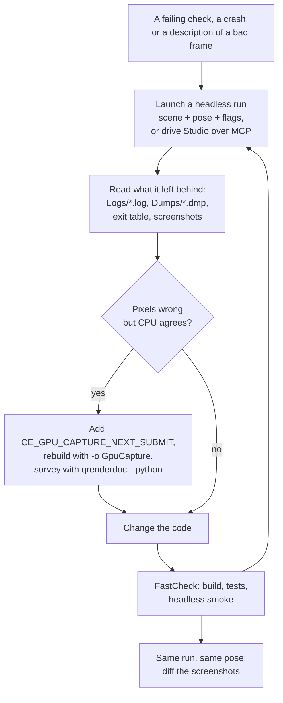

# Debugging

A failure in Ceili is meant to explain itself to someone who was not there when
it happened. Every run writes a log to disk. A crash writes a minidump beside it.
A rendering fault can be captured from code, without anyone pressing a capture
key at the right moment, and analysed from a script. A GPU hang leaves a report
naming the draw that stalled and the frame it belonged to.

That property is what lets an AI agent work on a defect alone. An agent has no
eyes on the screen and cannot hold a key down at the right frame. It can launch a
run, read the files the run leaves behind, change the code, and launch again. This
page covers each of those artefacts, the tools that produce them, and how they fit
together into a loop that needs no person at the keyboard.

---

## The persistent log

Every process writes a log file, named after the app it ran and the moment it
started:

```cpp
// Core/Src/Log.cpp
// Persistent per-run log file under path::GetLogPath(). Captures the full
// pre-loop boot transcript: log::Update leaves ring records unconsumed while
// no sinks exist, and app::Run flushes the ring immediately after creating
// the sinks -- so an offline reader (agent grepping the file) sees everything
// the in-memory ring buffer would have shown a live console, including
// records written during LoadScripts / shell::Create. Filename pattern:
//   <Prefix>_<YYYY-MM-DD_HH-MM-SS>_<PID>.log
// where Prefix is DeriveAppPrefix(-app), mirroring the minidump naming.
```

Three properties of that file matter more than its contents.

**It starts before the engine does.** Records written before any sink exists stay
in the in-memory ring, and the ring is flushed into the file the moment the file
sink is created. A failure during script loading or shell creation is therefore
in the file, which is exactly the class of failure a console window would have
closed over.

**It survives the crash.** The file sink flushes per record, and a `Critical`
record flushes even when the engine is batching log writes once per frame. A
process that dies leaves its last words on disk.

**One run, one file, a findable name.** The process id in the name pairs the log
with that run's minidump, and the app prefix separates a Studio run from a test
run from a headless smoke.

The log is also where several other tools report. The [degrade and witness
table](Core.md#three-primitives-a-defect-audit-paid-for) prints at exit, so the
last lines of a log say which silent fallbacks fired and which expected paths did
not run. A GPU device-removed report writes here too, as below.

### Read what the run did, not what you asked for

The habit that matters most with logs is easy to state and easy to skip: **count
what the log says the run did, never what the command line asked for.** A run
that was asked to load a scene and silently did not exits zero and looks
identical in any summary. The engine's own notes record ten such runs once being
counted as clean repro attempts, which reversed a whole session's conclusion. A
run that loaded the scene prints its name about 170 times; one that did not
prints it zero times. The smoke scripts now fail on exactly that case.

---

## Minidumps

An unhandled exception writes a minidump through a crash handler installed at
startup, and a failed `CE_ASSERT` writes one too. Both land under `Dumps/` with a
name built to sort and to pair with the log:

```cpp
// Core/Include/Minidump.h
// Build a unique dump file path under path::GetDumpsPath():
//   <dumps>/<Prefix>_<pid>_<YYYY-MM-DD_HH-MM-SS-mmm>_<tid>.dmp
// Returns DstPath. Prefix may be nullptr (defaults to "dump").
CE_API Str GenerateFilePath(Str DstPath, const size_t DstLen, ConstStr Prefix);

// Write a minidump for the calling process to FilePath. Creates the parent
// directory if missing.
//
// ExceptionInfo: when invoked from an unhandled exception filter on Windows,
// pass the LPEXCEPTION_POINTERS as void*. nullptr captures the calling thread
// without exception context.
CE_API Result Write(ConstStr FilePath, const Type Type = Type::Standard, void* ExceptionInfo = nullptr);
```

The default tier is `Standard`, and its size is the point. A bare thread-stack
dump is tens of kilobytes and leaves only registers usable, with no locals and no
parameters. `Standard` adds the memory the stack pointers reference, the module
data segments that hold globals, handle data and unloaded modules, and an
aggressive stack scan that resolves frames compiled without frame pointers. It
runs 5 to 50 MB, and it is enough for `!analyze -v` and a walk of every thread's
stack. A `Full` tier exists for the rare leak post-mortem that needs the whole
heap.

A `-noassertdialog` flag makes a tripped assert write its dump and exit rather
than open a modal dialog. Without it, a headless or scripted run that asserts
waits forever for a person to click; with it, the run ends and leaves the dump.

**A `Critical` log writes a dump only in a Debug build.** There, the debugger
output sink writes one with the reason `critical` before it breaks. In RelDbgSym,
the configuration the checks and unit tests run in, and in Release, a `Critical`
reaches a debug break that is taken only when a debugger is attached, so a
temporary diagnostic added as a `Critical` to capture a stack produces an empty
run. Use an assert when you want the dump in every configuration.

### How the Windows handler works

The handler goes in early. `app::Run` installs it before the first stage of
startup, so a crash inside a component's own initialisation is captured too:

```cpp
// App/Src/App.cpp
// Drop a minidump under <root>/Dumps/ if anything later raises an
// unhandled exception. Installed before PreInit so component init crashes
// are also captured. Prefix is the -app component id's tail segment so
// every executable produces uniquely-named dumps.
core::minidump::InstallCrashHandler(core::log::DeriveAppPrefix(core::platform::GetCommandLineArgValue("-app")));
```

The .NET host installs the same handler earlier still, as soon as it has read
its root and dumps paths, named after the executable. A native fault in the managed runtime's own startup,
before `app::Run` is ever reached, therefore still leaves a dump.

Installation is one call to `SetUnhandledExceptionFilter`, keeping whatever filter
was there before:

```cpp
// Core/Src/Platform/Win/MinidumpWin.cpp
if (!g_CrashHandler.installed)
{
    g_CrashHandler.previousFilter = SetUnhandledExceptionFilter(&CrashHandlerFilter);
    g_CrashHandler.installed      = true;
}
```

When an exception reaches the top of a thread with nothing to handle it, Windows
calls the filter with the exception pointers. The filter writes the dump, logs
where it went, and then hands the exception on:

```cpp
// Core/Src/Platform/Win/MinidumpWin.cpp
LONG WINAPI CrashHandlerFilter(EXCEPTION_POINTERS* ExceptionInfo)
{
    char file_path[kMaxFileNameLen + 1]{};
    GenerateFilePath(file_path, kMaxFileNameLen, g_CrashHandler.prefix);

    const Result res = Write(file_path, g_CrashHandler.type, ExceptionInfo);
    if (Succeeded(res))
    {
        CE_LOG(log::Type::Critical, "Minidump written: %s", file_path);
    }
    else
    {
        CE_LOG(log::Type::Critical, "Failed to write minidump to: %s", file_path);
    }

    if (g_CrashHandler.previousFilter != nullptr)
    {
        return g_CrashHandler.previousFilter(ExceptionInfo);
    }
    return EXCEPTION_CONTINUE_SEARCH;
}
```

Two details in that function are deliberate. Chaining to the previous filter keeps
any handler a library installed first. And returning `EXCEPTION_CONTINUE_SEARCH`
rather than swallowing the exception lets the process end with the fault's own
exit code. A script that launched the run reads that code and knows it crashed,
and the `Critical` log line, which flushes at once, puts the dump's path in the
log.

**The dump is written from a fresh thread.** `MiniDumpWriteDump` reads every
other thread's registers with `GetThreadContext`. A thread that dumps itself is
the one exception, and its recorded context lands inside the
system call that reads it rather than in its own code. So `Write` always hands the
work to a worker and waits:

```cpp
// Core/Src/Platform/Win/MinidumpWin.cpp
// Always write from a worker thread: voluntary dumps need it so the
// caller isn't the one stuck inside MiniDumpWriteDump's
// NtGetContextThread call when its own CONTEXT is captured, and crash
// dumps (real EXCEPTION_POINTERS from a top-level filter) ride the same
// path so the retry logic in WorkerProc can never leave a 0-byte dump
// behind.
```

The faulting thread stays parked inside the filter while the worker runs, so its
stack, with the crash frames below the exception dispatcher, is captured exactly
where it stopped. The worker passes the faulting thread's id and exception
pointers, which adds the exception stream to the dump, and that is what makes
`!analyze -v` select the crash frame on its own. A fresh thread also means the
writing happens on a full stack, which matters most after a stack overflow, where
the faulting thread has almost none left.

**A failed write retries without the exception stream.** If the first attempt
fails, the worker writes again with no exception information. A valid dump of
every thread without the exception record is far more useful than a 0-byte file.

**The exception record is declared by hand, packed to 4 bytes.** `dbghelp.dll` is
built against the Windows SDK header, which wraps the minidump structures in a
4-byte packing pragma, so the library expects the exception pointers at offset 4
even on x64. The engine's own Windows headers declare that structure without the
pragma, which puts the pointer at offset 8. Handed that layout, `dbghelp` reads
half a pointer as an address, fails with `ERROR_NOACCESS`, and leaves a 0-byte
file. The handler therefore declares its own copy with the packing the library
expects:

```cpp
// Core/Src/Platform/Win/MinidumpWin.cpp
    #pragma pack(push, 4)
struct ExceptionInformationAbi
{
    DWORD               threadId;
    EXCEPTION_POINTERS* exceptionPointers;
    BOOL                clientPointers;
};
    #pragma pack(pop)
```

and casts it to `PMINIDUMP_EXCEPTION_INFORMATION` at the one call that needs it,
which leaves the shared header untouched.

### Dumps the engine asks for

Not every dump comes from a crash. `WriteWithReason` writes one on demand and adds
the reason to the file name, so a directory listing tells the kinds apart:

- **`assert`**: a failed `CE_ASSERT` writes its dump before anything else, because
  both of its outcomes end the process. With `-noassertdialog` it then exits with
  `ExitProcess(3)`, which bypasses the unhandled-exception filter, so the run is
  not dumped twice on the way out.
- **`failfast`**: the engine's fail-fast path writes a dump and then calls
  `TerminateProcess` rather than `ExitProcess`. `ExitProcess` runs every library's
  detach routine, and a process that failed inside a worker can wedge there.
- **`critical`**: a `Critical` log in a Debug build, as above.

### A hung process, rather than a crashed one

A hang leaves no dump, because nothing faulted. The repository root carries a
PowerShell helper for that case, `Claude_StopHungProcess.ps1`. It defines one
function, `Stop-HungProcess`, and the smoke scripts dot-source it, so every check
that times out on a process handles it the same way:

```powershell
# Claude_StopHungProcess.ps1 - ends a smoke process that timed out, and saves its thread stacks first.
#
# Dot-source this file. It defines Stop-HungProcess and runs nothing by itself. Claude_Smokes.ps1 and
# Claude_LegacySceneSmoke.ps1 both call it, so every check handles a timed-out process the same way.
```

It works in two steps, and the order is the point.

**First it saves the stacks**, because the kill destroys them. It attaches the
console debugger `cdb` non-invasively (`cdb -pv`), which suspends the threads and
reads them, and writes every thread's stack to `Dumps/`. An invasive attach to a
process already inside its exit path reports that the process exited before the
attach completed and reads nothing. The stack of the wedged thread names the wait
that blocks it.

**Then it ends the process** with `TerminateProcess`, through .NET's
`Process.Kill()`, falling back to `cdb ".kill; q"` if that leaves it alive. The
usual tools do not work on this case. An asserting process that has already
called its exit routine *has* an exit code while its handle is not yet signalled,
so `taskkill` reads that code, reports "There is no running instance of the
task", and leaves it running. `HasExited` is true for the same reason; only
waiting on the handle tells whether the process has actually gone.

Getting that wrong matters beyond the one run. A wedged process holds the
engine's libraries open, so the next build fails to link with an error that names
nothing about why, and it holds the calling script's output pipe open too. The
helper never throws to its caller: a helper that aborts the check it serves is the
failure it exists to prevent.

---

## Screen captures

A capture of the main window is two calls, because the pixels come from the GPU
and arrive a couple of frames after they are asked for:

```cpp
// Graphics/Include/Graphics.h
// A capture of the main window, in two steps.  RequestScreenshot asks for the next frame the device replays: that
// frame copies its back buffer inside its own commands, BEFORE the present, so the capture is the image the window
// shows (Vulkan forbids a read of a presented image).  Main thread.
CE_API void RequestScreenshot();
// The capture RequestScreenshot asked for: GetWidth() x GetHeight() x 4 bytes into pBuffer, in the back buffer's channel
// order.  failure::Pending until the frame that copies it has finished on the GPU, which is about two frames after the
// request: ask again from a later render-worker-idle window (a core::chrono::NewFrameDelegate).  Any other failure means
// no capture is coming (no request, no device, a device that cannot read its back buffer).
CE_API Result TakeScreenshot(uint8_t* pBuffer);
```

The copy happens inside the frame's own command stream, before the present: the
point where the image is final and still readable on every backend.

A third call, `RequestScreenshotRegion`, crops to a rectangle and writes a file
itself, which is what a script or an agent reaches for. The runtime app also takes
`-captureFrame`, which waits for the scene to settle, writes that frame to
`Logs/RuntimeCapture_<device>.png` and exits. Combined with `-cameraPose x,y,z,yaw,pitch`, two runs of the same scene
from the same pose produce two images that can be diffed pixel for pixel, which is
how a rendering change is compared before and after.

---

## Driving the live engine from outside

Studio hosts an [MCP server](AiIntegration.md) on a port derived from the
checkout's own path, so two checkouts on one machine never collide. Among its
tools is one that executes Lua on Studio's main thread. That is enough to run most
repros with no document open and no clicking: load a scene, set a camera pose,
install a per-frame hook that exercises the suspect path, request a screenshot.

The same endpoint serves a person and an agent. A person can paste a request
into a terminal; an agent issues the same request as a tool call. The repro is a
file either of them can run again.

---

## GPU frame captures

When the CPU side says a render is correct and the pixels say otherwise, the
question is what the GPU was actually asked to do. A frame capture answers it,
and Ceili takes captures from code rather than from a key press:

```cpp
// Graphics/Module.h
// Programmatic GPU frame capture (Option_GpuCapture -> CE_USE_GPU_CAPTURE; Docs/FrameCapture.md).
// The CE_GPU_CAPTURE_NEXT_SUBMIT marker asks the trunk to bracket the submit that carries the
// CURRENT frame's commands in a capture under Captures/.  WHICH capture is the platform's business:
// RenderDoc on Windows, the console SDK's own on a console - the marker names what it wants, not the
// tool that provides it, so a site marked once is capturable on either.  Markers sit harmlessly at
// their call sites: without the option they compile to nothing, and with it they are still no-ops
// when the tool is absent, and capped per run.  Place one at the site under suspicion and rebuild
// with `-o GpuCapture`; the marker picks the frames, so no interactive capture key is needed.
```

The workflow is three steps. Put `CE_GPU_CAPTURE_NEXT_SUBMIT();` at the suspect
site, regenerate with the [build option](Building.md#options-toggling-one-adding-one)
on, and run the repro. The captures appear under `Captures/`, at most six per run,
and the log names the frame each one began on so a capture can be matched to the
log lines around it.

**The code picks the frame.** A marker can sit permanently in a retry path, such
as the one that discards a thumbnail frame for having dropped draws, so the frame
worth capturing is captured whenever it happens. A person watching for a
one-frame flicker would miss it; the marker does not.

**A frame's commands are submitted one frame later.** Commands recorded in frame
N are replayed by the render task that frame N+1 starts. The marker therefore arms
a countdown of two submits, which covers its own commands whichever side of the
task start it runs on.

Without the option the markers compile to nothing, so they cost nothing in a
normal build and can stay where they are. With the option and no RenderDoc
installed, every marker is a no-op and the log says so once. The runtime app's
`-gpuCapture` flag captures the settled frame with no code change at all, the same
frame `-captureFrame` writes as a PNG, so the two compare directly.

On a console the same marker reaches the console SDK's own capture through the
device, because a capture there belongs to the graphics queue. The marker, the
cap, the file naming and the bracket placement are shared.

<!-- MEDIA: RenderDoc open on a Ceili capture, with the event browser showing
     the engine's pass-named event scopes (Pass.DLIT, Shadow.Bake, ...) and one
     draw selected. The named scopes are the point. -->

### Reading a capture without opening it

RenderDoc's UI embeds Python, and `qrenderdoc --python script.py` runs a script
before the window opens. Ending the script with `os._exit(0)` keeps the whole thing
headless, so a capture can be surveyed from a shell:

```python
import os, renderdoc as rd
cap = rd.OpenCaptureFile(); cap.OpenFile(PATH, "", None)
res, controller = cap.OpenCapture(rd.ReplayOptions(), None)
sf  = controller.GetStructuredFile()
tex = {t.resourceId: t for t in controller.GetTextures()}
def walk(actions, depth):
    for a in actions:
        outs = ", ".join("%s %ux%u" % (o, tex[o].width, tex[o].height)
                         for o in a.outputs if o in tex)
        print("%s[%5u] %s -> %s" % ("  "*depth, a.eventId, a.GetName(sf), outs))
        walk(a.children, depth+1)
walk(controller.GetRootActions(), 0)
controller.Shutdown(); os._exit(0)
```

That walk lists every draw with the render target it wrote. Selecting an event
and asking for the pipeline state gives the bound descriptors and constant
blocks, and any texture at any event can be saved as a PNG.

**Write to a file, never `print()`, when a shell runs it.** The RenderDoc UI is a
windowed application, so its standard output does not reach the caller. A script
that prints returns an empty pipe from a process that looks wedged, and the reflex
is to kill it and doubt the script. Open a file at the top and flush after every
line, and a stall leaves a partial answer behind instead of nothing. The engine's
own executable has the same trap, which is why every headless run writes its log
file rather than relying on standard output.

### The event markers PIX and RenderDoc both read

On D3D12, every GPU profiler zone is also a debug event marker on the command
list, so a capture's event browser groups draws by pass with the same names the
profiler reports (see [Profiling](Profiling.md#zone-names-come-from-the-pass-type)).
PIX and RenderDoc both read them, and so does D3D12's device-removed reporting.
The Vulkan backend does not emit debug labels yet, so a Vulkan capture shows the
draws without the pass scopes.

The markers are written as wide strings, and the reason is specific. The D3D12
device-removed breadcrumbs carry their context string as a wide pointer with no
narrow sibling, so the runtime only captures wide markers as contexts. Narrow
markers reached the command list and the breadcrumbs still came back with no
contexts.

---

## The debug layer, and where its output goes

A capture is for when the draws are wrong. When the *resource state* is wrong, a
barrier or a layout or a target bound in the wrong state, the D3D12 debug layer
names it directly for the cost of one flag, `-d3ddebug`.

**Its messages go to standard output, not to the log file.** They are drained
through a direct write that bypasses the file sink, so a validation error is
invisible to every search of `Logs/` a triage normally starts with. Redirect the
run's output to a file and search that. Every GPU resource is named at creation,
so a message identifies which texture rather than an address.

Two more flags narrow harder cases. `-d3dgbv` turns on GPU-based validation,
which names the specific read that went wrong. `-drawBarriers` puts a full barrier
after every draw, which serialises the GPU so that "the draw that faulted" and "the
draw the report names" become the same draw.

---

## GPU hangs: a report written for the person who was not there

A GPU hang freezes the frame. After the watchdog timeout the driver removes the
device, and the engine writes a report into the log: the stalling operation and
its event marker, the stalling draw's parameters on a `<-- STALLED` line, its
constants, and a scan of its vertex and index buffers.

The report names the frame exactly, and the method is worth stealing. The
breadcrumb history keeps every marker operation, so the replay writes a number of
them at the head of every list that encodes the frame:

```cpp
// GraphicsD3D12/Src/Device.cpp
// FRAME CODE.  The replay writes 1 + (frameNo % kFrameCodeModulus) SetMarker ops at the head of every
// list, and DRED keeps them in the op history, so a stalled list names its frame EXACTLY rather than
// by the marker-draw fingerprint - which failed to match on the first two repro runs, and could not
// say whether the counting or the frame was wrong.
constexpr uint32_t kFrameCodeModulus = 6;
```

Counting markers is something the hardware report demonstrably preserves, so the
frame identity rides on it rather than on a context string that might not arrive.

A hang that needs a scene, a pose and a minute of camera movement does not need a
person either. The scene smoke can hold a loaded scene and wobble the camera about
a pose for as many frames as asked, and the smoke roster runs it on a real ported
scene under D3D12. **Wait for the `[Critical]` line before killing a hung
process**: a kill queued against it lands the instant the watchdog releases it,
before the report is written.

---

## Method rules the hunts paid for

The tools above are only as good as the questions put to them. These came out of
real investigations, each one after a session spent on the wrong lead:

- **A capture cannot tell "recorded then dropped" from "never recorded".** Pair it
  with a record-side counter. A zero counter with missing draws means a skip on
  the recording side.
- **When every counter is clean and the pixels still lie, trace the bytes.** Stamp
  a tag on each draw when it is recorded, log its constant bytes at the record site
  and again at the backend's submit, and diff by tag. One run tells you whether the
  transport changed the value or the value was wrong to begin with.
- **A diagnostic must ask the same object the render uses.** A probe that reads a
  preview's scene while the draw borrows the document's scene reports state that
  is true and irrelevant.
- **The draw a hang report names may not be the one that faulted.** Draws
  pipeline, so the operation not yet retired can sit one or two ahead of the
  fault. Serialise with `-drawBarriers` and let GPU-based validation name the read.
- **A log field that correlates perfectly with the failure is the mechanism
  showing itself**, not a side effect to fix and move past.
- **When a check fails and no diff explains it, ask what per-machine state the run
  reads**: a layout file beside the executable, a cache, a recently-used list. It
  is not in any commit, so bisecting will not find it.

---

## The loop, with nobody at the keyboard

Put together, the artefacts let an agent go from a report to a verified fix with
no person in the loop:



Each step leaves a file, so each step can be checked by whoever comes next,
person or agent. The run that reproduced the bug is a command line; the evidence
is a log, a dump and a capture; the proof is a pair of screenshots from the same
pose. The [build](Building.md) makes every one of those runs a single command, and
the [AI integration](AiIntegration.md) gives an agent the live engine to drive.

---

## What the debug tooling does not do

- **Programmatic RenderDoc capture is Windows-only.** It needs RenderDoc
  installed, and a missing library turns every marker into a no-op with one
  warning.
- **There is no automatic capture on a GPU hang.** A hung frame never completes,
  so it cannot be captured. The device-removed report is the evidence for that
  case.
- **The capture count is capped at six per run**, so a marker in a hot path
  captures the first few occurrences and then stops.
- **Debug-layer output does not reach the log file.** Redirect standard output
  when you need it.
- **Vulkan has no pass-named event scopes.** Debug labels are D3D12 only, so a
  Vulkan capture groups nothing by pass.
- **A hang leaves no minidump of its own.** The stack capture in
  `Claude_StopHungProcess.ps1` is the substitute, and it needs the Debugging Tools
  for Windows installed for `cdb`.
- **Minidumps are Windows-only.** The POSIX implementation of the same API returns
  `NotSupported`, so an Android fault leaves the platform's own crash record
  rather than a dump under `Dumps/`.
- **A fast-fail does not reach the filter.** Windows terminates a process through
  a fast-fail path for CRT invalid-parameter and buffer-security-check failures,
  and that path never calls an unhandled-exception filter. The engine installs no
  CRT handlers for those, so they end without a dump.

Next: [Profiling](Profiling.md) for the instrumentation that names the event
scopes, [Building Ceili](Building.md) for the options that switch these tools on,
or [AI Integration](AiIntegration.md) for the endpoint an agent drives the engine
through. Back to the [documentation index](README.md).
