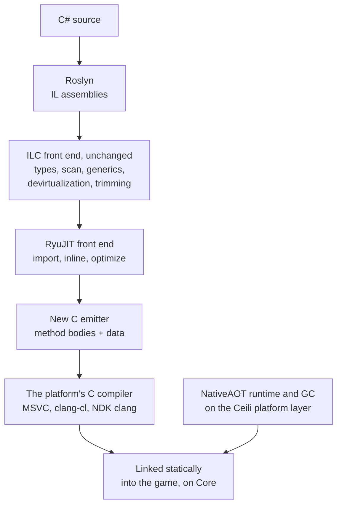

# The .NET Runtime on Core

Ceili's C# runs in three ways. On the desktop, the engine hosts the standard .NET
runtime, with hot reload. On Android, the C# is compiled ahead of time into one
native library. A third path is now in the engine: the C# is compiled ahead of
time to C source, and that C runs on a .NET runtime and garbage collector that
are built on Ceili Core.

This page covers why the third path exists, how the compiler pipeline works, the
rule that the runtime depends on Core and nothing else, the Core APIs that rule
produced, how the GC finds its roots, and where the work stands.

<!-- MEDIA: a terminal clip of the gate script: the generated C building at 48
     jobs, then the smoke-test summary line, "150 of 150". -->

---

## Why compile C# to C

Some platforms run no JIT, so C# there must be compiled ahead of time. A
standard ahead-of-time compiler writes machine code into object files itself.
On a platform whose own compiler must build every instruction, that route is
closed. The route that stays open is source code: a tool translates the program
to C, and the platform's compiler compiles it like any other C.

That C is only half of a program. Managed code also needs a runtime under it:
the type system's data, exceptions, threads, finalizers and the GC. Ceili builds
that runtime once, on Core, so every platform that runs Core runs it.

## The pipeline

The compiler is the .NET ahead-of-time compiler, ILC, with its machine-code
backend replaced. ILC's front end stays as it is: the type system, the
dependency scan, generic instances, devirtualization and trimming. The new
backend prints C.



The base is the NativeAOT-LLVM branch of the .NET runtime lab, vendored at
commit `527a565752`. That branch already turns RyuJIT's lowered IR into LLVM IR.
The emitter prints C from the same IR. This keeps RyuJIT's inlining and
optimization, and its knowledge of which locals hold GC references, which the
GC's root tracking needs. The branch's two largest backend files, lowering and
the shadow-stack allocator, make no LLVM calls at all, so they carry over as
they are.

The generated code is C11, and every test builds it with both MSVC and clang-cl.
Code that compiles cleanly with two compilers is a safer bet on a third. The
names in the source still say C++ (`DotNetCpp`, the `Cpp64` target), and the
files the emitter writes are C.

The path is off by default. A generate with `-o DotNetCpp` adds the projects that
run ILC and compile its output (see [Building Ceili](Building.md)), so a normal
build is untouched.

---

## Core, and nothing else

The package's build script states the rule that shapes the rest:

```lua
-- Pkg/Engine/DotNetRuntime/Module.lua
-- The .NET runtime that C# compiled to C++ runs on: the vendored NativeAOT runtime and GC, built on a Ceili platform
-- layer, and Ceili's System.Native. Plan: Prompts/NativeAotCppBackend.md.
--
-- It depends on Core ONLY (the user's decision, 2026-10-08): every OS service the runtime needs comes from Core, so
-- wherever Core runs the runtime runs. A need Core does not meet becomes a Core API, never a new dependency here.
```

NativeAOT has a Windows platform layer and a Unix layer. This package adds a
third, written on Core, and builds only that one. The runtime calls no OS API
directly. Threads, mutexes, events, memory, time, files and logging all come from
Core.

The rule pays off in the tools as well as in the ports:

- **C# threads show their names** in the engine's profiler (see
  [Profiling](Profiling.md)).
- **A runtime failure writes a minidump** through Core's crash handler, the same
  kind of dump the engine writes (see [Debugging](Debugging.md)).
- **The runtime's native allocations** go through the engine's allocator and
  appear in its leak report.
- **Runtime messages** reach the engine's log.

The runtime's own target identity follows the same idea. ILC has a new target
operating system, `Ceili`. It is Unix-flavoured, and the real CoreLib is built
for it with no Linux-only code paths.

### Needs that became Core APIs

When the runtime needed something that Core did not offer, the answer was a new
Core API. That rule added a condition variable, a thread exit slot, the calling
thread's stack bounds and a process-wide memory fence. The condition variable
shows the care these took:

```cpp
// Include/Thread.h
namespace condition
{
// ------------------------------------------------------------------------
// Declarations
// ------------------------------------------------------------------------
// A condition variable over a core::mutex. C++-only: the .NET runtime's LowLevelMonitor is the first consumer.
CE_HANDLE(Handle, uintptr_t)
constexpr uint32_t kInfinite = MaxValue<uint32_t>();

// ------------------------------------------------------------------------
// Functions
// ------------------------------------------------------------------------
CE_API Handle Create();
CE_API void   Destroy(const Handle hCondition);
// Releases hMutex, waits for a Signal or a Broadcast or for TimeoutMs (kInfinite: no limit), then enters hMutex again.
// The caller holds hMutex exactly ONCE: core::mutex is recursive, and a wait releases one level only, so a deeper
// hold stays locked and every thread that needs the mutex to signal deadlocks. Returns thread::results::failure::
// Timeout on a timeout. It may return with no signal, as every condition variable may: wait in a loop on a predicate.
CE_API Result Wait(const Handle hCondition, const mutex::Handle hMutex, const uint32_t TimeoutMs);
```

The platform layer then builds the runtime's monitor on it, in a few lines:

```cpp
// Src/Pal/Pal.cpp
bool WaitMonitor(void* hMonitor, const uint32_t TimeoutMs)
{
    // The condition variable releases the mutex and waits as one step, so a signal sent after the caller entered the
    // monitor is never lost. The caller holds the monitor exactly ONCE: core::mutex is recursive, and the wait releases
    // one level only, so a deeper hold would keep the mutex locked through the wait (Core asserts it on Windows).
    // CoreLib never waits with the monitor held twice (upstream's monitor is a non-recursive pthread mutex). A wait may
    // return with no signal, which every caller in CoreLib allows: each waits in a loop on its own condition.
    Object&      monitor = *static_cast<Object*>(hMonitor);
    const Result res     = thread::condition::Wait(monitor.hCondition, monitor.hMutex, TimeoutMs);
    return Succeeded(res);
}
```

The thread exit slot exists for a Windows trap. A `thread_local` destructor runs
under the loader lock, and it deadlocks if it takes a lock that another thread
holds while it loads a DLL. The exit slot uses fiber-local storage on Windows,
whose callback runs outside the loader lock, and the runtime detaches its
threads through it.

### The host

A program on this path starts through `cedn_host_begin`, which sets up the few
things the engine's own `app::Run` would:

```cpp
// Src/Host/Host.cpp
    // The two paths app::Run takes from the command line that a console program needs: the root, and where a fail
    // fast writes its minidump.
    if (const core::ConstStr root_path = core::platform::GetCommandLineArgValue("-rootPath"); root_path != nullptr)
    {
        core::path::SetRootPath(root_path);
    }
    if (const core::ConstStr dumps_path = core::platform::GetCommandLineArgValue("-dumpsPath"); dumps_path != nullptr)
    {
        core::path::SetDumpsPath(dumps_path);
    }

    // A native fault nothing handles (an access violation, a stack overflow) writes a minidump under the dumps path,
    // as app::Run's crash handler does, and the process still ends with the fault's code (P2e). The prefix is the
    // executable's name without its extension.
    host::InstallCrashHandler((Argc > 0) ? Argv[0] : nullptr);
```

The log sink then writes each record as it arrives, with no buffer on stdout, so
the output is complete and in order even when the program ends in a crash.

---

## How the GC finds its roots

A C compiler writes no map of which stack slots hold object references. So the
generated code keeps every live reference in a second, per-thread stack, the
shadow stack, and the GC reads only that. Each managed function receives its
frame's base as an extra argument. Only references that are live across a call
get a slot, and a call is the only safe point.

So the GC's polls are calls too. Every loop polls on its back edge, and a method
that makes a managed call polls at its entry, so a thread that spins still
reaches a safe point, and a collection on another thread can stop it.

The scan of the shadow stack is conservative. Every word in it is treated as a
pinned pointer, so an object that a live frame refers to does not move during a
collection. References inside the heap stay precise, and the GC can still
compact everything else. The pinned set is small, because the shadow stack holds
references and little else, and the GC never walks the native stack. A precise
scan would let the GC move those objects too, at a cost on every call. It is a
later phase, and only if a measured heap fragmentation over a long play session
asks for it.

---

## Where it stands

The work runs in phases, and each phase has a gate that must pass before the next
begins.

| Phase | What it proved | Done |
|---|---|---|
| P1 | A console program with strings, classes and virtual calls prints and exits 0, with the runtime on Core, with MSVC and clang-cl, Release and Debug | 2026-10-10 |
| P2 | The shadow stack, GC polls, allocation and collection, under a GC stress gate | 2026-10-11 |
| P3 | Exceptions with filters, static constructors, generics, threads, finalizers, the thread pool, tasks and timers, P/Invoke and callbacks | 2026-10-18 |
| P4 | Ceili's own C# on Windows and Android, through `-o DotNetCpp` | Design approved 2026-10-18 |

The P1 program gives a sense of scale. It is 11.3 MB of generated C in 161 files,
and it builds into a 1.59 MB executable. ILC takes 2.7 s and the C takes 2.3 to
2.7 s at 48 jobs. A one-method change rewrites one file, which compiles in a
fraction of a second before the link.

P3's gate is the runtime's own NativeAOT smoke tests, vendored byte for byte.
Every gate test runs in three ILC modes, with both compilers, in Release and
Debug, and two of them also run under GC stress. All 150 rows pass. When the
gate was first measured, 64 of 134 passed. One list names every test that the
gate does not run or does not expect to pass, each with its reason, so a skipped
test is never silent.

---

## What it does not do

- **No JIT, no `Reflection.Emit`, no loading assemblies at runtime.** Ceili's
  C# uses none of these.
- **It does not replace the desktop.** Desktop keeps the standard runtime and hot
  reload. This path is for platforms with no JIT, with a Windows build of it
  for testing.
- **Ceili's own C# does not run on it yet.** That is P4. So far it runs test
  programs and the runtime's smoke tests.
- **No source-level C# debugging on a device** in the first version.
- **No numbers against the standard compiler yet.** Code quality and build time
  against RyuJIT's native output are measured in a later phase, on Windows and on
  the Quest.

Next: [Components](Components.md) for how C# systems plug into the engine,
[Core](Core.md) for the platform layer this runtime is built on, or
[Debugging](Debugging.md) for the minidumps it writes. Back to the
[documentation index](README.md).
