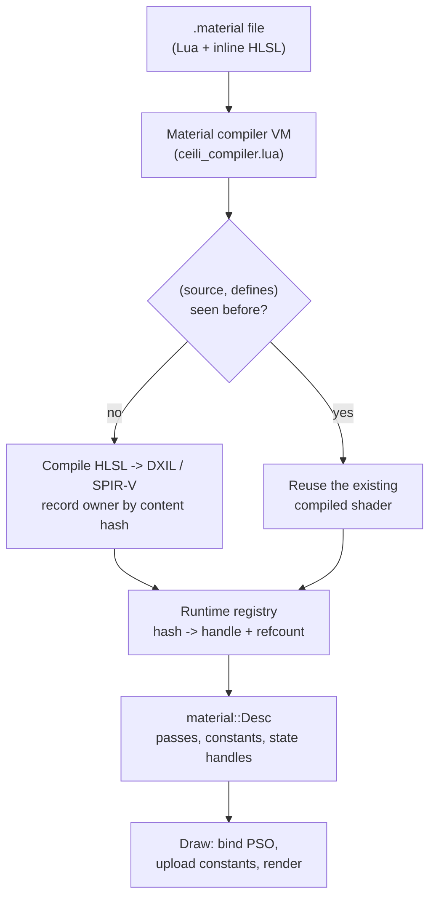

# Materials

Most engines treat a material as data: a fixed shader plus a bag of parameters
you fill in. Ceili treats a material as a **program**. A `.material` file is a
Lua script that builds the material (its passes, its render states, its
constants) and embeds its HLSL shader source inline. Materials inherit from one
another, constants can be driven by live script, and identical shaders and
constant blocks are de-duplicated automatically.

It is worth seeing one in full.

<!-- MEDIA: the Studio material preview panel showing a PBR sphere, ideally a
     short clip cycling through a few materials (chrome, iron, dielectric) and one
     of the live script-driven materials pulsing. This is the money shot for this
     page. -->

---

## A material is a Lua program

Here is the shape of a real one. `baseLightPBR.material` declares an inline
vertex shader as a value, then creates materials from it:

```lua
-- baseLightPBR.material
-- ONE directional vertex shader serves both directional passes: the instanced
-- pass compiles it with INSTANCED defined (per-pass `definitions`), sourcing
-- World / NormalMatrix from the instance buffer via SV_InstanceID and
-- computing worldViewProj = mul(World, viewProj) in the VS; the per-surface
-- pass compiles the #else branch. Both branches flow into the SAME
-- LightDirVS, so the instanced path is math-identical to the per-surface one.
local dirVertexShader = M.inlineShader([[
    #include "lightCommon.hlsli"
```

The HLSL lives right next to the Lua that uses it. The `#elif defined(INSTANCED)`
in that shader is a real preprocessor branch: the same source compiles to a
per-surface, an instanced, an interpolated instanced, or a skinned variant,
depending on the defines a pass requests (`INSTANCED`, `INSTANCED;INTERPOLATED`,
`SKINNED`). As we will see, each variant is de-duplicated if its
`(source, defines)` pair matches something already compiled.

> **Shader convention.** Ceili's `math::Mat4` is row-major with row-vector
> semantics, so the canonical multiply order in shaders is `mul(v, M)`, vector
> first. `o.Position = mul(pos4, WorldViewProj);`. `mul(M, v)` compiles fine and
> silently transposes your matrix; if a projection lands off-screen, check this
> first.

## The compiler VM

Calling a `.material` file "a program" is literal: the file is executed in a Lua
VM. The material compiler boots a minimal VM that loads the Core, math, and
Graphics bindings, the material DSL itself, and the entity DSL, then runs each
`.material` file so its `M.create` calls register the material. The compiler VM
sets `_resolveOnly`, so it never registers runtime GPU resources:

```lua
-- ceili_compiler.lua
ceili._resolveOnly = true

-- Load the material DSL
ceili.material = dofile(path.join(ceili.packagesPath, "Graphics", "Resources", "Materials", "core.material"))

-- Load the entity DSL (hand-written authoring helper that extends
-- ceili.core.scene.entity with .create / .include).  Loaded after core.lua
-- so the auto-generated ceili.core.scene.entity table already exists.  The
-- compiler VM only needs the DSL, not _loadAllEntityFiles (it never spawns).
dofile(path.join(ceili.packagesPath, "Core", "Resources", "Entities", "core.entity"))
```

Despite the name, `core.material` is the DSL: `M.create`, `M.inlineShader`,
`M.include`, the `PBR.*` helpers, the pass and binding tables, all of it is Lua
defined in `core.material`, so authoring a material is calling into a small
library, not filling in a fixed schema. The same DSL runs at runtime for hot
reload, which is why editing a `.material` and saving shows up in the running
editor the next frame (the hot-reload path described in [Core](Core.md)).

## Inheritance

A material can derive from another by naming it as the second argument to
`M.create`. The child inherits the parent's passes and shaders and overrides only
what differs. `baseLightPBR.material` derives its metal and legacy variants this
way, but the preprocessor define that picks a variant cannot simply live on the
child's `flags.definitions`: a material-level `definitions` string joins onto
*every* pass, and `base/surface` inherits `base/light/pbr`'s passes alongside
another lighting model's. The define would then land on the Blinn passes too. It
does nothing in that shader, but it changes the passes' `(source, definitions)`
identity, so they stop sharing a compiled shader and compile a byte-identical
copy. The fix is two small per-pass helpers: `pbrVariant` stamps the define onto
the PBR lit passes, and `gbufferVariant` stamps it onto the deferred G-buffer
passes:

```lua
-- baseLightPBR.material
local function stampDefinitions(Overrides, PassTypes, Definitions)
    local def = Overrides or {}
    for _, pass_type in ipairs(PassTypes) do
        -- `false` is a derive DROPPING the inherited pass (core.material skips it); stamping a
        -- define onto it would resurrect an empty pass.
        if def[pass_type] ~= false then
            def[pass_type]             = def[pass_type] or {}
            def[pass_type].definitions = Definitions
        end
    end
    return def
end

local function pbrVariant(Definitions, Overrides)
    return stampDefinitions(Overrides, kPbrLitPasses, Definitions)
end

local function gbufferVariant(Definitions, Overrides)
    return stampDefinitions(Overrides, kPbrGBufferPasses, Definitions)
end
```

The metal variant then wraps its overrides in both helpers:

```lua
-- baseLightPBR.material
-------------------------------------------------------------------------------
-- Clean metallic: F0 from constant, no diffuse
-------------------------------------------------------------------------------
M.create("base/light/pbrMetal", "base/light/pbr", pbrVariant("PBR_METAL", gbufferVariant("PBR_METAL", {
    flags = { metal = true },
})))
```

Concrete materials then derive from those bases and supply textures and constant
values through helper functions, so authoring a new material is a couple of
lines:

```lua
-- baseLightPBR.material
-------------------------------------------------------------------------------
-- Clean metal test materials (F0 presets, roughness via material constant)
-------------------------------------------------------------------------------
M.create("pbr/test/iron_smooth", "base/light/pbrMetal", PBR.metalWithTextures("iron", {
    metalRough = "predefined://mr_metal",
}, 0.1))
```

## Constants driven by live script

A material constant does not have to be a static value. Its `binding` can be an
**expression**: a Lua function evaluated with a per-frame context. This material
pulses its colour every frame with a sine wave, entirely from the `.material`
file, no C++ involved:

```lua
-- base.material
M.create("base/2D/pulse", "base/2D", {
    [P.kUi] = {
        fragmentShaderConstants = {
            { name = "pulseColor", valueType = VT.Float4, semantic = S.Color, binding = B.Expression,
                value = function(ctx)
                    local t = ctx and ctx.time or 0
                    local pulse = 0.5 + 0.5 * math.sin(t * 2)
                    return {pulse, 0.0, 0.5, pulse}
                end },
            { name = "textureIndex", valueType = VT.UInt, binding = B.Texture },
        },
```

Other bindings cover the common cases: `B.User` (a value the property grid
edits, with a `default`), `B.Texture`, and `B.Expression` (the live function
above). The same declarative constant list drives editable parameters, texture
slots, and animated values alike.

<!-- MEDIA: a short clip of the pulse material animating in the preview, side by
     side with the ~8 lines of Lua that produce it. Shows "authored as data,
     alive at runtime" in one glance. -->

## Dedup: shaders and constants are content-addressed

An engine with hundreds of materials would drown in duplicate shader binaries and
constant layouts if each material compiled its own. Ceili avoids that by making
the **content** the identity.

A shader's identity is the pair `(source, defines)`. The first pass to claim a
pair owns the compiled file; every later pass or material sharing that pair reuses
it, even across different passes:

```lua
-- core.material (the material DSL)
-- Stage is material::shader::Type (Vertex 0, Fragment 1, Compute 2). BlobName is the name the pass resolved
-- above, so the compiler writes the blob to the name the pass loads. Only the shader's registrant registers
-- it (claimShaderOwners), so the compiler compiles each name once.
local function registerInline(shaderDef, stage, defs, defs_hash, blob_name)
    if not (type(shaderDef) == "table" and shaderDef._inline and shaderDef.source) then
        return
    end
    local registrant = inlineRegistrants[blob_name]
    if registrant and registrant ~= (mat_ns .. "." .. pass_name) then
        return
    end
    local inl = ffi.new("ceili_graphics_material_registry_InlineSource")
    ceili.core.setString(inl.materialName, def._name)
    ceili.core.setString(inl.passName, pass_name)
    inl.stage      = stage
    inl.source     = shaderDef.source
    inl.sourceHash = bit.bxor(hash32(shaderDef.source), defs_hash)
    inl.sourceLine = shaderDef._sourceLine or 0
    if defs ~= "" then ceili.core.setString(inl.definitions, defs) end
```

On the C++ side the runtime registry is a set of hash-to-handle maps
(`shaderHashToHandle`, and `materialHashToHandle`, keyed on a 64-bit content hash
of a material's first pass) plus refcounted state slots, so a state block or
shader shared by 500 materials is stored once and released when the last
reference drops:

```cpp
// Material.h: namespace registry
struct BlendSlot : core::slot::RefCounted<states::blend::Handle>
{
    states::blend::Desc          desc;
    uint32_t                     descHash{0};
    Array<uint32_t, 0, uint32_t> nameHashes;
};
```

The identity even works *across* passes. An instanced pass whose fragment-shader
`(source, defines)` pair matches its per-surface sibling resolves to the
sibling's already-compiled shader, so the two variants share one binary. Each
inline shader records its source hash and its defines as the key:

```cpp
// Material.h
// Compiler table -- inline shader source (one per inline shader per material)
// source points into Lua's string pool -- valid for the lifetime of the Lua script
struct InlineSource
{
    String                 materialName;
    String                 passName;
    material::shader::Type stage{material::shader::Type::Vertex};
    ConstStr               source{nullptr};
    uint32_t               sourceHash{0};
    uint32_t               sourceLine{0}; // Line in material file where inline source starts
    String                 definitions;   // Semicolon-delimited preprocessor defines (e.g. "PBR_METAL;PBR_LEGACY")
    // The compiled file's name without its target extension ("<name>.vert"), which core.material resolves and a pass
    // registers its shader under. The compiler writes the blob to exactly this name, so the name has one author.
    // LAST, so a frozen Bootstrap that predates it still reads every field before it: it copies the shorter struct
    // and names the file itself. Empty in a record from such a Lua, and the compiler then does the same.
    String blobName;
};
```

Sharing raises a lifetime question: if 500 materials share one blend state, when
is it freed? Each registry entry is reference counted and keeps the list of name
hashes that alias it, so releasing the last material that references a state block
drops it in O(K), without scanning the whole registry.

## The pipeline, end to end



At the bottom sits the C++ data model. A `Desc` is a named list of passes; a
`Pass` carries its compiled shader and state handles plus the declared constant
elements; a `ConstElement` describes one constant and its authoring metadata:

```cpp
// Material.h
struct ConstElement
{
    String                       name;
    shader::constants::ValueType valueType{shader::constants::ValueType::Float};
    shader::constants::Binding   binding{shader::constants::Binding::User};
    bool                         hasExpression{false};

    // Per-element compile-time metadata (range / enum / desc) piped from
    // Lua's registerCompilerMetadata via SetPassFsConstantMeta. The
    // material compiler reads this when emitting Materials.h to synthesise
    // enum classes and default-value field initializers. Format:
    // `Range:..;Enum:..;Description:..` parts joined by `;`.
    String         annotation;
    Array<uint8_t> defaultValue;
};
```

A `Pass` opens with its state and shader handles. Further down, its `vsConstants`
and `fsConstants` arrays hold the `ConstElement`s it declares:

```cpp
// Material.h
struct Pass
{
    // Shared (compiler + runtime)
    String                                    name;
    draw::pass::Type                          passType{draw::pass::kInvalidType};
    SortType                                  sortType{SortType::Opaque};
    states::blend::Handle                     hBlend;
    states::rasterizer::Handle                hRasterizer;
    states::depth::Handle                     hDepth;
    states::stencil::Handle                   hStencil;
    Array<primitive::vb::Element, 0, uint8_t> vertexElements;
    Array<texture::Handle, 0, uint8_t>        textures;

    // Runtime (resolved from compiler data)
    shader::Handle            hVertexShader;
    shader::Handle            hFragmentShader;
    shader::constants::Handle hVsConstants;
    shader::constants::Handle hFsConstants;
    uint32_t                  vsConstantsSize{0};
    uint32_t                  fsConstantsSize{0};
```

## Baking the registration away

Running a Lua program for every material at every start is honest and it is not
free. A build-time pass now writes what each material registers as plain bytes,
so a shipped build can skip the VM:

```cpp
// Include/Materials/Recipe.h
// A material RECIPE is the plain data one material registers: its passes with their resolved shader names, state
// descs, constants layouts and defaults, its flags and texture infos. core.material computes it from a definition and
// writes it as bytes; Build and Update read those bytes and make every registration a material needs, in the order the
// Lua build used, so handle values do not move.
//
// Bytes rather than a cdata struct: the baked recipe file holds these same records, so one writer (core.material)
// and one reader (Recipe.cpp) serve both the runtime call and the file. The layout is documented beside the reader.
```

One writer and one reader serve both the live path and the file. The live
registration and the baked registration cannot drift, because they are the same
two functions reading the same bytes. Registrations also happen in the order the
Lua build used, so handle values do not move between a baked run and a live one.

Two settings ride on top, and both are off by default:

```cpp
// Include/Materials/Recipe.h
// Whether material::LoadScripts builds materials from the baked MaterialRecipes.bin files the material compiler writes,
// instead of running the .material files. It does so only when every file is fresh; otherwise it logs why and runs
// them. Off by default: a baked material has no Lua definition yet, so hot reload, Studio's definition queries and
// expression-bound constants do not work with it on. Set from config.lua, before materials load.
CE_API void SetBaked(const bool Enabled);
```

The default is off for a plain reason: a baked material has no Lua definition, so
hot reload, Studio's definition queries and expression-bound constants stop
working. The authoring loop keeps the VM; a shipped build can drop it.

A second setting makes a baked material build when a lookup first asks for it,
rather than at load. That one needed a companion, because a tool that lists every
material rather than looking one up would otherwise stall the frame that opens a
panel. A background budget in milliseconds per frame lets Studio's menus fill in
over a few seconds instead.

A material edited since the bake runs alone, through the VM, rather than forcing
the whole set back onto the slow path.

## Authored once, used everywhere

Look again at `ConstElement`: alongside the GPU-facing `valueType` and `binding`
it carries an `annotation`, a range or enum or description piped straight from the
Lua declaration. That one field is why the **property grid builds itself** from a
material. When the editor inspects a material it walks the constant elements, and
each one already knows its widget, its bounds, and its tooltip, so the property
grid needs no separate editor schema and no per-material inspector code.

So a single constant declaration in a `.material` file drives four things at once:
the GPU constant binding, the value the serializer saves, the value the network
layer replicates, and the widget the property grid renders. That is the
[Metadata](Metadata.md) philosophy (one declaration, one Read/Write funnel, many
consumers) reaching all the way into graphics.

One practical corollary worth knowing: a surface references its material by
*name*, and an unregistered name resolves to an invalid handle, which the render
passes skip silently. If a surface renders nothing, an unregistered material name
is the first thing to check. Name resolution is device independent, so this is
catchable headless (see [Rendering & Visibility](Rendering.md)).

## Output and post-processing

Materials render into an HDR scene target, which the tonemapper and post chain
turn into the final image, in SDR, HDR10, or scRGB depending on the display:

```cpp
// Include/Graphics.h
// Ldr / Sdr are universally supported. Hdr10 / Scrgb need an HDR-capable
// display + backend support, gated by IsOutputModeSupported. GetUseHDR()
// returns true for everything except Ldr.
enum class OutputMode : uint8_t
{
    Ldr   = 0,
    Sdr   = 1,
    Hdr10 = 2,
    Scrgb = 3,
};
```

The post-processing chain (bloom, depth of field, tonemap, lens flare, 3D-LUT
grading) is itself authored as a list of `.material` passes wired together by
their input/output slots. That is its own story:
[Post-Processing & HDR](PostProcessing.md).

---

## Why this is unusual

Pulling the pieces together: a material in Ceili is a **live, inheriting,
de-duplicated program** whose declaration simultaneously drives the GPU pipeline,
the serialized data, the network representation, and the editor UI, from a
single Lua file with the HLSL inline. Most engines split those into a shader
file, a material asset format, a separate parameter UI schema, and a C++ binding
layer. Collapsing them into one authored artifact is what makes iteration fast:
editing the `.material` file and hot-reloading shows the result immediately.

Next: [Post-Processing & HDR](PostProcessing.md) for the chain that reads the HDR
target, or [Lighting](Lighting.md) for the passes a lit material declares. Back
to the [documentation index](README.md).
