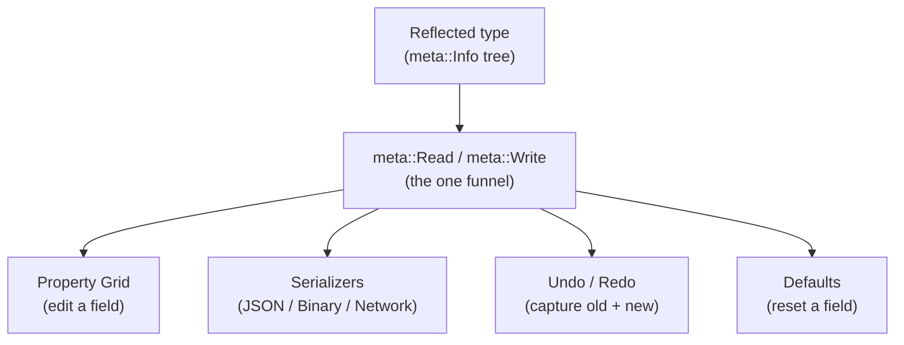
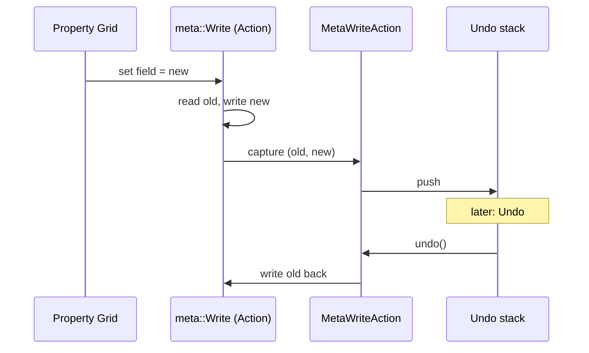

# Metadata & Reflection

This is the milestone that ties the engine together. On its own, reflection
(knowing a type's fields at runtime) is unremarkable. What makes it the spine of
the editor is a single design rule, stated in the engine's own notes: **keep the
`Read()` and `Write()` code paths to a minimum, and funnel everything through
them.** One metadata tree, walked by one funnel, drives the property grid, every
serializer, and undo/redo. Add a field to a struct and it becomes editable,
saveable, networkable, and undoable, with no extra code.

This page shows how that funnel is built and how four features fall out of it.

---

## The metadata tree

Every reflected type has a tree of `meta::Info` nodes, one per field. An `Info` is
a compact descriptor: a name, a size and offset into the instance, a type, a hash,
links to parent and child nodes, flags, and an optional annotation.

```cpp
// Meta.h
struct Info
{
    static constexpr uint32_t kMaxNameLen           = 63;
    char                      name[kMaxNameLen + 1] = {};
    Size                      size                  = 0;
    union {
        Size offset = 0;
        Size enumValue;
    };
    data::Key                 count; // A key for multidimensonal types, or the number of elements, or the nesting depth of a container
    types::Meta               type     = types::Meta::None;
    Hash                      typeHash = 0;
    Entry                     entry;
    Entry                     parent;
    Entry                     children;
    Flags                     flags                             = Flags::None;
    static constexpr uint32_t kMaxAnnotationLen                 = 255;
    char                      annotation[kMaxAnnotationLen + 1] = {};
    IContainer*               pContainer                        = nullptr;
```

A type registers its fields once, at startup. The registration is *generated*
from the header by the script generator (see [Script Generation](ScriptGeneration.md)),
so you never hand-write it. The generated code is one `Create` per member, and a
composite member opens a child entry for its own fields:

```cpp
// Core_ScriptingC.cpp
static void initMeta_33()
{
    // ceili::core::meta::WriteActionParams
    const auto entry_0 = Create<ceili::core::meta::WriteActionParams>();
    Create(entry_0, &ceili::core::meta::WriteActionParams::pInstance, "pInstance", {}, Flags::None);
    const auto entry_1 = Create<ceili::core::meta::Info>(entry_0, "pMemberInfo", offsetof(ceili::core::meta::WriteActionParams, pMemberInfo), {}, Flags::None);
    Create(entry_1, &ceili::core::meta::Info::name, "name", {}, Flags::HasDefault);
    Create(entry_1, &ceili::core::meta::Info::size, "size", {}, Flags::HasDefault);
    Create(entry_1, &ceili::core::meta::Info::offset, "offset", {}, Flags::HasDefault);
```

The flags are where a lot of the power hides, because the *same* flag mechanism
controls the editor and the serializer at once:

```cpp
// Meta.h
CE_BITFIELD enum class Flags : uint8_t {
    None = 0,
    // Serialization opt-out.  Default behaviour is "serialize every
    // reflected field"; setting this flag excludes the field from the
    // walker's traversal (no leaf emit, no composite recurse, no
    // container walk).  Mirrors how Hide and ReadOnly opt the UI out
    // of properties grid editing -- the field stays reflected, the
    // serializer just skips it.
    NoSerialize   = 1u << 0,
    InContainer   = 1u << 1,
    ReadOnly      = 1u << 2,
    Hide          = 1u << 3,
    Enum          = 1u << 4,
    HasDefault    = 1u << 5,
    NoContextMenu = 1u << 6,
    Bitfield      = 1u << 7,
    All           = UINT8_MAX
};
```

`Hide` keeps a field out of the grid, and `ReadOnly` shows it but blocks edits.
`NoContextMenu` hides the field's right-click menu in the grid. `InContainer` marks
a mirrored child `Info` that belongs to a container's element type.

You set these declaratively in the header, with attribute macros that the generator
parses. A range becomes the grid's slider bounds, and a description becomes its
tooltip:

```cpp
// Macros/Scripting.h
    #define CE_READONLY    Attribute(ReadOnly)
    #define CE_HIDE        Attribute(Hide)
    #define CE_NOSERIALIZE Attribute(NoSerialize)
// clang-format off
    #define CE_RANGE(Min, Max) Attribute(Range:Min,Max)
    #define CE_RANGE_STEP(Min, Max, Step, StepFast) Attribute(Range:Min,Max,Step,StepFast)
    #define CE_DESC(Text) Attribute(Description:Text)
    #define CE_RANGE_DESC(Min, Max, Text) Attribute(Range:Min,Max;Description:Text)
    #define CE_RANGE_DESC_STEP(Min, Max, Step, StepFast, Text) Attribute(Range:Min,Max,Step,StepFast;Description:Text)
```

The runtime-only fields of a scene struct carry both `CE_HIDE` and
`CE_NOSERIALIZE`, so save-load and the property grid can never disturb them:

```cpp
// Surface.h
// The material resolved from Desc::materialName by OnInsert / ReconcileDirtySurfaces,
// or set directly as a runtime override (Studio preview / SetSurfaceMaterial, with an
// empty materialName).  The render passes skip a surface whose hMaterial is invalid.
ceili::graphics::material::Handle hMaterial CE_HIDE CE_NOSERIALIZE;

// The scene-owned mesh ReconcileDirtySurfaces generates from the authoring shape;
// ~Surface frees it when OwnsPrimitive is set.
ceili::graphics::primitive::Handle hPrimitive CE_HIDE CE_NOSERIALIZE;
```

The one primitive everything else is built on is child iteration:
`GetInfoSpan(node.children)` returns a field's members, and recursing it walks any
type to any depth.

```cpp
// Meta.h
using InfoSpan = Span<const Info, DynamicExtent, Size>;
CE_API InfoSpan GetInfoSpan(const Entry Entry);
```

---

## The funnel: one Read, one Write

Every field access in the engine actually routes through these two functions, not
just by convention: the property grid, the serializers, the defaults system, and
undo all call them and nothing else to touch a field:

```cpp
// Meta.h -- the single choke point.
CE_API Result Write(void*            pInstance,
                    const Info&      MemberInfo,
                    const void*      pValue,
                    const Hash       ValueTypeHash,
                    const Size       ValueCount,
                    const Size       ValueSize,
                    const SizeSpan   MemberValueIndex = {},
                    const WriteFlags WriteFlags       = WriteFlags::None);

CE_API const void* Read(const void*     pInstance,
                        const Info&     MemberInfo,
                        const Hash      ValueTypeHash,
                        const SizeSpan  MemberValueIndex = {} /* Empty span will return the container instance, otherwise an element within the container */,
                        Size*           pValueCount      = nullptr /* the count remaining from MemberValueIndex */,
                        Size*           pValueSize       = nullptr /* the size remaining from MemberValueIndex */,
                        const ReadFlags ReadFlags        = ReadFlags::None);
```



Because there is exactly one way in and one way out of a field, a behaviour added
at the funnel is a behaviour every feature gets for free. Undo, below, is the
clearest example: it works simply by being a flag on `Write`, needing no separate
subsystem.

---

## The property grid builds itself

The property grid is not configured. It walks the metadata tree and renders a
widget per field, recursing into composites. There is no separate editor schema to
keep in sync with the data, because the data *is* the schema.

Inside `Input()`, a type delegate draws the field when one is registered. If not,
the function picks a widget off the field's type bits, with one branch per
primitive type:

```cpp
// PropertiesGrid.cpp -- dispatch a widget off the field's type bits.
meta::Flags property_flags = pInfo->flags;

if (pTypeDelegate)
{
    property_flags |= (*pTypeDelegate)(ValueTypeHash != 0 ? ValueTypeHash : pInfo->typeHash, pData, *pInfo);
}
else
{
    if (HasBitfield(pInfo->type, types::Meta::Bool))
    {
        auto p_value = reinterpret_cast<const bool*>(pData);
        InputScalar(ImGuiDataType_Bool, p_value, pInfo, nullptr);
    }
    else if (HasBitfield(pInfo->type, types::Meta::Float))
    {
        auto p_value = reinterpret_cast<const float*>(pData);
        InputScalar(ImGuiDataType_Float, p_value, pInfo, "%g");
    }
```

The annotations from the header show up here: a `CE_RANGE` becomes the slider
bounds, a description becomes the tooltip. Enum fields resolve their options and
current label through `meta::GetEnumName`. `Hide` fields are skipped;
`ReadOnly` fields render disabled. And a field's delegate can read its *siblings*
through `meta::GetParentInstance` (walk back from a member pointer to its parent
sub-object), which is how one field can grey out another, for example disabling an
HDRI-name combo unless a sibling `source` field is set to `Hdri`:

```cpp
// Meta.h
CE_API const void* GetParentInstance(const void* pInstance, const Info& MemberInfo);
```

<!-- MEDIA: a screenshot of the Studio PropertyGrid inspecting a rich object (a
     material or a light), showing sliders with ranges, an enum dropdown, and a
     greyed-out conditional field. This is the "no glue code did this" money shot. -->

This is where Ceili diverges from engines that carry a separate UI schema or a
hand-written inspector per type. Here the grid is a few hundred lines that work
for *every* reflected type, forever, including types that do not exist yet.

---

## Serializers: one walk, many formats

Saving and loading also route through the metadata tree. A single base class owns
the tree walk; each format is a small set of overridden hooks. From the package's
own design note: a shared base "owns the single meta-tree walk. Backends inherit
from this and override the protected hooks." The hooks are `beginObject` /
`endObject` and `beginArray` / `endArray` (structural, no-op by default), and
`writeLeaf` / `readLeaf` (mandatory). The walk itself is short:

```cpp
// SerializerBase.h -- the one traversal; backends only override the hooks.
//   walkChildren(pInstance, ParentInfo)
//     for each child in GetInfoSpan(ParentInfo.children):
//       walkMember(pInstance, child)
//
//   walkMember(pInstance, MemberInfo)
//     if MemberInfo.pContainer  -> walkContainerField(pInstance, MemberInfo)
//     elif MemberInfo.children  -> beginObject + walkChildren + endObject
//     else (leaf)               -> writeLeaf(MemberInfo, pInstance + offset)
//
//   walkContainerField(pInstance, MemberInfo)
//     -- offsets the container instance, delegates to walkContainer.
```

The public interface is one `serialize` / `deserialize` pair, and the facade
`Read` / `Write` takes the type hash and a format component id (`FormatCid`),
dispatching to the chosen backend:

```cpp
// Serializer.h
struct ISerializer : core::component::IComponent
{
    // Walk pInstance's reflected tree, emit to Stream.
    virtual core::Result serialize(IByteStream&     Stream,
                                   const void*      pInstance,
                                   const core::Hash TypeHash) = 0;

    // Inverse of serialize: populate pInstance from Stream.
    virtual core::Result deserialize(IByteStream&     Stream,
                                     void*            pInstance,
                                     const core::Hash TypeHash) = 0;
};
CE_DECLARE_INTERFACE_ID(Serializer)
```

Each format also has a FourCC identity:

```cpp
// Serializer.h
// Format identity.  Stored as a FourCC strong-type so it's greppable in a
// hex view of a binary stream and round-trippable through interop
// without losing distinction from an arbitrary uint32_t.  These values
// will be embedded as record headers in the binary stream when the
// SerializerBinary backend lands; for Phase 1 they exist as the public
// identity of each format CID.
CE_STRONG_TYPE(Format, uint32_t)
constexpr Format kJson = core::FourCC<Format>('J', 'S', 'O', 'N');
constexpr Format kBin  = core::FourCC<Format>('B', 'I', 'N', ' ');
constexpr Format kNet  = core::FourCC<Format>('N', 'E', 'T', ' '); // reserved for the network backend
```

Three backends sit on that one walk, each suited to a job:

- **JSON** is the human-readable text format for scenes and templates. Its leaf
  printers/parsers are a hash-keyed registry, "the JSON equivalent of
  `meta::RegisterToString`."
- **Binary** is the compact format for fast load.
- **Network** is a bit-packed, quantizing wire format that "reuses the same
  `SerializerBase` meta walk."

What lets one walk serve all three is the **leaf gate**: composites that are
logically primitives (a `Vec2`, an enum, a string) are stamped as single leaves
rather than recursed, so each backend decides how to emit a leaf and the structure
above it is shared.

```cpp
// Serializer.h -- IsLeafType keeps Vec2/enum/string as one value, not a sub-tree.
// Some types are reflected as composites or containers (math::Vec2 has
// x/y children, core::String is Container<char>) but they're really
// primitives from a serialization standpoint -- we want one encoded
// value per instance, not a composite object with per-field members or
// a container that iterates per-char.  IsLeafType is the walker's gate
// for that: if true, the walker calls writeLeaf / readLeaf instead of
// recursing into Info.children or walking the container.
```

The result is that a new field serializes to JSON, binary, and the wire the moment
it is reflected, and a new *format* is a class of hook overrides, not a rewrite.
That is the opposite of the common engine pattern, where each format is its own
hand-maintained code path drifting quietly out of sync with the others.

---

## Undo/redo is the funnel watching itself

Here is the payoff: undo/redo is implemented as a flag on `meta::Write`, so it
never has to be taught about each editable field separately.

When a write is tagged `WriteFlags::Action` and a write-action delegate is bound,
the funnel removes the `Action` bit (`stripped_flags`), reads the old value first,
and performs the real write:

```cpp
// Meta.cpp -- change capture lives inside Write itself.
uint8_t     old_value_buffer[kMaxDefaultBufferSize] = {};
Size        old_value_count                         = ValueCount;
const bool  is_string                               = IsString(MemberInfo);
Size        read_value_count                        = 0;
const void* p_old_value                             = Read(pInstance, MemberInfo, ValueTypeHash, MemberValueIndex, is_string ? &read_value_count : nullptr);
if (is_string && read_value_count > 0)
{
    old_value_count = read_value_count;
}
if (p_old_value != nullptr)
{
    const Size copy_size = ValueSize * old_value_count;
    CE_ASSERT(copy_size <= kMaxDefaultBufferSize)
    heap::MemCpy(old_value_buffer, p_old_value, size_t(copy_size));
}

// Perform the actual write without the Action flag
const Result write_result = Write(pInstance, MemberInfo, pValue, ValueTypeHash, ValueCount, ValueSize, MemberValueIndex, stripped_flags);
```

Then it fires the delegate with both the old and the new bytes, through
`g_.WriteActionDelegate(params)`:

```cpp
// Meta.cpp
// Always call the delegate, even if the write failed.
// A failed write leaves the instance unchanged (old == new), so the resulting Action
// will be a no-op undo.  But the Action still appears in the undo list, preventing
// edits from silently disappearing from the history.
WriteActionParams params = {};
params.pInstance         = pInstance;
params.pMemberInfo       = &MemberInfo;
params.pOldValue         = old_value_buffer;
params.pNewValue         = pValue;
params.valueTypeHash     = ValueTypeHash;
params.valueCount        = ValueCount;
params.oldValueCount     = old_value_count;
params.valueSize         = ValueSize;
params.writeFlags        = stripped_flags;
```

That delegate turns each captured change into an `IAction` and pushes it onto the
undo stack. An action is a tiny interface, and the stacks are two arrays:

```cpp
// Action.h
struct IAction : component::IComponent
{
    enum class State : uint8_t
    {
        Init = 0,
        Running,
        Done
    };

    virtual State    getState() const       = 0;
    virtual ConstStr getDescription() const = 0;
    virtual Result   run()                  = 0;
    virtual Result   undo()                 = 0;
    virtual bool     drawPreview() { return false; }
};
```

The concrete `MetaWriteAction` stores the old and new bytes and reverts by writing
the old ones back, again through the same funnel:

```cpp
// MetaWriteAction.cpp
Result undo() override
{
    m_State = State::Running;

    const core::meta::Info* p_member_info = getMemberInfo();
    if (p_member_info == nullptr)
    {
        m_State = State::Done;
        return core::results::failure::Error;
    }

    const core::meta::SizeSpan idx = {m_MemberValueIndices.data(), m_MemberValueIndices.size()};
    const Result               res = core::meta::Write(m_pInstance,
                                         *p_member_info,
                                         m_OldValue.data(),
                                         m_ValueTypeHash,
                                         m_OldValueCount,
                                         m_ValueSize,
                                         idx,
                                         m_WriteFlags);
```

It even builds its human-readable label ("Roughness: 0.30 to 0.45") by walking the
parent chain and stringifying through `meta::ToString` and `meta::GetEnumName`:
the same metadata, a fourth time. Container edits (insert, erase, clear) undo
through a parallel path backed by the container's capture/restore vtable.



No editable field ever has to opt into undo: if it goes through the property grid,
it goes through `Write`, and that write path is what makes it undoable.

---

## The wire, and the "what changed?" seam

Per-instance serialization covers save, load, and undo. Live networking needs one
more thing: deltas. The scene snapshot layer captures a database's table rows and
can emit either a full snapshot or a delta against a baseline, and, crucially, the
delta stream is the *same wire format* as a full snapshot, so applying a delta and
restoring a snapshot are the same operation. `Restore(DatabaseId, In)` reads a full
snapshot, and `ApplyDelta` reads a delta:

```cpp
// Snapshot.h
// Apply a delta stream to DatabaseId in place: overwrite each present key, skip keys absent from the
// live table.  PCodecs decodes the quantized tables (it must match the one CaptureDelta emitted with);
// tables absent from it are read raw.  With PCodecs == nullptr this is exactly Restore.
//
// POutApplied is optional (nullptr = no collection): pass one to receive every row this delta carried,
// in wire order.  A row is reported once its key parses, whether or not that key is live locally -- an
// absent key writes nothing, exactly as before, so the caller's own liveness check stays the filter.
CE_API core::Result ApplyDelta(const core::data::DatabaseId          DatabaseId,
                               IByteStream&                          In,
                               const RowCodecTable*                  PCodecs     = nullptr,
                               core::Array<AppliedRow, 0, uint32_t>* POutApplied = nullptr);
```

This is the row-level counterpart to [Core's dirty tracking](Core.md#data-the-table-store-the-engine-is-made-of):
mutations mark rows dirty, the snapshot layer drains them, quantizes per-table via
row codecs, and ships the delta. The same "what changed?" question that powers
undo powers replication, which is exactly why one field-level change-capture layer
can feed both networked multiplayer and live collaborative editing, the promise
made back in [Philosophy](Philosophy.md).

---

## Why this is the keystone

Count the features that share one metadata tree and one Read/Write funnel:

- The **property grid** renders any reflected type with no per-type code.
- **Serialization** to JSON, binary, and the wire is one walk with pluggable leaf
  hooks.
- **Undo/redo** works as a flag on `Write`, with no separate subsystem to maintain.
- **Defaults**, **stringification**, and **network delta** all read the same tree.

Adding a field to a struct lights up all of them at once. Most engines pay for
each of these separately: an inspector schema, a serialization code path, an undo
command per action, a replication descriptor. Collapsing them onto one funnel is
what makes the editor cheap to extend, and it is the clearest expression of the
engine's central bet that the runtime and the tools are one thing.

Next: [Component Architecture](Components.md), or back to the
[documentation index](README.md).
