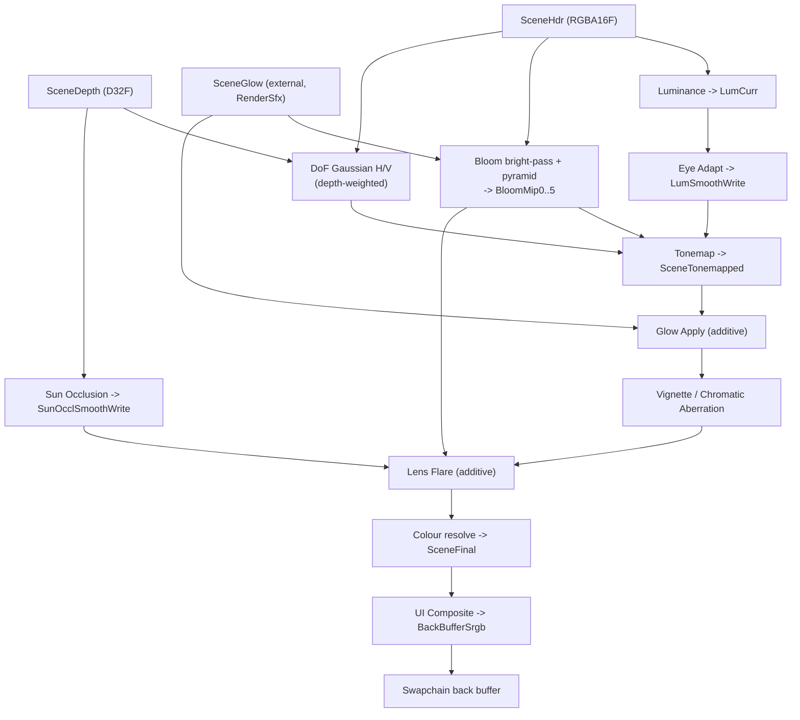

# Post-Processing & HDR

The post-processing chain is the last thing that touches a frame before it reaches
the display. In most engines it is a fixed pipeline compiled into the renderer:
bloom, tonemap, and grade wired together in C++, tuned by a scattering of console
variables. Ceili takes the same position here that it takes for surface shading:
**the post chain is authored as data, not baked into code.**

Every pass is a `.material` file (see [Materials](Materials.md)). Each pass names
the slots it reads and the slot it writes. The whole chain, in order, is a list
assembled in a Lua config function. Reordering the chain, disabling a stage,
swapping in a different tonemapper, or hot-reloading a pass's shader is a data edit,
not a rebuild. This page walks that model end to end: the slot graph, the default
chain stage by stage, and the HDR output path that the chain feeds.

---

## The chain is a list of passes wired by named slots

A post pass is a full-screen draw: sample some input textures, run a fragment
shader, write one output. The only thing that makes a *chain* out of a pile of
passes is agreement on names. Ceili gives every intermediate render target a
**slot**: a four-character id that a pass reads from or writes to.

```cpp
// PostProcess.h: slots are FourCC ids, one per intermediate target.
namespace slots
{
constexpr Slot SceneHdr       = core::FourCC<Slot>('S', 'H', 'D', 'R');
constexpr Slot LumCurr        = core::FourCC<Slot>('L', 'U', 'M', 'C');
constexpr Slot LumSmoothPrev  = core::FourCC<Slot>('L', 'M', 'S', 'P');
constexpr Slot LumSmoothWrite = core::FourCC<Slot>('L', 'M', 'S', 'W');
// The meter LOW-PASSED ahead of eye adapt (postProcess/meter_filter reads LumCurr and LumFilterPrev, writes
// LumFilterWrite, which eye_adapt reads): a second pole, so a flickering light does not make the exposure breathe.
constexpr Slot LumFilterPrev  = core::FourCC<Slot>('L', 'M', 'F', 'P');
constexpr Slot LumFilterWrite = core::FourCC<Slot>('L', 'M', 'F', 'W');
constexpr Slot BackBufferSrgb = core::FourCC<Slot>('B', 'B', 'S', 'R');
```

The namespace continues with the other targets: `SceneHdrB`, `SceneDepth`,
`SceneGlow`, the tonemapped pair `SceneTonemapped` and `SceneTonemappedB`,
`SceneFinal`, `UiOverlay`, the bloom pyramid `BloomMip0` to `BloomMip5`, the
sun-occlusion pair, and the slots of the look and local-exposure stages, among
others.

The `FourCC` id is the same construction the metadata serializers use for format
tags (see [Metadata: format ids](Metadata.md#serializers-one-walk-many-formats));
a four-character code is small, printable, and cheap to compare. A slot is a
*promise* of a texture: something later resolves the slot to a live render target
handle. That indirection is the whole trick, and we come back to it when we reach
HDR.

A single pass is a `ChainEntry`. It names the material to run, the slot it writes,
the slots it reads (bound to material texture slots), and an optional
shader-constants override:

```cpp
// PostProcess.h: one pass in the chain.
struct ChainEntry
{
    // BOOTSTRAP-scoped, not the row's ScopeDataString and not a heap core::String: the chain is a
    // process-lifetime array that already routes every mutation through ScopeTyped<Bootstrap> (see
    // PostProcess.cpp's BootstrapGuard), so the name belongs in the same arena its entry does.  A
    // heap-owning member here would free at static atexit -- after heap::ReportLeaks -- and report
    // as a leak.  Writers are already under that guard.
    core::BootstrapString materialName;
    char                  label[kMaxLabelLen + 1]{};
    bool                  enabled{true};
    Slot                  output{slots::BackBufferSrgb};
    uint8_t               numInputs{0};
    InputBinding          inputs[kMaxInputBindings]{};

    material::shader::constants::Handle current;
```

After `current`, the struct holds a `blend` state (a cross-fade of the constants
for live tuning), a `groupName` for the chain editor, and the pass `flags`.

`materialName` is deliberately `core::BootstrapString`, not a heap-owning
`core::String`: the chain array itself is Bootstrap-scoped, so a heap-owning
member here would free at static atexit, after the leak detector has already
reported, and show up as a spurious leak.

An `InputBinding` is just `{ Slot source; uint8_t materialSlot; }`: "feed the target
currently in slot `source` into texture slot `materialSlot` of my shader." The cap
is `kMaxInputBindings`, which is eight.

The flags are small but load-bearing. The first three give the structure of a pass:

```cpp
// PostProcess.h
CE_BITFIELD enum class Flags : uint32_t {
    None = 0,
    // Tags HDR-pipeline entries (tonemap, eye-adapt / luminance, lens band).
    // Active-chain rebuild treats these as authored-disabled when
    // GetOutputMode() == Ldr; the chain editor greys + locks them.
    HdrOnly = 1u << 0,
    // Skip the entry when its primary input slot (inputs[0].source) was
    // not written by any enabled chain entry this frame. Opt-in for
    // entries whose math is meaningful only on chain-produced data --
    // e.g. lens_flare math expects bloom-bright values, not raw scene HDR
    // after the slot remap walks back to an external slot.
    RequiresLiveInput = 1u << 1,
```

```cpp
// PostProcess.h
// The entry BLENDS INTO its output rather than transforming
// input -> output. The chain rebuild needs this hint because the
// disabled-branch slot remap differs: transformative entries fall
// through (out -> in); blending entries keep current content.
//
// Named for the One/One case it was written for, and it covers every
// blend: legacy_fog composites SrcAlpha/InvSrcAlpha and needs the same
// hint, because its input is a DEPTH slot - remapping the output to it
// would hand downstream readers the depth buffer as the scene image.
Additive = 1u << 2,
```

`HdrOnly` is how a stage says "I only make sense in the HDR pipeline." `Additive`
is how a pass says "add me on top of what is already there" instead of replacing
it. `RequiresLiveInput` makes the runner skip a pass when no enabled pass wrote
its primary input this frame. The remaining flags (`ModernOnly`, `ModernBloom`,
`LensFlare`, `DepthOfField`, `ColourUnit`, `LocalExposure` and others) mark whole
units of passes that the runner skips per view, for example on a view that draws
the legacy look or while a strategy setting turns an effect off. These are single
bits checked with `core::HasBitfield`, the same strongly typed bitfield helper
used everywhere else in the engine (see
[Core: strong types](Core.md#strong-types-and-handles)).

---

## The chain is assembled in config, not compiled

The default chain is built in `postProcessConfig()` in `config.lua`. Passes are
appended in execution order. The engine exposes two append entry points (one for
the active chain, one for an inactive pool of passes you can toggle on), and the
config wraps both in a small `appendGroup` helper so related passes (the five
bloom downsamples, say) share a group label in the chain editor:

```lua
-- config.lua: the grouping wrapper over the raw append calls.
local function appendGroup(group, materialName, label, output, inputs, numInputs, hConstants, enabled, entryFlags)
    local flags = entryFlags or pp.Flags.None
    if enabled then
        pp.appendToChainWithBindings(materialName, label, output, inputs, numInputs, hConstants, true, flags)
        pp.setEntryGroup(pp.getChainSize() - 1, group)
    else
        pp.appendToInactive(materialName, label, output, inputs, numInputs, hConstants, flags)
        pp.setInactiveEntryGroup(pp.getInactiveSize() - 1, group)
    end
end
```

`appendToChainWithBindings` takes exactly the `ChainEntry` fields: the material
name, a label, the output slot, an input-binding array plus its count, a constants
handle, the enabled flag, and the pass flags. Because this is Lua and not C++, the
entire pipeline is data that loads at runtime and reloads on edit. Adding a pass is
one more line in this function; there is no renderer code to touch. This is the
same authored-as-data, hot-reloadable story as [Materials](Materials.md), lifted up
one level to the pipeline that strings materials together.

And because the chain is data rather than compiled code, `config.lua` only
supplies the *default*: the whole pipeline is editable live. Graphics exposes a
runtime chain-mutation API (insert, remove, move, and enable or disable a pass),
each call firing an `OnChainChanged` event so the chain runner and the property
grid react, and Studio ships a **Post Process** panel built on it. From that panel
you activate a pass from the inactive pool, remove one, reorder with up and down
(a grouped set of passes, like the bloom pyramid, moves as a unit), toggle any
pass, and tweak a pass's constants in place, all while the scene renders and all
undoable within the session. Tuning the look is a live activity, not an
edit-reload cycle.

---

## The default chain, stage by stage

Here is the shipped chain in order, quoting the real append calls. Read the
`output` slot and the input slots together and the graph draws itself: each stage
reads what the previous stage wrote. The short names in the flag arguments are
local aliases in `config.lua` for the unit flags: `MO` is `ModernOnly`, `MB` is
`ModernBloom`, `LDOF` is `DepthOfField`, `LVIG` is `Vignette`, `LCA` is
`ChromaticAberration`, `LFL` is `LensFlare`, and `CU` is `ColourUnit`.

**Auto-exposure (luminance, meter filter, eye adaptation).** The first passes
measure how bright the scene is and adapt toward it over time, so a scene that
steps from a dark interior into sunlight settles, and the highlights do not blow out.
`luminance` reduces the HDR scene to a luminance value in `LumCurr`. It also reads
the scene depth, so that a sky tap counts by its own weight in the meter.
`meter_filter` low-passes that value, so a flickering light does not make the
exposure breathe. `eye_adapt` smooths the result against last frame's smoothed
value:

```lua
-- config.lua
local function appendEyeAdapt()
    local inputs = ffi.new("ceili_graphics_postProcess_InputBinding[2]")
    inputs[0].source       = has_meter_filter and slots.LumFilterWrite or slots.LumCurr
    inputs[0].materialSlot = 0
    inputs[1].source       = slots.LumSmoothPrev
    inputs[1].materialSlot = 1
    pp.appendToChainWithBindings("postProcess/eye_adapt", "Eye Adapt", slots.LumSmoothWrite, inputs, 2, consts.getInvalidHandle(), true, bit.bor(pp.Flags.HdrOnly, MO))
end
```

The two `LumSmoothPrev` / `LumSmoothWrite` slots are a ping-pong: this frame reads
the previous smoothed luminance and writes the new one, which becomes next frame's
previous. All three passes are `HdrOnly`, because auto-exposure is a property of
the HDR pipeline. A local-exposure unit follows them: it builds a grid from a
quarter-size luminance image, and the tonemap samples that grid.

**Bloom.** A bright-pass isolates the highlights into `BloomMip0`, then five
downsamples build a blurred pyramid and five upsamples combine it back up. The
bright-pass also reads the smoothed luminance, for an exposure-relative threshold.
This is the classic energy-preserving bloom, and it is authored as three materials
reused across the pyramid, with no hard-coded loop. One material backs all
five downsamples:

```lua
-- config.lua
local function append_downsample(label, src, dst)
    local inputs = ffi.new("ceili_graphics_postProcess_InputBinding[1]")
    inputs[0].source       = src
    inputs[0].materialSlot = 0
    appendGroup("Bloom", "postProcess/bloom_downsample", label, dst, inputs, 1, consts.getInvalidHandle(), true, bit.bor(MO, MB))
end

append_downsample("Bloom Down 0->1", slots.BloomMip0, slots.BloomMip1)
append_downsample("Bloom Down 1->2", slots.BloomMip1, slots.BloomMip2)
append_downsample("Bloom Down 2->3", slots.BloomMip2, slots.BloomMip3)
append_downsample("Bloom Down 3->4", slots.BloomMip3, slots.BloomMip4)
append_downsample("Bloom Down 4->5", slots.BloomMip4, slots.BloomMip5)
```

Between the bright-pass and the downsamples, `glow_inject` additively adds
`SceneGlow` into `BloomMip0`. `SceneGlow` is written outside the chain entirely, by
`RenderSfx` from every SFX/emissive material pass, so this is how emissive surfaces
join the bloom pyramid without having to clear the bright-pass threshold first:
emissive content always blooms.

<!-- MEDIA: a before/after bloom comparison on a scene with bright emissive
     highlights (sun, glowing material, specular sparkle) -- left with the Bloom
     group disabled, right with it on, to show the highlight bleed. -->

**Depth of field.** The shipped variant is a separable Gaussian: a horizontal blur
into `SceneHdrB`, then a vertical blur back into `SceneHdr`. Both DoF passes read
`SceneDepth` as their second input, which is why the depth slot exists: the blur is
depth-weighted so only out-of-focus regions soften.

```lua
-- config.lua
local h_inputs = ffi.new("ceili_graphics_postProcess_InputBinding[2]")
h_inputs[0].source       = slots.SceneHdr
h_inputs[0].materialSlot = 0
h_inputs[1].source       = slots.SceneDepth
h_inputs[1].materialSlot = 1
appendGroup("DoF Gaussian", "postProcess/dof_gaussian_h", "DoF Gaussian H", slots.SceneHdrB, h_inputs, 2, consts.getInvalidHandle(), true, bit.bor(MO, LDOF))

local v_inputs = ffi.new("ceili_graphics_postProcess_InputBinding[2]")
v_inputs[0].source       = slots.SceneHdrB
v_inputs[0].materialSlot = 0
v_inputs[1].source       = slots.SceneDepth
v_inputs[1].materialSlot = 1
appendGroup("DoF Gaussian", "postProcess/dof_gaussian_v", "DoF Gaussian V", slots.SceneHdr, v_inputs, 2, consts.getInvalidHandle(), true, bit.bor(MO, LDOF))
```

A second, disc-shaped bokeh DoF ships too, but registered into the *inactive* pool
(`enabled` = false) rather than the running chain:

```lua
-- config.lua
local disc_inputs = ffi.new("ceili_graphics_postProcess_InputBinding[2]")
disc_inputs[0].source       = slots.SceneHdr
disc_inputs[0].materialSlot = 0
disc_inputs[1].source       = slots.SceneDepth
disc_inputs[1].materialSlot = 1
appendGroup("DoF Disc", "postProcess/dof_disc", "DoF Disc", slots.SceneHdrB, disc_inputs, 2, consts.getInvalidHandle(), false, bit.bor(MO, LDOF))

-- Copy back to SceneHdr so tonemap input stays anchored on SceneHdr.
-- Disabled by default (only used with disc mode); enable alongside
-- dof_disc via the group toggle.
local blit_inputs = ffi.new("ceili_graphics_postProcess_InputBinding[1]")
blit_inputs[0].source       = slots.SceneHdrB
blit_inputs[0].materialSlot = 0
appendGroup("DoF Disc", "postProcess/scene_blit", "DoF -> SceneHdr", slots.SceneHdr, blit_inputs, 1, consts.getInvalidHandle(), false, bit.bor(MO, LDOF))
```

`scene_blit` copies the disc result from `SceneHdrB` back into `SceneHdr`, so
tonemap keeps reading `SceneHdr` regardless of which DoF variant is active. This is
what the inactive pool is for: `dof_disc` and `scene_blit` are a fully authored,
ready-to-run alternative sitting on the bench, and the chain editor can activate
that pair (and deactivate the Gaussian one) without touching config, because both
variants are already data. The running pipeline and the alternatives are described
in the same list.

**Tonemap.** This is the pivot from HDR to display range. `tonemap` reads the HDR
scene, the smoothed luminance from auto-exposure, and the bloom result, and writes
the display-referred `SceneTonemapped`. Where the slots exist, it also reads the
local-exposure grid and the look's LUT. The look is the artist-authored grade: the
tonemap applies it before its tone curve.

```lua
-- config.lua
local inputs = ffi.new("ceili_graphics_postProcess_InputBinding[5]")
inputs[0].source       = slots.SceneHdr
inputs[0].materialSlot = 0
inputs[1].source       = slots.LumSmoothWrite
inputs[1].materialSlot = 1
inputs[2].source       = slots.BloomMip0
inputs[2].materialSlot = 2
local num_inputs = 3
if slots.LocalExposureGrid ~= nil then
    inputs[3].source       = slots.LocalExposureGrid
    inputs[3].materialSlot = 3
    num_inputs             = 4
    if slots.LookLut ~= nil then
        inputs[4].source       = slots.LookLut
        inputs[4].materialSlot = 4
        num_inputs             = 5
    end
end
pp.appendToChainWithBindings("postProcess/tonemap", "Tonemap", slots.SceneTonemapped, inputs, num_inputs, consts.getInvalidHandle(), true, bit.bor(pp.Flags.HdrOnly, CU))
```

The stages before tonemap work in scene-referred HDR, while everything after works
in the tonemapped range. The stages that follow are the glow and lens layer.

**Glow apply.** Immediately after tonemap, `glow_apply` re-adds the same
`SceneGlow` buffer onto the tonemapped scene, this time additively and directly
(not through the bloom pyramid):

```lua
-- config.lua
local function appendGlowApply()
    local inputs = ffi.new("ceili_graphics_postProcess_InputBinding[1]")
    inputs[0].source       = slots.SceneGlow
    inputs[0].materialSlot = 0
    pp.appendToChainWithBindings("postProcess/glow_apply", "Glow Apply", slots.SceneTonemapped, inputs, 1, consts.getInvalidHandle(), true, bit.bor(pp.Flags.HdrOnly, pp.Flags.Additive, CU))
end
```

This gives emissive content two contributions: the soft halo from `glow_inject`
riding the bloom pyramid, and a sharp re-add here so the emissive surface itself
still reads at full brightness after tonemap compresses it, matching the legacy
glow-overlay look.

**Sun occlusion.** `sun_occlusion` samples a disc of the scene depth buffer around
the projected sun to estimate how much on-screen geometry is blocking it this
frame, eases that raw coverage against last frame's smoothed value, and writes the
result to `SunOcclSmoothWrite`:

```lua
-- config.lua
local function appendSunOcclusion()
    local inputs = ffi.new("ceili_graphics_postProcess_InputBinding[2]")
    inputs[0].source       = slots.SceneDepth
    inputs[0].materialSlot = 0
    inputs[1].source       = slots.SunOcclSmoothPrev
    inputs[1].materialSlot = 1
    -- MB as well: only the lens flare reads the coverage, and the flare stands down with the HDR bloom, so the
    -- two stand down together (one unit, the ModernOnly contract).
    pp.appendToChainWithBindings("postProcess/sun_occlusion", "Sun Occlusion", slots.SunOcclSmoothWrite, inputs, 2, consts.getInvalidHandle(), true, bit.bor(pp.Flags.HdrOnly, MO, MB, LFL))
end
```

The lens flare pass below reads this smoothed coverage to fade its starburst out
when the sun is behind geometry, rather than popping instantly on hard edges.

**Vignette and chromatic aberration.** Two cheap screen-space passes ping-pong
between `SceneTonemapped` and `SceneTonemappedB`. Vignette darkens the edges into
`SceneTonemappedB`; chromatic aberration splits the channels radially back into
`SceneTonemapped`:

```lua
-- config.lua
local vig_inputs = ffi.new("ceili_graphics_postProcess_InputBinding[1]")
vig_inputs[0].source       = slots.SceneTonemapped
vig_inputs[0].materialSlot = 0
pp.appendToChainWithBindings("postProcess/vignette", "Vignette", slots.SceneTonemappedB, vig_inputs, 1, consts.getInvalidHandle(), true, bit.bor(pp.Flags.HdrOnly, MO, LVIG, LCA))

-- Phase 5b: chromatic aberration. Reads SceneTonemappedB (vignette
-- output) and samples R/G/B at radially offset UVs to simulate lateral
-- lens dispersion. Writes back to SceneTonemapped (ping-pong). LUT then
-- reads SceneTonemapped as it did before Phase 5a. strength=0 disables.
local ca_inputs = ffi.new("ceili_graphics_postProcess_InputBinding[1]")
ca_inputs[0].source       = slots.SceneTonemappedB
ca_inputs[0].materialSlot = 0
pp.appendToChainWithBindings("postProcess/chromatic_aberration", "Chromatic Aberration", slots.SceneTonemapped, ca_inputs, 1, consts.getInvalidHandle(), true, bit.bor(pp.Flags.HdrOnly, MO, LVIG, LCA))
```

**Lens flare.** The one pass with all three interesting flags at once. It samples a
live bloom input plus the sun-occlusion coverage from the pass above, and *adds*
its contribution on top of `SceneTonemapped` rather than overwriting it:

```lua
-- config.lua
local flare_inputs = ffi.new("ceili_graphics_postProcess_InputBinding[3]")
flare_inputs[0].source       = slots.BloomMip2
flare_inputs[0].materialSlot = 0
flare_inputs[1].source       = slots.SunOcclSmoothWrite
flare_inputs[1].materialSlot = 3
flare_inputs[2].source       = slots.LumSmoothWrite
flare_inputs[2].materialSlot = 4
pp.appendToChainWithBindings("postProcess/lens_flare", "Lens Flare", slots.SceneTonemapped, flare_inputs, 3, consts.getInvalidHandle(), true, bit.bor(pp.Flags.HdrOnly, pp.Flags.RequiresLiveInput, pp.Flags.Additive, MO, MB, LFL))
```

The three inputs bind `BloomMip2` (a pre-thresholded bright signal that drives the
ghosts and halo), `SunOcclSmoothWrite` (this frame's smoothed sun coverage, which
fades the starburst behind on-screen geometry), and `LumSmoothWrite` (the metered
luminance, so the ghosts take the frame's exposure). `bit.bor` combines the flags:
`HdrOnly` (only in the HDR pipeline), `RequiresLiveInput` (the bloom input must
actually have been written by an enabled bloom entry this frame), and `Additive`
(blend onto the output). This is exactly the case
the `Additive` flag serves: a glow that layers on top of the output and keeps what is there.

**Colour resolve and UI composite.** The colour resolve moves the tonemapped scene
from `SceneTonemapped` into `SceneFinal`. In the `Sdr` output mode it also decodes
to linear, so the sRGB-typed store encodes the colour exactly once:

```lua
-- config.lua
local function appendColourResolve()
    local inputs = ffi.new("ceili_graphics_postProcess_InputBinding[1]")
    inputs[0].source       = slots.SceneTonemapped
    inputs[0].materialSlot = 0
    pp.appendToChainWithBindings("postProcess/colour_resolve", "Colour resolve", slots.SceneFinal, inputs, 1, consts.getInvalidHandle(), true, CU)
end
```

Last, `ui_composite` combines the final scene with the UI overlay and writes the
swapchain back buffer. It runs only on an HDR display, where it also does the
HDR10 or scRGB encode. Its enabled state follows the output mode:

```lua
-- config.lua
local composite_index = pp.getChainSize()
local initial_mode    = ceili.graphics.getOutputMode()
local initial_enabled = ceili.graphics.isHdrDisplay(initial_mode)
pp.appendToChainWithBindings("postProcess/ui_composite", "UI Composite", slots.BackBufferSrgb, inputs, 2, consts.getInvalidHandle(), true)
pp.setEnabled(composite_index, initial_enabled)
```

A fused colour pass, `colour_fused`, also sits in the chain. It does the tonemap,
the glow apply and the colour resolve in one full-size pass. The runner draws it
in their place on a view where the lens flare and the vignette pair do not draw,
while the `fusedColourPass` strategy setting is on. On every other view it draws
the separate passes.

<!-- MEDIA: the look grading step -- the same frame with three different .look
     files applied (neutral, cinematicTeal, cool) side by side, to show that the
     grade is a data swap. -->

Every one of those material names maps to a real file under
`Pkg/Engine/Graphics/Resources/Materials/`: `luminance.material`, `bloom.material`,
`tonemap.material`, `lens_flare.material`, `colourResolve.material`, and the rest. Each is
an ordinary post-process material carrying its own fragment shader and constants,
authored the same way any surface material is. Edit one, save, and the pass updates
in the running editor on the next hot-reload drain (see
[Core: hot reload](Core.md#the-support-cast-logging-profiling-time-hot-reload)).

---

## The slot graph

Putting the outputs and inputs together, the default chain is a directed graph
over slots. Auto-exposure and the bloom pyramid feed the tonemap, whose output
then runs through the glow and lens passes before the colour resolve and UI
composite land it on the back buffer.



The append list alone produces the graph: each pass's `output` slot and `inputs`
array are the edges, so editing the list directly reshapes the graph.

---

## HDR output: one chain, three destinations

The chain writes an HDR scene, tonemaps it, and lands on a back buffer. What "the
back buffer" *is* depends on the display. Ceili supports three output modes, plus a
legacy path:

```cpp
// Graphics.h
// Ldr / Sdr are universally supported. Hdr10 / Scrgb need an HDR-capable
// display + backend support, gated by IsOutputModeSupported. GetUseHDR()
// returns true for everything except Ldr.
enum class OutputMode : uint8_t
{
    Ldr   = 0,
    Sdr   = 1,
    Hdr10 = 2,
    Scrgb = 3,
};

// Hdr10 / Scrgb are the HDR-display output paths -- the swapchain encodes
// extended-range linear with a peak-nits multiplier. Ldr / Sdr drive an
// LDR sRGB swapchain. Centralised so chain-runner runtime pushes and the
// SceneFinal / UiOverlay slot resolvers stay in agreement on the boundary.
CE_INLINE bool IsHdrDisplay(const OutputMode Mode)
{
    return Mode == OutputMode::Hdr10 || Mode == OutputMode::Scrgb;
}
```

`Sdr` is the default, and the naming rewards a second look: it runs the full HDR
pipeline and tonemaps it onto a standard display, rather than skipping HDR
outright. The HDR scene target is a viewport-resolution `RGBA16F` (with a `D32F`
depth), exposed as:

```cpp
// Graphics.h
CE_API renderTarget::Handle GetSceneRenderTarget();
```

The scene is always rendered in HDR into that target. The difference between the
modes is only what happens at the very end of the chain, and that is where the slot
indirection pays off. A slot resolves to a live render target through a registered
producer, and the final-output slots register a producer that *branches on the
output mode*:

```cpp
// PostProcessSetup.cpp: the final slots resolve differently per output mode.
RegisterSlot(slots::SceneFinal, []() {
    return IsHdrDisplay(GetOutputMode()) ? GetSceneFinalRenderTarget() : GetBackBufferSrgbHandle();
});
RegisterSlot(slots::UiOverlay, []() {
    return IsHdrDisplay(GetOutputMode()) ? GetUiOverlayRenderTarget() : GetBackBufferSrgbHandle();
});
```

On an SDR display the graded scene goes straight to the sRGB back buffer. On an HDR
display it lands in an intermediate HDR final target instead, so a wide-gamut
encode step can take it the rest of the way to HDR10 or scRGB. The chain, the
passes, and the materials stay the same either way; only the slot's resolved
handle changes.

### The HDR-only passes drop out in LDR

The legacy `Ldr` mode is where `Flags::HdrOnly` earns its place. When the active
chain is rebuilt, an `HdrOnly` pass is suppressed if the output mode is `Ldr`:

```cpp
// PostProcess.cpp: HdrOnly passes are skipped when the output is legacy LDR.
const bool is_ldr = (graphics::GetOutputMode() == graphics::OutputMode::Ldr);
// ...
const bool hdr_only_suppressed  = is_ldr && core::HasBitfield(entry.flags, Flags::HdrOnly);
const bool effectively_enabled  = entry.enabled && !hdr_only_suppressed;
```

Auto-exposure, tonemap, vignette, chromatic aberration, and lens flare are all
`HdrOnly`; in the legacy LDR path they simply are not part of the chain. The passes
without the flag (bloom, DoF, the colour resolve) still run. One flag,
checked at chain-build time, is the entire mechanism.

### A mode change re-plumbs the chain

Because the slot producers branch on the output mode, switching modes at runtime has
to rebuild the active chain so the branches re-resolve. That is wired as a delegate:
the output-mode change fires a hook that marks the active chain dirty, and it gets
rebuilt on the next frame.

```cpp
// PostProcessSetup.cpp
void DirtyActiveChainOnModeChange([[maybe_unused]] const OutputMode Mode)
{
    MarkActiveChainDirty();
}
// ... registered at setup:
AddOnOutputModeDelegate({&DirtyActiveChainOnModeChange});
```

This is the same dirty-then-rebuild pattern the rest of the engine uses (mark
something dirty, drain and reconcile once per frame) rather than re-plumbing the
pipeline inline at the point of the mode switch. The mode itself is an ordinary
setting, reflected and editable like any other:

```cpp
// Display.h: outputMode is a reflected setting.
struct Settings
{
    OutputMode outputMode             CE_DESC("Swapchain output mode -- Sdr runs the HDR pipeline onto any display, Ldr is the legacy LDR path, Hdr10 / Scrgb need an HDR-capable display. An unsupported mode reverts on apply") = OutputMode::Sdr;
    texture::Flags activeTextureFlags CE_DESC("Material texture channels to display -- a debug mask. All shows every channel")                                                                                                    = texture::Flags::All;
```

`Apply()` pushes the settings to the engine, and reverts `outputMode` if the
device rejects the mode:

```cpp
// Display.h
// The live settings singleton -- the App settings registry binds the PropertyGrid to this, and
// external callers (agent / config) can mutate it; Apply() pushes the values to the engine.
CE_API Settings& GetSettings();

// Push the settings to the engine: outputMode -> SetOutputMode (reverting the field to the active
// mode if the device / OS rejects it), activeTextureFlags -> texture::SetActiveFlags.  Registered
// as a per-frame update delegate by Init (cheap -- the setters early-out when unchanged).
CE_API void Apply();
```

Because `outputMode` is a reflected field with a `CE_DESC` annotation, it shows up
in the Studio settings grid with its tooltip automatically, the same way every
reflected field does (see
[Metadata: the property grid builds itself](Metadata.md#the-property-grid-builds-itself)).
Picking HDR10 on a display that cannot do it fails cleanly: `Apply()` reverts the
field.

<!-- MEDIA: an HDR10-vs-SDR comparison of the same frame (ideally a split-screen or
     an HDR-captured photo of an HDR display next to the SDR tonemap) showing the
     extended highlight range. Note in the caption that SDR here is still the full
     HDR pipeline tonemapped down. -->

### One binary, desktop to mobile

Step back and the output mode is doing more than picking a swapchain format: it is
a lever for targeting the full spread of hardware from a single build, from a
high-powered desktop with an HDR display down to a low-capability mobile device. On
capable hardware the engine runs the whole HDR pipeline and encodes to HDR10 or
scRGB. On a constrained device it drops to the `Ldr` path, where the expensive
`HdrOnly` passes (auto-exposure, tonemap, vignette, chromatic aberration, lens
flare) fall out of the chain entirely and only the cheap passes remain. And because
the mode is an ordinary reflected setting whose change re-plumbs the chain on the
next frame, that choice is not baked in at compile time: the engine can move in and
out of `Ldr` *dynamically at runtime*, adapting to the detected display, a
performance budget, or a user toggle, with no rebuild and no second render path to
maintain. Spanning high-end desktop to low-powered mobile from one codebase is a
deliberate goal, and the output mode together with the `HdrOnly` flag is a good part
of how the pixel pipeline pulls its weight in that.

---

## Why author the pipeline as data

Post-processing lands on exactly the bet the rest of the engine is built on. A
fixed C++ post chain is fast to write once and expensive to change forever:
reordering forces a recompile, adding a new effect means changing renderer code
directly, and the SDR and HDR paths drift into two code paths that have to be kept
in sync by hand. Ceili instead makes the chain a list of data-authored passes
wired by named slots, with the per-mode differences collapsed onto a single
slot-resolution branch and a single `HdrOnly` flag.

The consequences fall straight out of that:

- **Reordering, disabling, or swapping a pass is a config edit**, not a rebuild. The
  chain editor operates on the same `ChainEntry` list, including an inactive pool of
  ready-to-run alternatives like the disc-bokeh DoF.
- **A pass's shader hot-reloads** like any material, so tuning bloom or a tonemapper
  is an edit-save-see loop with no restart.
- **SDR and HDR are one pipeline.** The scene is always HDR; only the final slot's
  resolved target and the set of `HdrOnly` passes differ, so there is no second code
  path to maintain.

It is the same story as [Materials](Materials.md), one level up: the individual
passes are authored materials, and the pipeline that sequences them is authored data
too. For where those HDR targets come from and how the scene is rendered into them
in the first place, see [Rendering](Rendering.md).

Next: [Rendering](Rendering.md), or back to the
[documentation index](README.md).
