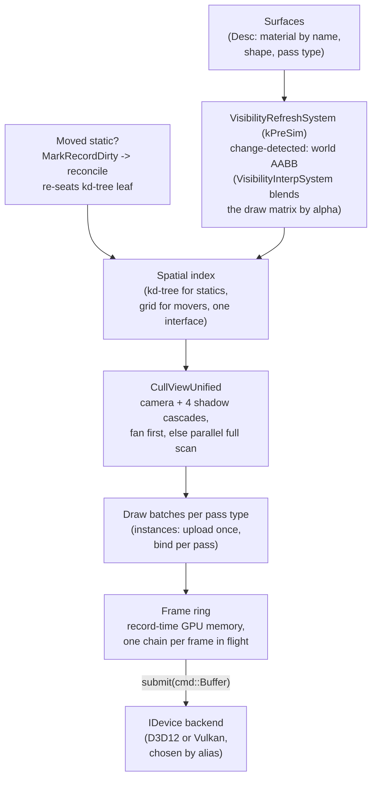

# Rendering & Visibility

The rendering path is where two of the engine's bets meet. From
[Core](Core.md) it inherits the data table store, the fixed-tick clock, and the
task scheduler. From [Components](Components.md) it inherits the trunk-and-backend
pattern that lets one interface stand in for many implementations. Put those
together and you get a renderer where the calling code never names a graphics API,
and a visibility pipeline where "what is on screen this frame" is answered by
draining a spatial index rather than scanning the world.

This page walks the frame from the top: how a device backend is chosen, how a
surface becomes a draw, how the cull decides what survives, and how the picture
stays smooth between simulation ticks. The through-line is that rendering is the
[trunk-and-backend philosophy](Components.md) applied to graphics, all the way
down.

---

## One device interface, any number of backends

The GPU is behind a single interface, `IDevice`. Every rendering call the rest of
the engine makes goes through it, and nothing above it knows which graphics API
the concrete device speaks. Direct3D 12 and Vulkan ship today, and further
backends are in progress. The Vulkan backend also runs on Android, including a
Meta Quest headset, where OpenXR supplies the swapchain and the camera draws two
eye views into it:

```cpp
// IDevice.h
struct IDevice : component::IComponentSingleton
{
    virtual ConstStr                 getName() const                                                                                                                 = 0;
    virtual material::shader::Format getShaderType() const                                                                                                           = 0;
    virtual Result                   beginFrame()                                                                                                                    = 0;
    virtual void                     endFrame()                                                                                                                      = 0;
    virtual void                     resize()                                                                                                                        = 0;
    virtual Result                   createPrimitive(const primitive::Desc& Desc, const uint32_t NumVerts, const uint32_t NumIndices, primitive::Handle& hPrimitive) = 0;
    virtual void                     destroyPrimitive(const primitive::Handle hPrimitive)                                                                            = 0;
    // mapPrimitiveData reads a STATIC primitive's geometry back, from the buffers' CPU copies or from memory
    // the CPU can map, so a read-back needs no fence.  Studio's entity-selection narrow phase reads geometry
    // back this way (paired with unmapPrimitiveData); the counts it needs come from the surface row + the
    // shape.  A dynamic primitive keeps no bytes of its own, so mapping one fails.
    virtual Result mapPrimitiveData(const primitive::Handle hPrimitive, void** ppVertexData, void** ppIndexData)                 = 0;
    virtual void   unmapPrimitiveData(const primitive::Handle hPrimitive, const uint32_t NumVertices, const uint32_t NumIndices) = 0;
```

Lower down, the interface declares `submit(cmd::Buffer& Buffer)`, and the free
function `GetDevice()` returns the device that the alias selects.

`IDevice` is itself script-exported, which constrains what can go on it: no new
reference-out or `void**` virtuals, because those do not survive the C / C# / Lua
binding generator (see [Script Generation](ScriptGeneration.md)). The `void**`
pair on `mapPrimitiveData` is a pre-existing exception the generator already
tolerates, not a template for new methods. That constraint is a feature: it keeps
the device surface honest and portable across the three scripting languages.

Which backend answers `GetDevice()` is decided by the **component alias**, the
generic-CID pattern documented in [Components](Components.md#the-trunk-and-backends-pattern).
The trunk (`Graphics`) declares a generic device id alongside a no-op fallback:

```cpp
// Graphics/Module.h
// CID_Device is the generic device CID; each backend's Initializer aliases it
// to its own concrete CID (CID_DeviceD3D12 / CID_DeviceVk). CID_DeviceNull is
// the trunk's default fallback -- a no-op, no-GPU device for headless tests and
// dedicated servers.
CE_DECLARE_COMPONENT_ID(Device)
CE_DECLARE_COMPONENT_ID(DeviceNull)
```

Three layers then compete to resolve that alias, exactly as the pattern
prescribes. The trunk sets a default, and each backend overwrites it when it
loads:

```cpp
// Graphics/ModuleFactories.cpp: the trunk default, so the package works alone.
// Default device alias -> the trunk's own no-op DeviceNull, plus its
// companion shader provider. This makes the package work standalone
// (headless tests, dedicated servers) with no GraphicsD3D12 / GraphicsVk
// linked. Real backends overwrite the alias in their own Initializer
// (they init after this trunk one); config.lua has the final say for
// Studio. See the "generic CID + alias" pattern in CLAUDE.md.
// The software codec answers unless a platform overrides the alias.  Set here so the
// package works standalone: a Studio with no backend loaded still decodes its own textures.
component::SetComponentAlias(CID_TextureCodec, CID_TextureCodecBcdec);

component::SetComponentAlias(CID_Device, CID_DeviceNull);
```

```cpp
// GraphicsD3D12/ModuleFactories.cpp: this DLL, when loaded, claims the device.
Initializer::Initializer()
{
    if (g_InitializerRefCount++ == 0)
    {
        char pkg_path[file::kMaxNameLen + 1];
        core::path::PathCombine(pkg_path, core::path::GetPackagesPath(), core::path::packages::kPrefix, core::path::packages::kGraphicsD3D12);
        core::path::AddPackagePath(core::path::packages::kGraphicsD3D12, pkg_path);

        component::SetComponentAlias(CID_Device, CID_DeviceD3D12);

        material::shader::IResourceProvider* p_shader_provider = nullptr;
        component::Create(&p_shader_provider, CID_ShaderResourceProviderD3D12);
        CE_ASSERT(p_shader_provider != nullptr)
    }
}
```

The Vulkan package's initializer does the same with `CID_DeviceVk`. Then
`config.lua` has the last word, picked by a `-graphicsBackend` command-line
argument. With no argument, the default is D3D12, or Vulkan in a build that has
no D3D12 backend (Android):

```lua
-- Resources/Scripts/config.lua: the last word, picked by the CLI arg.
if ceili.core.platform.hasCommandLineArgValue("-graphicsBackend", "vk") then
    ceili.core.component.setComponentAlias(ceili.graphics.CID_Device, ceili.graphics.vk.CID_DeviceVk)
elseif ceili.core.platform.hasCommandLineArgValue("-graphicsBackend", "d3d12") then
    ceili.core.component.setComponentAlias(ceili.graphics.CID_Device, ceili.graphics.d3d12.CID_DeviceD3D12)
elseif ceili.core.component.getComponentFactory(ceili.graphics.d3d12.CID_DeviceD3D12, ceili.graphics.IID_Device) ~= nil then
    --ceili.core.component.setComponentAlias(ceili.graphics.CID_Device, ceili.graphics.vk.CID_DeviceVk)
    ceili.core.component.setComponentAlias(ceili.graphics.CID_Device, ceili.graphics.d3d12.CID_DeviceD3D12)
else
    -- No D3D12 in this build (Android): Vulkan is the only backend.
    ceili.core.component.setComponentAlias(ceili.graphics.CID_Device, ceili.graphics.vk.CID_DeviceVk)
end
```

The `Null` fallback is what makes the whole engine testable without a GPU: unit
tests and headless servers load no backend DLL, the alias
stays on `CID_DeviceNull`, and rendering calls become no-ops that still exercise
every code path above the device line. This is why the headless smoke test in
[Core's build workflow](Core.md) can validate scene teardown with no window and no
adapter. The commercial heavyweights tend to bury the backend selection in a build
configuration or a platform abstraction layer compiled per-target; here it is a
one-line runtime alias, swappable in a config script, and one binary carries every
backend it was linked with.

**Adding a backend adds no seam.** A new device is a package with its own
`IDevice` implementation and one line aliasing `CID_Device` to itself. Nothing
above the device line is edited, and nothing needs to know how many backends
exist. The sections below talk about "the backends" in the plural for that
reason: where this page names Direct3D 12 and Vulkan, it is naming the two that
are shipping rather than a limit on the shape.

---

## Surfaces: a draw described by data

A **surface** is the authoring-side description of a renderable thing. Following
the [Desc-versus-wrapper split](Core.md), the authored `Desc` holds only data a
designer edits, and it references its material **by name**, never by handle:

```cpp
// Surface.h
struct Desc
{
    // Material referenced by name.  Resolved to the wrapper's hMaterial via
    // material::GetMaterialHandle; an empty name leaves the wrapper's hMaterial as-is
    // (so a runtime override -- the Studio preview / SetSurfaceMaterial -- isn't
    // clobbered).
    //
    // DATABASE-scoped, not a fixed char[N]: a path past the old 63-char cap used to
    // truncate SILENTLY, and since the registry resolves by hash a truncated name
    // matches nothing at all -- the surface drew the missing-material checkerboard with
    // no failed lookup to log.  ScopeDataString sizes to the name stored and dies with
    // the database arena, which is the one lifetime a row can rely on (DestroyDatabase
    // frees the arena WITHOUT running per-row destructors).  Two caller obligations come
    // with it, both on the writers: bind a core::data::DataGuard around any assign, and
    // prefer assign(ptr, len) over operator= (which reallocates unconditionally, and on
    // an arena that never gives memory back that grows it on every reconcile).
    core::ScopeDataString materialName;
```

After the name, `Desc` holds the procedural `shapeParams` (shape, tiling, UV pan)
and a `shadowDistance` cap.

The runtime handle lives on the scene wrapper, `scene::Surface`, which derives
from `Desc`. The handle is hidden from the property grid and skipped by every
serializer, because a handle is a per-process token that must never be saved:

```cpp
// Surface.h
// Runtime state -- all hidden from the property grid and serialiser
// (CE_HIDE CE_NOSERIALIZE) so users / save-load round-trips can't disturb it; the
// engine re-resolves / recomputes it each load / frame.  The raw bytes still live
// past-the-Desc for layout stability with the sparse-set storage.

// The material resolved from Desc::materialName by OnInsert / ReconcileDirtySurfaces,
// or set directly as a runtime override (Studio preview / SetSurfaceMaterial, with an
// empty materialName).  The render passes skip a surface whose hMaterial is invalid.
ceili::graphics::material::Handle hMaterial CE_HIDE CE_NOSERIALIZE;
```

The contract reduces to one line: **name resolves to handle, and an unresolved
name renders nothing.** A surface whose `materialName` does not
match a registered material has an invalid `hMaterial`, and every pass silently
skips it. This is a deliberate, checkable failure mode rather than a crash, and it
is verifiable in a headless run with no device at all: material identity is a
`Hash32` of the slash-name, resolved on the CPU side, so the resolution is device
independent. See [Materials](Materials.md) for how names become handles.

Surfaces are drawn under **pass types**. A pass type is a strong 64-bit id that
packs a priority in the high bits and a FourCC tag in the low bits, so passes sort
into a fixed pipeline order without a hand-maintained enum:

```cpp
// Graphics.h
namespace priority
{
constexpr uint32_t kShadow         = 0;
constexpr uint32_t kPreEnvironment = 50;
constexpr uint32_t kDepth          = 100;
constexpr uint32_t kGBuffer        = 200;
constexpr uint32_t kEnvironment    = 300;
constexpr uint32_t kLighting       = 400;
constexpr uint32_t kForward        = 500;
```

Finer steps follow inside the scene bands: `kOcean` (540), `kForwardTransparent`
(545), `kSfx` (550) for the emissive glow, `kParticle` (560), and more, up to the
post chain at `kPostProcess` (600).

Each pass is served by an `IRender` looked up by its type, and every renderer
reports the pass it belongs to:

```cpp
// Draw.h
struct IRender : component::IComponent
{
    // Active state is the inherited component::IComponentBase flag (ComponentFlags::Active);
    // draw::Process skips a render whose Active bit is clear.
    virtual pass::Type getPassType() const = 0;
```

`GetRender(const pass::Type Type)` returns the renderer registered for a pass type.

The priority ordering (`kShadow` before `kDepth` before `kForward` before
`kPostProcess`) is the frame's pipeline written as data. Adding a pass is
registering a renderer under a new FourCC at the right priority, not editing a
central switch. The list has grown steadily by exactly that route: the shadow
bake, the deferred G-buffer, the deferred ambient, the light grid and the
particle billboards were each a new FourCC at an existing priority.

Most pass types come in a family rather than alone. A forward pass has an
instanced sibling, a skinned sibling and a temporally interpolated sibling,
because the batch shape decides how the vertex shader composes its clip position,
and every pass that draws a batch has to compose it the same way. A missing
sibling is a visible defect: a skinned model that bakes its bind pose, or a
batched surface that fails its own depth test in the low mantissa bits and shows
as a dark hatch.

Three pages cover what fills these slots:
[Lighting](Lighting.md) for the G-buffer and the light grid,
[Shadows](Shadows.md) for the bake at `kShadow`, and
[Post-Processing](PostProcessing.md) for the tail of the order. The particle
system draws its camera-facing billboards in a world-space pass of this kind: see
[Particles](Particles.md).

---

## Visibility: a hot-cold split

Before anything is culled, each renderable carries a small amount of
visibility state, and the engine splits it into a **hot** part (touched by the
cull every frame) and a **cold** part (the geometry math that only changes when
the object moves):

```cpp
// Scene/Visibility.h
// Composable cull component (HOT).  Pair with VisibilityGeometry + a Surface / Light
// wrapper on the same entity key.  VisibilityUpdateSystem (PreSim) composes `world` into
// this row from the cold row's local + worldMatrix each frame; CullVisibilityParallel
// tests `world` and stamps Visible.  Runtime-only -- never authored, never serialized.
struct Visibility
{
    // World AABB the cull loop tests -- composed each PreSim, and the at-rest cache once
    // dirty-gating lands.  Empty == always visible.  Also read by the kd/reconcile drain
    // (insertEntity) and the SceneBounds union.
    math::Bounds world CE_READONLY CE_NOSERIALIZE{};

    // Per-frame cull output.  Rows start un-flagged (the cull stamps Visible each pass,
    // before draw reads it within the same Update; a never-culled scene draws nothing --
    // it has no view).  Runtime-only.
    VisibleFlags flags CE_HIDE CE_NOSERIALIZE = VisibleFlags::None;
};
```

```cpp
// Scene/Visibility.h
// Composable cull component (COLD).  Sibling of Visibility on the same entity key.
struct VisibilityGeometry
{
    // World matrix the PreSim visibility compose derives from the entity Transform
    // (surface::SurfaceWorldMatrix / Mat4FromTransform) and stamps here each refresh -- the
    // per-surface world the draw path reads (BuildBatches -> surfaceWorld), so cull / draw
    // keep NO Transform dependency and stay concurrent with a Transform writer (the boids
    // flock).  Lights leave it identity (they compose `world` directly, not drawn via surfaces).
    math::Mat4 worldMatrix CE_HIDE CE_NOSERIALIZE = math::Mat4Identity();
```

After `worldMatrix`, `VisibilityGeometry` holds the `cachedPoseHash`, the
`prevTick` and `currTick` poses, the `local` bounds, the `stateFlags`, an authored
`localTransform`, and a few per-frame stamps.

The `Visibility.world` AABB is the *only* thing the cull reads. Everything else,
the world matrix used to draw, the local bounds, the previous and current tick
poses used for interpolation, lives in `VisibilityGeometry` and is recomputed only
when the object's transform changes. Keeping the cull's working set to one bounds
per object is what lets it stay cache-friendly at a hundred thousand objects.

Both structs are stored as columns in the scene's [data table store](Core.md).
`Visibility` is its own table, keyed by type hash like every other component, and
the cull's job is to fill each view's visible-key set from those rows.

---

## Keeping visibility fresh: one generic system

When an object moves, its `Visibility.world` and its `VisibilityGeometry` must be
recomputed, or the cull tests a stale box and the draw uses a stale matrix. The
naive approach is a companion updater per moving type (one for boids, one for the
player, one for every future kind). The engine rejects that. There is exactly
**one** generic, change-detected system that refreshes every renderable surface:

```cpp
// Scene/SceneSystems.cpp
using VisibilityRefreshContract =
    core::scene::system::Contract<const math::Position, const surface::scene::Surface, Visibility>;

CE_COMPONENT_FACTORY_DEFINITION(CID_VisibilityRefreshSystem, core::scene::system::ISystem, VisibilityRefreshSystem)
class VisibilityRefreshSystem final : public core::scene::system::SystemBase<VisibilityRefreshContract>
{
public:
    core::ConstStr getName() const override { return "visibilityRefreshSystem"; }

    core::scene::system::Priority getPriority() const override
    {
        // PreSim slot 4, before the flock / player (kSim).  The slot and its reasoning live with the
        // rest of the band's layout in Core/Include/Scene/System.h - including the note that its
        // position relative to the animation system is preserved rather than endorsed.
        return core::scene::system::kVisibilityRefresh;
    }
```

Read the `Contract` the way [Core's scheduler](Core.md#tasks-threading-and-the-fixed-tick-clock)
does: `const math::Position` and `const surface::scene::Surface` are reads, the
non-const `Visibility` is a write. The scheduler now knows this system reads
position data and writes visibility, and can fan it out in parallel against any
system whose writes do not overlap, with no locks and no manual barrier. It runs
in the `kPreSim` band so the visibility set is fresh before the cull looks at it.
Rotation and Scale are optional siblings the update resolves per row, since a boid
may carry only Position while a full surface carries all three. Change detection
hashes whichever pose rows are present into a 64-bit `cachedPoseHash` on
`VisibilityGeometry`: a row whose hash still matches its last compose is skipped
entirely, so a static surface pays only the hash and an 8-byte compare, never a
matrix rebuild.

This is the single-source-of-truth rule from [Core](Core.md) applied to
visibility: one funnel refreshes every moving surface, so a new renderable type
gets correct culling and correct draw matrices for free, exactly the way a new
reflected field gets serialization for free in [Metadata](Metadata.md).

**Moved statics need one extra nudge.** A static object binned into the scene's
kd-tree has its world AABB stored *inside a tree leaf*. Recomputing its bounds is
not enough; the tree must re-seat it, or a frustum query walks past its old leaf.
The engine enqueues an editor-moved entity onto the surface table's dirty-key
worklist, and the same reconcile pass that [Core's dirty tracking](Core.md#data-the-table-store-the-engine-is-made-of)
drains re-bins it:

```cpp
// Scene/SceneSystems.cpp
// Enqueue a composed (i.e. editor-moved) entity onto the surface table's dirty-key worklist - the
// generic changed-entity queue ReconcileDirtySurfaces drains - so the scene kd-tree re-seats the
// entity's world AABB (updateEntity + leaf re-bin) before the next query.  EVERY
// ComposeVisibilityForKey caller funnels through this (the property-grid sync hook, the gizmo drag /
// transform undo-redo WriteTransform): without it a gizmo-dragged entity kept its load-time leaf
// binning, so ray picking and the cull fan read stale bounds at the OLD position.  No-op when the
// scene has no Surface table (then there is no worklist and no reconcile drain either).
void EnqueueMovedEntityForReconcile(const core::data::DatabaseId Db, const core::data::Key Key)
{
    core::data::MarkRecordDirty(Db, core::data::TableId(core::meta::TypeHash<surface::scene::Surface>()), Key);
}
```

Moving a surface in the editor is a `MarkRecordDirty` call; the reconcile drains
the worklist and calls the tree's `updateEntity`. The same dirty-key primitive
that drives the property grid and undo drives spatial re-seating.

---

## The spatial index: two shapes, one interface

The cull is only fast because it does not scan the world. It queries a **spatial
index**, and the index itself follows the trunk-and-backend pattern one more time:
a base interface with two specializations, selected through `getInterface` rather
than a downcast.

```cpp
// Spatial/SpatialIndex.h
struct ISpatialTree : ISpatialIndex
{
    // Build the fixed POW2 partition over the scene bounds down to a min leaf size (clears prior content),
    // then insertEntity each entity by key + world AABB at warmup.  updateEntity + removeEntity keep the
    // set LIVE afterwards (driven by ReconcileDirtySurfaces draining the surface dirty-key worklist), so
    // the cull fan tracks a moved entity instead of its stale load-time bounds.  (These are the scene's
    // NON-boid surfaces -- not necessarily static, hence "entity" not "static".)
    //   insertEntity -- add (re-seat if already present) a key; used by warmup's ingest.
    //   updateEntity -- re-seat an EXISTING key's world; a NO-OP for an absent key.  This is the boid
    //                   discriminator: boids spawn AFTER warmup so they were never ingested, and the
    //                   reconcile drain (which includes the 100k boid-surfaces -- boids ARE surfaces) calls
    //                   updateEntity, so a boid find-misses and is skipped; only warmup entities update.
    //   removeEntity -- drop a deleted key (swap-pop); a NO-OP for an absent key.
    //   containsEntity -- is the key in the entity set?  Lets a caller skip work for keys updateEntity
    //                     would find-miss anyway (e.g. the ReconcileDirtySurfaces per-row Visibility read).
    virtual void buildTree(const math::Bounds& SceneBounds, const int32_t MinLeafSize) = 0;
    virtual void insertEntity(const core::data::Key Key, const math::Bounds& World)    = 0;
    virtual void updateEntity(const core::data::Key Key, const math::Bounds& World)    = 0;
    virtual void removeEntity(const core::data::Key Key)                               = 0;
    virtual bool containsEntity(const core::data::Key Key) const                       = 0;
```

The base `ISpatialIndex` carries the verbs every backend answers: `getType`,
`buildPoints`, `queryRay`, `queryRadius`, `queryFrustum`, `applyVisibleNodes` and
`warmup`. `ISpatialGrid` adds `buildLeafCellMap` and `isMembershipValid`. A caller
reaches either specialization through `getInterface`:

```cpp
// Spatial/SpatialIndex.h
// Downcast an ISpatialIndex to a derived backend interface via the component getInterface() query (the
// scene holds all backends under one IID_SpatialIndex registry; getType() finds the KIND, getInterface()
// hands back the kind-specific interface).  nullptr if the backend is not that kind / the pointer is null.
inline ISpatialTree* AsSpatialTree(ISpatialIndex* pIndex)
{
    core::component::IComponentBase* p_iface = nullptr;
    return (pIndex != nullptr && core::Succeeded(pIndex->getInterface(IID_SpatialTree, &p_iface))) ? static_cast<ISpatialTree*>(p_iface) : nullptr;
}
inline ISpatialGrid* AsSpatialGrid(ISpatialIndex* pIndex)
{
    core::component::IComponentBase* p_iface = nullptr;
    return (pIndex != nullptr && core::Succeeded(pIndex->getInterface(IID_SpatialGrid, &p_iface))) ? static_cast<ISpatialGrid*>(p_iface) : nullptr;
}
```

The **kd-tree** is the static-geometry index. It is built once at scene-load
warmup, ingesting the static `Visibility` rows, and it answers the queries that
matter for a mostly-still world:

```cpp
// Spatial/SceneKdTree.h
// The scene's kd-tree -- the STATIC-entity index: its queryRay returns the static candidates (picking),
// queryFrustum the cull fan's frustum-tested static set, and queryFrustumNodes the visible-leaf set a
// grid expands.  Resolves the scene's Level-scope index by getType() == kTypeKdTree and hands back its
// ISpatialTree interface (via getInterface(IID_SpatialTree)); nullptr if none.  Created + warmed
// (buildTree + ingest the static Visibility rows) by the SpatialSetupSystem at scene-load warmup, BEFORE
// the boid spawn -- this only FINDS it.  The kd-tree's KIND-specific structural verbs live on ISpatialTree
// (the LeafId / VisibleNodeSet types beside it in SpatialIndex.h); the generic query verbs on the base.
CE_API ISpatialTree* GetSceneKdTree(const core::scene::Handle hScene);
```

The **grid** handles the opposite case: a large population of small movers where a
uniform cell map is cheaper to keep current than a tree of tight leaves. It even
bootstraps off the tree, calling `buildLeafCellMap(Tree, ...)` to seed its cells
from the tree's visible-leaf set. Two data structures, two performance profiles,
one interface, and the caller picks between them with `getInterface` rather than
knowing either concrete type. This is the same swap-the-implementation seam as the
device backend, at a finer grain.

---

## The unified cull: one fan for 3D and 2D

The camera and the [2D orthographic views](Studio.md) do not have separate cull
code. Both route through one entry point, which tries the fast spatial-index fan
first and falls back to a parallel full scan only when there is no usable index:

```cpp
// Scene/SceneSystems.cpp
// The unified cull - try the O(visible) kd-tree/grid fan (descend once + applyVisibleNodes per index,
// gathers parallel), else the parallel full scan (CullVisibilityParallel).  BOTH the 3D camera
// (CullSystem, kCull) AND the 2D ortho wireframe views (the DrawSystem loop, kDraw) route here: the fan's
// gather is parallel, so it wins when it prunes and merely ties the scan when a view frames ~the whole
// swarm (no zoom-guard bail).  The fan DECLINES to the full scan only when it cannot run at all - no
// kd-tree / leafCount==0, an uncovered visible set, or a stale/absent grid membership.  CullVisibilityParallel's
// ParallelFor join auto-selects WaitParticipating on main or WaitParticipatingWorker on a worker, so it
// spreads across the pool.
void CullViewUnified(const core::scene::Handle         hScene,
                     const core::data::DatabaseId      Db,
                     const math::Frustum&              Frustum,
                     const core::data::Key             ViewKey,
                     core::Span<const math::Frustum>   ExtraFrustums,
                     core::Span<const core::data::Key> ExtraViewKeys)
```

The fan is the fast path: descend the index once, call `applyVisibleNodes` per
index to gather the leaves the frustum touches, and produce the visible-key set in
time proportional to what is *visible*, not to the scene's total object count. The
full scan (`CullVisibilityParallel`) is the fallback, a `ParallelFor` over every
`Visibility.world`, used only when a view has no spatial index yet, and it doubles
as the direct entry point unit tests call. The important detail is that the
**camera takes the same fan-first path as the wireframe views**: there is no
privileged "real" cull and cheap "editor" cull that drift apart: one router
serves both, sharing the same set of statistics counters.

The extra frustums are the four directional [shadow cascades](Shadows.md). Each
is offered the fan first and on its own, because a kd-tree descent already costs
only what that frustum sees. The frustums the fan declines are gathered into one
list, so the full scan runs once for all of them:

```cpp
// Scene/SceneSystems.cpp
// MULTI-FRUSTUM, and that is the point of the span: the four shadow cascades need their own caster
// lists, and running this once per frustum would be a separate O(N) pass over every entity each
// time - five passes over a 100k swarm rather than one.  Each row is read ONCE and tested against
// every frustum while its bounds are still in cache.
//
// StampBitFrustum names which frustum - if any - owns the per-row Visible bit, and it is an INDEX
// rather than "the first one" on purpose.  That bit has exactly one meaning ("visible to the primary
// view") and exactly one writer, so a cascade adding itself to it would silently clobber what the
// draw gate reads.
```

Because every path writes the same per-view visible-key set, the rest of the
pipeline downstream of the cull neither knows nor cares which path produced it.

---

## Instance transforms: upload once, bind per pass

A batch of instanced surfaces (a swarm of identical boids, say) shares one mesh
and differs only by transform. Uploading those matrices to the GPU every frame,
for every pass, is pure waste when they have not changed. The engine tags each
instanced upload with a stable id and a changed flag, and the backend keeps a
persistent buffer keyed by that id:

```cpp
// InstanceUpload.h
// The point: draw::UploadInstances routes every INSTANCED batch through UploadInstanceTransformsBatched,
// tagging it with a STABLE per-batch id + whether its transforms changed this frame.  The submit-side
// backend keeps a per-batch PERSISTENT instance buffer keyed by that id: a batch unchanged for longer than
// the backend's frames-in-flight is uploaded ONCE and thereafter only BOUND -- no per-frame re-upload of
// identical matrices (the idle-editor win layered on G1).  A moving batch (Play, or a just-edited swarm)
// falls back to the per-frame ring exactly as before.  The plain cmd::UploadInstanceTransforms path is
// unchanged; it tags stableId 0, which the backend always rings.  Assumes Module.h (math::Mat4, CE_API)
// was already included, like the other Graphics headers.
```

```cpp
// InstanceUpload.h
// Record an instanced-batch upload TAGGED with its stable id + change signal (the persistent-buffer path).
// Behaves exactly like cmd::UploadInstanceTransforms (same per-frame handle mint, same double-buffered
// record-time copy, same overflow degrade to an invalid handle) but additionally stamps the tag into the
// op (StampMeta; the backends read it back with MetaOf).  cmd::UploadInstanceTransforms forwards to this with
// {stableId 0, contentChanged true}, so untagged callers always ring.
// No CE_API: the sole caller (draw::UploadInstances, Src/Draw.cpp) lives in this same DLL, and neither
// GraphicsD3D12 nor GraphicsVk references it.
InstanceHandle UploadInstanceTransformsBatched(const math::Mat4* pData, const uint32_t Count, const InstanceBatchId StableId, const bool ContentChanged);
```

The tag travels in an `InstanceUploadMeta` (`stableId`, `contentChanged`, the
bind slot, and the element stride), and each backend reads it back with `MetaOf`
at submit.

The rule is **upload once, bind per pass.** A batch's matrices go to the GPU a
single time; each of the many passes that draw it (depth pre-pass, then the
forward pass, then any overlay) *binds* the already-resident buffer instead of
re-uploading. For a static or idle scene the per-frame instance-transform traffic
collapses to nothing, which is a large part of how the boids demo holds its frame
budget. The full story of that budget is [The Road to 100k Boids](Performance_100kBoids.md).

---

## Render interpolation: smooth between fixed ticks

Simulation runs on a [fixed-tick clock](Core.md#tasks-threading-and-the-fixed-tick-clock)
so behaviour is deterministic regardless of frame rate. But if the renderer drew
the raw simulated pose, motion would visibly step at the tick rate whenever the
frame rate ran ahead of the sim rate. The fix is to interpolate the *draw* pose
between the last two simulated ticks by the frame's `alpha`, while leaving the
*cull* bounds on the live pose:

```cpp
// Scene/SceneSystems.cpp
bool GetInterpolatedRenderPose(math::Transform& Out, const VisibilityGeometry& Geom, const math::Transform& Live, const float Alpha)
{
    // Interpolate ONLY when the shadow is TRACKING: currTick == the live Transform (true in Play, where
    // RenderShadowSystem set currTick to this row's last-tick value and nothing has moved it since
    // kPreSim) AND the row actually moved (prevTick != currTick).  Otherwise - Design (the shadow
    // system is Play-only, so currTick lags), the first Play frames, a Play->Design rollback, or a
    // static - the row is drawn at the live pose and the caller keeps it.
    if (Geom.currTick != Live || Geom.prevTick == Geom.currTick)
    {
        return false;
    }
    Out = math::TransformLerp(Geom.prevTick, Geom.currTick, Alpha);
    return true;
}
```


The two tick poses (`prevTick`, `currTick` on `VisibilityGeometry`) are shifted
once per simulation tick by `RenderShadowSystem`, which runs only in Play. Every
frame, `VisibilityInterpSystem` in the `kGraphics` band calls
`RefreshInterpolatedDrawMatrix` for each row that can interpolate. That function
blends the draw matrix by `ComponentUpdate.alpha`, or puts the live pose back when
the row does not interpolate. The result is a clean separation: **draw pose is
interpolated for the eye, cull pose stays on the tick for correctness.** This is
what lets a hundred thousand boids simulate at a fixed rate and still render
buttery-smooth on a faster display; the same decoupling underpins the remote-peer
smoothing the [multiplayer layer](Networking.md#path-a-gameplay-replication) relies
on.

One convention worth carrying into your shaders when you consume these matrices:
`math::Mat4` is row-major with row-vector semantics, so the canonical HLSL
multiply is `mul(v, M)`, vector first. `mul(M, v)` compiles and silently projects
through the transpose. The full rationale is in [Materials](Materials.md).

---

## Who owns the frame: the clock and the ring

Recording a frame and running it on the GPU overlap. The recording thread writes
command buffers while the GPU is still executing what was recorded one or two
frames ago, so anything the recording writes has to outlive the frames still in
flight. For a while each backend answered that on its own, with its own frame
counter and its own ring of buffers. The trunk now owns both.

```cpp
// Include/FrameClock.h
// The trunk numbers every frame it records, so a backend reads one frame serial and one frame slot
// instead of keeping a counter of its own.  cmd::Swap hands each recording to the replay, at the one
// point where no thread records and no replay runs.
//
// Frames in flight is how many submitted frames the GPU may still run when a replay begins.  A backend
// keeps one frame context for each slot.  Before a replay reuses a context, it waits for what that
// context submitted last, and then publishes that serial as completed.  A replay that submits nothing
// leaves the GPU no work, so the swap publishes it once everything submitted before it has completed.
```

One number falls out of that and is worth stating, because several buffer
rotations depend on it:

```cpp
// Include/FrameClock.h
// The frames that a buffer written while recording must outlast, at the most frames in flight: the frames
// in flight, the replay that overlaps the recording, and the recording itself.  A record-time rotation of
// this many buffers never rewrites one that the GPU may still read.
constexpr uint32_t kMaxFramesPendingGpu = kMaxFramesInFlight + 2;
```

The **frame ring** is mapped GPU memory the recording thread writes into
directly. A payload placed there is copied once, at record time, and the replay
binds the bytes where they lie. Each recorded frame bump-allocates from a chain
of blocks of its own, and that chain stays with the frame until the GPU reports
it complete. The swap frees every completed chain and hands the next recording a
free one.

Dynamic geometry goes through it. The UI and the debug line drawer used to write
their vertices into a staging buffer and then copy; they now write once, into the
ring.

Two properties make the accounting simple. A block index belongs to one chain for
good, so no index a pending frame binds is handed out again before that frame
completes. And when every chain is pending, because the GPU has stalled, the
recording gets no chain, its allocations fail, and the swap logs it. The failure
is loud rather than a silent overwrite of memory the GPU is reading.

The trunk owns the policy and the block indices. The device owns what a block
actually is. With no device at all, a block is plain memory from the bootstrap
scope, so the headless path exercises the same allocator.

---

## The frame path, end to end

Putting the pieces in order, one frame of rendering flows like this:



<!-- MEDIA: a side-by-side capture of the same scene rendered through the Vulkan
     backend and the D3D12 backend, pixel-identical, with the config.lua alias
     line that selects each. This is the "no calling code changed" proof. -->

<!-- MEDIA: a debug-overlay screenshot of the kd-tree / grid leaf boxes with the
     camera frustum, and the cull statistics counter showing visible-set count
     versus total object count (the fan's O(visible) win made visual). -->

Read left to right, every arrow crosses a seam the engine deliberately made
swappable. Surfaces are pure data. Visibility refresh is one generic system the
scheduler parallelizes off its contract. The spatial index is an interface with
many backends. The cull is one router serving camera and editor alike. And the
device at the end is chosen by a config line, not a compile flag.

---

## Why it composes

The renderer is the same handful of Core and Component ideas applied to pixels,
not a special subsystem with its own rules:

- A **device** is an interface resolved by a runtime **alias**, so one binary
  carries every backend linked into it (Direct3D 12 and Vulkan today), and a
  headless `Null` device makes the whole path testable with no GPU.
- A **surface** is authored data that references its material by name; an
  unresolved name is a checkable no-draw, not a crash.
- **Visibility** is a table column, refreshed by **one** change-detected system
  whose read/write **contract** lets the scheduler parallelize it for free.
- The **cull** queries a **spatial index** (a kd-tree or a grid behind one
  interface), and the camera, the shadow cascades and the 2D views all share the
  identical fan-first path.
- **Instances upload once and bind per pass**, and the **draw pose interpolates**
  between fixed ticks while the cull pose stays on the tick.
- The **trunk numbers the frames** and owns the record-time memory ring, so a
  backend reads one serial and one slot rather than keeping a counter of its own.

Most engines assemble a renderer from bespoke parts: a platform render hardware
interface, a hand-written visibility system per object kind, a separate editor
viewport path. Ceili reaches the same capabilities by pointing its existing
interfaces, tables, systems, and aliases at rendering. The leverage is that adding
a backend, a pass, or a renderable type is filling in a known seam, not inventing
one.

Next: [Lighting](Lighting.md) for what fills the G-buffer and the forward passes,
[Shadows](Shadows.md) for the bake at the head of the frame,
[XR and Quest](Xr.md) for how a headset's frame loop fits record and replay,
[Materials](Materials.md) for how a material name becomes a pipeline, or
[The Road to 100k Boids](Performance_100kBoids.md) for the numbers this path was
built to hit. Back to the [documentation index](README.md).
