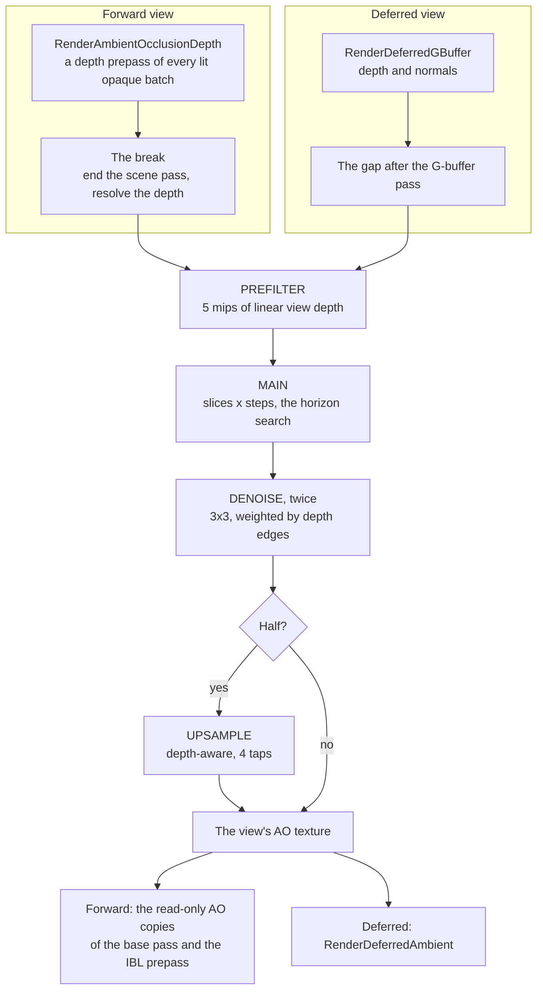

# Ambient Occlusion (GTAO)

Ceili darkens creases, corners and the ground at the foot of large objects with
GTAO (ground-truth ambient occlusion). GTAO is a set of compute kernels that read
the scene depth. The result darkens the ambient light only. The sun and the local
lights keep their own shadows (see [Shadows](Shadows.md)).

Three settings control the cost, and one row per level controls the look:

- **The mode:** Off, Full (the search at the scene's size) or Half (the search at
  half size each way, then an upsample).
- **The quality preset:** Low, Medium or High, the number of samples a pixel
  takes.
- **The depth chain's precision:** 32-bit or 16-bit floats.
- **The look:** the reach, the darkness and the fade distance, set per level.

The desktop runs Half at High on a 32-bit chain. At 4K on an RTX 3080 this costs
0.73 to 0.83 ms of GPU time a frame.

<!-- MEDIA: RedMines at 4K, the same pose twice, side by side: CEILI_AO=off and
CEILI_AO=half. Frame the foot of a large rock and the toe of a cliff, where the
occlusion reads most. Save as Docs/Media/Rendering/gtao_off_half.webp. -->

---

## The frame, from depth to ambient



One function, `render::ambientOcclusion::Record`, runs the kernels for a view.
Each kernel is a compute material of its own. The shader header states the
chain:

```hlsl
// Shaders/gtao.hlsli
// GROUND-TRUTH AMBIENT OCCLUSION (GTAO; Jimenez et al. 2016, "Practical Real-Time Strategies for Accurate Indirect
// Occlusion"; the shape follows Intel's XeGTAO, MIT). render::ambientOcclusion::Record dispatches three kernels a view,
// each its own compute material (gtao.material), over the view's region of the scene-sized targets:
//
//   PREFILTER  the scene's resolved depth into a mip chain of LINEAR view depth (R32F, kGtaoDepthMips), one dispatch a
//              mip. Mip 0 is the depth itself; a later mip averages its 2x2 with weights that drop a sample much
//              farther than the nearest, so a silhouette does not blur into the background.
//   MAIN       per pixel, kSlices directions across the screen, each searched kSteps times both ways for the highest
//              horizon, then the cosine-weighted visibility between the two horizons, integrated in closed form.
//              Writes the visibility and the four depth edges (for the denoise) to an RG16F target.
//   DENOISE    a 3x3 blur weighted by the edges, twice (ping-pong), so it never crosses a silhouette.
//   UPSAMPLE   at half size only (display::AmbientOcclusion::Half, where MAIN and DENOISE run on the chain's mip 1): the
//              result back up to the view's size, each pixel from the half-size texels on its own surface.
//
// The noise is SPATIAL and FIXED from frame to frame (interleaved gradient noise on the pixel): the engine has no
// temporal accumulation, and a per-frame pattern would shimmer. The denoise removes most of the fixed pattern.
```

The prefilter writes 5 mips. The main pass picks a coarser mip for a sample
farther from the pixel, so a long step reads a smaller texture. The denoise reads the
four depth edges that the main pass packs next to the visibility, so it blurs
across a surface and stops at a silhouette.

## Two routes into the frame

GTAO needs a whole depth buffer. The deferred path and the forward path get it
in different places.

**A deferred view** already ends its G-buffer pass before the lights. The AO
runs in that gap, and it reads the G-buffer's normals:

```cpp
// Render/DeferredGBuffer.cpp
cmd::EndRenderTarget(h_gbuffer);
// THE AMBIENT OCCLUSION, in the gap the G-buffer already opens: the depth is whole and the normals are written,
// and RenderDeferredAmbient reads the result in this view.
if ((drawn > 0) && ambientOcclusion::Wanted(View))
{
    ambientOcclusion::Record(View, graphics::GetGBufferTexture(gbuffer::kNormal));
}
// BOTH ops load, and the depth stays ATTACHED: everything from here to the post chain
// still depth-tests against the shared depth (the forward fallback at Equal, particles,
// refraction), which a plain Load would silently leave out of the pass on Vulkan.
cmd::BeginRenderTarget(h_scene, cmd::LoadOp::Load, cmd::LoadOp::LoadBound);
ReapplyViewSubRect(View);
```

**A forward view** has no G-buffer, so the AO adds a pass of its own:
`RenderAmbientOcclusionDepth`. It runs one priority step before the depth band,
and it draws the depth of every lit opaque batch. Then it breaks the scene
pass, records the AO, and opens the pass again:

```cpp
// Render/PrePassDepth.cpp
ambientOcclusion::SetViewDepthDrawn(true);

// THE BREAK: ending the pass resolves the multisampled depth into the depth the kernels read.  The depth stays
// attached on the way back in (LoadBound), so every pass after this one tests against it.
cmd::EndRenderTarget(h_scene);
ambientOcclusion::Record(View, texture::Handle()); // no G-buffer: the normal is rebuilt from the depth
cmd::BeginRenderTarget(h_scene, cmd::LoadOp::Load, cmd::LoadOp::LoadBound);
ReapplyViewSubRect(View);
return core::results::success::Ok;
```

The main pass then rebuilds each normal from the depth. After the break, the
forward base pass and the IBL prepass draw through read-only AO copies of their
materials. These copies test the depth with `GreaterEqual`, write no depth, and
read the AO in the ambient. With the depth already drawn, early-Z makes the base
pass 0.04 to 0.06 ms cheaper.

Not every forward view can take the break. The test is one function:

```cpp
// Render/AmbientOcclusion.cpp
bool WantedForward(const draw::ViewDesc& View)
{
    if (!Wanted(View) || !HasBitfield(View.flags, draw::ViewDescFlags::PrePassIBL) || HasBitfield(View.flags, draw::ViewDescFlags::Deferred))
    {
        return false;
    }
    // One eye: the kernels read one depth slice. A transient scene depth is never stored, and under TRANSIENT MSAA the
    // break never writes the 1x scene depth (SceneCapture's rule), so there is nothing to read.
    if ((graphics::GetSceneViewCount() > 1) || graphics::GetSceneDepthTransient())
    {
        return false;
    }
    return (graphics::GetSceneSamples() <= 1) || HasBitfield(GetDeviceCaps().flags, DeviceCaps::Flags::MsaaStoredResolve);
}
```

`Wanted` is the test that both routes share. It asks for the mode to be on, a
lit view that is not Ui or wireframe, and a perspective projection.

## The search

For each slice, the main pass steps out both ways from the pixel and keeps the
highest horizon it finds. The steps bunch up near the pixel, where the
occlusion that you see most lives:

```hlsl
// Shaders/gtaoMain.comp
for (float step = 0.0; step < step_count; step += 1.0)
{
    // Quadratic spacing: more steps near the pixel, where the occlusion that reads most lives.
    float s = (step + noise_step) / step_count;
    s       = s * s + min_s;
    const float2 offset_px  = round(s * omega);
    const float  offset_len = length(offset_px);
    // A mip past the base: the chain holds kGtaoDepthMips in all, so the base leaves fewer to step down.
    const uint   mip        = (uint)clamp(log2(max(offset_len, 1.0)) - kGtaoMipOffset, 0.0, float(kGtaoDepthMips - 1 - base));
    // Clamped into the view's own region: a view that shares the targets (a split) must not read its
    // neighbour's depth.
    const int2   p0         = clamp(p + int2(offset_px), origin, view_last);
    const int2   p1         = clamp(p - int2(offset_px), origin, view_last);
    const float  z0         = GtaoLoad(depth_index, p0 >> mip, mip + base).r;
    const float  z1         = GtaoLoad(depth_index, p1 >> mip, mip + base).r;
```

A sample past the radius counts for less and less, over the outer share of the
radius that `falloff` sets. After the slices, the pass integrates the
cosine-weighted visibility between the two horizons in closed form. Then it
applies the look:

```hlsl
// Shaders/gtaoMain.comp
// NOT clamped to 1 here. One slice on a flat floor reads below 1 or above it by its direction (a slice across the
// normal sees little of it, one along it sees more than all), and only the average over the slices is 1. A clamp
// here cuts the high half and keeps the low one, so with few slices the open floor greys: the Low preset's open
// floor read 189 of 255. The denoise averages the neighbours, then clamps.
visibility = pow(max(visibility, 0.0), gGtao.effect.z);
visibility = max(visibility, 0.03); // never fully black: a crease still takes some of the sky

// Faded out with distance, and in as the radius grows on screen.
const float fade_start = gGtao.quality.z;
const float fade       = saturate((center_z - fade_start) / max(fade_end - fade_start, 1e-3));
visibility             = lerp(1.0, visibility, visibility_scale * (1.0 - fade));
```

## How the ambient takes it

Every ambient writer reads the AO through one function, so the forward ambient
and the deferred ambient agree:

```hlsl
// Shaders/ambientOcclusion.hlsli
// Jimenez's multi-bounce fit (2016): a bright surface loses less light in a crease than a dark one, because light
// bounces inside the crease. Taken against the surface's grey level, so the AO stays one scalar. Saturated: the fit
// reads a hair over 1 at full visibility on a white surface, and a view with no AO (the white placeholder) must
// multiply by exactly 1.
//
// The authored AO and the screen-space AO see the same crease, so a caller takes the SMALLER of the two, never their
// product, which would darken the crease twice.
float AmbientOcclusionMultiBounce(float Visibility, float3 Albedo)
{
    const float grey = dot(Albedo, float3(0.2126, 0.7152, 0.0722));
    const float a    = 2.0404 * grey - 0.3324;
    const float b    = -4.7951 * grey + 0.6417;
    const float c    = 2.7552 * grey + 0.6903;
    return saturate(max(Visibility, ((Visibility * a + b) * Visibility + c) * Visibility));
}
```

A material can also author its own AO in a texture. The deferred ambient takes
the smaller of the authored AO and the screen-space AO. A view that records no
AO binds a white texture, so the ambient multiplies by exactly 1.

## The options

### Mode: Off, Full, Half

```cpp
// Include/Display.h
// SCREEN-SPACE AMBIENT OCCLUSION (StrategySettings::ambientOcclusion): GTAO over the scene depth, folded into the
// AMBIENT only, never the sun or the local lights.  Half is the desktop default.  Off draws the frame exactly as it was
// before AO existed.  On a forward
// view, AO adds a depth prepass of every opaque lit batch, and the base pass and the IBL prepass then draw with depth
// write OFF, testing against it (render::RenderAmbientOcclusion).  APPENDED values only: config.lua writes them as integers.
enum class AmbientOcclusion : uint8_t
{
    Off = 0,
    // At the scene's size.
    Full = 1,
    // The search at half the scene's size each way, a quarter of the pixels, then a depth-aware upsample to the scene's
    // size, so the readers see a full-size result either way.
    Half = 2,
};
```

Full and Half publish a full-size texture, so the readers do not know which mode
ran. Half runs the main pass and the denoise on mip 1 of the depth chain, a
quarter of the pixels. The upsample then takes each view pixel from the four
nearest half-size texels and keeps only the texels whose depth agrees with the
pixel's own. Where no texel agrees, the texel nearest in depth wins. So a
block's occlusion does not bleed onto the floor behind its silhouette.

### Quality: Low, Medium, High

The preset sets the slices (directions) a pixel searches and the steps it takes
each side of each slice:

```cpp
// Render/AmbientOcclusion.cpp
// THE QUALITY PRESETS (display::AmbientOcclusionQuality, indexed by its value): directions searched a pixel, and samples a
// direction each side. The look is the scene's own (env::ambientOcclusion::Desc), whatever the preset.
struct Preset
{
    float slices;
    float steps;
};
constexpr Preset kPresets[] = {{1.0f, 2.0f}, {2.0f, 2.0f}, {3.0f, 3.0f}};
static_assert(static_cast<uint32_t>(display::AmbientOcclusionQuality::High) + 1u == sizeof(kPresets) / sizeof(kPresets[0]), "one preset per display::AmbientOcclusionQuality value");
```

| Preset | Slices | Steps a side | Depth samples a pixel |
|---|---|---|---|
| Low | 1 | 2 | 4 |
| Medium | 2 | 2 | 8 |
| High | 3 | 3 | 18 |

The preset changes only the main pass. The prefilter, the denoise and the
upsample cost the same at every preset.

### Depth chain: R32F or R16F

`ambientOcclusionDepth16` stores the depth mips as 16-bit floats. Each sample
then reads half the bytes. The chain clamps the view depth to 30,000, which a
16-bit float can hold. Far depth loses precision, and at that distance the AO
has already faded out. A change rebuilds the AO targets.

### The look, per level

The strategy decides whether the AO runs and how much it costs. The level
decides what it looks like. Each scene carries an `env::ambientOcclusion::Desc`
row, and a scene with no row reads the defaults:

```cpp
// Env/AmbientOcclusion.h
struct Desc
{
    float radius    CE_RANGE_DESC(0.1f, 50.0f, "How far the occlusion search reaches from each point, in metres. Larger darkens wider creases and the ground around large objects") = 12.0f;
    float falloff   CE_RANGE_DESC(0.05f, 1.0f, "The outer share of the radius over which an occluder counts for less and less. Higher gives a softer edge to the occlusion")        = 0.615f;
    float power     CE_RANGE_DESC(0.5f, 5.0f, "How dark the occlusion is: a power on the visibility. Higher darkens creases more and leaves open ground as it is")                  = 2.2f;
    float fadeStart CE_RANGE_DESC(1.0f, 20000.0f, "The distance from the eye, in metres, at which the occlusion starts to fade out")                                                = 800.0f;
    float fadeEnd   CE_RANGE_DESC(1.0f, 20000.0f, "The distance from the eye, in metres, past which there is no occlusion. Nothing past it pays for the search")                    = 1600.0f;
};
```

The defaults suit levels with rocks, cliffs, hangars and aircraft of 5 to 30 m.
A 12 m reach shades the foot of a rock or a cliff, and at Half it costs the same
as a 6 m reach. A scene at human scale wants a reach near 1 m and a shorter fade.
A pixel past `fadeEnd` does not run the search.

### Debug views

`DebugSettings::ambientOcclusionDenoise` (on by default) turns the two denoise
passes off, so you can judge the main pass alone:

```cpp
// Render/AmbientOcclusion.cpp
// DebugSettings::ambientOcclusionDenoise off publishes the main pass's own result, so the stages can be judged apart.
if (display::GetSettings().debug.ambientOcclusionDenoise)
{
    const texture::Handle passes[2][2] = {{h_a, h_b}, {h_b, h_a}};
    for (const auto& pass : passes)
    {
        block.indices[0] = texture::GetUavHeapIndex(pass[1]).get();
        block.indices[1] = texture::GetHeapIndex(pass[0]).get();
        block.indices[2] = kNoNormals;
        Push(h_denoise, block);
        cmd::Dispatch(GroupsFor(work_w), GroupsFor(work_h), 1u, pass[1]);
    }
}
```

The G-buffer debug view has an `AmbientOcclusion` channel that shows the view's
AO texture. All the kernels run inside the GPU zone `AO.Gtao`. On a forward view,
the zone `Pass.AODP` holds `AO.Gtao` and also the depth prepass and the break.

### Where to set them

| Setting | Field | Environment variable | Default |
|---|---|---|---|
| Mode | `StrategySettings::ambientOcclusion` | `CEILI_AO=off`, `full` or `half` | Half |
| Quality | `StrategySettings::ambientOcclusionQuality` | `CEILI_AO_QUALITY=low`, `medium` or `high` | High |
| Depth chain | `StrategySettings::ambientOcclusionDepth16` | `CEILI_AO_DEPTH16=1` or `0` | `0` (R32F) |
| Denoise | `DebugSettings::ambientOcclusionDenoise` | none | on |
| Look | `env::ambientOcclusion::Desc` on the scene's env entity | none | see above |

All the strategy fields take effect on the next frame. `config.lua` reads the
environment variables at start-up.

## Performance

All the figures are GPU frame times from a Release build at 4K with 4x MSAA, on
the forward clustered lighting path, on an RTX 3080. Each arm ran 4 times, in an
interleaved order. No arm's range overlaps another's, except R16F against High
on DirtBox Vulkan.

### Off, Half and Full

| Level | Backend | Off | Half | Full |
|---|---|---|---|---|
| RedMines | D3D12 | 2.691 ms | 3.473 ms (+0.78) | 4.119 ms (+1.43) |
| RedMines | Vulkan | 2.868 ms | 3.673 ms (+0.81) | 4.250 ms (+1.38) |
| DirtBox | D3D12 | 3.399 ms | 4.233 ms (+0.83) | 4.708 ms (+1.31) |
| DirtBox | Vulkan | 3.614 ms | 4.341 ms (+0.73) | 4.919 ms (+1.31) |

Half searches a quarter of the pixels, but it costs a little over half of Full.
The profiling zones show why:

- **The kernels** (`AO.Gtao`) take 0.51 to 0.57 ms at Half and 0.99 to 1.29 ms
  at Full.
- **The depth prepass and the break** take 0.24 to 0.33 ms in both modes. The
  mode does not change this part.

### Quality presets and the depth chain

At Half:

| Level | Backend | High | Medium | Low | High on R16F |
|---|---|---|---|---|---|
| RedMines | D3D12 | 3.470 ms | 3.406 ms | 3.371 ms | 3.449 ms |
| RedMines | Vulkan | 3.395 ms | 3.319 ms | 3.281 ms | 3.361 ms |
| DirtBox | D3D12 | 4.259 ms | 4.212 ms | 4.184 ms | 4.238 ms |
| DirtBox | Vulkan | 4.172 ms | 4.107 ms | 4.090 ms | 4.141 ms |

Medium saves 0.05 to 0.08 ms against High, Low saves 0.08 to 0.11 ms, and R16F
saves 0.02 to 0.03 ms. The `AO.Gtao` zone goes from 0.50 to 0.55 ms at High to
0.43 to 0.45 ms at Low. Most of the cost is fixed: the prefilter, the denoise,
the upsample, the depth prepass and the break. So on a desktop GPU, a cheaper
search buys little.

## Quality

Each comparison counts the pixels that differ between two captures of the same
pose, on a scale of 255 levels.

- **AO against no AO:** 5.2% of RedMines pixels and 1.6% of DirtBox pixels go
  darker by 2 or more levels, at the feet of rocks and the toes of cliffs.
- **Half against Full:** 0.11% of RedMines pixels differ, along silhouette lines.
  On DirtBox it is 0.38%, most of it on the animated smoke.
- **The presets against High:** R16F matches R32F on RedMines to within 4
  levels. Medium differs on 0.22% of pixels and Low on
  0.50%, at the feet of rocks.

Low and Medium show more of the fixed noise before the denoise smooths it. The
main pass does not clamp a pixel's visibility to 1 before the denoise, because
one slice on a flat floor can read above 1. The denoise averages the
neighbours and then clamps, so an open floor reads near 1 at every preset.

## Platform defaults

| Platform | AO |
|---|---|
| Desktop | Half, High, R32F |
| Quest, phones, console devkits | Off |

The Quest, phone and console profiles pin the AO off until it is measured on
those devices. On a tile-based GPU, the costs that matter most are the forward
depth prepass and the break, because the break stores the scene pass's tiles to
memory and loads them again. Low and R16F stay in the engine for that
measurement: Low takes 4.5x fewer samples than High, and R16F halves the
bandwidth of the chain.

## How it is tested

The `-ambientOcclusionSmoke` gate draws a block on a floor, lit by the ambient
alone, on D3D12 and on Vulkan. It judges each stage on its own capture: the
depth chain's first and last mips, the raw AO with the denoise off, the
denoised AO, and the lit frame with the AO on against off. Then it runs the same
view forward, and it judges the forward depth, the forward AO, and the two
read-only copies (the base pass and the IBL prepass). A failure names the stage
that broke.

## Limits

- **Screen space only.** An occluder off screen, or hidden behind the nearest
  surface, does not occlude.
- **No temporal accumulation.** The noise is fixed per pixel, and the denoise
  removes most of it. Low and Medium show more of it.
- **One eye on the forward route.** The kernels read one depth slice, so a stereo
  forward view goes without. So does a forward view with a transient depth, or
  with MSAA on a device that cannot store the MSAA resolve.
- **On the forward route, only views that draw into the scene target.** A
  reflection or capture view draws into a target of its own, and it gets no AO.
- **Perspective only.** An orthographic view gets no AO.
- **No AO on the merged deferred subpass.** That route has no gap after the
  G-buffer, so it draws without AO and reports a tolerated degrade.
- **Measured on a desktop GPU only.** The tile-based and console figures are
  still to come.

Next: [Lighting](Lighting.md) for the ambient that the AO darkens,
[Render Passes & Visibility](RenderPasses.md) for the pass order, or
[Rendering](README.md). Back to the [documentation index](../README.md).
