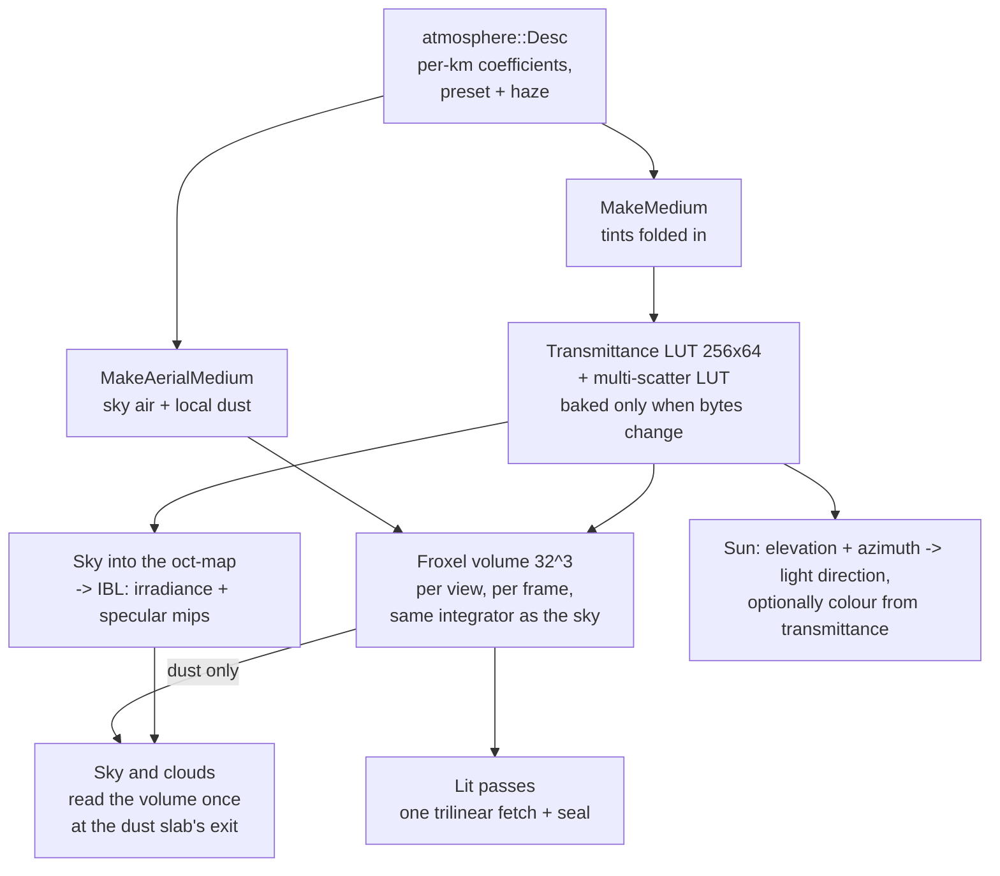

# Atmosphere

The sky in Ceili is a physical model of a planet's air, authored in real units.
The same medium that colours the sky also hazes the distant world and tints the
sun, and all three are integrated by one function, so they cannot disagree about
what the air is made of.

This page covers the model, the lookup tables that make it cheap, the froxel
volume that carries it onto geometry, the local dust layer that the volume
marches and the sky looks through, the sun and its light units, and the horizon
seal that dissolves a play area into the sky.

The atmosphere is one of four environment sources a scene can pick, and it is the
default:

```cpp
// Include/Env/Env.h
enum class Source : uint8_t
{
    None = 0,   // no sky, no IBL prepass -- user lights only
    Atmosphere, // procedural atmospheric scattering sky (the default)
    Gradient,   // procedural gradient sky
    Hdri,       // prebaked HDRI environment, referenced by hdriName
```

The list continues with `Cubemap`, which bakes a six-face legacy skybox into the
same octahedral map the others produce, so every source feeds the same
image-based lighting chain downstream.

---

## The model, in kilometres

The scattering model is Hillaire's, and every coefficient is a published
physical value per kilometre. The header says why the units can be real ones:

```cpp
// Include/Env/Atmosphere.h
// The units are free to be real ones because the atmosphere renders into an
// oct-map from a synthetic observer - nothing in the world couples to
// planetRadius, so it costs nothing to make these numbers checkable.
//
// Three properties of this parameterisation are load-bearing, not stylistic:
```

- **Scattering is separate from extinction.** The multiple-scattering transfer
  factor is a ratio of the two, so a model with one coefficient serving as both
  cannot express it at all.
- **Mie authors absorption, and extinction is derived.** Extinction is scatter
  plus absorb, so extinction is at least scattering for any authored value. That
  is the invariant the multiple-scattering series needs: a single-scatter albedo
  above one makes it diverge, and authoring extinction directly would put that
  divergence one slider drag away.
- **Ozone absorbs without scattering.** No combination of Rayleigh and Mie
  reproduces it, and it is the whole reason dusk and the blue hour work.

Real units make the defaults checkable against a textbook, and they make a
preset a statement of fact, as Mars shows:

```cpp
// Src/Env/Atmosphere.cpp
// Real Mars.  A CO2 atmosphere at about one percent of Earth's density scatters
// almost no blue, so the sky's colour comes from suspended DUST - which is Mie, not
// Rayleigh, and is exactly what mieTint is for.  Lower gravity gives it a taller
// scale height than Earth's despite the thinner air, and there is no ozone layer.
// sunIlluminance is a fact rather than a mood: Mars receives 43 percent of Earth's
// insolation, so 0.43 x 128000 lux.
```

Every field carries a description written for two readers at once. The property
grid shows it as a tooltip, and the [AI agent](../Tools/AiIntegration.md) reads the same
string from its generated API catalogue, so "push it up for haze" is written once
and serves both.

### Presets and haze

A preset stamps a named set of values into the fields and then leaves them free
to tune: Earth clear, overcast and sunset, Mars, an alien sky, and a `Classic`
preset tuned to reproduce the ported legacy content's painted dome. Two more,
`Sunrise` and `Midday`, also drive the scene's sun to their hour.

Haze is a second axis that scales the stamped preset's aerosol, so Mars under
snow is still Mars, whiter and dimmer:

```cpp
// Src/Env/Atmosphere.cpp
// Haze modifiers indexed by (Haze - 1), skipping None -- same named-function form as the preset
// table, same reason.  Each entry SCALES the resolved preset's aerosol rather than replacing it,
// so every preset keeps its identity under every haze (Mars under Snow is still Mars, whiter and
// dimmer), and the model's invariants survive by construction: scales are non-negative, so
// authored absorption stays non-negative and extinction >= scattering holds.  The tint is a LERP
// toward a haze colour rather than a multiply, because a multiply could only darken channels --
// Snow could never neutralise Classic's sand toward white.  The stamped scatter and absorb are
// clamped to the Desc's authored ranges (0.2 / 0.05) so a dense preset under a heavy haze stays
// grid-representable; phase is clamped to its 0.99 cap.
```

The haze values are `None`, `Overcast`, `Bright`, `Sunny`, `Raining`, `Snow` and
`Storm`. The selection lives on the scene's weather row as
`weather::Desc::haze`, and a weather preset stamps it, so a snow weather also
whitens the sky. Restamping always starts from
the table, so flipping hazes never compounds. The [Weather](Weather.md) page
covers the rest of that row.

---

## Two lookup tables, baked only when the air changes

Integrating scattering along every view ray every frame is expensive. The model
avoids it with two small tables that depend only on the medium.

The **transmittance table** stores, per altitude and view angle, how much of each
colour channel survives from a point out to the top of the atmosphere. It is 256
by 64 at RGBA16F, 128 KB, and wide in the angle axis because the air mass changes
fastest near the horizon.

The **multiple-scattering table** stores the light that has bounced more than
once. Hillaire's contribution is that this converges to a closed form, so higher
orders cost a lookup rather than a loop.

The bake runs only when the medium changes, and "changes" is decided by comparing
the medium's bytes:

```cpp
// Render/Atmosphere.cpp
const env::atmosphere::Desc& desc   = env::atmosphere::GetDesc(hScene);
const Medium                 medium = env::atmosphere::MakeMedium(desc);
if (!m_LutFilled || !m_MultiScatterFilled || heap::MemCmp(&medium, &m_LastMedium, sizeof(Medium)) != 0)
{
    const bool transmittance_ok = bakeTransmittanceLut(medium);
    const bool multi_scatter_ok = transmittance_ok && bakeMultiScatterLut(medium, m_hMultiScatterRt);
```

Sliding a field in the property grid rebakes both tables. Moving the camera does
not, and neither does moving the sun: the tables are indexed by sun angle, so the
sun is no part of what they are baked from. A pair of counters records bakes and
skips, because "a medium change rebakes and a sun move does not" is invisible to
every check that only looks at the picture.

The sky itself is a different matter. It is rendered into an octahedral map that
the IBL chain then convolves into irradiance and seven specular mips, and that
does re-run when the sun moves, since the sky's appearance depends on where the
sun is. That is why the sky's ray-march sample count defaults high: it runs on an
edit or a sun move, never per frame.

### One parameterisation, one file

The bake writes a texel per altitude and angle, and the sky shader reads back at
an arbitrary altitude and angle, so the two mappings must agree. A mismatch fails
silently and reads as a tuning problem rather than a bug, which is why the mapping
exists once:

```hlsl
// Resources/Shaders/atmosphereLut.hlsli
// The bake writes a texel per (radius, mu) and the sky shader reads back at an
// arbitrary (radius, mu), so the two mappings MUST agree. A mismatch is silent:
// nothing errors, the sky merely looks wrong in a way that reads as a tuning
// problem rather than a bug. That is why this lives here and not twice.
```

The table stores zero for a ray that meets the ground, and the choice of stored
quantity is what makes that safe. Because it stores transmittance, a reader
combines two readings by multiplying them, and zero is exactly representable. A
table of optical depth would be combined by subtraction, which needs a finite
sentinel for a blocked ray, and two blocked directions would give infinity minus
infinity: a NaN that the IBL prepass samples and that resets the GPU driver.
Multiplying rules that failure out by construction rather than by a careful
choice of constant.

---

## Aerial perspective: the air in front of the world

Distant geometry takes on the sky's colour and loses contrast, which is most of
what makes a large outdoor scene read as large. Ceili carries the atmosphere onto
geometry through a froxel volume: a 32 by 32 by 32 grid laid over the camera
frustum, where each cell stores what the air between the eye and that cell does
to whatever sits behind it.

```hlsl
// Resources/Shaders/atmosphereFroxel.comp
// One thread per froxel. Each marches the segment from the EYE to its own depth and stores what
// that column of air did to whatever sits behind it: rgb is the light scattered INTO the view
// along the way, a is the transmittance that survives it. Forward shading then needs one
// trilinear fetch per pixel to fog a surface correctly, which is the whole reason the volume
// exists rather than a screen-space march: the cost is the volume's own size, not the pixel
// count, so it does not multiply with a VR headset's two eyes.
```

A lit surface then applies aerial perspective with one trilinear texture fetch.
The volume is 256 KB and its cost is its own size, fixed, however many pixels the
view has.

**The froxel and the sky call the same integrator.** The march lives in the shared
LUT file, not in the compute shader, so the fog on a distant hill and the sky above
it integrate one medium through one function:

```hlsl
// Resources/Shaders/atmosphereFroxel.comp
// The march itself is NOT here - it is AtmosphereIntegrateSegment in atmosphereLut.hlsli, the
// same function the sky calls. That is what C2.2 hoisted it for: the fog on a distant hill and
// the sky above it integrate one medium through one integrator, so they cannot disagree.
```

### Slices, squared

The 32 depth slices are not spaced evenly. Aerial perspective changes fastest over
the first few hundred metres and barely at all past ten kilometres, so the slice
depth grows with the square of its index:

```hlsl
// Resources/Shaders/aerialPerspective.hlsli
float AtmosphereFroxelSliceDistance(uint Slice, uint NumSlices, float MaxDistance)
{
    const float unit = (float(Slice) + 1.0f) / float(NumSlices);
    return MaxDistance * unit * unit;
}
```

The build walks slice index to distance and the read walks distance back to a
slice coordinate. Both directions live in one file, because a write and a read
that must agree belong in one place. The volume reaches 32 km.

Unlike the tables, the volume is rebuilt every frame for every view. The tables
depend only on the air; every froxel is a ray through the camera, so the volume is
stale the moment the camera moves.

<!-- MEDIA: a ported outdoor scene with the froxel haze on and off, side by
     side, from a low camera looking across the terrain toward the horizon. The
     "large reads as large" point needs the comparison. -->

---

## Local dust: air only the ground sees

A dust bowl, a sandstorm, smoke over a town: these are scene-scale layers, not
planetary air. The sky tables are planet-wide, indexed by altitude and sun angle,
and have nowhere to put a local layer. The froxel volume marches real scene
distances and does. So the dust layer is authored on the atmosphere and marched
only by the volume:

```cpp
// Include/Env/Atmosphere.h
// - The LOCAL DUST LAYER: aerosol that ONLY the aerial-perspective volume marches, and the sky
//   deliberately does not.  A dust bowl, a sandstorm, smoke over a city: a scene-scale layer,
//   not planetary air.  It belongs to the froxel volume, which marches real scene distances,
//   rather than to the sky LUT, which is a planet-wide table indexed by radius and sun angle
//   and has nowhere to put a local layer at all.  MakeAerialMedium (Src/Env/EnvInternal.h)
//   folds these into the volume's copy of the medium; MakeMedium never sees them.
```

Zero means off. With no dust, the volume marches exactly the sky's own air.

A ported level derives its dust from its legacy fog. That dust is a dial toward
the legacy look, and it reads wrong under physical light, so under the Standard
look a ported level shows with no dust (`env::atmosphere::ShownAir`). The row
keeps the dust for the Classic look. A native scene's authored dust shows under
both looks.

**Dust absorption is tinted separately from dust scattering**, and that split is
what makes the layer work at all. When scattering and extinction share one tint,
the tint warms what is scattered and cools what survives by the same factor, and
where the air is thick the two cancel. Measured on the ported DirtBox scene, taking
the shared aerosol tint all the way to orange moved the horizon hue by less than a
tenth of a level. A term that absorbs blue without scattering breaks the symmetry,
which is also what real airborne dust does: it eats blue on the way in and leaves
what it scatters warm.

**Dense dust needs its own multiple-scattering table.** The multiple-scattering
factor carries the albedo of the air it was baked from. DirtBox's dust scatters
about 130 times more than the sky's aerosol, and pairing the sky's table with the
dust's coefficient asked a thin aerosol's factor to describe a dense layer. With
the term forced off, multiple scattering turned out to be 82 percent of the haze,
so the mismatch owned most of it. The volume bakes a second table from the dust
medium, and only when a scene has dust:

```cpp
// Render/Atmosphere.cpp
// NO DUST MEANS NO SECOND BAKE. MakeAerialMedium returns the sky's medium byte for byte when
// a scene authors none (Atmosphere_MakeAerialMedium_NoDustIsTheSkysOwnAir pins exactly
// that), so the compare below leaves every existing scene on the sky's table, bit-identical
// and at the cost of one MemCmp.
```

The dust also has its own phase function. The sky's aerosol draws the sun, since
there is no separate sun disc and the sun is the forward lobe of the Mie phase, so
it wants a tight lobe. A ported scene's dust stands in for a legacy fog that was
unlit and flat, so it wants a broad one. Sharing one value made a defined sun and
a flat haze mutually exclusive. The sky's `miePhaseG` defaults to 0.99, the top
of its range, for a tight bright sun. The dust's `dustPhaseG` defaults to 0.7.

### The sky looks through the dust

The sky's tables hold no dust, and the procedural sky does not march the volume,
because its bake owns its own air. On its own, that leaves the ground hazed
orange under a clear blue sky: at RedMines' skyline the blue channel read 132
above the line against 69 below (measured 2026-10-26). So the sky and the clouds
read the volume once, at the dust slab's exit:

```cpp
// Src/Env/EnvInternal.h
// THE DUST SLAB'S HEIGHT in world units, for a sky feature that looks THROUGH the dust: the procedural sky and the
// clouds. Their own air is baked or modelled apart from the volume, and the dust is not in it, so without this the
// ground hazes through the dust while the sky behind it stays clear - a seam at the skyline (RedMines under Standard,
// measured 2026-10-26: blue 132 above the line against 69 below). The shader divides this by the ray's elevation, the
// slab-exit path of an exponential layer, and reads the volume there. That volume also holds the sky's own Rayleigh,
// which the sky then counts twice over the dust's short path: about 3 percent at the zenith, and nothing at the
// horizon, where the dust hides what is behind it. Every pass that dissolves into the sky at the horizon seal reads it
// too (the aerialDustHeight slot, aerialPerspective.hlsli AerialSealAir), so the world past its edge becomes the sky seen
// through the dust, which carries on past the edge, rather than the raw sky. 0 with no dust layer, so such a scene is unchanged.
inline float DustSlabHeight(const Desc& Desc)
{
    if (!HasDustLayer(Desc))
    {
        return 0.0f;
    }
    return Desc.dustHeight / AerialUnitsToKm(Desc.worldUnitsPerKm);
}
```

The seam gate measures the worst colour channel over the brighter of the pair:
43.9 percent apart with the sky blind to the dust, 4.2 percent with it, on both
backends.

**The dust carries on past the world's edge**, as the legacy fog it stands in
for did. Cut at the edge, the sky depended on where the camera stood. With the
camera 200 units inside the edge, the sky on that side looked through almost no
dust and read blue beside an orange sky on the other side, 52.2 percent apart.
Carried on, the two sides measure 0.0 apart on both backends
(`aerial_dust_seal_sides_smoke`, 2026-10-26).

**The sky and every cloud take their whole dust term from one path**,
`AerialDustPath` in `aerialPerspective.hlsli`: the dust's equivalent path, which
is continuous in the direction. A blend of two reads, one folded by the horizon
seal and one not, had weights that did not sum to one where the slab exit crossed
the world's edge, and it drew a darker ring around the zenith, 3.5 percent deep.
The one path measures 0.00 (2026-10-26).

**The air is extended from one read near the eye.** The volume is a homogeneous
slab at the eye's altitude, so along one ray the transmittance over any length is
exact from a single read: T(L) = T0^(L / L0). The read sits at a slice centre
about 500 units out, near enough to be inside any play area, and its own seal
factor is divided back out for an eye that stands inside the seal. A read at the
edge took in a neighbour slice that the seal had already part-folded, by an amount
that differs per froxel column, and the sky came out in vertical stripes.

A far cloud then converges on the sky beside it, at the horizon most of all. Over
the volume's full distance, a cloud took the eye's dust density all the way up to
its layer and was hazed out.

---

## The sun

The sun is authored as a time of day, and a scene system drives the first
directional light from it. One elevation moves the sun round its daily circle: 0
is sunrise, 0.5 is noon, 1 is sunset, and past either end the sun is under the
horizon, with 1.5 (or -0.5) at midnight. Named hours snap the elevation:

```cpp
// Include/Env/Sun.h
enum class TimeOfDay : uint8_t
{
    SunRise = 0, // sunrise, east  (elevation 0.0)
    Time4am,     // early morning  (0.1)
    Time8am,     // mid-morning    (0.25)
    Midday,      // overhead       (0.5)
    Time4pm,     // afternoon      (0.75)
    Time8pm,     // evening        (0.9)
    SunSet,      // sunset, west   (1.0)
    // The night (D7), appended so every stored value keeps its meaning.  The sun is below the horizon at each.
    Dusk,     // after sunset, west and below (1.1)
    Midnight, // straight below           (1.5, the same direction as -0.5)
    PreDawn,  // before sunrise, east and below (-0.1)
};
```

A second field, `sunAzimuth`, turns the whole circle about the vertical. It is the
compass bearing of the noon sun, on the same compass the moon uses, and the
default of 180 puts noon in the south, with sunrise in the east:

```cpp
// Include/Env/Sun.h
// The sun::Desc::sunAzimuth that leaves the daily circle where it always was: noon in the south.
constexpr float kDefaultSunAzimuth = 180.0f;

//-----------------------------------------------------------------------------
// Functions
//-----------------------------------------------------------------------------
// The unit FROM-LIGHT forward for an elevation on the daily circle -- at the default azimuth the point
// {cos(e*pi), -sin(e*pi), 0.5} normalised (constant length), and the whole circle turned about the vertical for any
// other (sun::Desc::sunAzimuth).  [0,1] is the day; outside it the forward points UP, a sun below the horizon.
// Authored onto a light as Transform.rotation = QuatFromForwardVector(DirectionFromElevation(elevation, azimuth)).
CE_API math::Point3 DirectionFromElevation(const float Elevation, const float AzimuthDegrees);
```

Rotating the light with the gizmo writes back to the elevation through the same
azimuth, so the two views of the sun stay in step. An azimuth edit drives the
light as an elevation edit does.

By night the key light follows the moon. While the sun is under the horizon and
the moon is above it, the scene's key directional light takes the moon's
direction (`sun::KeyBodyFor`), which the moon's own altitude and azimuth set. The
sky also carries a faint glow of its own (airglow and starlight), so a moonless
sky is never black, and a procedural field of about 9,000 stars that is drawn and
lights nothing.

The light's colour can come from the sky instead of from the author. With
`Radiometry::Atmosphere`, the sun's colour is its brightness times the
transmittance table's value at the current elevation, so noon is a strong warm
white, sunset a dim red, and a storm that dims the sky's sun dims the light too.
The default is `Authored`, and there is a measured reason: a preset tuned to match
how a painted legacy sky *looks* extinguishes the key light far more than the
legacy game ever did, because legacy lit its ground with an authored sun and no
atmospheric extinction at all. For ported content, the coupled light's own
colour and the share of the sky's extinction it takes live with the ported-scene
settings (`env::LegacyMatch::keyLightTint`, and the Classic look's
`sunExtinction`).

### Light in real units

Every sky light is authored at the top of the atmosphere, in real units: the
sun's `sunIlluminance` in lux (Earth's 128,000), the moon's `moonIlluminance` in
lux (0.32 for a real full moon), the night sky's glow in cd/m^2, and the stars as
the illuminance of a magnitude-0 star. The engine applies the air's transmittance
itself, so a full moon's 0.32 lux reaches the ground as about 0.25.

Noon to a moonless night spans about 28 stops, far more than a 16-bit HDR target
holds. So each view stores the physical light times its own pre-exposure P, which
follows the view's meter, and a moonlit exterior and a sun-calibrated torch
interior both fit. A sunlit, mid-albedo frame meters about 5,760 cd/m^2 (EV100
15.5). The [Lighting](Lighting.md) page covers how a light row meets P.

The sky bakes its maps in a unit of its own, picked so the brightest light of the
moment sits near the day's level:

```cpp
// Src/Render/Atmosphere.cpp
// THE BAKE'S UNIT: the maps hold the relative light times this, picked so the brightest light of
// the moment lands near the day's level, where the 16-bit maps hold it with room both ways. The sun's share of the
// day is 1 while it is up, and below the horizon falls about 1.3 stops a degree from a sixteenth: an upper estimate of
// the twilight sky, so the bake never overflows. The moon's and the airglow's shares are their night units times
// kFullMoonToSun, and the floor is a dark night sky's, so an empty sky keeps a finite unit. An authored ambient HDRI
// keeps its own unit: its irradiance is copied into this one (env::ibl::UpdateScaledIrradiance), so the sky never
// bakes out of its range for it (plan phase A2b3).
static float BakeSkyUnit(const math::Point3& SunForward, const env::atmosphere::NightSky& Night)
{
    const float sun_altitude = math::RadiansToDegrees(asinf(math::Clamp(-SunForward.y, -1.0f, 1.0f)));
    const float sun_share    = env::sun::TwilightSkyShare(sun_altitude);
    const float night_share  = core::Max(env::atmosphere::MoonSkyScatter(Night), Night.airglow) * env::sun::kFullMoonToSun;
    const float floor_share  = env::sun::kFullMoonToSun * env::sun::kNightSkyToMoon;
    return 1.0f / core::Max(core::Max(sun_share, night_share), floor_share);
}
```

A change of unit rebakes the sky, as a sun move does. The copy of an authored
ambient HDRI is a pass of its own, `RenderAmbientIrradiance`, in the band after
every sky source. It draws nothing while the two units agree.

---

## The horizon seal

A play area has an edge, and the world must dissolve into the sky before that
edge shows, whatever the weather. That is a gameplay fade rather than a scattering
term, and it is authored in world units rather than kilometres, so retuning the
air or flipping a preset can never move the play boundary.

Two seals compose, and either one saturating dissolves the pixel:

- **The camera seal** fades by distance from the camera. It is simple and it has
  one flaw: as the player walks toward the boundary, the outside world comes back.
- **The world seal** fades by horizontal distance from a fixed point, an infinite
  vertical cylinder. A pixel beyond its outer radius is sky from anywhere the
  player can stand, and inside its inner radius the world term is exactly zero.
  The legacy importer derives it from the ported game's arena radii.

The seal also caps the [shadow cascades](Shadows.md): there is no point resolving
shadows on geometry the seal has already turned into sky, so the last cascade stops
at the seal where that is nearer than its authored reach.

### The seal folds the volume to zero

The seal is folded into the froxel volume itself. Past the seal a froxel holds no
in-scatter and no transmittance, so a surface shaded through it contributes
nothing. The passes that write a surface's base value then restore the sky per
pixel, from the sky's octahedral map, so the sun behind a sealed ridge stays crisp.
Under a dust layer that restore is the sky seen through the dust
(`AerialSealTarget`), so the world past the edge dissolves into the same hazed sky
that sits beside it. On `aerial_dust_seal_smoke` the band at the seal measures 9.8
percent against 60.1 for a restore to the raw sky (2026-10-26).

Some passes read the volume for something in the air near the eye, and they must
not go dark at the seal: rain, snow, the storm's dust, the lightning bolt, and the
sea, which dissolves itself into the sky. These divide the fold back out:

```hlsl
// Resources/Shaders/aerialPerspective.hlsli
// THE SEAL'S FOLD UNDONE, for a pass that reads the volume and must not go dark at the seal: weather in the air near the
// eye (rain, snow, the storm's dust), the lightning, and the sea, which then dissolves itself into the raw sky. The
// fold scales both channels by keep = 1 - Seal, so dividing keep back out is exact while any is left. Under the last
// twentieth of keep the division is not trusted and the air fades to none, the neutral, so it never divides by nothing.
// Read through the fold, the storm's dust and every drop took the scene's light away and gave none back: a black band in
// a Blizzard past DirtBox's seal (measured 2026-10-25).
float4 AerialUnfoldSeal(float4 Ap, float Seal)
{
    const float keep = 1.0f - Seal;
    if (keep >= 0.05f)
    {
        return Ap / keep;
    }
    return lerp(float4(0.0f, 0.0f, 0.0f, 1.0f), Ap / 0.05f, keep / 0.05f);
}
```

The storm's dust takes the air only up to where the seal begins
(`AerialSealOnset`).

A cloud is part of the sky, so it reads none of the volume where the volume holds
more than the sky's air. The cloud layer, its puffs and its march take the sky's
own air at the eye (`env::atmosphere::SkyAirAtEye`) and fade into the raw sky
behind them over that air's equivalent path (`AerialSkyAir`), and the local dust
then applies last, over the dust's one path (`AerialDustPath`). Sealed geometry, a far cloud
and the sky's own horizon land on one value. On DirtBox under Standard the
horizon band measured within one level of the sky beside it, against 15 levels
when the clouds read the volume with its fold divided out (2026-10-25).

---

## The whole path



Everything above the froxel is keyed by scene, because the edited scene, the
material preview and each thumbnail render a sky in the same frame, and Play mode
overlaps them. When the sky's output was process-global, a thumbnail's sky once
reached the main camera.

---

## What the atmosphere does not do

- **The medium has no clouds of its own.** The atmosphere is a clear or hazy
  shell, and the source is candid about it: the overcast preset is "honestly the
  hazy white sky rather than the gloom", because what makes a real overcast day
  gloomy is cloud blocking the sun. Clouds are scene entities, covered on the
  [weather](Weather.md) page: each cloud layer is drawn per pixel over the
  cloudless sky, and the cloud shadows on the ground read the same published
  layers, so the two drift together.
- **No volumetric shadows in the haze.** The froxel march takes the sun's
  transmittance through the air, and does not test the shadow atlas, so terrain
  does not cast light shafts through the dust.
- **One key light at a time.** The sky has a sun and a moon, and the key
  directional light follows one of them (`sun::KeyBodyFor`). The stars light
  nothing.
- **A moving sun is not free.** The tables stay put, but the sky's octahedral
  map and its IBL convolution re-render every frame the sun moves, and again when
  the bake's unit changes. A continuous time-of-day sweep is correct and is not
  the case that path was designed around.
- **The sky counts some air twice under dust.** The volume it reads at the dust
  slab's exit also holds the sky's own Rayleigh, so over the dust's short path the
  sky counts it twice: about 3 percent at the zenith, and nothing at the horizon.
- **The volume is fixed at 32 slices over 32 km.** Both numbers are defines shared
  between C++ and HLSL rather than settings, because the lit passes' constant
  blocks have almost no room left under Vulkan's push-constant cap.

Next: [Weather](Weather.md) for the clouds, rain and sea that sit on this sky,
[Lighting](Lighting.md) for the ambient pass that applies the haze to the
G-buffer, [Shadows](Shadows.md) for the cascades the seal caps, or
[Post-Processing](PostProcessing.md) for the exposure and tonemapping downstream.
Back to the [documentation index](../README.md).
