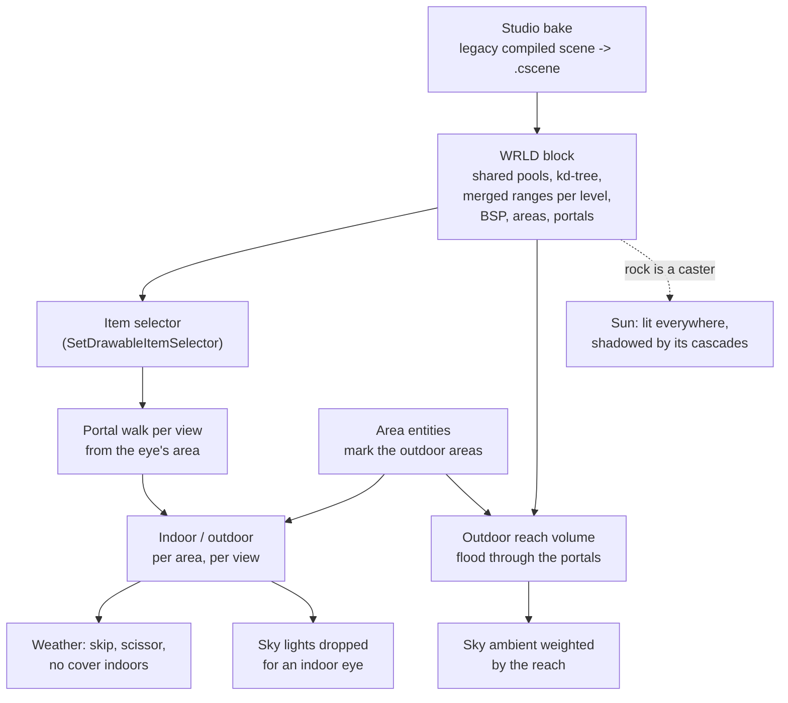

# Compiled Worlds: BSP, Areas and Portals

The ported levels arrive as compiled scenes. Their static geometry, its kd-tree,
its BSP, and its areas and portals are baked into one block that the runtime casts
in place. That block answers two questions for the rest of the engine: what a
view can see, and whether a point or a view is indoors or outdoors.

The second answer has wide effects. It decides how much of the
sky's light enters a tunnel, whether the lightning flash lights a room, and
whether the sky, clouds and rain draw at all. The sun is the exception: its light
indoors is decided by its shadows, and this page explains why.

This page covers the block, the shared pools and the hierarchical draws through
their index buffers, the detail levels for every kind of view, how the world
joins the cull, the portal walk, the indoor and outdoor classification, and what
that classification decides. It is part of
the [Rendering](README.md) set.



---

## A level as one block

A compiled scene is one file that the runtime loads with one read:

```cpp
// App/Include/CompiledScene.h
// One file a runtime loads with ONE read and no text parsing: a header, a section table, and sections that each
// owning package defines and reads.  The container knows nothing about what a section holds.
//
//   ENTS  the entities (serialize::scene::entityBlock), flattened: every live entity of the baked scene, the ones
//         its base scenes contributed included, so the runtime needs no base scene and no JSON.
//   WRLD  the static world (graphics::world)
//   CAMS  named camera poses
//   MNFT  reserved, and NOT written by any bake.  The device data sync reads AstcBakeApp's `<scene>.files` beside the
//         ASTC cache instead: turning a resource name into the file a device needs takes the search paths and the
```

The bake runs in Studio, on the PC. It reads a ported legacy level and writes
the container. The runtime on any device reads it back with no text parsing.

The `WRLD` section holds the static world: its vertex and index pools, its
kd-tree, its detail levels, its BSP, and its areas and portals. The next two
sections cover how the pools and the tree make the draws cheap.

Beside the kd-tree sits the legacy BSP, which answers one question: which area
holds a point.

```cpp
// Include/World/WorldFormat.h
// Child encoding, BSP (the legacy one): > 0 is a node, < 0 is the area -1-v, 0 is solid.
struct BspNode
{
    float   plane[4];
    int32_t front;
    int32_t back;
    int32_t pad[2];
};
```

`world::FindArea` descends it and returns the area, or -1 when the point is in
solid rock or outside the world. A world with no BSP and one area answers 0. The
BSP is not drawn and is not used for the cull; it is how the engine places the
eye, an Area entity, or a voxel of the reach volume in an area.

---

## One vertex buffer, hierarchical draws through the index buffer

A compiled world's geometry lives in a few shared **pools**: one vertex buffer and
one index buffer each, for each vertex layout. Indices are 16-bit, which halves
the index bandwidth on a tile-based GPU, so a pool holds at most 65,536 vertices:
DirtBox's 132,784 vertices take three pools. Nothing in the world owns a vertex
buffer of its own. Every draw is a range of a pool's index buffer.

The bake writes those indices in an order chosen for the cull:

```cpp
// Include/World/WorldFormat.h
// THE DRAW EARLY-OUT IS WHY THE LAYOUT LOOKS THIS WAY.  kd nodes and leaves are numbered depth-first, front child
// first, so every subtree owns a contiguous run of leaves.  Drawables are sorted by (area, opaque first, material,
// leaf) and their indices are written in that order, so for each (material, pool) the drawables of any subtree are a
// contiguous run of indices.  Each node therefore holds ONE merged range per (material, pool): a node fully inside a
// view draws its whole subtree with one draw per material.  That is the legacy engine's CDrawVisibility_World,
// measured, not guessed: see the prompt doc.
```

So the tree holds two kinds of draw over the same bytes:

```cpp
// Include/World/WorldFormat.h
// A subtree's merged draw for one (material, pool): every drawable of that pair under the node, as one run.
struct NodeRange
{
    uint32_t material;
    uint32_t pool;
    uint32_t firstIndex;
    uint32_t numIndices;
};

// A reduced level's run of one drawable or one node range, in its pool's index blob.
struct IndexRun
{
    uint32_t firstIndex;
    uint32_t numIndices;
};
```

A `Drawable` is one legacy surface: one material on one kd leaf, with its own
range. A `NodeRange` is a whole subtree's drawables of one material, as one
range. The cull walks the kd-tree from each area's root. A node wholly inside the
view draws its merged ranges and stops; a node across the frustum's edge recurses;
a leaf tests its drawables' boxes. A view that sees the whole world draws one item
per material, and the triangles are the same either way, so `CullMode::Flat` is
the control in every A/B of the merged ranges. With [draw runs](Xr.md#draw-runs),
touching ranges of one material also join into one draw after the cull.

The world publishes all of these as items of one key:

```cpp
// Include/World/World.h
// Which of a world's draw items a view draws.  A world publishes its items on ONE key, in two runs:
//
//   items [0, drawables)                     one per Drawable: a material on a kd leaf
//   items [drawables, drawables + ranges)    one per NodeRange: a node's whole subtree, one material, merged
//
// and then the same two runs again for each reduced detail level (WorldFormat.h): level k's copy of item i is item
// i + k * (drawables + ranges).  A level draws the same items with fewer triangles, so it is picked per VIEW, never per
// item: the selector walks the tree once and offsets what it chose.
```

---

## Detail levels: more runs in the same pools

Level of detail extends the same idea. A coarser level is one more index list
into the same pools, with no second mesh and no second vertex buffer:

```cpp
// Include/World/WorldFormat.h
// DETAIL LEVELS (version 2).  Level 0 is the full world.  Each coarser level is a REDUCED INDEX LIST into the SAME
// vertex pools, written after level 0 in each pool's index blob and in the same drawable order, so a subtree's reduced
// indices are one contiguous run too and every node range has one reduced range per level.  The bake reduces each
// drawable on its own with its outline locked, so neighbouring leaves still meet exactly at every level.  Only the
// views that are not looked at directly draw them (the ocean reflection and the shadow cascades, World.h).
```

Because each level is written in the drawable order of level 0, a subtree's
reduced indices are one contiguous run too, and every `NodeRange` has an
`IndexRun` per level. The hierarchical draw therefore works unchanged at any
level: the selector walks the tree once, chooses its items, and offsets them to
the view's level. Level k's copy of item i is item i + k x (drawables + ranges).

### The levels for views nobody looks at directly

Version 2 of the block carries two reduced levels for the views that are not the
player's eyes:

- **The shadow cascades** step one level coarser each, from full detail in
  cascade 0 up to `strategy.worldLodShadow`. One level for every cascade let a
  coarse caster stand above the full-detail ground and shadow it in dark diamonds
  near the camera; stepped, cascade 0 keeps full detail where the eye can see the
  contact.
- **The ocean's planar reflection** and **its view under the sea** draw at one
  level of their own (`worldLodReflection`, `worldLodRefraction`).

The bake reduces each drawable on its own with meshoptimizer, at an absolute error
of 0.25 m for level 1 and 1.0 m for level 2. Seams and borders are free, so a
level can crack between neighbours. That is acceptable where no one looks
directly, and it is what lets the reduction go far: TheOldGods keeps 44.0% and
17.7% of its 218,660 triangles at levels 1 and 2, where locking the borders
stopped at 68.6% and 56.4%.

On a Quest 2, TheOldGods (2026-10-17): the reflection at level 2 every frame took
`Frame.Gpu` down 0.90 ms, from 520k to 345k triangles a frame, and its pass from
2.25 to 1.30 ms. The stepped cascades, every cascade re-baked each frame, took the
shadow bake from 1.03 to 0.50 ms and 275k to 71k shadow triangles. The desktop
default is full detail for all three; the Quest's device profile draws all three
at level 2.

### The levels for the eyes

The camera and both eyes need levels with no crack, because they look at every
seam. Version 3 adds a second set:

```cpp
// Include/World/WorldFormat.h
// THE MAIN VIEW'S LEVELS (version 3), beside level 0 and apart from the levels above: one reduced list per kd node range
// (one material of a node's whole subtree, simplified as one mesh) and per drawable, each with its OUTLINE LOCKED and its
// texture and normal seams kept.  Any mix of them meets exactly, because two neighbours' shared edge is part of both
// outlines, so the camera picks a level per node by distance with no crack.  A node wider than a level's distance band
// never uses that level and does not store it (its run is {0, 0}); a level that did not reduce points at the finer run.
constexpr uint32_t kMaxNodeLods = 4;
```

These are simplified per **node**, with each node's whole subtree as one mesh, and
per drawable, with the outline locked and the texture and normal seams kept. Two
neighbours share an edge that is part of both outlines, so any mix of levels meets
exactly. A per-drawable list alone stops reducing early, because a small kd leaf is
mostly outline; a node's subtree only locks the node's outline. The bake's error
bounds are 0.05, 0.2 and 0.8 m, and a node wider than a level's distance band
never uses that level, so the bake does not store it.

The pick uses each node's projected error:

```cpp
// Include/World/World.h
// THE MAIN VIEW'S PICK (the camera and both eyes, strategy.worldLodMainView): a world that stores main-view levels
// (WorldFormat.h) draws each node at the coarsest level whose projected error, bound x pixelScale / distance, stays under
// pixels.  pixelScale is the view's projection [5] x half its height in pixels.
struct LodPick
{
    math::Vec4 eye{};
    float      pixelScale{0.0f};
    float      pixels{1.0f};
```

A node whose nearest and farthest points ask for the same level draws its runs
whole and stops. A node that spans two levels walks on into its children, and a
leaf's drawables take the level of their nearest point. The hierarchical draw
survives the pick: most of the world still draws as merged node ranges, each at
its own level.

The cost is index memory, since every level is more indices: the main-view lists
add 7.6 to 13.6 MB to a world, and TheOldGods' compiled scene goes from 16.5 to
30.9 MB. The measured gain on the Quest and the full grid of level settings are on
[XR and Quest](Xr.md#geometry-lod-the-compiled-world). The main-view levels are
off by default and on in the Quest's device profile.

---

## How a compiled world joins the cull

Visibility runs in two stages. In the broad phase, the scene's `IVisibility`
providers put keys in each view's visible set, and the compiled world's key is one
of them. In the narrow phase, a drawable key whose producer chooses its own items
picks which of them draw:

```cpp
// Src/Draw.h
// A multi-item key whose PRODUCER chooses, per view, which of its items draw - instead of each item being tested on
// its own box.  The compiled world is the reason: its key carries per-surface items AND merged per-node ranges over
// the same triangles, so a box test per item would draw both.  Its selector runs the legacy kd early-out
// (graphics::world::SelectItems) and returns item indices.
//
// BOTH gathers call it - the narrow phase (CommitVisibleSet) and the full scan (Pass1FullScan) - for the reason they
// share DrawableInFrustum: a rule one of them applies alone draws two different images of one scene.  The selector
// must be pure over data that outlives the scene's draws (it runs on the cull and gather threads), and pContext must
// stay valid until the key is cleared (Selector null) or the scene is destroyed.  Same thread rules as
// SetDrawableItemCount.
```

The world registers `SelectWorldItems` for its key, and the cull calls it with
the frustum and a `SelectorView` that names the view, its portal eye and its
detail level. Keeping the stages apart keeps a per-item cost out of the broad
phase, where every frustum of the frame is culled in one pass. Every other surface in the scene goes through the ordinary spatial
index and box test beside it. The [Render Passes & Visibility](RenderPasses.md#visibility-backends)
page covers both.

---

## Areas and portals: visibility walked every frame

A compiled world is divided into areas joined by portals: a doorway, a tunnel
mouth, a shaft. A view that knows where its eye is draws only the areas it can
see through them:

```cpp
// Include/World/World.h
// AREAS AND PORTALS (the legacy CDefaultSpatialTechnique): a view that names its eye walks the portals from the area
// holding it, and draws only the areas it sees, each through the frustum narrowed to the portals it is seen through.
// A view with no eye (a shadow cascade, a reflection, the overhead map), an eye in solid or outside the world, or
// display::DebugSettings::worldPortals off visits every area with the view's own frustum, which is the legacy rule
// for a camera outside the world and exact for a one-area world (DirtBox).  Kept off the script surface: Module.h
// does not include this header.  Assumes Module.h was already included.
```

The walk is the legacy engine's, run every frame:

```cpp
// Src/World/World.cpp
// THE PORTAL WALK (the legacy CDefaultSpatialTechnique::R_buildVis).  From the area holding the eye, breadth first:
// each portal of a reached area whose polygon survives the clip against the frustum it was reached with leads to the
// area on its far side, seen through a frustum narrowed to that polygon.  Each portal is passed once per view, which
// bounds the walk.  The visits are kept on the stack, so a walk that would pass kMaxPortalVisits gives up and every
// area is drawn with the view frustum, which is never wrong.
constexpr uint32_t kMaxPortalVisits = 64;
```

There is **no precomputed PVS**, by design. The walk answers "what does this view
see" from the actual eye. A baked area-by-area table answers a coarser question,
"what can be seen from anywhere in this area", and building one by reusing the
walk would mean sampling eye positions, which is not strictly conservative. The
walk is exact for the frame and needs nothing baked or invalidated.
Each portal is passed at most once per view, and a walk that would pass 64 visits
gives up and draws every area, which is never wrong. An eye within 0.2 units of a
portal's plane passes it with the frustum it has, because a polygon that close
clips to nothing useful.

Two views walk the portals: the camera, and a headset's right eye, each stamped
with its eye position. The walk publishes what it reached: an `AreaSet`, a 256-bit
mask of the areas the view sees, with the frame's union across views kept on the
world. Each entity row also carries the area it stands in (`areaIndex` on its
cold visibility row), so a later rule can ask whether a row's area is in view. Every other view visits every area with its own frustum.
That matters for the sun: a shadow cascade has no eye, so a caster in an area the
camera cannot see still casts its shadow. `debug.worldPortals` turns the walk off,
which is the control in an A/B of its cost.

---

## Indoor and outdoor

The portals divide space, but they do not say which side is the outside. An
**Area entity** does:

```lua
-- Resources/Entities/area.entity
-- area.entity -- an Area entity: the ambient of the area it stands in
--
-- One env::area::Desc row on a pose (Prompts/PhysicalCameraGrading.md, area ambient). On a compiled world the entity's
-- position names its area (the world's BSP), and its source lights that area and reaches the areas around it through
-- the portals. The rotation is unused; base/pose carries it so Studio's gizmo places the entity like any other.
--
-- studio/area is legacy's own name (Studio/Area), which the legacy importer's template branch spawns by name: a legacy
-- level marks its outdoor area with one, so it takes the environment's light, the Desc's default.
-------------------------------------------------------------------------------
```

An area is **outdoor** when an Area entity whose source is the environment stands
in it, and every other area is indoors. A legacy level already marks its outdoor
area this way, so the importer brings the classification across with no new
authoring. On RedMines, 1 of 33 areas is outdoor.

The classification is used in two forms. **Per item**, the world's publish stamps
`VisibilityStateFlags::Indoor` on every drawable in an indoor area, and it is the
only writer of that bit. **Per view**, the portal walk answers a question about
what the view can see:

```cpp
// Include/World/World.h
// THE INDOOR FACT (Prompts/WeatherCloudsOcean.md 8.2): an area is OUTDOOR when an Area entity whose source is the
// environment stands in it (the areas the area ambient's reach floods from), and every other area is indoors.  What a
// view's portal walk finds, from its eye:
//   known        the walk applied: the world has outdoor and indoor areas, and the eye stands in an area.  False, the
//                view is treated as it was before the fact existed: everything draws.
//   eyeOutdoor   the eye's own area is outdoor
//   seesOutdoor  an outdoor area is seen, the eye's own or one through the portals
//   rect         where on the screen, in NDC (min x, min y, max x, max y): the whole screen for an outdoor eye, else the
//                union of the clipped portal polygons the outdoor areas are seen through (a doorway); the whole screen
//                when the walk was given no view-projection
// Each weather pass decides what to do with it.  The skips are exact for a SEALED world, as legacy compiled levels are:
// a leak shows the clear colour where the sky was.
struct OutdoorView
{
    bool  known{false};
    bool  eyeOutdoor{false};
    bool  seesOutdoor{false};
    float rect[4]{-1.0f, -1.0f, 1.0f, 1.0f};
};
```

`rect` is what makes a doorway cheap. Looking out of a tunnel, the outdoors is
only the screen rectangle of the portals it shows through, and the passes that
draw the sky can confine themselves to it.

---

## What the classification decides

| Light or effect | Rule indoors | Covered on |
|---|---|---|
| The sun's direct light | No rule. The cascaded shadow maps decide, because the rock is a caster. | [Shadows](Shadows.md) |
| The sky's ambient (IBL irradiance and reflections) | Weighted by how far outdoor light travels through the portals to the point. | [Lighting](Lighting.md#the-area-ambient-outdoor-light-indoors) |
| The air's in-scatter | Weighted the same way, because the air in a tunnel is not sunlit. | [Lighting](Lighting.md#the-area-ambient-outdoor-light-indoors) |
| A light from the sky (the lightning flash) | Dropped when the view's eye stands in an indoor area. | [Lighting](Lighting.md#the-indoor-fact) |
| Snow, sand and wetness on surfaces | An indoor drawable binds no cover. | [Weather](Weather.md#indoors-on-a-compiled-level) |
| The sky, clouds, rain and the bolt | Skipped when the view sees no outdoor area; drawn only inside the doorway rectangle when it sees one through a portal. | [Weather](Weather.md#indoors-on-a-compiled-level) |

### The sun: shadowed by geometry

The sun is the scene's key directional light, and the classification does not
touch it. Its direct light is computed for every lit pixel, indoors and out, and
its cascaded shadow maps take it away where something stands between the pixel
and the sun. The rock over a tunnel is a caster like any other: the cascades are
views with no eye, so they visit every area, and the rock is in their cull
whichever area the camera stands in.

That is the physically right answer, and the reason no indoor rule is needed.
Sunlight that falls down a shaft lights the floor of the tunnel below it, as far
as the geometry lets it, and stops at the shaft's shadow edge. A rule that switched
the sun off indoors would black out that patch. The shadow keeps the patch lit,
and keeps the walls dark wherever rock stands between them and the sun.

The direct light has one limit: the cascades end at their far plane, and past it a
surface takes no shadow. The camera's own surroundings are always inside the near
cascades, so a tunnel the camera stands in is shadowed. A deep interior seen from
far outside, beyond the last cascade, would take the sun unshadowed.

### The sky's light: weighted by the path

The sky is different. Its ambient comes from the whole hemisphere through the
image-based light, and no shadow map holds it back, so without help the sky lights
a mine as brightly as a canyon: by day about 10,000 lux in the RedMines tunnel.
The area ambient fixes it with the portals. At reconcile, a flood fill carries the
path that outdoor light takes from the outdoor areas through the portals into a
two-level volume, and every pass that reads the environment's light weights it by
`exp(-path / reach)`. The reach defaults to 8 m. With it, the deep tunnel's mean
luma falls from 30 to 1 and the mouth does not change, so the interior is lit by
its torches and its far opening. The [Lighting](Lighting.md#the-area-ambient-outdoor-light-indoors)
page covers the volume, its build and its cost.

### Sky lights and the weather

A point light casts no shadow, so a light that stands for the sky (the lightning
flash) would light a tunnel's walls through the rock. It carries
`light::Flags::FromSky`, and the light gather drops it when the view's eye stands
indoors. The rule reads the camera's own area: from inside a tunnel, the flash
still shows in the outdoors seen through the mouth, through the area ambient's
flash term.

The weather uses both forms of the fact. An indoor drawable takes no snow, sand or
wetness, and a view that sees no outdoor area draws no sky, clouds, rain or bolt.
Deep in a RedMines tunnel that skip took `Frame.Gpu` from 2.069 to 1.247 ms on
D3D12 (-39.7%) and from 2.142 to 1.383 ms on Vulkan (-35.4%), on 2026-10-24. The
[Weather](Weather.md#indoors-on-a-compiled-level) page has the measurements and
the doorway scissor.

---

## Scenes with no compiled world

A scene authored in Studio has no areas and no portals. For it, the weather's
overhead depth map stands in: a point with static geometry above it is indoors.
It drives the surface cover and the falling weather, and, behind
`DebugSettings::ambientOverheadCover`, an estimate of the sky's ambient weight. It
is an approximation: a porch reads as indoors, and a shaft narrower than a map
texel reads as covered. Where both estimates apply, the lesser weight wins.

---

## What compiled worlds do not do yet

- **No PVS.** Visibility is the portal walk, recomputed every frame from the eye.
- **Lights are not culled by area.** A gate that dropped every light whose area no
  view could see was built and measured on RedMines (2026-10-28, a console
  devkit, 3840x2160): it culled 123,890 light tests by area, the frame drew the
  same one light per view in both arms, and the deferred lighting pass held at
  0.78 ms. It was taken out, because no scene in the corpus shows the effect.
- **The world must be sealed.** The weather skips are exact for a sealed world, as
  legacy compiled levels are; a leak shows the clear colour where the sky was.
- **Indoor areas have no light of their own.** An indoor area takes only what the
  reach carries in from outside, and its torches; a probe per area is planned.
- **The sun indoors ends with the last cascade.** Past it, an interior seen from
  far away takes the sun unshadowed.
- **Studio's brushes do not compile into a world.** Only ported compiled scenes
  carry areas and portals (see [Brush Editing](../Tools/BrushEditing.md)).
- **Occlusion culling is off by default.** The world can rasterize its nearest
  occluders on the CPU and skip what they hide (`strategy.worldOcclusion`). On
  open terrain (DirtBox, 2026-10-13) it hid 0.3% of the triangles for about 5 ms
  of CPU, so it waits for denser content.

Next: [Lighting](Lighting.md#the-area-ambient-outdoor-light-indoors) for the area
ambient in depth, [Weather](Weather.md#indoors-on-a-compiled-level) for the indoor
weather rules, or [Render Passes & Visibility](RenderPasses.md) for the cull this
world joins. Back to [Rendering](README.md) or the
[documentation index](../README.md).
