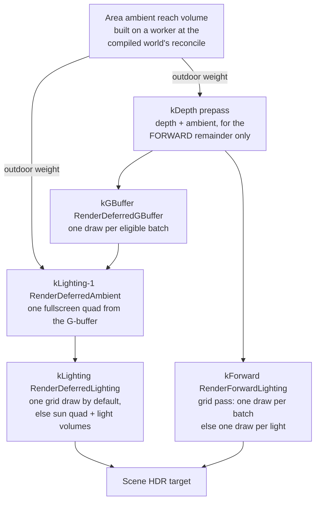

# Lighting

A lit pixel in Ceili can be shaded three ways, and all three run in the same
frame. A batch can be drawn once per light that reaches it, drawn once with a
shader that loops the lights in its screen cell, or written into a G-buffer and
lit afterwards from the screen. Which one a batch takes is decided per view and
per material, and the picture is meant to be the same whichever it takes.

This page walks the three paths, the light grid they share, the measured reason
each one exists, and the area ambient that keeps outdoor light out of a tunnel. Shadows have [their own page](Shadows.md); this one
covers how a light reaches a surface.

---

## Where the paths came from

Ceili lit forward only until September 2026. `RenderPrePassIBL` wrote depth and
ambient into the scene HDR target, and `RenderForwardLighting` then drew every
lit batch once per light, additively. That is correct and it scales badly: a
scene with many small lights redraws the same geometry once for each of them.

Two changes landed ten days apart, and both are on in the shipped default:

- **The deferred renderer** (8 September). A batch whose material carries an
  eligible G-buffer pass writes its surface parameters once, and the lighting is
  a screen-space pass afterwards.
- **The forward light grid** (18 September). A lit batch draws once through a
  pass whose fragment shader loops the lights its screen cell lists.

Both are hybrid by construction. A material family with no grid pass keeps the
per-light path in the same view, and a family with no G-buffer pass stays forward
lit in the same view. Cloth and clear-coat stay forward by decision. That is what
lets the paths be compared live against each other on real content.

---

## One frame, any lighting path

The engine commits to neither forward nor deferred lighting. Both paths are sets of
renders that stay registered for the life of the process, and the settings
decide which of them draw. Four switches decide the path, and one control names
the combinations that matter:

```cpp
// Include/Display.h
enum class LightingPathMode : uint8_t
{
    Custom = 0,
    // One forward draw per light per batch. The CONTROL every clustering measurement is taken
    // against, and the slowest of the five by a wide margin.
    Forward = 1,
    // Forward, but each batch lit in ONE draw whose shader loops its screen cell's lights.
    ForwardClustered = 2,
    // The G-buffer, lit with one draw per light.
    Deferred = 3,
    // The G-buffer, lit in ONE fullscreen draw per view whatever the light count. The default.
    DeferredClustered = 4,
    // As above, with the G-buffer write and the lighting sharing one render pass. Needs a Vulkan
    // device - D3D12 has no subpasses - so selecting it on D3D12 sets the switch and changes
    // nothing, exactly as toggling deferredSubpassMerge by hand there does.
    DeferredMerged = 5,
```

`display::SetLightingPathMode` stamps the four switches, and
`GetLightingPathMode` reads them back every time, so the mode can never disagree
with the switches it names. Each switch is read on the next frame. A game, a
Studio session or an A/B script can change the path while the scene runs, with
no reload and no rebuild.

Two rules make the switch safe to pull at any moment:

- **The paths share one frame.** Under deferred, a batch whose material has a
  G-buffer pass is lit through the G-buffer, and every other batch stays
  forward-lit in the same view (see [The deferred path](#the-deferred-path)).
  A material with no G-buffer pass still draws correctly.
- **A path costs nothing until it is asked for.** The G-buffer and light-grid
  pipelines build the first time the settings ask for that path, on worker
  threads (see [Pipelines only for the path a view runs](#pipelines-only-for-the-path-a-view-runs)),
  and stay built after that.

The defaults follow the device. The desktop draws `DeferredClustered`. The
Quest's device profile calls `SetLightingPathMode` with `ForwardClustered`,
because a G-buffer costs more on a tile-based GPU (see [XR and Quest](Xr.md)).

The runtime switch is also what makes the measurements on this page honest. An
interleaved A/B flips the path between frames inside one run, so both arms see
the same clocks, the same thermals and the same camera. The split-screen compare
in Studio goes one step further and draws both paths in one frame:

```cpp
// Include/Display.h
// The third thing the split can vary (Phase 5): the RENDER PATH.  The compare side gains the
// Deferred view flag and the primary loses it, whatever Render Passes authored globally, so
// the left half is forward-lit and the right half lit through the G-buffer - one camera, one
// exposure, one lighting model (use with Pbr To Pbr so the model is not a second variable).
// The two halves must agree to the G-buffer's quantisation and nothing else; a seam at the
// divider is a deferred defect, located.
bool deferredRight CE_DESC("Light the RIGHT half of the split through the deferred path (the G-buffer) and the LEFT half forward, under the same camera and lighting model. Pair with 'Pbr To Pbr' so the render path is the only variable. The two halves should agree to the G-buffer's 8-bit quantisation; a seam at the divider is a deferred defect") = false;
```

One camera, one exposure and one lighting model, forward on the left and deferred
on the right: a seam at the divider is a deferred defect, and its position shows
where it is. The same compare can split the frame by lighting model, which the
[Materials](Materials.md#two-generations-in-one-material-pbr-and-legacy-blinn)
page covers.

---

## A light, as the shader reads it

A light is an entity row like any other, authored in the property grid and
serialized with the scene. What the grid uploads is a flat record:

```cpp
// Include/LightGrid.h
struct Row
{
    // Point and spot: the point the light shades FROM (light::scene::Light::lightPos).  Directional: the unit
    // direction TO the light (lightDir).
    math::Vec4 position;
    // rgb: the colour the light shades with (light::ResolveLitColor).  a: the authored ambient.
    math::Vec4 color;
    // rgb: the ambient the Blinn shading adds (light::ResolveAmbient: legacy's AmbientColor * AmbientFactor).
    math::Vec4 ambient;
    // The world -> light-clip rows and the falloff row, as light::Update caches them on the light's row.
    math::Vec4 projectionS;
    math::Vec4 projectionT;
    math::Vec4 projectionR;
    math::Vec4 projectionQ;
    math::Vec4 falloffS;
    // Bindless heap indices of the cookie's projection and falloff textures.
    uint32_t projectionIndex = 0;
    uint32_t falloffIndex    = 0;
    // The animated cookie's slice, or -1 when the projection is not an array.
    float projectionSlice = -1.0f;
```

The row carries the ambient the Blinn shading adds, the projection matrix a spot
light's cookie needs, and the
bindless indices of its projection and falloff textures, so a grid-lit pixel gets
the same cookies a per-light draw would give it.

A test pins the layout. The shader side is
`lightGrid.hlsli`, and a unit test reads the member offsets back out of the
compiled SPIR-V and compares them with `offsetof` on the C++ struct. A member
that drifts fails a test instead of shading with the wrong value.

### Physical light, stored against the view's exposure

The rows hold the physical light. Noon to a moonless night spans about 28 stops,
far more than a 16-bit HDR target holds, so each view stores the light times its
own pre-exposure P, which follows the view's meter. One function forms that
product, on the CPU:

```cpp
// Src/LightInternal.h
// THE SCALE A LIGHT ROW TAKES TO THE VIEW'S STORED LIGHT (plan phase A2): the rows hold the physical light in the
// relative unit, so a row times P x C is the physical light times the view's exposure P (SceneLighting::exposureAbs).
// The ONE place a row meets P. Never 1 / P's own size in a shader: P is about 2^-15 by day, which half precision
// flushes, so the product is formed here, on the CPU, in single precision. Also the scale for light that carries no
// key-body term: an authored light, the twilight sun, an artistic constant, so a night shows it as bright as it
// physically is.
inline float RowScale(const graphics::SceneLighting& Lighting)
{
    return Lighting.exposureAbs * env::units::kRelativeLightToAbsolute;
}
```

C is the relative unit in absolute terms: 6,400, the sun's 128,000 lux over 20. A
value stated against the key body's full light (the sky-coupled sun or moon, the
night sky's terms, the lightning flash) also takes the key light's level: 1 by
day, and a full moon's light against the sun's (2.5e-6) by night. The sky's own
units are on the [Atmosphere](Atmosphere.md) page.

**Ported firelight is one level for every ported scene.** Under the Standard look,
a ported scene's display-coded local lights take one lux value per unit of their
decoded code, so a torch is as bright at RedMines as at Prospector:

```cpp
// Include/Env/Units.h
// PORTED FIRELIGHT (plan A3): a ported scene's display-coded local lights in lux per unit of their decoded code
// (pow(2 x code, 2.2)), ONE value for every ported scene, so a torch is as bright at RedMines as at Prospector whatever
// body the import calibrated it against. Standard only: the Classic lens keeps legacy's per-scene balance
// (LegacyMatch::localLightGain and localLightCalibration). 16 is the user's pick from a live sweep at Prospector's porch
// lantern and RedMines' mine mouth (2026-10-26). The first pick, 64 (2026-10-19), lit the lantern's wall about 9.5 stops
// over the full moon, past the meter's 8-stop dark range (display::DebugSettings::meterDarkRange), so the exposure
// followed the wall and the moonlit town went black. At 16 the wall sits about 7.5 stops over, inside that range.
constexpr float kPortedFirelightLux = 16.0f;
```

The level sets where a torch-lit wall sits against the moonlit ground. At 16 lux
the lantern's wall is about 7.5 stops over the full moon, inside the meter's
8-stop dark range, so the meter keeps the moonlit town in the frame. Particle
lights and self-lit sprites read the same gain, so torch flames follow.

---

## The light grid

The grid covers the view with screen tiles and depth slices, and records which
local lights can reach each part of it. A fragment finds its own place in the grid
and loops the lights listed there. The image is identical whichever way the grid
is laid out, and there are three layouts, chosen per view:

- **ZBin**, the default: a bitmask of lights per screen tile and a range of
  depth-sorted lights per depth band, which a pixel combines. It costs a few
  thousand words at any resolution, at the price of a pixel sometimes testing a
  few more lights than reach it. It became the default on measured CPU savings:
  the CPU frame dropped 38 to 40 percent on a 256-light stress scene and 13 to 19
  percent on the ported RedMines level.
- **Froxel**: a list per tile and depth slice, with a light copied into every cell
  its reach covers. Its cost grows with resolution times lights, about 640,000
  indices per view at 1080p on the stress scene, against ZBin's 3,600.
- **Tree**: a hierarchy over the froxel cells, with each light listed once at the
  largest blocks its volume fills, so a pixel tests close to only the lights that
  reach it. On the stress scene the lighting pass measured 27 to 35 percent cheaper
  on the GPU than ZBin, the same on RedMines, and about 1 ms more CPU to rebuild
  for a view that moves. It is kept as a measured option rather than the default.

The froxel layout's dimensions show the shape all three share:

```cpp
// Src/Render/LightGrid.h
// The nominal tile edge in pixels.  A view gets ceil(size / this) tiles along each axis, so a tile is at most this big.
constexpr uint32_t kTilePixels = 64;
// Tiles along one axis at most: a 4096-pixel view at the nominal tile size.
constexpr uint32_t kMaxTilesPerAxis = 64;
// Depth slices for a perspective view.  An orthographic view has no depth to slice by clip w, and gets one.
constexpr uint32_t kNumSlices = 24;
// The deepest the last slice may end, in world units.  A light farther than this still lands in the last slice, which
// then covers everything past it; without the cap one distant light would stretch every slice and pack the near
// lights, which are the ones large on screen, into a few of them.
constexpr float kMaxDepthCap = 2048.0f;
```

The lists are deliberately loose. A light lands in a cell if the corners of its
influence volume reach it, so a cell can list a light that does not actually
light any pixel in it. That is safe because the fragment shader still tests each
listed light's own volume, exactly as the per-light passes do. **The grid narrows
the set of lights a pixel tests; the volume test still decides which of them
light it.**

Directional lights sit outside the cells. They are the first rows, and every
pixel loops all of them.

### One piece of maths, two languages

The CPU decides which cell a light lands in. The shader decides which cell a
pixel is in. If those two disagree about where a slice boundary sits, a light
goes missing along the seam. Ceili removes the possibility by compiling the
shader's own source as C++:

```cpp
// Src/Render/LightGridMath.h
// Resources/Shaders/lightGridMath.hlsli is written in the subset HLSL and C++ share, and this header compiles it as
// C++.  The CPU decides which cell a light lands in with these functions and the fragment shader decides which cell it
// is in with the same text, so the two cannot disagree about a slice or a tile edge.  Include after Module.h.
```

The header defines the handful of intrinsics the shared text spells through
macros, includes the `.hlsli` file, and undefines them again. There is one
definition of the cell maths in the tree.

### What it bought

Measured on the RedMines scene, which is ported legacy content with many small
lights:

| Path | Forward draws | `Frame.Gpu` change |
|------|---------------|--------------------|
| Per light | 42,570 | reference |
| Light grid | 3,330 | -61% Vulkan, -63% D3D12 |

The `Frame.Gpu` figures are at 1920x1080 (2026-09-18). On a 256-square view,
where a pixel costs about a thirty-second as much, they read -35 and -44 percent.
`RenderForwardLighting::process` dropped about 90 percent on both backends, over
36 of 36 measured pairs. PBR, Blinn and terrain all light through the grid.
Cloth and blended overlays keep the per-light passes.

Finding that needed real content. The Blinn slice's own coverage turned up a
material-system defect on the way: a second parent's pass removal merged onto the
first parent's pass of the same type, so every material built on the cloth family
had silently lost its grid pass.

### The device decides

The grid needs two structured buffers readable from the fragment stage. On
D3D12 they are root views; on Vulkan they fit within the four descriptor sets the
specification guarantees every device can bind:

```cpp
// Include/DeviceCaps.h
// The fragment stage can read the light grid's two structured buffers (Include/LightGrid.h).  Always on D3D12,
// where they are root SRVs.  On Vulkan they are the FOURTH descriptor set, within the maxBoundDescriptorSets of 4
// the spec guarantees (the Quest 2 reports exactly 4).  A view on a device without it keeps per-light lighting.
FragmentStorageBuffers = 1u << 11,
```

Fitting in four sets is a deliberate constraint. The vertex and fragment constants
share one set to leave the fourth free, because a device that reports exactly the
minimum, the Quest 2 among them, would otherwise fall back to per-light lighting.

The capability is probed once at device creation and published into a trunk-owned
latch. A strategy resolves its automatic setting against that latch and never
against a device name.

### Pipelines only for the path a view runs

A material declares passes for every lighting path, and a pass gets a pipeline
only once the settings ask for its path. The G-buffer passes are built when a
view runs the deferred path, and a forward grid pass is built only for the grid
layout a view asks for (`material::IsPassBuildable`, with `SyncPassBuilds`
building a pass on first use). The Quest's forward device profile builds no
G-buffer pipeline. On the Quest 2 (Volcano, mobile profile, 2026-10-22) that gave 148
pipelines in all, 0 of them G-buffer, against 257 to 265 with 52 G-buffer, and
the scene was ready 8.30 s after its open against 9.19 to 9.58 s.
[Materials](Materials.md) covers how a material declares its passes.

The surface sampler's mip filter is a device setting,
`display::StrategySettings::samplerTrilinear`, read when the backend creates the
sampler. On, it blends the two nearest mip levels. Off, it reads the nearest one,
half the texel reads, with visible lines where the mip level steps. The mobile
profile draws bilinear at 1x anisotropy. On the Quest (2026-10-19) trilinear cost
0.16 to 0.50 ms a frame where texture fetches dominate.

---

## The deferred path

A view carrying `ViewDescFlags::Deferred` writes eligible batches into a
G-buffer at the `kGBuffer` priority, then lights the screen. Eligibility is one
decision, shared by the pass that draws and the pass that skips, so a batch is
lit exactly once.

### One layout for two lighting models

Ceili carries a physically based model and a legacy Blinn model side by side (see
[Materials](Materials.md)). The G-buffer serves both from one layout. The
header opens with the diffuse target:

```cpp
// Include/GBuffer.h
// The deferred G-buffer: ONE layout for both lighting models.  The view's enabled pass flags
// (display::Settings::enabledPassFlags) fix which model every pixel was written with, exactly as
// they fix which forward pass draws, so the lighting pass never needs a per-pixel model id.
//
//   RT0 kAlbedo  RGBA8 sRGB   The DIFFUSE colour, with every material variant folded at write:
//                             PBR albedo * (1 - metallic) (so a metal writes black), a legacy
//                             PBR surface its albedo, Blinn its diffuse map.  The target is
//                             sRGB-TYPED (kAttachments[kAlbedo].srgb): the FS writes linear and
//                             the hardware encodes on store / decodes on sample, so the 8 bits
//                             spend their precision where a dark diffuse needs it.  A LINEAR
//                             RGBA8 measured -2 levels on every dark flat surface against the
//                             forward path (DeferredRenderer.md, P5-2), and that was the larger
//                             half of the whole forward-vs-deferred residue.  The alpha band
//                             below is untouched by the encoding (sRGB applies to rgb only).
```

The normal target packs an octahedral normal and a material table row:

```cpp
// Include/GBuffer.h
//   RT1 kNormal  R10G10B10A2  rg = the world-space SHADING normal, OCTAHEDRAL (GBufferEncode /
//                             DecodeNormal, OctMapUV / OctMapDir).  Two 10-bit channels hold a unit
//                             direction at least as well as the three the legacy xyz*0.5+0.5
//                             encoding spent, which wasted its range on the interior of a cube when
//                             only the sphere's surface is reachable.
//                             b (10 bits) = the surface's MATERIAL TABLE ROW over 1023, 0 meaning
//                             no shading-model constants - so the row is its own enable flag and
//                             costs no separate bit.  Freeing b is what the octahedral pair bought.
```

RT2, `kParams`, holds F0 and roughness for PBR, or the specular map and the
specular power for Blinn. The depth is the shared scene depth, in reverse Z,
which the G-buffer attaches and never owns.

Three decisions in that layout are worth pulling out.

**Folding at write time.** Every material variant resolves its diffuse and its
F0 in the G-buffer pass, so a metal writes black diffuse and its albedo as F0.
The lighting pass is then one formula per model rather than a switch over the
variants.

**The targets are sRGB-typed.** A linear RGBA8 measured two levels darker on
every dark flat surface against the forward path, and that was the larger half of
the whole forward-versus-deferred difference. The encoding applies to RGB only,
so the alpha band on RT0 and the roughness in RT2 stay linear.

**The normal is octahedral.** Two 10-bit channels hold a unit direction at least
as well as the three channels the old `xyz * 0.5 + 0.5` encoding spent, which
wasted its range on the interior of a cube when only the sphere's surface is
reachable. Freeing the third channel is what paid for the material table row.

The G-buffer is never cleared. Every texel that passes the depth-equal test is
overwritten, and a texel that does not (the sky) keeps whatever the previous
frame left there. So every reader tests the scene depth first and treats far as
"no surface". RT0's alpha carries a second mark for the same question, and the
debug view paints magenta wherever depth says a surface is there and the alpha
says nothing wrote: a batch the forward pass skipped as deferred-eligible that
the G-buffer pass then did not draw.

### Ambient first, then lights

The deferred frame lays the ambient down one priority slot before the lights, as
a single fullscreen draw:

```cpp
// Include/Graphics.h
// The deferred AMBIENT pass (RenderDeferredAmbient, base/deferred/ambient): one fullscreen draw
// per view that WRITES each G-buffer pixel's base value - the split-sum IBL / Blinn ambient with
// both aerial terms and the horizon seal - from the G-buffer, where RenderPrePassIBL draws the
// geometry a second time for it.  One slot BEFORE the lights (kLighting - 1): it lays the base
// down that the light draws add to.  Authored twice, per lighting model, like the lights.
constexpr Type kDeferredAmbient  = PriorityFourCC<Type>(priority::kLighting - 1, 'D', 'A', 'M', 'B');
```

The two aerial terms are the [atmosphere's](Atmosphere.md) haze between the eye
and the surface, read from the froxel volume. The ambient occlusion, the specular
mask and the split-sum horizon fade all ride in the G-buffer's spare bits for this
pass alone. The lights never read them.
They are what the forward IBL prepass computed from the surface's own samples,
carried across so the ambient can be lit from the screen without drawing the
geometry a second time. Both ambient passes weight everything they take from the
environment by the [area ambient](#the-area-ambient-outdoor-light-indoors).

The forward IBL prepass is the forward path's only depth writer, so it draws even
when a scene has no environment (a sky that never baked, as under the mobile
profile with its sky passes off). It then binds predefined black for both maps
(`env::ibl::GetNoEnvironmentMap`): the ambient is zero, and the depth that every
forward lit pass tests EQUAL is still written.

Then the lights. The sun is a fullscreen quad. A point or spot light draws its
influence frustum as a unit box unprojected in the vertex shader, back faces
only, with no depth test, which gives the exact screen footprint whether the
camera is inside the volume or outside it. The fragment shader rejects a pixel
outside the light's volume before it reads the albedo, normal and params.

On a tile-based GPU, the kind in a standalone headset, writing a G-buffer and
then reading it back costs a trip out to memory and back for every target. Vulkan
can avoid that with subpasses: the G-buffer write and the lighting draw share one
render pass, and the lighting reads the G-buffer as input attachments that never
leave the tile. Ceili has that merged path behind a setting. It renders the same
image, needs the deferred light grid and a Vulkan device (D3D12 has no
subpasses), and is off by default, because on a desktop GPU with no tiles it is
expected to change nothing. Merged views are counted rather than inferred, since a
merge that silently stopped resolving would look exactly like success.

<!-- MEDIA: the G-buffer debug grid (albedo, normal, params, depth in four
     quadrants) beside the finished frame. One image explains the layout section
     better than the table does. -->

### Clustered deferred, and the honest result

The same grid that lights forward batches can light the G-buffer: one fullscreen
draw whose fragment shader loops each pixel's cell, in place of one draw per
light. It is on by default (`display::DebugSettings::deferredLightGrid`), and a
view that runs both paths builds the grid once.

On RedMines, 3,776 light draws become 236. At 1920x1080 the deferred lighting
pass (`Pass.DLIT`) drops 62.5 percent on Vulkan and 59.2 percent on D3D12, and
`Frame.Gpu` drops 14.6 and 16.2 percent, at 144 and 143 of 144 pairs.

The view size decides the answer. On the scene smoke's 256-square target, a
pixel costs about a thirty-second of what it costs at 1920x1080, so a strategy
that trades per-draw cost against per-pixel cost loses its per-pixel side. On one
binary and one scene (SponzaLightStress, Vulkan), `Pass.DLIT` reads 22.3 percent
slower at 256 square and 36.3 percent faster at 1920x1080. The A/B harness
measures on the 1920x1080 panel target for that reason.

---

## The area ambient: outdoor light indoors

The environment's image-based light comes from the whole sky, and nothing in the
IBL knows that a mine tunnel has rock above it. By day the sky's ambient in the
RedMines tunnel is about 10,000 lux, and physical torches vanish under it. The
area ambient fixes that at the source: outdoor light reaches a point only as far
as it can travel from outside. The areas, portals and BSP it travels through are
covered on [Compiled Worlds](CompiledWorlds.md).

```hlsl
// Resources/Shaders/areaAmbient.hlsli
// THE AREA AMBIENT (Prompts/PhysicalCameraGrading.md, area ambient)
//
// Every point's ambient is a sum of sources, each with a weight there. The OUTDOOR source is the environment's ambient
// (the IBL irradiance and reflections); its weight is how far outdoor light reaches the point, 1 outdoors and falling
// off inside. An area's own sources (its Area entity's probe, later) join this struct as fields beside it, each read by
// the pass that sums them; an indoor area with none of its own is black.
//
// Two estimates of the outdoor weight, the lesser kept:
//   * THE PORTALS' (a compiled world, graphics::world's reach volume): the path outdoor light takes through the portals
//     from an area holding an Area entity, in metres in an R8 volume, fading as exp(-path / reach);
//   * THE OVERHEAD MAP'S (DebugSettings::ambientOverheadCover, for a scene with no areas): open to the sky above or not.
// Each reads 1 when its source is not bound (the index sentinel) or the point is outside it.
//
// Needs weather.hlsli (WEATHER_SKY_EXPOSURE) and aerialPerspective.hlsli (the bindless 3D array, `aerialVolumes`, which
// holds every 3D texture) before it, and the pass's `textures`.
//-----------------------------------------------------------------------------
```

The weight scales everything a pass takes from the environment: the IBL's
irradiance and reflections, the lightning's flash term, and the aerial
in-scatter, because the air in a tunnel is not sunlit either. The deferred
ambient pass and every body of the forward IBL prepass (PBR with terrain, Blinn
and the legacy flavours, clear coat, cloth) read it through one macro,
`AREA_AMBIENT_OUTDOOR`, from one constants block that one C++ function writes
(`render::WriteAreaAmbientConstants`). A legacy view and a scene with no volume
write the sentinels, which read as weight 1. Deep in the RedMines tunnel the two
paths solve the light's path at 52.2 m forward and 52.4 m deferred (2026-10-20).

### Area entities and the reach through the portals

An **Area entity** (`env::area::Desc` on the `graphics/area` template) owns the
ambient of the area it stands in. Its one source today is `Environment`: the area
is outdoors. Legacy content's own area entities import as `studio/area`, and the
compiled-scene bake carries them across. A world with no Area entity builds no
volume and keeps the full ambient everywhere.

At a compiled world's reconcile, a flood fill carries the path outdoor light
takes from those areas into a volume, crossing from one area into another only
through a portal:

```cpp
// Include/World/World.h
// THE AREA AMBIENT'S OUTDOOR REACH (Prompts/PhysicalCameraGrading.md, area ambient): how far outdoor light must travel
// through the world to reach each point, in metres. Every air voxel of a seed area (one an Area entity with the
// environment's source stands in) starts at 0, and a 6-neighbour flood fill carries the path on through air: within an
// area freely, and from one area into another only through a portal joining them, where the step crosses the portal's
// polygon (widened by half a voxel, so a portal narrower than a voxel still passes light).
//
// TWO LEVELS, because a level's indoors spreads over its whole extent while its tunnels are a few metres wide: an INDEX
// grid of cells over Bounds, and an ATLAS of bricks, kReachBrick voxels a side, for the cells that hold indoor geometry
// (each overlapping one of the Indoors boxes, the indoor areas' drawables). Only brick voxels are flooded. Any other cell
// is uniform: the path at its centre (0 in a seed area, kReachMaxMetres in rock or an indoor area no brick covers).
//
//   index  RGBA8 per cell: a brick cell is (atlas x, y, z in bricks, kReachBrickCell); a uniform one (0, 0, 0, metres).
//   atlas  R8 metres, kReachBrickStored voxels a brick side: the brick's voxels inside a one-voxel apron copied from the
//          neighbouring cells, so a trilinear read inside a cell never sees the next brick in the atlas.
//
// A solid voxel takes its nearest air neighbour's path, so a read at a wall reads the room, not the rock. Metres in a
// byte, 1 m steps, kReachMaxMetres also meaning unreached (an area that is all its own). The brick voxel is TargetVoxel,
// or larger so the index grid stays within MaxCellsPerAxis. Pure, so it runs in a test.
```

On RedMines the index cells are 10 m and the bricks are 8^3 voxels of 1.25 m. A
single grid of 128 cells an axis gives 10 m voxels against 5 m tunnels, and a
blocky edge at every opening, which is why the volume has two levels. The shader
weight is `exp(-path / reach)`, and the reach, `ambientReachMetres`, defaults to
8 m: the light falls to about a third over that path. A RedMines sweep of 0 to
32 m picked 8 (2026-10-19). Against no reach, the tunnel's mean luma falls from 48
to 33 and the deep tunnel's from 30 to 1, while the mouth and the canyon do not
change. The deep tunnel is then lit by its torches and its far opening alone.

**The build classifies before it floods.** Boxes are tested against the world's
BSP first (rock, one area, or many), bricks of one value collapse to uniform
cells, and the flood stops at 128 m. RedMines builds 127x43x128 cells and 7,827
bricks, 10.3 MB, in about 2 s. A per-voxel walk of the BSP over the whole volume
took 19.5 s and 129 MB. The build runs on a worker with a copy of the world's view,
and the volume in use stays until the new one lands: on RedMines it lands 2.4 s
after launch.

**The cost per pixel** is one index fetch and one trilinear fetch. On the desktop
(2026-10-21, Vulkan, an RTX 3080, the mobile profile under a simulated headset,
RedMines from inside a tunnel), the forward IBL prepass moved from 0.185 to 0.209
ms with the reach at 8 m (+12.7 percent), and `Frame.Gpu` moved +2.4 percent, at
64 of 64 pairs. A device verdict is still to come.

**Studio's Edit mode has no compiled areas**, so a second estimate reads the
weather's overhead depth map: a point with static geometry above it is indoors
(`DebugSettings::ambientOverheadCover`, off by default). It is an approximation:
a porch or an overhang reads as indoors, a shaft narrower than a map texel (1 to
4 m) reads as covered, and a moving object is no roof. Where both estimates apply,
the lesser weight wins.

### The indoor fact

The same Area entities say which areas are outdoors, and every other area is
indoors. `world::ClassifyView` walks the portals from a view's eye and answers
whether the eye stands outdoors and whether any outdoor area is in sight. On
RedMines, 1 of 33 areas is outdoor. A view that sees no outdoor area skips the
sky, the clouds, the rain and the lightning bolt; the [Weather](Weather.md) page
covers those passes.

For lighting, the fact drops a light that comes from the sky:

```cpp
// Include/Light.h
// This light is LIGHT FROM THE SKY: the lightning flash (lightning.entity).  A fact about the light, authored on its
// template.  A point light casts no shadow, so a sky light would light a tunnel's walls through the rock; the light
// gather drops it for a view whose eye stands in an indoor area of a compiled world (render::DropsSkyLight,
// Prompts/WeatherCloudsOcean.md 8.2).  Elsewhere it lights as any light does.
FromSky = 1 << 7,
```

The test reads the camera's own area. From inside a tunnel, the outdoors seen
through the mouth still flashes, through the area ambient's flash term. This is a correctness rule, so no setting turns it off, and
a view whose area is unknown keeps the light. The headless smoke stands a flash
beside a deep eye on RedMines and finds it dropped on 4 of 4 frames, and kept
outdoors.

<!-- MEDIA: RedMines from just inside a tunnel mouth by day, ambientReachMetres
     0 and 8 side by side, same exposure. The tunnel should fall off into torch
     light at 8 and stay sky-lit at 0. -->

---

## The frame, with all three paths



An eligible batch is drawn once, in the G-buffer, and the forward pass skips it.
Everything else takes the forward path in the same view. Previews, thumbnails and
the 2D orthographic views stay forward, because the flag is per view.

---

## Parity, and how it is held

Two paths that shade the same surface will drift, and the drift is invisible
until someone measures it. Ceili gates it: two smoke tests compare the deferred
and forward images on one calibrated scene, the ambient pass at a tolerance of
0.007 and the direct lighting at 0.012.

Those gates exist because of what held the deferred path back for four sessions.
One line in `deferredLighting.material` handed the shadow function a
`float3(0, 0, cos)` as a tangent-space light vector, and that function reads the
cosine as `normalize(v).z`, which is 1 for every positive cosine. So the
normal-offset shadow bias was inert across the whole deferred path, and every
deferred-lit surface self-shadowed about 12 percent dark. It was diagnosed as an
ambient gap first, which was wrong because the three ambients agree to 0.007, and
then as a lighting-model gap, which was wrong because the same quads agree with
shadows off. One intermediate reading of 8.7 percent turned out to be the post
chain's vignette, measured because two probes sat at different distances from the
frame centre.

The lesson that became a rule: put the probes on a calibrated circle, and always
carry a control that the change under test cannot possibly affect.

**Both renderers decode a display-coded albedo by one rule.** Ported content
stores its albedo as a display code, and a pass that lights the code as linear
draws too bright. The rule lives in one function:

```cpp
// Src/Render/Base.h
// THE ALBEDO DECODE, ONE DECISION FOR BOTH RENDERERS: 1 when this view decodes a display-coded albedo before lighting it
// (graphics::SceneLighting::albedoDisplayCoded, ported legacy content, or DebugSettings::pbrAlbedoDecode for any
// scene), 0 on a legacy view, which lights the codes as legacy did. The deferred passes decode RT0 by it, and every
// forward PBR body by BindAlbedoDecodeConstants. Until 2026-10-20 only the deferred passes decoded, so a ported scene
// lit forward drew about a stop brighter than the same scene lit deferred (2.28x median on RedMines, the whole gap).
// AlbedoDecode is the rule with its inputs: C++-only and CE_API for a unit test.
CE_API float AlbedoDecode(const bool PbrView, const bool Forced, const graphics::SceneLighting& Lighting);
float        AlbedoDecodeFor(const draw::ViewDesc& View);
```

Each forward PBR body (PBR, clear coat, cloth, terrain and the IBL prepass)
applies the decode after the weather cover, where the G-buffer writer packs the
albedo. A stage-by-stage A/B at a fixed exposure found the forward-to-deferred
ratio at 2.28 on the ambient and 1.79 on the direct light with the forward bodies
lighting the code as linear. With the one rule it reads 1.000 in every stage, at
the tunnel mouth and at a sunlit pose (2026-10-21).

---

## What lighting does not do yet

- **Local lights cast no shadows.** Point and spot shadow passes are declared and
  not rendered, so every local row carries `kNoShadow`. See
  [Shadows](Shadows.md).
- **The subpass-merged deferred path is off by default.** Its saving is a
  tile-based GPU that keeps the G-buffer in tile memory, and no device has
  measured it yet.
- **An indoor area has no ambient of its own.** Where no outdoor light reaches,
  the ambient is black and the torches light the room. Probes are the planned
  indoor source, and they join the area ambient's sum beside the outdoor weight.
- **The area ambient is weighted at the surface.** The air in front of an
  opening seen from outside takes the opening's weight, so that short stretch of
  in-scatter comes out too dark.
- **The reach volume has no device measurement yet.** It is 10.3 MB on RedMines,
  and the Quest's device profile builds it whenever the reach is above 0, though
  a desktop run of that profile's frame shows no pass that reads it.
- **Cloth and clear-coat have no G-buffer pass**, by decision. They stay forward
  lit, and an id-free fourth target is the path if content needs them deferred.
- **The grid has caps.** In the Froxel and Tree layouts a cell lists as many
  lights as its count field's 8 bits allow; ZBin takes up to 65,535 local lights a
  view. A light past a cap is dropped and counted, and the counter is reported, so
  an overflowing scene says so.

Next: [Shadows](Shadows.md) for the atlas these lights sample,
[Materials](Materials.md) for how a material declares its passes, or
[Rendering](README.md) for the frame around all of it. Back to the
[documentation index](../README.md).
