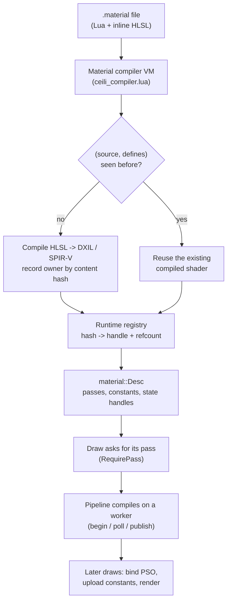

# Materials

Most engines treat a material as data: a fixed shader plus a bag of parameters
you fill in. Ceili treats a material as a **program**. A `.material` file is a
Lua script that builds the material (its passes, its render states, its
constants) and embeds its HLSL shader source inline. Materials inherit from one
another, constants can be driven by live script, and identical shaders and
constant blocks are de-duplicated automatically.

It is worth seeing one in full.

<!-- MEDIA: the Studio material preview panel showing a PBR sphere, ideally a
     short clip cycling through a few materials (chrome, iron, dielectric) and one
     of the live script-driven materials pulsing. This is the money shot for this
     page. -->

---

## A material is a Lua program

Here is the shape of a real one. `baseLightPBR.material` declares an inline
vertex shader as a value, then creates materials from it:

```lua
-- baseLightPBR.material
-- ONE directional vertex shader serves both directional passes: the instanced
-- pass compiles it with INSTANCED defined (per-pass `definitions`), sourcing
-- World / NormalMatrix from the instance buffer via SV_InstanceID and
-- computing worldViewProj = mul(World, viewProj) in the VS; the per-surface
-- pass compiles the #else branch. Both branches flow into the SAME
-- LightDirVS, so the instanced path is math-identical to the per-surface one.
local dirVertexShader = M.inlineShader([[
    #include "lightCommon.hlsli"
```

The HLSL lives right next to the Lua that uses it. The `#elif defined(INSTANCED)`
in that shader is a real preprocessor branch: the same source compiles to a
per-surface, an instanced, an interpolated instanced, or a skinned variant,
depending on the defines a pass requests (`INSTANCED`, `INSTANCED;INTERPOLATED`,
`SKINNED`). Each variant is de-duplicated when its `(source, defines)` pair
matches a shader already compiled (see
[Dedup](#dedup-shaders-and-constants-are-content-addressed)).

> **Shader convention.** Ceili's `math::Mat4` is row-major with row-vector
> semantics, so the canonical multiply order in shaders is `mul(v, M)`, vector
> first. `o.Position = mul(pos4, WorldViewProj);`. `mul(M, v)` compiles fine and
> silently transposes your matrix; if a projection lands off-screen, check this
> first.

## The compiler VM

Calling a `.material` file "a program" is literal: the file is executed in a Lua
VM. The material compiler boots a minimal VM that loads the Core, math, and
Graphics bindings, the material DSL itself, and the entity DSL, then runs each
`.material` file so its `M.create` calls register the material. The compiler VM
sets `_resolveOnly`, so it never registers runtime GPU resources:

```lua
-- ceili_compiler.lua
ceili._resolveOnly = true

-- Load the material DSL
ceili.material = dofile(path.join(ceili.packagesPath, "Graphics", "Resources", "Materials", "core.material"))

-- Load the entity DSL (hand-written authoring helper that extends
-- ceili.core.scene.entity with .create / .include).  Loaded after core.lua
-- so the auto-generated ceili.core.scene.entity table already exists.  The
-- compiler VM only needs the DSL, not _loadAllEntityFiles (it never spawns).
dofile(path.join(ceili.packagesPath, "Core", "Resources", "Entities", "core.entity"))
```

Despite the name, `core.material` is the DSL: `M.create`, `M.inlineShader`,
`M.include`, the `PBR.*` helpers, the pass and binding tables, all of it is Lua
defined in `core.material`, so authoring a material is calling into a small
library. The same DSL runs at runtime for hot
reload, which is why editing a `.material` and saving shows up in the running
editor the next frame (the hot-reload path described in [Core](../Core/Core.md)).

## Inheritance

A material can derive from another by naming it as the second argument to
`M.create`. The child inherits the parent's passes and shaders and overrides only
what differs. `baseLightPBR.material` derives its metal and legacy variants this
way, but the preprocessor define that picks a variant cannot simply live on the
child's `flags.definitions`: a material-level `definitions` string joins onto
*every* pass, and `base/surface` inherits `base/light/pbr`'s passes alongside
another lighting model's. The define would then land on the Blinn passes too. It
does nothing in that shader, but it changes the passes' `(source, definitions)`
identity, so they stop sharing a compiled shader and compile a byte-identical
copy. The fix is two small per-pass helpers: `pbrVariant` stamps the define onto
the PBR lit passes, and `gbufferVariant` stamps it onto the deferred G-buffer
passes:

```lua
-- baseLightPBR.material
local function stampDefinitions(Overrides, PassTypes, Definitions)
    local def = Overrides or {}
    for _, pass_type in ipairs(PassTypes) do
        -- `false` is a derive DROPPING the inherited pass (core.material skips it); stamping a
        -- define onto it would resurrect an empty pass.
        if def[pass_type] ~= false then
            def[pass_type]             = def[pass_type] or {}
            def[pass_type].definitions = Definitions
        end
    end
    return def
end

local function pbrVariant(Definitions, Overrides)
    return stampDefinitions(Overrides, kPbrLitPasses, Definitions)
end

local function gbufferVariant(Definitions, Overrides)
    return stampDefinitions(Overrides, kPbrGBufferPasses, Definitions)
end
```

The metal variant then wraps its overrides in both helpers:

```lua
-- baseLightPBR.material
-------------------------------------------------------------------------------
-- Clean metallic: F0 from constant, no diffuse
-------------------------------------------------------------------------------
M.create("base/light/pbrMetal", "base/light/pbr", pbrVariant("PBR_METAL", gbufferVariant("PBR_METAL", {
    flags = { metal = true },
})))
```

Concrete materials then derive from those bases and supply textures and constant
values through helper functions, so authoring a new material is a couple of
lines:

```lua
-- baseLightPBR.material
-------------------------------------------------------------------------------
-- Clean metal test materials (F0 presets, roughness via material constant)
-------------------------------------------------------------------------------
M.create("pbr/test/iron_smooth", "base/light/pbrMetal", PBR.metalWithTextures("iron", {
    metalRough = "predefined://mr_metal",
}, 0.1))
```

## Constants driven by live script

A material constant does not have to be a static value. Its `binding` can be an
**expression**: a Lua function evaluated with a per-frame context. This material
pulses its colour every frame with a sine wave, entirely from the `.material`
file, no C++ involved:

```lua
-- base.material
M.create("base/2D/pulse", "base/2D", {
    [P.kUi] = {
        fragmentShaderConstants = {
            { name = "pulseColor", valueType = VT.Float4, semantic = S.Color, binding = B.Expression,
                value = function(ctx)
                    local t = ctx and ctx.time or 0
                    local pulse = 0.5 + 0.5 * math.sin(t * 2)
                    return {pulse, 0.0, 0.5, pulse}
                end },
            { name = "textureIndex", valueType = VT.UInt, binding = B.Texture },
        },
```

Other bindings cover the common cases: `B.User` (a value the property grid
edits, with a `default`), `B.Texture`, and `B.Expression` (the live function
above). The same declarative constant list drives editable parameters, texture
slots, and animated values alike.

<!-- MEDIA: a short clip of the pulse material animating in the preview, side by
     side with the ~8 lines of Lua that produce it. Shows "authored as data,
     alive at runtime" in one glance. -->

## Dedup: shaders and constants are content-addressed

An engine with hundreds of materials would drown in duplicate shader binaries and
constant layouts if each material compiled its own. Ceili avoids that by making
the **content** the identity.

A shader's identity is the pair `(source, defines)`. The first pass to claim a
pair owns the compiled file; every later pass or material sharing that pair reuses
it, even across different passes:

```lua
-- core.material (the material DSL)
-- Stage is material::shader::Type (Vertex 0, Fragment 1, Compute 2). BlobName is the name the pass resolved
-- above, so the compiler writes the blob to the name the pass loads. Only the shader's registrant registers
-- it (claimShaderOwners), so the compiler compiles each name once.
local function registerInline(shaderDef, stage, defs, defs_hash, blob_name)
    if not (type(shaderDef) == "table" and shaderDef._inline and shaderDef.source) then
        return
    end
    local registrant = inlineRegistrants[blob_name]
    if registrant and registrant ~= (mat_ns .. "." .. pass_name) then
        return
    end
    local inl = ffi.new("ceili_graphics_material_registry_InlineSource")
    ceili.core.setString(inl.materialName, def._name)
    ceili.core.setString(inl.passName, pass_name)
    inl.stage      = stage
    inl.source     = shaderDef.source
    inl.sourceHash = bit.bxor(hash32(shaderDef.source), defs_hash)
    inl.sourceLine = shaderDef._sourceLine or 0
    if defs ~= "" then ceili.core.setString(inl.definitions, defs) end
```

On the C++ side the runtime registry is a set of hash-to-handle maps
(`shaderHashToHandle`, and `materialHashToHandle`, keyed on a 64-bit content hash
of a material's first pass) plus refcounted state slots, so a state block or
shader shared by 500 materials is stored once and released when the last
reference drops:

```cpp
// Material.h: namespace registry
struct BlendSlot : core::slot::RefCounted<states::blend::Handle>
{
    states::blend::Desc          desc;
    uint32_t                     descHash{0};
    Array<uint32_t, 0, uint32_t> nameHashes;
};
```

The identity even works *across* passes. An instanced pass whose fragment-shader
`(source, defines)` pair matches its per-surface sibling resolves to the
sibling's already-compiled shader, so the two variants share one binary. Each
inline shader records its source hash and its defines as the key:

```cpp
// Material.h
// Compiler table -- inline shader source (one per inline shader per material)
// source points into Lua's string pool -- valid for the lifetime of the Lua script
struct InlineSource
{
    String                 materialName;
    String                 passName;
    material::shader::Type stage{material::shader::Type::Vertex};
    ConstStr               source{nullptr};
    uint32_t               sourceHash{0};
    uint32_t               sourceLine{0}; // Line in material file where inline source starts
    String                 definitions;   // Semicolon-delimited preprocessor defines (e.g. "PBR_METAL;PBR_LEGACY")
    // The compiled file's name without its target extension ("<name>.vert"), which core.material resolves and a pass
    // registers its shader under. The compiler writes the blob to exactly this name, so the name has one author.
    // LAST, so a frozen Bootstrap that predates it still reads every field before it: it copies the shorter struct
    // and names the file itself. Empty in a record from such a Lua, and the compiler then does the same.
    String blobName;
};
```

Sharing raises a lifetime question: if 500 materials share one blend state, when
is it freed? Each registry entry is reference counted and keeps the list of name
hashes that alias it, so releasing the last material that references a state block
drops it in O(K), without scanning the whole registry.

The compiler keeps one more record between builds: `InlineShaderCache.txt`, the
hash each inline shader's blob was compiled from. Its key is
`<blob name>@<target>`, one line per shader and per target, because builds with
different target sets write the same shader folder. A run treats a shader as
current only when every target it builds records the same hash. A platform with
no shader target passes `-target none`: the compiler then writes `Materials.h`,
`Materials.hlsli` and the recipes, compiles no shader, and leaves the cache file
alone.

## The pipeline, end to end



At the bottom sits the C++ data model. A `Desc` is a named list of passes; a
`Pass` carries its compiled shader and state handles plus the declared constant
elements; a `ConstElement` describes one constant and its authoring metadata:

```cpp
// Material.h
struct ConstElement
{
    String                       name;
    shader::constants::ValueType valueType{shader::constants::ValueType::Float};
    shader::constants::Binding   binding{shader::constants::Binding::User};
    bool                         hasExpression{false};

    // Per-element compile-time metadata (range / enum / desc) piped from
    // Lua's registerCompilerMetadata via SetPassFsConstantMeta. The
    // material compiler reads this when emitting Materials.h to synthesise
    // enum classes and default-value field initializers. Format:
    // `Range:..;Enum:..;Description:..` parts joined by `;`.
    String         annotation;
    Array<uint8_t> defaultValue;
};
```

A `Pass` opens with its state and shader handles. Further down, its `vsConstants`
and `fsConstants` arrays hold the `ConstElement`s it declares:

```cpp
// Material.h
struct Pass
{
    // Shared (compiler + runtime)
    String                                    name;
    draw::pass::Type                          passType{draw::pass::kInvalidType};
    SortType                                  sortType{SortType::Opaque};
    states::blend::Handle                     hBlend;
    states::rasterizer::Handle                hRasterizer;
    states::depth::Handle                     hDepth;
    states::stencil::Handle                   hStencil;
    Array<primitive::vb::Element, 0, uint8_t> vertexElements;
    Array<texture::Handle, 0, uint8_t>        textures;

    // Runtime (resolved from compiler data)
    shader::Handle            hVertexShader;
    shader::Handle            hFragmentShader;
    shader::constants::Handle hVsConstants;
    shader::constants::Handle hFsConstants;
    uint32_t                  vsConstantsSize{0};
    uint32_t                  fsConstantsSize{0};
```

## Pipelines: built when a draw asks, compiled on a worker

A material declares many passes, and a view draws few of them. One PBR material
carries a forward pass and its instanced, skinned and interpolated siblings, a
depth prepass, a shadow caster, G-buffer passes, light-grid variants and
[shader levels](Xr.md#shader-lod). A GPU pipeline for each one costs build time
and memory that most scenes never use. On a Galaxy S20 FE phone a pipeline
compile takes about 45 ms (2026-10-25). With every declared pass built, DirtBox
asked for 950 pipelines on that phone, 28 of them for one terrain material whose
view drew two. The scene did not settle, Android raised ANR dialogs, and the
low-memory killer ended the app at about 1.09 GB.

Two settings decide when a pass gets its pipeline. Both are on by default:

```cpp
// Include/Materials/Material.h
// PASSES ON DEMAND, on by default: a scene surface's material builds a pipeline only for the passes its draws ask for
// (RequirePass), not for every pass it declares. Off, PrepareMaterial builds every admitted pass, as CreateMaterial
// does; the validation smokes turn it off so every pipeline is still created under the debug layers. config.lua sets
// it, and -passesOnDemand 0 on a device.
CE_API void SetPassesOnDemand(const bool OnDemand);
CE_API bool GetPassesOnDemand();

// PIPELINE BUILDS ON WORKERS, 2 by default: at most this many passes compile at once on core::tasks workers, and a pass
// stays pending (its draws dropped, CreateMaterial Pending) until its build is published, so the thread that asked never
// waits out a compile. 0 builds every pass on the thread that asks, as the engine always did. A device that cannot
// build off the caller (the null device) ignores it. config.lua sets it, and -pipelineCompileWorkers N on a device.
CE_API void     SetPipelineCompileWorkers(const uint32_t NumWorkers);
CE_API uint32_t GetPipelineCompileWorkers();
```

**A draw asks for its pass.** `cmd::SetMaterial` calls `material::RequirePass`
for every pass it draws with. A renderer that picks a fallback while a pass
builds (the forward base, the masked depth prepass, the IBL source pass, the
shadow caster, the overhead bake) asks for its own pass the same way. One atomic
bit per pass makes a repeat request cost one read, and the main thread drains the
queue in `PumpPendingMaterialPipelineBuilds`. `IsPassCreated` is the question
for code that only reports: it never starts a build. The surface reconcile, the
compiled world and scatter call `PrepareMaterial`, which builds no pipeline while
passes on demand is on.

**A worker compiles it.** `IDevice` splits a pass build into three steps, all
called on the main thread. `beginMaterialPassBuild` captures what the build reads
(the pass snapshot, its textures, and a copy of its shader blobs, because the
shader store can retire a replaced blob within a few frames) and starts the
compile on a `core::tasks` worker. `pollMaterialPassBuild` answers `Running`
until the compile ends. `publishMaterialPassBuild` gives the finished pipeline to
the device store at its next sync, and from then on `IsPassCreated` answers true.
A write to the material cancels its builds in flight. `createMaterial` is the
same three steps on the caller's thread. D3D12 builds every pass on a worker,
because a PSO names formats and no render pass. Vulkan builds a pass on the
window's render pass on the caller, because a resize recreates that render pass.
The null device builds everything on the caller.

Until its pipeline is published, a pass is pending: its draws are dropped, and a
read of its textures returns an invalid handle with no assert.
`material::GetNumPipelineBuildsPending` counts every pass build that is not live
yet. The runtime app waits on it before Play, a capture or an A/B starts: at
least 180 frames after the scene opens, then the first frame after three frames
in a row with no build pending, and never more than 1800 frames.

**Some passes wait for the settings.** A G-buffer pass gets no pipeline while no
view runs the deferred path, and a forward light-grid pass gets none while no
view asks for the forward grid. Light-grid layouts and shader levels follow the
same gate. One predicate answers it for the build and for the later walk that
builds the passes a settings change admits (`SyncPassBuilds`):

```cpp
// Src/Materials/Material.cpp
// Whether a pass gets a pipeline under the given built layouts, levels and G-buffer state: every pass but a grid pass of
// a layout, a levelled pass of a level, or a G-buffer pass, that no view reads yet.  One predicate for the build gate and
// for the lazy walk, so the two cannot disagree about which passes are pending.
bool PassAdmitted(const material::Pass& Pass, const uint32_t Layouts, const uint32_t Levels, const bool GBuffer, const bool ForwardGrid)
{
    const bool     layout_ok  = !draw::pass::ReadsLightGrid(Pass.passType) || ((Layouts & GridLayoutBit(render::lightgrid::PassLayout(Pass.passType))) != 0);
    const bool     gbuffer_ok = GBuffer || (draw::pass::GetPriority(Pass.passType) != draw::pass::priority::kGBuffer);
    const bool     grid_ok    = ForwardGrid || !IsForwardGridPass(Pass);
    const uint32_t level      = static_cast<uint32_t>(Pass.flags & kShaderLevelPassFlags);
    return layout_ok && gbuffer_ok && grid_ok && (level == 0u || (Levels & level) != 0u);
}
```

The gate is asked before a pass loads its textures, so a pass it refuses starts
no texture load and cannot fail its material's validation.

**Measured.** On a Quest 2 (Volcano, the Quest profile, 2026-10-22), the scene
builds 148 pipelines with the G-buffer gate and none of them is a G-buffer
pipeline. Without the gate it built 257 to 265, 52 of them G-buffer. The scene is
ready 8.30 s after it opens, against 9.19 to 9.58 s without the gate
(2026-10-20). On the Galaxy S20 FE (DirtBox, 2026-10-25, the phone on the
Quest's profile that day), passes on demand build 105 pipelines in place of 950,
and Play begins 3.6 s after launch at about 540 MB.

<!-- MEDIA: a log excerpt or overlay from the Galaxy S20 FE showing the
     pipeline-pending count falling to 0 and Play starting at 3.6 s on DirtBox,
     beside a run with -passesOnDemand 0. -->

## Refraction stand-ins

A refracting material (`base/water`, `base/refract` and the materials that derive
from them) samples a capture of the scene behind it. On a tile-based GPU that
capture breaks the scene's render pass once a view. The setting
`display::StrategySettings::refractionSource` chooses what a refractor sees:
`Live` takes the mid-frame capture (the desktop default), and `Off` draws a
stand-in that reads no capture at all.

The stand-in costs no authoring. `core.material` makes it from a mark on the
pass:

```lua
-- core.material
-- THE REFRACTION STAND-IN COPY (display::StrategySettings::refractionSource Off): a pass marked `standIn = { passType,
-- states }` (M.water.pass and M.refract.pass mark their kRefraction pass) gets ONE copy of that pass type: the same
-- shaders and constants, the given states, and its fragment shader compiled with REFRACT_STANDIN, under which it reads no
-- scene capture. Made from the RESOLVED pass, after every derive, as the forward base copy is, so every refracting
-- material carries one with nothing authored. It shares its source's constants struct (constantsName), as a level copy
-- does, so RenderRefractionStandIn binds the same constants RenderRefraction does.
```

The water pass marks itself opaque, so its stand-in draws deep water with the
opaque world:

```lua
-- baseWater.material
    vertexShader   = waterVertexShader,
    fragmentShader = waterFragmentShader,

    -- THE STAND-IN (display::RefractionSource::Off, core.material's standInCopy): the same water with no scene
    -- capture, deep everywhere. Opaque and writing depth, as this pass is.
    standIn = { passType = P.kRefractionStandIn, states = { blend = base.blend.opaque, depth = base.depth.readWrite } },
}
```

`base/refract` marks a multiply blend with no depth write, so glass draws as a
tint over what is behind it. Refracting particles draw nothing under `Off`. One
function, `render::RefractionPlanFor`, turns the setting into what runs (the
capture, the refraction passes, or the stand-in passes), so the three cannot
disagree about a view.

Measured on the Quest at 90 Hz (Volcano, the Quest profile, 25 pairs,
2026-10-20), `Off` against `Live` saves 2.38 ms of GPU frame at the default
camera (10.87 -> 8.50 ms) and 5.22 ms over the lava (15.47 -> 10.25 ms), where
the frame rate goes from 63.3 to 90.0 fps. The capture pass goes to zero, and the
scene pass grows 1.1 to 1.6 ms with the stand-ins it draws. The Quest profile
ships `Off`, and `-refractionSource live` brings the capture back for an A/B.

## Baking the registration away

Running a Lua program for every material at every start is honest and it is not
free. A build-time pass writes what each material registers as plain bytes,
so a shipped build can skip the VM:

```cpp
// Include/Materials/Recipe.h
// A material RECIPE is the plain data one material registers: its passes with their resolved shader names, state
// descs, constants layouts and defaults, its flags and texture infos. core.material computes it from a definition and
// writes it as bytes; Build and Update read those bytes and make every registration a material needs, in the order the
// Lua build used, so handle values do not move.
//
// Bytes rather than a cdata struct: the baked recipe file holds these same records, so one writer (core.material)
// and one reader (Recipe.cpp) serve both the runtime call and the file. The layout is documented beside the reader.
```

One writer and one reader serve both the live path and the file. The live
registration and the baked registration cannot drift, because they are the same
two functions reading the same bytes. Registrations also happen in the order the
Lua build used, so handle values do not move between a baked run and a live one.

Two settings ride on top, and both are off by default:

```cpp
// Include/Materials/Recipe.h
// Whether material::LoadScripts builds materials from the baked MaterialRecipes.bin files the material compiler writes,
// instead of running the .material files. It does so only when every file is fresh; otherwise it logs why and runs
// them. Off by default: a baked material has no Lua definition yet, so hot reload, Studio's definition queries and
// expression-bound constants do not work with it on. Set from config.lua, before materials load.
CE_API void SetBaked(const bool Enabled);
```

The default is off for a plain reason: a baked material has no Lua definition, so
hot reload, Studio's definition queries and expression-bound constants stop
working. The authoring loop keeps the VM; a shipped build can drop it.

A second setting, `SetLazy`, makes a baked material build when a lookup first
asks for it, and not at load. A tool that lists every material, and does not
look one up, needs a companion: a background budget in milliseconds per frame
(`SetBackgroundBuildBudgetMs`) builds records nothing has asked for, so a panel
fills in over a few seconds and does not stall the frame that opens it. The
budget runs only on a frame that asks for it. A lister calls
`recipe::RequestBackgroundBuilds` on each frame it draws (Studio's Materials
panel in its Thumbnails and Registry views, and its material picker), and a
frame that does not ask builds only what a lookup missed. The request matters
because one record build runs well past a 2 ms budget, so the drain takes one
record a frame. Measured on 2026-10-25, Studio warming all 1665 baked records at
every launch kept a core busy for more than a minute after the window opened.
With the request, the Studio window opens at 2.3 s with no build behind it.

A material edited since the bake runs alone, through the VM, and the rest of the
set stays baked.

## Authored once, used everywhere

Look again at `ConstElement`: alongside the GPU-facing `valueType` and `binding`
it carries an `annotation`, a range or enum or description piped straight from the
Lua declaration. That one field is why the **property grid builds itself** from a
material. When the editor inspects a material it walks the constant elements, and
each one already knows its widget, its bounds, and its tooltip, so the property
grid needs no separate editor schema and no per-material inspector code.

So a single constant declaration in a `.material` file drives four things at once:
the GPU constant binding, the value the serializer saves, the value the network
layer replicates, and the widget the property grid renders. That is the
[Metadata](../Core/Metadata.md) philosophy (one declaration, one Read/Write funnel, many
consumers) reaching all the way into graphics.

One practical corollary worth knowing: a surface references its material by
*name*, and an unregistered name resolves to an invalid handle, which the render
passes skip silently. If a surface renders nothing, an unregistered material name
is the first thing to check. Name resolution is device independent, so this is
catchable headless (see [Surfaces & Draw Data](Surfaces.md)).

## Two generations in one material: PBR and legacy Blinn

The ported content was built for a Blinn-Phong renderer with an 8-bit LDR output.
Ceili draws it two ways: through the physically based HDR path, and as the
original game drew it. Both live in the same engine, the same material and the
same frame, and a setting chooses between them while the game runs.

The lighting model is not a pass type. It is a separate axis that a pass
declares:

```cpp
// Include/Materials/Material.h
// Which render CONFIGURATIONS a pass is valid for -- a refinement WITHIN a pass type,
// not a replacement for one.
//
// A draw::pass::Type names the render-loop SLOT: which light set drives the pass.
// kDirectionalForward means "responds to a directional light", and that is equally true
// of a blinn-phong and a PBR shader -- the shading model is an ORTHOGONAL axis.  Encoding
// it as a pass type would conflate the two, and the cost of doing that is already visible:
// one light slot spends THREE fourCCs (kDirectionalForward / *Instanced / *InstancedInterp)
// because instancing and temporal interpolation went in as pass types.  Adding the BRDF the
// same way would make it six, then twelve.  These flags are where such axes belong.
//
// Semantics are PER AXIS:
//
//     no bits set for an axis  ->  agnostic on that axis, always eligible
//     one or more bits set     ->  eligible only when an enabled bit matches
//
// so None (the default) means "renders under every configuration", which is exactly the
// behaviour every material had before this field existed.  A material opts in by declaring
// bits; nothing changes for one that does not.  A pass valid under both lighting models
// declares both bits, or neither.
```

So a ported material carries a Blinn pass and a PBR pass for the same pass type,
and `display::Settings::enabledPassFlags` decides which one draws. Its default is
`LightingModelPbr`. Set it to `LightingModelBlinnPhong` and the next frame draws
every dual material through its Blinn pass. A material that declares no model
draws under both. With passes on demand, the first frames after a switch compile
the newly needed pipelines on workers (see
[Pipelines](#pipelines-built-when-a-draw-asks-compiled-on-a-worker)).

The lighting model is only part of the old look. A view whose resolved model is
Blinn-Phong is a legacy view, and one predicate tells every system so:

```cpp
// Src/Draw.h
// A LEGACY VIEW renders the legacy generation: its resolved pass model is Blinn-Phong, whether a
// global setting or the compare slider's side put it there.  One fact, and everything that
// reproduces legacy keys on it: the view's content and passes (ApplyLegacyViewPolicy), its light
// values (the authored sun and AmbientColor) and its display (the tonemap writes each scene value
// out as the display byte - legacy had no exposure and no tone curve).
CE_API bool IsLegacyView(const ViewDesc& View);
```

A legacy view drops the environment sky, the image-based ambient and the aerial
perspective, and the legacy fog takes the distance term. Content marked
legacy-only or modern-only swaps in or out. The tonemap writes each scene value
straight out as the display byte, because the old game had no exposure and no
tone curve. The output itself is a second runtime switch: `Ldr` drives the 8-bit
path, where the HDR-only post passes drop out (see
[Post-Processing](PostProcessing.md)).

The switches that make one look are grouped as a render profile, applied at
runtime:

```lua
-- Resources/Scripts/config.lua
-- THE RENDER PROFILES (the legacy profile's phase 3, Docs/MobilePerformanceStrategies.md section 8): the switches one
-- look depends on, applied together.  `legacy` is the shipped PC game's look on the Quest's path: Blinn-Phong
-- (material::PassFlags::LightingModelBlinnPhong; the shader-level bits are left as they are), the 8-bit Ldr output, both
-- eyes in one multiview pass and the one-pass forward base.  Post-processing is not part of a render profile; the mobile
-- DEVICE profile turns it off (the user's call, 2026-10-14).
--
-- The mobile device profile names one (its `renderProfile`); CEILI_RENDER_PROFILE=<name> picks one outright, so a
-- desktop run can show it; ceili.config.applyRenderProfile(name) applies one at runtime, from an A/B spec.  Returns
-- the fields it set, for the caller's log line, or nil for an unknown name.
```

### Both generations in one frame

The Studio compare slider draws the viewport twice, split by a divider that the
user drags:

```cpp
// Include/Display.h
// The Instinct vs Ceili slider: the focused Studio scene document reconciles this into
// graphics::scene::SetCompareView every frame - Edit and windowed Play alike; the engine latch
// persists into fullscreen play (the reconciling UI is bypassed there, which is what carries the
// split into a full-res capture).  A graphics setting rather than a per-document chip so it
// lives beside the other display toggles and the Settings panel renders it for free.
bool view CE_DESC("Split-screen compare (Instinct vs Ceili): render the viewport twice - PBR left of a draggable divider, legacy blinn-phong right of it. The legacy treatment (env sky, IBL and aerial dropped, legacy-only and modern-only content swapped) applies only while the compare side's lighting model differs from the primary's: against a Blinn-lit primary (Enabled Pass Flags = Blinn) both sides share one renderer and the split is a null. Applies in Edit and Play. Drag the divider in the viewport to move the split") = false;
```

PBR draws on the left and the legacy game on the right, under one camera. The
same slider can also compare PBR against PBR at a coarser texture mip, or forward
against deferred lighting (see
[Lighting](Lighting.md#one-frame-any-lighting-path)). One control, three
questions: what changed from the old game, what a texture uplift buys, and where
the deferred path disagrees with forward.

---

## Output and post-processing

Materials render into an HDR scene target, which the tonemapper and post chain
turn into the final image, in SDR, HDR10, or scRGB depending on the display:

```cpp
// Include/Graphics.h
// Ldr / Sdr are universally supported. Hdr10 / Scrgb need an HDR-capable
// display + backend support, gated by IsOutputModeSupported. GetUseHDR()
// returns true for everything except Ldr.
enum class OutputMode : uint8_t
{
    Ldr   = 0,
    Sdr   = 1,
    Hdr10 = 2,
    Scrgb = 3,
};
```

The post-processing chain (bloom, depth of field, tonemap, lens flare, the colour
resolve) is itself authored as a list of `.material` passes wired together by
their input/output slots. That is its own story:
[Post-Processing & HDR](PostProcessing.md).

---

## Why this is unusual

Pulling the pieces together: a material in Ceili is a **live, inheriting,
de-duplicated program** whose declaration simultaneously drives the GPU pipeline,
the serialized data, the network representation, and the editor UI, from a
single Lua file with the HLSL inline. Most engines split those into a shader
file, a material asset format, a separate parameter UI schema, and a C++ binding
layer. Collapsing them into one authored artifact is what makes iteration fast:
editing the `.material` file and hot-reloading shows the result immediately.

Next: [Post-Processing & HDR](PostProcessing.md) for the chain that reads the HDR
target, or [Lighting](Lighting.md) for the passes a lit material declares. Back
to the [documentation index](../README.md).
