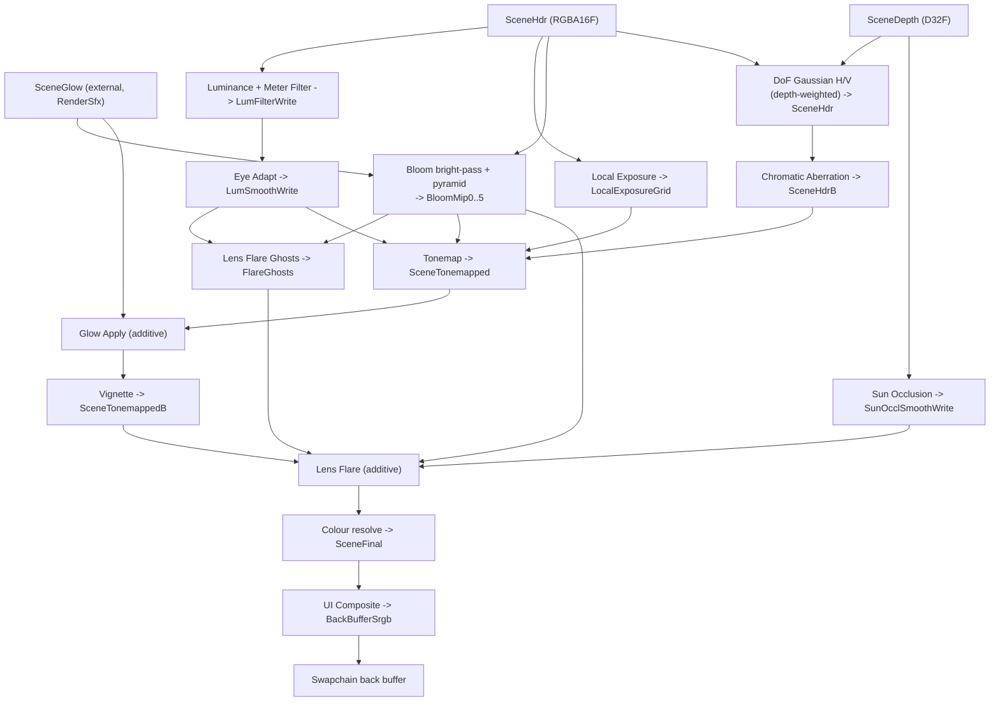
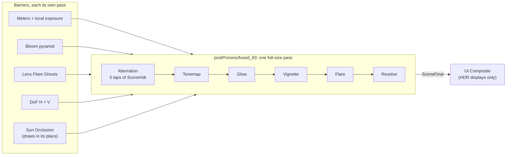

# Post-Processing & HDR

The post-processing chain is the last thing that touches a frame before it reaches
the display. In most engines it is a fixed pipeline compiled into the renderer:
bloom, tonemap, and grade wired together in C++, tuned by a scattering of console
variables. Ceili treats the post chain the way it treats surface shading:
**the post chain is authored as data.**

Every pass is a `.material` file (see [Materials](Materials.md)). Each pass names
the slots it reads and the slot it writes. The whole chain, in order, is a list
assembled in a Lua config function. Reordering the chain, disabling a stage,
swapping in a different tonemapper, or hot-reloading a pass's shader is a data edit,
and none of them needs a rebuild. This page walks that model end to end: the slot
graph, the default chain stage by stage, how the runner fuses adjacent stages into
one pass, and the HDR output path that the chain feeds.

---

## The chain is a list of passes wired by named slots

A post pass is a full-screen draw: sample some input textures, run a fragment
shader, write one output. The only thing that makes a *chain* out of a pile of
passes is agreement on names. Ceili gives every intermediate render target a
**slot**: a four-character id that a pass reads from or writes to.

```cpp
// PostProcess.h: slots are FourCC ids, one per intermediate target.
namespace slots
{
constexpr Slot SceneHdr       = core::FourCC<Slot>('S', 'H', 'D', 'R');
constexpr Slot LumCurr        = core::FourCC<Slot>('L', 'U', 'M', 'C');
constexpr Slot LumSmoothPrev  = core::FourCC<Slot>('L', 'M', 'S', 'P');
constexpr Slot LumSmoothWrite = core::FourCC<Slot>('L', 'M', 'S', 'W');
// The meter LOW-PASSED ahead of eye adapt (postProcess/meter_filter reads LumCurr and LumFilterPrev, writes
// LumFilterWrite, which eye_adapt reads): a second pole, so a flickering light does not make the exposure breathe.
constexpr Slot LumFilterPrev  = core::FourCC<Slot>('L', 'M', 'F', 'P');
constexpr Slot LumFilterWrite = core::FourCC<Slot>('L', 'M', 'F', 'W');
constexpr Slot BackBufferSrgb = core::FourCC<Slot>('B', 'B', 'S', 'R');
```

The namespace continues with the other targets: `SceneHdrB`, `SceneDepth`,
`SceneGlow`, the tonemapped pair `SceneTonemapped` and `SceneTonemappedB`,
`SceneFinal`, `UiOverlay`, the bloom pyramid `BloomMip0` to `BloomMip5`,
`FlareGhosts` (the lens flare's ghosts at the bloom's size), the sun-occlusion
pair, and the slots of the look and local-exposure stages, among others.

The `FourCC` id is the same construction the metadata serializers use for format
tags (see [Metadata: format ids](../Core/Metadata.md#serializers-one-walk-many-formats));
a four-character code is small, printable, and cheap to compare. A slot is a
*promise* of a texture: something later resolves the slot to a live render target
handle. The HDR section below shows what this indirection buys.

A single pass is a `ChainEntry`. It names the material to run, the slot it writes,
the slots it reads (bound to material texture slots), and an optional
shader-constants override:

```cpp
// PostProcess.h: one pass in the chain.
struct ChainEntry
{
    // BOOTSTRAP-scoped, not the row's ScopeDataString and not a heap core::String: the chain is a
    // process-lifetime array that already routes every mutation through ScopeTyped<Bootstrap> (see
    // PostProcess.cpp's BootstrapGuard), so the name belongs in the same arena its entry does.  A
    // heap-owning member here would free at static atexit -- after heap::ReportLeaks -- and report
    // as a leak.  Writers are already under that guard.
    core::BootstrapString materialName;
    char                  label[kMaxLabelLen + 1]{};
    bool                  enabled{true};
    Slot                  output{slots::BackBufferSrgb};
    uint8_t               numInputs{0};
    InputBinding          inputs[kMaxInputBindings]{};

    material::shader::constants::Handle current;
```

After `current`, the struct holds a `blend` state (a cross-fade of the constants
for live tuning), a `groupName` for the chain editor, the pass `flags`, and a
`dialSource`: the material of a later entry whose user dials this entry takes. The
lens flare's ghosts entry uses it, so a designer edits one Lens Flare entry.

`materialName` is a `core::BootstrapString`, and the reason is the leak report.
The chain array itself is Bootstrap-scoped, so a heap-owning member here would
free at static atexit, after the leak detector has already reported, and show up
as a spurious leak.

An `InputBinding` is just `{ Slot source; uint8_t materialSlot; }`: "feed the target
currently in slot `source` into texture slot `materialSlot` of my shader." The cap
is `kMaxInputBindings`, which is eight.

The flags are small but load-bearing. The first three give the structure of a pass:

```cpp
// PostProcess.h
CE_BITFIELD enum class Flags : uint32_t {
    None = 0,
    // Tags HDR-pipeline entries (tonemap, eye-adapt / luminance, lens band).
    // Active-chain rebuild treats these as authored-disabled when
    // GetOutputMode() == Ldr; the chain editor greys + locks them.
    HdrOnly = 1u << 0,
    // Skip the entry when its primary input slot (inputs[0].source) was
    // not written by any enabled chain entry this frame. Opt-in for
    // entries whose math is meaningful only on chain-produced data --
    // e.g. lens_flare math expects bloom-bright values, not raw scene HDR
    // after the slot remap walks back to an external slot.
    RequiresLiveInput = 1u << 1,
```

```cpp
// PostProcess.h
// The entry BLENDS INTO its output rather than transforming
// input -> output. The chain rebuild needs this hint because the
// disabled-branch slot remap differs: transformative entries fall
// through (out -> in); blending entries keep current content.
//
// Named for the One/One case it was written for, and it covers every
// blend: legacy_fog composites SrcAlpha/InvSrcAlpha and needs the same
// hint, because its input is a DEPTH slot - remapping the output to it
// would hand downstream readers the depth buffer as the scene image.
Additive = 1u << 2,
```

`HdrOnly` is how a stage says "I only make sense in the HDR pipeline." `Additive`
is how a pass says "add me on top of what is already there." `RequiresLiveInput`
makes the runner skip a pass when no enabled pass wrote its primary input this
frame.

The other flags tell the runner when to skip a pass and how to draw it. Each one
is a single bit, checked with `core::HasBitfield`, the same strongly typed bitfield
helper used everywhere else in the engine (see
[Core: strong types](../Core/Core.md#strong-types-and-handles)):

- `ModernOnly` and `ModernBloom` skip a pass on a view that draws the legacy look
  or the legacy bloom. `LegacyFogOnly` and `LegacyBloomOnly` do the reverse.
- `DepthOfField`, `Vignette` and `ChromaticAberration` name the scene lens dials a
  pass depends on. The pass stands down on a view whose scene sets those dials to 0.
- `LensFlare`, `LocalExposure` and `FlareGhosts` name a unit that a device strategy
  setting can turn off.
- `WholeOutput` draws over the whole output, for an output whose layout is not the
  scene's image.
- `PerPixel` and `Taps` say how a pass reads its input image. Post-stage fusion
  groups passes by these two flags (see
  [Post-stage fusion](#post-stage-fusion-adjacent-stages-draw-as-one-pass)).

When a pass stands down on one view, the runner's per-view slot remap
(`postProcess::ApplyViewRemap`) hands later readers that pass's input, as the
chain rebuild does for a disabled pass. So a lone pass can stand down and the next
pass still reads a live image.

---

## The chain is assembled in config

The default chain is built in `postProcessConfig()` in `config.lua`. Passes are
appended in execution order. The engine exposes two append entry points (one for
the active chain, one for an inactive pool of passes you can toggle on), and the
config wraps both in a small `appendGroup` helper so related passes (the five
bloom downsamples, say) share a group label in the chain editor:

```lua
-- config.lua: the grouping wrapper over the raw append calls.
local function appendGroup(group, materialName, label, output, inputs, numInputs, hConstants, enabled, entryFlags)
    local flags = entryFlags or pp.Flags.None
    if enabled then
        pp.appendToChainWithBindings(materialName, label, output, inputs, numInputs, hConstants, true, flags)
        pp.setEntryGroup(pp.getChainSize() - 1, group)
    else
        pp.appendToInactive(materialName, label, output, inputs, numInputs, hConstants, flags)
        pp.setInactiveEntryGroup(pp.getInactiveSize() - 1, group)
    end
end
```

`appendToChainWithBindings` takes exactly the `ChainEntry` fields: the material
name, a label, the output slot, an input-binding array plus its count, a constants
handle, the enabled flag, and the pass flags. Because this is Lua, the entire
pipeline is data that loads at runtime and reloads on edit. Adding a pass is one
more line in this function, and no renderer code changes. This is the same
authored-as-data, hot-reloadable story as [Materials](Materials.md), lifted up one
level to the pipeline that strings materials together.

`config.lua` supplies only the *default*: the whole pipeline is editable live.
Graphics exposes a runtime chain-mutation API (insert, remove, move, and enable or
disable a pass), each call firing an `OnChainChanged` event so the chain runner
and the property grid react, and Studio ships a **Post Process** panel built on
it. From that panel you activate a pass from the inactive pool, remove one,
reorder with up and down (a grouped set of passes, like the bloom pyramid, moves
as a unit), toggle any pass, and tweak a pass's constants in place, all while the
scene renders and all undoable within the session. You tune the look live, with no
edit-reload cycle.

---

## The default chain, stage by stage

Here is the shipped chain in order, quoting the real append calls. Read the
`output` slot and the input slots together and the graph draws itself: each stage
reads what the previous stage wrote. The short names in the flag arguments are
local aliases in `config.lua`: `MO` is `ModernOnly`, `MB` is `ModernBloom`, `LDOF`
is `DepthOfField`, `LVIG` is `Vignette`, `LCA` is `ChromaticAberration`, `LFL` is
`LensFlare`, `PPX` is `PerPixel`, and `TAP` is `Taps`.

**Auto-exposure (luminance, meter filter, eye adaptation).** The first passes
measure how bright the scene is and adapt toward it over time, so a scene that
steps from a dark interior into sunlight settles, and the highlights do not blow out.
`luminance` reduces the HDR scene to a luminance value in `LumCurr`. It also reads
the scene depth, so that a sky tap counts by its own weight in the meter.
`meter_filter` low-passes that value, so a flickering light does not make the
exposure breathe. `eye_adapt` smooths the result against last frame's smoothed
value:

```lua
-- config.lua
local function appendEyeAdapt()
    local inputs = ffi.new("ceili_graphics_postProcess_InputBinding[2]")
    inputs[0].source       = has_meter_filter and slots.LumFilterWrite or slots.LumCurr
    inputs[0].materialSlot = 0
    inputs[1].source       = slots.LumSmoothPrev
    inputs[1].materialSlot = 1
    pp.appendToChainWithBindings("postProcess/eye_adapt", "Eye Adapt", slots.LumSmoothWrite, inputs, 2, consts.getInvalidHandle(), true, bit.bor(pp.Flags.HdrOnly, MO))
end
```

The two `LumSmoothPrev` / `LumSmoothWrite` slots are a ping-pong: this frame reads
the previous smoothed luminance and writes the new one, which becomes next frame's
previous. All three passes are `HdrOnly`, because auto-exposure is a property of
the HDR pipeline. A local-exposure unit follows them: it builds a grid from a
quarter-size luminance image, and the tonemap samples that grid.

`eye_adapt` adapts at 1.5 per second in both directions (`rateUp` and `rateDown`).
A step from RedMines' torch-lit mine into the night takes about 1.5 s to see. Each
view meters into its own leased luminance slot. On the first frame a view draws on
a newly leased slot, the engine pushes `instantAdapt`, and the meter filter and the
eye adaptation take that first reading whole. The slot's history belongs to the
previous holder, or holds nothing. Without this step, a night scene that opens
eases down from the daylight seed, and Prospector's night stays black for about
8 s (measured 2026-10-26). Scripts can force every view to its settled exposure with
`ceili.graphics.setForceInstantExposure(true)`, which an A/B spec uses to measure
each hour at its settled level.

The exposure does not lift a dark frame all the way to mid-grey. The tonemap
applies the eye's adaptation limit, a knee under which part of each stop of
darkness stays on screen:

```cpp
// Exposure.h
// THE EYE'S ADAPTATION LIMIT (plan phase B1): above the knee the exposure follows the light fully; under it, each
// stop of darkness keeps darknessShare of a stop on screen. It is a fact about the eye, so it holds at any hour and
// under any sky: a cave by day and a moonlit field at the same light look the same, and nothing steps at sunset.
// The knee's 7 is 16 cd/m^2, a dim interior; 0.25 keeps a full-moon frame (EV100 about -3) about 2.5 stops darker
// than a day. The user's pick (2026-10-20) from a capture A/B of four pairs: it keeps an open night where the
// daylight-key curve it replaced had it, and lifts a torch-lit interior by night about 0.6 stop. Auto and Fixed alike; the
// measurement pin, a legacy view and a physical camera ignore it. Classic's fixed exposure reads the SCENE's dials
// for its band (env::ClassicExposureEV100). Replaced nightAdaptation (1 - share, measured against a daylight key).
float adaptationKneeEV100 CE_RANGE_DESC(-10.0, 20.0, "Under this EV100 the exposure stops following the light fully, so a darker frame shows darker. 7 is a dim interior")                                                                                      = 7.0f;
float darknessShare       CE_RANGE_DESC(0.0, 1.0, "The share of each stop under the knee that stays on screen: 0 lifts every dark frame to the knee's level, 1 holds the exposure at the knee, 0.25 keeps a full-moon night about 2.5 stops darker than a day") = 0.25f;
```

**Bloom.** A bright-pass isolates the highlights into `BloomMip0`, then five
downsamples build a blurred pyramid and five upsamples combine it back up. The
bright-pass also reads the smoothed luminance, for an exposure-relative threshold.
This is the classic energy-preserving bloom, and it is authored as three materials
reused across the pyramid, with no hard-coded loop. One material backs all
five downsamples:

```lua
-- config.lua
local function append_downsample(label, src, dst)
    local inputs = ffi.new("ceili_graphics_postProcess_InputBinding[1]")
    inputs[0].source       = src
    inputs[0].materialSlot = 0
    appendGroup("Bloom", "postProcess/bloom_downsample", label, dst, inputs, 1, consts.getInvalidHandle(), true, bit.bor(MO, MB))
end

append_downsample("Bloom Down 0->1", slots.BloomMip0, slots.BloomMip1)
append_downsample("Bloom Down 1->2", slots.BloomMip1, slots.BloomMip2)
append_downsample("Bloom Down 2->3", slots.BloomMip2, slots.BloomMip3)
append_downsample("Bloom Down 3->4", slots.BloomMip3, slots.BloomMip4)
append_downsample("Bloom Down 4->5", slots.BloomMip4, slots.BloomMip5)
```

Between the bright-pass and the downsamples, `glow_inject` additively adds
`SceneGlow` into `BloomMip0`. `SceneGlow` is written outside the chain entirely, by
`RenderSfx` from every SFX/emissive material pass, so this is how emissive surfaces
join the bloom pyramid without having to clear the bright-pass threshold first:
emissive content always blooms.

<!-- MEDIA: a before/after bloom comparison on a scene with bright emissive
     highlights (sun, glowing material, specular sparkle) -- left with the Bloom
     group disabled, right with it on, to show the highlight bleed. -->

After the bloom, the lens flare's ghosts pass draws at the size of `BloomMip2`.
The [lens flare](#the-lens-flare-and-its-cost) stage below describes it.

**Depth of field.** The shipped variant is a separable Gaussian: a horizontal blur
into `SceneHdrB`, then a vertical blur back into `SceneHdr`. Both DoF passes read
`SceneDepth` as their second input, which is why the depth slot exists: the blur is
depth-weighted so only out-of-focus regions soften.

```lua
-- config.lua
local h_inputs = ffi.new("ceili_graphics_postProcess_InputBinding[2]")
h_inputs[0].source       = slots.SceneHdr
h_inputs[0].materialSlot = 0
h_inputs[1].source       = slots.SceneDepth
h_inputs[1].materialSlot = 1
appendGroup("DoF Gaussian", "postProcess/dof_gaussian_h", "DoF Gaussian H", slots.SceneHdrB, h_inputs, 2, consts.getInvalidHandle(), true, bit.bor(MO, LDOF))

local v_inputs = ffi.new("ceili_graphics_postProcess_InputBinding[2]")
v_inputs[0].source       = slots.SceneHdrB
v_inputs[0].materialSlot = 0
v_inputs[1].source       = slots.SceneDepth
v_inputs[1].materialSlot = 1
appendGroup("DoF Gaussian", "postProcess/dof_gaussian_v", "DoF Gaussian V", slots.SceneHdr, v_inputs, 2, consts.getInvalidHandle(), true, bit.bor(MO, LDOF))
```

The blur follows the active camera's `focusDistance`. A game or a script can pull
focus once a frame with `scene::PullCameraFocus(hScene, NdcX, NdcY, DeltaSeconds,
HalfLifeSeconds)`, also exported to Lua and C#. It casts a CPU ray through a point
of the view, takes the depth along the camera's axis (the depth the DoF passes
measure), and eases the focus toward it in dioptres, as a lens's focus ring moves.
A miss leaves the focus where it is, and the pull needs no GPU readback.

A second, disc-shaped bokeh DoF ships too, registered into the *inactive* pool
(`enabled` = false), outside the running chain:

```lua
-- config.lua
local disc_inputs = ffi.new("ceili_graphics_postProcess_InputBinding[2]")
disc_inputs[0].source       = slots.SceneHdr
disc_inputs[0].materialSlot = 0
disc_inputs[1].source       = slots.SceneDepth
disc_inputs[1].materialSlot = 1
appendGroup("DoF Disc", "postProcess/dof_disc", "DoF Disc", slots.SceneHdrB, disc_inputs, 2, consts.getInvalidHandle(), false, bit.bor(MO, LDOF))

-- Copy back to SceneHdr so tonemap input stays anchored on SceneHdr.
-- Disabled by default (only used with disc mode); enable alongside
-- dof_disc via the group toggle.
local blit_inputs = ffi.new("ceili_graphics_postProcess_InputBinding[1]")
blit_inputs[0].source       = slots.SceneHdrB
blit_inputs[0].materialSlot = 0
appendGroup("DoF Disc", "postProcess/scene_blit", "DoF -> SceneHdr", slots.SceneHdr, blit_inputs, 1, consts.getInvalidHandle(), false, bit.bor(MO, LDOF))
```

`scene_blit` copies the disc result from `SceneHdrB` back into `SceneHdr`, so
both DoF variants finish in `SceneHdr`. This is what the inactive pool is for:
`dof_disc` and `scene_blit` are a fully authored, ready-to-run alternative sitting
on the bench, and the chain editor can activate that pair (and deactivate the
Gaussian one) without touching config, because both variants are already data. The
running pipeline and the alternatives are described in the same list.

**Chromatic aberration.** Lateral chromatic aberration is an effect of the lens, so
it acts on the scene's light, ahead of the tonemap. It reads `SceneHdr` after the
depth of field and writes `SceneHdrB`, which the tonemap reads:

```lua
-- config.lua
-- The CHROMATIC ABERRATION, ahead of the tonemap: lateral dispersion is the lens's, so it acts on the scene's light.
-- Reads SceneHdr (after the depth of field, which finishes back in SceneHdr) and writes SceneHdrB, which the tonemap
-- reads; where it stands down (disabled, its dial 0, a legacy view, the device strategy) the remap hands the tonemap
-- SceneHdr. Its taps then read the HDR scene alone in a fused post pass (Graphics/Prompts/PostStageFusion.md phase 4).
-- TAP: an output pixel reads its input at three nearby positions.
local function appendChromaticAberration()
    local ca_inputs = ffi.new("ceili_graphics_postProcess_InputBinding[1]")
    ca_inputs[0].source       = slots.SceneHdr
    ca_inputs[0].materialSlot = 0
    pp.appendToChainWithBindings("postProcess/chromatic_aberration", "Chromatic Aberration", slots.SceneHdrB, ca_inputs, 1, consts.getInvalidHandle(), true, bit.bor(pp.Flags.HdrOnly, MO, LCA, TAP))
end
```

Because the fringes come from HDR light, a bright highlight fringes more strongly
than the same highlight would after the tonemap.

**Tonemap.** This is the pivot from HDR to display range. `tonemap` reads the HDR
scene the aberration made, the smoothed luminance from auto-exposure, and the bloom
result, and writes the display-referred `SceneTonemapped`. Where the slots exist,
it also reads the local-exposure grid and the look's LUT. The look is the
artist-authored grade: the tonemap applies it before its tone curve.

```lua
-- config.lua
local inputs = ffi.new("ceili_graphics_postProcess_InputBinding[5]")
inputs[0].source       = slots.SceneHdrB
inputs[0].materialSlot = 0
inputs[1].source       = slots.LumSmoothWrite
inputs[1].materialSlot = 1
inputs[2].source       = slots.BloomMip0
inputs[2].materialSlot = 2
local num_inputs = 3
if slots.LocalExposureGrid ~= nil then
    inputs[3].source       = slots.LocalExposureGrid
    inputs[3].materialSlot = 3
    num_inputs             = 4
    if slots.LookLut ~= nil then
        inputs[4].source       = slots.LookLut
        inputs[4].materialSlot = 4
        num_inputs             = 5
    end
end
pp.appendToChainWithBindings("postProcess/tonemap", "Tonemap", slots.SceneTonemapped, inputs, num_inputs, consts.getInvalidHandle(), true, bit.bor(pp.Flags.HdrOnly, PPX))
```

Where the chromatic aberration stands down, the slot remap hands the tonemap
`SceneHdr` in place of `SceneHdrB`. The stages before tonemap work in
scene-referred HDR, and everything after works in the tonemapped range. The stages
that follow are the glow and lens layer.

**Glow apply.** Immediately after tonemap, `glow_apply` re-adds the same
`SceneGlow` buffer onto the tonemapped scene, this time additively and directly,
outside the bloom pyramid:

```lua
-- config.lua
local function appendGlowApply()
    local inputs = ffi.new("ceili_graphics_postProcess_InputBinding[1]")
    inputs[0].source       = slots.SceneGlow
    inputs[0].materialSlot = 0
    pp.appendToChainWithBindings("postProcess/glow_apply", "Glow Apply", slots.SceneTonemapped, inputs, 1, consts.getInvalidHandle(), true, bit.bor(pp.Flags.HdrOnly, pp.Flags.Additive, PPX))
end
```

This gives emissive content two contributions: the soft halo from `glow_inject`
riding the bloom pyramid, and a sharp re-add here so the emissive surface itself
still reads at full brightness after tonemap compresses it, matching the legacy
glow-overlay look.

**Sun occlusion.** `sun_occlusion` samples a disc of the scene depth buffer around
the projected sun to estimate how much on-screen geometry is blocking it this
frame, eases that raw coverage against last frame's smoothed value, and writes the
result to `SunOcclSmoothWrite`:

```lua
-- config.lua
local function appendSunOcclusion()
    local inputs = ffi.new("ceili_graphics_postProcess_InputBinding[2]")
    inputs[0].source       = slots.SceneDepth
    inputs[0].materialSlot = 0
    inputs[1].source       = slots.SunOcclSmoothPrev
    inputs[1].materialSlot = 1
    -- MB as well: only the lens flare reads the coverage, and the flare stands down with the HDR bloom, so the
    -- two stand down together (one unit, the ModernOnly contract).
    pp.appendToChainWithBindings("postProcess/sun_occlusion", "Sun Occlusion", slots.SunOcclSmoothWrite, inputs, 2, consts.getInvalidHandle(), true, bit.bor(pp.Flags.HdrOnly, MO, MB, LFL))
end
```

The lens flare pass below reads this smoothed coverage to fade its starburst out
when the sun is behind geometry, so the starburst does not pop on hard edges.

**Vignette.** The vignette darkens the edges of the tonemapped image. It reads
`SceneTonemapped` and writes `SceneTonemappedB`, which the lens flare blends onto
and the colour resolve reads:

```lua
-- config.lua
-- Lens band: vignette + lens flare. Both HdrOnly -- they composite onto the
-- tonemapped scene, no meaning in Ldr mode. The vignette writes
-- SceneTonemappedB and the lens flare blends onto it; the colour resolve
-- reads it. (The chromatic aberration ran ahead of the tonemap.)
local function appendLensBand()
    -- Phase 5a: lens vignette. Radial darkening applied between tonemap and
    -- the LUT grade. Reads SceneTonemapped, writes SceneTonemappedB. LUT
    -- then reads SceneTonemappedB so vignette darkening is included before
    -- the final grade. strength=0 disables the effect without removing it.
    local vig_inputs = ffi.new("ceili_graphics_postProcess_InputBinding[1]")
    vig_inputs[0].source       = slots.SceneTonemapped
    vig_inputs[0].materialSlot = 0
    pp.appendToChainWithBindings("postProcess/vignette", "Vignette", slots.SceneTonemappedB, vig_inputs, 1, consts.getInvalidHandle(), true, bit.bor(pp.Flags.HdrOnly, MO, LVIG, PPX))
```

### The lens flare and its cost

The lens flare is the one pass with all three structural flags at once. It samples
a live bloom input, the sun-occlusion coverage and the meter, and *adds* its
contribution on top of the vignette's `SceneTonemappedB`:

```lua
-- config.lua
local flare_inputs = ffi.new("ceili_graphics_postProcess_InputBinding[4]")
flare_inputs[0].source       = slots.BloomMip2
flare_inputs[0].materialSlot = 0
flare_inputs[1].source       = slots.SunOcclSmoothWrite
flare_inputs[1].materialSlot = 3
flare_inputs[2].source       = slots.LumSmoothWrite
flare_inputs[2].materialSlot = 4
-- input 3 = FlareGhosts (materialSlot 5), the ghosts drawn at the bloom's size, read only on a view where that
-- entry drew (the engine-pushed ghostsAtBloomSize).
local num_flare_inputs = 3
if slots.FlareGhosts ~= nil then
    flare_inputs[3].source       = slots.FlareGhosts
    flare_inputs[3].materialSlot = 5
    num_flare_inputs             = 4
end
pp.appendToChainWithBindings("postProcess/lens_flare", "Lens Flare", slots.SceneTonemappedB, flare_inputs, num_flare_inputs, consts.getInvalidHandle(), true, bit.bor(pp.Flags.HdrOnly, pp.Flags.RequiresLiveInput, pp.Flags.Additive, MO, MB, LFL, PPX))
```

The inputs bind `BloomMip2` (a pre-thresholded bright signal that drives the ghosts
and halo), `SunOcclSmoothWrite` (this frame's smoothed sun coverage, which fades the
starburst behind on-screen geometry), `LumSmoothWrite` (the metered luminance, so
the ghosts take the frame's exposure), and `FlareGhosts`. `bit.bor` combines the
flags: `HdrOnly` (only in the HDR pipeline), `RequiresLiveInput` (the bloom input
must actually have been written by an enabled bloom entry this frame), and
`Additive` (blend onto the output). The flare reads only its own textures and never
the image it adds onto, so it also carries `PerPixel` and fuses like the glow apply.

The flare is expensive on a mobile tiler. On a Quest 2 (2026-10-22,
`Tools/ab_quest_lens_flare.lua`, stereo_view with the post chain on, every stage as
its own pass, 36 of 36 pairs) it cost 12.84 ms of `Frame.Gpu` for both eyes, 6.4 ms
an eye. Of that, the bloom samples were 60% (7.7 ms), the bare full-size pass 38%
(4.8 ms, a load and a store of the frame), and the starburst and the dirt 2%. With
the ghosts drawn per pixel, each pixel reads 18 taps of the 1/8-size `BloomMip2`:
six chromatic samples of three taps.

Two changes cut that cost:

- **A zero dial skips its taps.** `postLensFlare.hlsli` branches on its uniform
  dials. A zero `ghostIntensity` skips the 18 bloom taps and the meter read, a zero
  `chromaticOffset` takes one tap a sample, and a zero `dirtIntensity` skips the
  dirt tap. The shipped dials draw the same image.
- **The ghosts draw at the bloom's size.** `postProcess/lens_flare_ghosts` draws
  the ghosts and the halo once per texel of `BloomMip2` into `FlareGhosts`, and the
  flare reads them with one bilinear tap. The ghosts entry takes the flare entry's
  dials through `setEntryDialSource`:

```lua
-- config.lua
local inputs = ffi.new("ceili_graphics_postProcess_InputBinding[2]")
inputs[0].source       = slots.BloomMip2
inputs[0].materialSlot = 0
inputs[1].source       = slots.LumSmoothWrite
inputs[1].materialSlot = 1
pp.appendToChainWithBindings("postProcess/lens_flare_ghosts", "Lens Flare Ghosts", slots.FlareGhosts, inputs, 2, consts.getInvalidHandle(), true,
    bit.bor(pp.Flags.HdrOnly, pp.Flags.RequiresLiveInput, MO, MB, LFL, pp.Flags.FlareGhosts))
pp.setEntryDialSource(pp.getChainSize() - 1, "postProcess/lens_flare")
```

The ghosts pass runs while `display::StrategySettings::flareGhostsAtBloomSize` is
on, which is the default, on exactly the views where the flare draws. It sits ahead
of the fused run, because it reads the meter that the tonemap reads. Measured
2026-10-24 with `Tools/ab_flare_ghosts.lua` (144 of 144 pairs on every line, the
null arm inside 0.05%):

| Device | Scene | `Frame.Gpu`, ghosts per pixel -> at the bloom's size |
|---|---|---|
| D3D12, RTX 3080, 2304x1296 | light_stress | 1.372 -> 1.290 ms (-6.0%) |
| D3D12, RTX 3080, 2304x1296 | RedMines | 1.453 -> 1.374 ms (-5.4%) |
| A console devkit, 1080p | light_stress | 2.435 -> 2.290 ms (-5.9%) |

The ghosts soften slightly: 52 of 3M pixels move by more than 12 levels in the
constants smoke. The Quest 2 is still to measure, because the shipped headset
profile keeps the flare and the post chain off.

**Colour resolve and UI composite.** The colour resolve moves the image from
`SceneTonemappedB` into `SceneFinal`. In the `Sdr` output mode it also decodes to
linear, so the sRGB-typed store encodes the colour exactly once:

```lua
-- config.lua
local function appendColourResolve()
    local inputs = ffi.new("ceili_graphics_postProcess_InputBinding[1]")
    inputs[0].source       = slots.SceneTonemappedB
    inputs[0].materialSlot = 0
    pp.appendToChainWithBindings("postProcess/colour_resolve", "Colour resolve", slots.SceneFinal, inputs, 1, consts.getInvalidHandle(), true, PPX)
end
```

Last, `ui_composite` combines the final scene with the UI overlay and writes the
swapchain back buffer. It runs only on an HDR display, where it also does the
HDR10 or scRGB encode. Its enabled state follows the output mode:

```lua
-- config.lua
local composite_index = pp.getChainSize()
local initial_mode    = ceili.graphics.getOutputMode()
local initial_enabled = ceili.graphics.isHdrDisplay(initial_mode)
pp.appendToChainWithBindings("postProcess/ui_composite", "UI Composite", slots.BackBufferSrgb, inputs, 2, consts.getInvalidHandle(), true)
pp.setEnabled(composite_index, initial_enabled)
```

On a view that draws the scene's legacy bloom, five `legacy_bloom` passes run
between the tonemap and the glow apply, and every other view skips them.

<!-- MEDIA: the look grading step -- the same frame with three different .look
     files applied (neutral, cinematicTeal, cool) side by side, to show that the
     grade is a data swap. -->

Every one of those material names maps to a real file under
`Pkg/Engine/Graphics/Resources/Materials/`: `luminance.material`, `bloom.material`,
`tonemap.material`, `lens_flare.material`, `lens_flare_ghosts.material`,
`colourResolve.material`, `postFused.material`, and the rest. Each is an ordinary
post-process material carrying its own fragment shader and constants, authored the
same way any surface material is. Edit one, save, and the pass updates in the
running editor on the next hot-reload drain (see
[Core: hot reload](../Core/Core.md#the-support-cast-logging-profiling-time-hot-reload)).

---

## The slot graph

Putting the outputs and inputs together, the default chain is a directed graph
over slots. Auto-exposure, the bloom pyramid and the chromatic aberration feed the
tonemap, whose output then runs through the glow and lens passes before the colour
resolve and UI composite land it on the back buffer.



The append list alone produces the graph: each pass's `output` slot and `inputs`
array are the edges, so editing the list directly reshapes the graph.

---

## Post-stage fusion: adjacent stages draw as one pass

Each full-size stage reads the whole frame and writes the whole frame. On a
tile-based GPU each one is also its own render pass, with a load and a store of the
frame. On every device measured, the post chain is a large share of the GPU frame:
1.9 ms of a 2.9 ms frame on a console devkit at 1080p (2026-10-22). So the chain
runner draws each run of adjacent per-pixel stages as **one** pass, whatever stages
the user turns on or off.

### What can fuse

Each stage declares how it reads its input image, with a flag:

- `PerPixel`: an output pixel reads only its own pixel of the input. Other
  textures at any position are fine. The tonemap, the glow apply, the vignette, the
  lens flare and the colour resolve carry it.
- `Taps`: an output pixel reads its input at a few positions near its own. The
  chromatic aberration carries it.
- Neither flag makes the stage a **barrier**: it reads neighbours at a distance, or
  a shrunk copy of the frame. The meters, the bloom pyramid, the depth of field,
  the local exposure and the sun occlusion are barriers.

Six stages have a fused form, in a fixed **canonical order**. Bit `i` of a run's
mask is stage `i` of this table:

```cpp
// PostProcess/PostProcess.cpp
// The canonical order, which every fused variant evaluates in (postFused.hlsli). The chromatic aberration comes
// FIRST: it is a lens effect on the scene's light, so it reads the HDR scene, and as a run's first member its three
// taps read that texture alone, where later in a run each tap re-ran every stage before it (Prompts/PostStageFusion.md
// phase 4). The lens flare fuses as the glow does: it adds onto the image what it reads from its own textures. The
// texture slots map each member's material slot onto the variants' ten (postFused.material): 0 the run's image, 1 the
// metered luminance, 2 the bloom, 3 the glow, 4 the local exposure grid, 5 the look's LUT, 6 the flare's bloom, 9 the
// sun occlusion's coverage, 10 the flare's ghosts at the bloom's size (7 and 8, the flare's dirt and starburst, are the
// variants' own textures).
constexpr uint8_t           N         = kNoFusedSlot;
static constexpr FusedStage kStages[] = {
    {"postProcess/chromatic_aberration", "ca_", "Aberration", {kFusedImageSlot, N, N, N, N, N, N, N}},
    {"postProcess/tonemap", "tm_", "Tonemap", {kFusedImageSlot, 1, 2, 4, 5, N, N, N}},
    {"postProcess/glow_apply", "ga_", "Glow", {3, N, N, N, N, N, N, N}},
    {"postProcess/vignette", "vig_", "Vignette", {kFusedImageSlot, N, N, N, N, N, N, N}},
    {"postProcess/lens_flare", "lf_", "Flare", {6, N, N, 9, 1, 10, N, N}},
    {"postProcess/colour_resolve", "cr_", "Resolve", {kFusedImageSlot, N, N, N, N, N, N, N}},
};
```

In a fused pass, a `Taps` stage evaluates every stage before it once per tap. The
chromatic aberration comes first in the order, so its three taps read the HDR
scene texture alone, and the stages after it run once per pixel. The order was
measured: with the aberration after the vignette (2026-10-22, D3D12, RTX 3080),
each tap ran the tonemap, glow and vignette again, and fusing it made the GPU frame
1.7% slower on light_stress and 7.0% slower on RedMines.

### How the runner groups a run

Each frame, for each view, the runner builds a plan of the active chain:
`BuildFusedRuns` in `Render/PostProcess.cpp` takes every entry that draws on the
view, applies the per-view slot remap, and calls `postProcess::GroupFusedRuns`. A
run is a sequence of adjacent drawing stages, each reading the image the one before
it made. A run of two or more draws as `postProcess/fused_<mask>` at the position of
its last member, and binds the members' own inputs. A run of one draws that stage's
own pass. Each reason a stage does not join a run has a name:

```cpp
// PostProcess.h
// Why an entry is not a member of a fused run, for the chain panel and the grouping tests.
enum class FuseBreak : uint8_t
{
    None = 0,       // a member, or the entry that began a run
    NotDrawing,     // it stands down on this view
    Barrier,        // it reads beyond its own pixel and a few taps (neither PerPixel nor Taps)
    NoFusedForm,    // per-pixel, but no fused variant carries its stage, or the strategy keeps its stage out
    Reordered,      // its stage comes before the run's last one in the canonical order
    NotLinked,      // it neither reads nor blends onto the image the run made
    ReadsRunOutput, // the run would read a slot it writes
    ImageReadLater, // a later entry reads an image the fused pass would no longer write
};
```

A barrier that uses none of the run's slots so far does not end the run. It draws
in its place, and the fused pass draws later, at the last member. The sun occlusion
is the shipped case: it sits between the glow apply and the vignette and reads only
the depth and its own coverage. A stage that a user moves out of the canonical
order draws separately. The image is still correct, and the frame is slower. Each
rule has its own unit test in `PostProcessChainUnitTests.cpp`.

With every stage on, the whole default colour path is one run on a modern view:



### One shader text for each stage

Each stage's shader code lives once, and both the stage's own pass and every fused
variant call it. The tonemap is two macros in `postColour.hlsli`
(`POST_TONEMAP_PARAMS` and `POST_TONEMAP_EXPOSE`), the vignette, the aberration's
offset and the colour resolve are functions there, and the lens flare is
`PostLensFlare` in `postLensFlare.hlsli`. So a fused pass cannot drift from the
passes it replaces. The fused body evaluates the members in order and never
stores the image between them:

```hlsl
// postFused.hlsli
// THE CHROMATIC ABERRATION'S THREE TAPS read only that input texture: it comes first, on the scene's light, so the stages
// after it run once. Every other stage reads its own pixel. So a fused pass draws exactly the separate passes' image, up
// to the rounding of the intermediate images they store.
//
// The grade still (tm_lookStill) is never drawn fused: the runner keeps a still view on the separate passes.
Col main(in VsToFs In)
{
#if FUSE_ABERRATION
    const float2 offs = PostChromaticOffset(In.uv, fc.ca_viewUvScale, fc.ca_strength * fc.ca_chromaticAberrationScale);
    POST_CHROMATIC_TAPS(image, In.uv, offs, textures, sampler0, fc.inputIndex)
#else
    float4 image = SAMPLE_TEXTURE(textures, sampler0, In.uv, fc.inputIndex);
#endif
#if FUSE_TONEMAP
    POST_TONEMAP_PARAMS(tm, fc, tm_)
    POST_TONEMAP_EXPOSE(exposed, image, In.uv, fc, tm_, tm, textures, sampler0)
    POST_LOOK(exposed, textures, sampler0, fc.lookLutIndex, tm)
    image.rgb = PostTonemapFinish(exposed, In.pos.xy, tm);
```

`postFused.material` builds one variant for every subset of two or more of the six
stages: 57 variants with one shared vertex shader. They are built ahead of time,
because a console or a Quest has no runtime shader compiler. A fused variant owns
no dials. Each draw, the runner forwards each member entry's resolved constants
under the stage's prefix (`ca_`, `tm_`, `vig_`, `lf_`, `cr_`), so the designer's
dials, looks, blends and engine pushes reach the fused pass with no second copy.
A run whose variant or member is still building draws its stages separately that
frame.

### Toggles, parity and measurements

Two strategy settings control fusion. Both take effect on the next frame:

- `display::StrategySettings::fusePostStages` (on by default;
  `CEILI_FUSE_POST_STAGES=0` turns it off).
- `display::StrategySettings::fuseStageMask` (all six bits, 63, by default;
  `CEILI_FUSE_STAGE_MASK`). Bit 1 is the chromatic aberration, 2 the tonemap, 4 the
  glow, 8 the vignette, 16 the lens flare and 32 the colour resolve. A stage left
  out draws its own pass, so a device can price one stage fused against alone.

Fusion does not change the image. The constants smoke (`-constantsSmoke`) has a
fusion arm for every variant. On Vulkan, Vulkan with validation and D3D12, 55 of
the 57 variants form in the shipped chain and draw the separate passes' image with
no pixel past the tolerance. Masks 20 and 52 cannot form in the shipped chain: a
run that the glow apply begins, with the flare and no vignette, would read the slot
it writes. The smoke skips them and logs the reason.

All six stages fused, measured 2026-10-22 against every stage as its own pass
(`Tools/ab_fuse_post_stages.lua` and `Tools/ab_quest_fuse_post_stages.lua`, 36 of
36 pairs on every line):

| Device, scene | GPU frame, separate | All six fused | The stages: separate -> fused |
|---|---|---|---|
| D3D12, RTX 3080, light_stress 2304x1296 | 1.543 ms | **-10.2%** | 0.368 -> 0.211 ms |
| D3D12, RTX 3080, RedMines 2304x1296 | | **-10.8%** | 0.426 -> 0.254 ms |
| A console devkit, light_stress 1080p | 2.772 ms | **-11.9%** | 0.703 -> 0.367 ms |
| Quest 2, stereo_view, post chain on | 41.69 ms | **-24.8%** (31.34 ms) | 24.29 -> 14.04 ms, both eyes |

With the aberration kept out of the run (mask 62), the frame is 3.2% slower than
all six fused on the console devkit and 3.0% slower on the Quest 2. So no stage is
kept out by default. The Quest line turns the post chain on over the shipped
headset profile, which turns it off. That profile keeps `fusePostStages` on,
so a profile that turns the chain back on gets the fused frame.

<!-- MEDIA: the Studio Post Process panel's "Show active chain" table with the
     default chain on light_stress: the header "N running in M passes", the
     collapsed teal "Fused pass: Aberration + Tonemap + Glow + Vignette + Flare +
     Resolve (6 stages)" row, and the tooltip on the Sun Occlusion row. -->

### The chain panel shows what fused

The runner publishes what it drew on the frame's largest view
(`postProcess::GetFuseSnapshot`): its runs, each active entry's `FuseBreak`, and
the number of passes drawn. The **Post Process** panel only reads it. Its active
chain header counts passes as well as entries, for example "9 running in 6 passes".
Each fused run is one collapsible row named for its stages, such as "Fused pass:
Tonemap + Glow + Resolve (3 stages)", with its members banded in one teal. A stage
outside a run has a tooltip that says why it did not fuse, and the authoring rows
show a "fused" badge on every member, so an edit to the chain shows its effect at
once.

### A pass that covers its output discards it

A post entry that does not blend writes every pixel of its output, so it does not
need the output's old contents. The runner opens such an output with
`cmd::LoadOp::DontCare`:

```cpp
// Render/PostProcess.cpp
// An entry that covers its whole output (no blend, no clip or placement, a full span) writes every pixel, so the
// output's old contents are not needed and are discarded rather than cleared.  A clear there was a second full
// write on a device without colour compression: 0.04 ms of each 0.14 ms full-screen entry at 1080p on a console.
// A sub-rect present keeps its clear, because the rest of the back buffer shows.  The strategy's off arm clears, as
// before, so the saving stays measurable on each device.
//
// A PLACED present (an XR eye) names its destination as the render area, so a backend that loads and stores per
// pass touches only that rectangle and the other eye's half keeps what it holds whatever the op says. Inside it the
// present writes every pixel, so it discards rather than loads. Before the area each eye loaded and stored the whole
// 2880x1584 image on a Quest 2: 4.6% of its GPU frame (2026-10-21). Off, it loads the whole image, as before.
const bool        area_present = placed_present && !clipped_present && display::GetStrategy().presentRenderArea;
const bool        loads        = Blends || clipped_present || (placed_present && !area_present);
const bool        covers       = (SpanX >= 1.0f) && (SpanY >= 1.0f) && display::GetStrategy().discardCoveredPostOutputs;
const cmd::LoadOp color_op     = loads ? cmd::LoadOp::Load : ((covers || area_present) ? cmd::LoadOp::DontCare : cmd::LoadOp::Clear);
```

D3D12 and the consoles skip the clear. Vulkan takes `LOAD_OP_DONT_CARE` through two
render pass variants that reuse the clear variants' framebuffers. The setting is
`display::StrategySettings::discardCoveredPostOutputs` (on by default;
`CEILI_DISCARD_COVERED_POST_OUTPUTS=0` turns it off), and both states draw the same
image. Measured 2026-10-21 on RedMines with `Tools/ab_post_discard.lua`:

- D3D12, RTX 3080, 2304x1296: `Frame.Gpu` 1.682 -> 1.668 ms (-0.8%). The clear
  was nearly free.
- A console devkit, 1080p: the vignette 0.138 -> 0.096 ms and the GPU frame
  3.10 -> 2.86 ms, because its colour clear writes the whole uncompressed target.
- Another console devkit, 3840x2160: `Frame.Gpu` -0.85%.
- Quest 2: no change, because the shipped headset profile turns the post chain off.

---

## HDR output: one chain, three destinations

The chain writes an HDR scene, tonemaps it, and lands on a back buffer. What "the
back buffer" *is* depends on the display. Ceili supports three output modes, plus a
legacy path:

```cpp
// Graphics.h
// Ldr / Sdr are universally supported. Hdr10 / Scrgb need an HDR-capable
// display + backend support, gated by IsOutputModeSupported. GetUseHDR()
// returns true for everything except Ldr.
enum class OutputMode : uint8_t
{
    Ldr   = 0,
    Sdr   = 1,
    Hdr10 = 2,
    Scrgb = 3,
};

// Hdr10 / Scrgb are the HDR-display output paths -- the swapchain encodes
// extended-range linear with a peak-nits multiplier. Ldr / Sdr drive an
// LDR sRGB swapchain. Centralised so chain-runner runtime pushes and the
// SceneFinal / UiOverlay slot resolvers stay in agreement on the boundary.
CE_INLINE bool IsHdrDisplay(const OutputMode Mode)
{
    return Mode == OutputMode::Hdr10 || Mode == OutputMode::Scrgb;
}
```

`Sdr` is the default. It runs the full HDR pipeline and tonemaps the result onto a
standard display. The HDR scene target is a viewport-resolution `RGBA16F` (with a
`D32F` depth), exposed as:

```cpp
// Graphics.h
CE_API renderTarget::Handle GetSceneRenderTarget();
```

The scene is always rendered in HDR into that target. The difference between the
modes is only what happens at the very end of the chain, and that is where the slot
indirection pays off. A slot resolves to a live render target through a registered
producer, and the final-output slots register a producer that *branches on the
output mode*:

```cpp
// PostProcess/PostProcessSetup.cpp
RegisterSlot(slots::SceneFinal, []() {
    return IsHdrDisplay(GetOutputMode()) ? GetSceneFinalRenderTarget() : GetBackBufferSrgbHandle();
});
RegisterSlot(slots::UiOverlay, []() {
    return IsHdrDisplay(GetOutputMode()) ? GetUiOverlayRenderTarget() : GetBackBufferSrgbHandle();
});
```

On an SDR display the graded scene goes straight to the sRGB back buffer. On an HDR
display it lands in an intermediate HDR final target, so a wide-gamut encode step
can take it the rest of the way to HDR10 or scRGB. The chain, the passes, and the
materials stay the same either way; only the slot's resolved handle changes.

### The HDR-only passes drop out in LDR

The legacy `Ldr` mode is where `Flags::HdrOnly` earns its place. The chain
rebuild reads the output mode once, before it walks the entries:

```cpp
// PostProcess/PostProcess.cpp
// HdrOnly entries (tonemap, lens stylization, the auto-exposure pair
// that feeds tonemap) are treated as authored-disabled in Ldr -- the
// user wants Ldr to approximate the pre-HDR-pipeline ground truth
// (geometry -> back buffer, no tonemap formation, no lens stylization).
// Other modes leave the flag inert.
const bool is_ldr = (graphics::GetOutputMode() == graphics::OutputMode::Ldr);
```

Then, for each entry, an `HdrOnly` pass is suppressed if the output mode is `Ldr`:

```cpp
// PostProcess/PostProcess.cpp
// `enabled` choice is preserved across mode flips, but in Ldr the
// entry doesn't enter the active chain (treated identically to an
// authored-disabled entry -- propagates via slot remap, doesn't
// appear in the runner's view). Other modes ignore the flag.
const bool hdr_only_suppressed = is_ldr && core::HasBitfield(entry.flags, Flags::HdrOnly);
const bool effectively_enabled = entry.enabled && !hdr_only_suppressed;
```

Auto-exposure, local exposure, the chromatic aberration, the tonemap, the glow
apply, the sun occlusion, the vignette, and the lens flare with its ghosts are all
`HdrOnly`; in the legacy LDR path they are not part of the chain. The passes
without the flag (bloom, DoF, the colour resolve) still run. One flag, checked at
chain-build time, is the entire mechanism.

### A mode change re-plumbs the chain

Because the slot producers branch on the output mode, switching modes at runtime has
to rebuild the active chain so the branches re-resolve. That is wired as a delegate:
the output-mode change fires a hook that marks the active chain dirty, and it gets
rebuilt on the next frame.

```cpp
// PostProcessSetup.cpp
// Active-chain HdrOnly suppression flips on the Ldr boundary. Mark the
// chain dirty so the next runner read re-evaluates which entries appear
// in the active chain under the new mode. Registered as an
// OnOutputModeDelegate so SetOutputMode fires it after the RT recreation
// hooks already in place.
void DirtyActiveChainOnModeChange([[maybe_unused]] const OutputMode Mode)
{
    MarkActiveChainDirty();
}
```

The engine slot setup registers the hook:

```cpp
// PostProcessSetup.cpp

// Active chain rebuild reads GetOutputMode() to decide whether
// HdrOnly entries are suppressed (Ldr) or active (Sdr / Hdr10 /
// Scrgb). Without this hook the chain stays at its prior mode's
// shape until a chain mutator dirties it; with it, every mode
// flip refreshes on the next runner read.
AddOnOutputModeDelegate({&DirtyActiveChainOnModeChange});
```

This is the same dirty-then-rebuild pattern the rest of the engine uses: mark
something dirty, then drain and reconcile once per frame. The mode switch itself
does no re-plumbing. The mode is an ordinary setting, reflected and editable like
any other:

```cpp
// Display.h: outputMode is a reflected setting.
struct Settings
{
    OutputMode outputMode             CE_DESC("Swapchain output mode -- Sdr runs the HDR pipeline onto any display, Ldr is the legacy LDR path, Hdr10 / Scrgb need an HDR-capable display. An unsupported mode reverts on apply") = OutputMode::Sdr;
    texture::Flags activeTextureFlags CE_DESC("Material texture channels to display -- a debug mask. All shows every channel")                                                                                                    = texture::Flags::All;
```

`Apply()` pushes the settings to the engine, and reverts `outputMode` if the
device rejects the mode:

```cpp
// Display.h
// The live settings singleton -- the App settings registry binds the PropertyGrid to this, and
// external callers (agent / config) can mutate it; Apply() pushes the values to the engine.
CE_API Settings& GetSettings();

// Push the settings to the engine: outputMode -> SetOutputMode (reverting the field to the active
// mode if the device / OS rejects it), activeTextureFlags -> texture::SetActiveFlags.  Registered
// as a per-frame update delegate by Init (cheap -- the setters early-out when unchanged).
CE_API void Apply();
```

Because `outputMode` is a reflected field with a `CE_DESC` annotation, it shows up
in the Studio settings grid with its tooltip automatically, the same way every
reflected field does (see
[Metadata: the property grid builds itself](../Core/Metadata.md#the-property-grid-builds-itself)).
Picking HDR10 on a display that cannot do it fails cleanly: `Apply()` reverts the
field.

<!-- MEDIA: an HDR10-vs-SDR comparison of the same frame (ideally a split-screen or
     an HDR-captured photo of an HDR display next to the SDR tonemap) showing the
     extended highlight range. Note in the caption that SDR here is still the full
     HDR pipeline tonemapped down. -->

### One binary, desktop to mobile

The output mode is also a lever for targeting
the full spread of hardware from a single build, from a high-powered desktop with
an HDR display down to a low-capability mobile device. On capable hardware the
engine runs the whole HDR pipeline and encodes to HDR10 or scRGB. On a constrained
device it drops to the `Ldr` path, where the expensive `HdrOnly` passes fall out of
the chain entirely and only the cheap passes remain. The mode is an ordinary
reflected setting whose change re-plumbs the chain on the next frame, so the engine
can move in and out of `Ldr` *dynamically at runtime*, adapting to the detected
display, a performance budget, or a user toggle, with no rebuild and no second
render path to maintain. The device strategy settings (`lensFlare`,
`depthOfField`, `vignetteAndAberration`, `localExposure`, the fusion toggles) add
finer levers on top. The shipped Quest profile goes further and turns the whole
post chain off (`postProcess::SetPostProcessingEnabled`). Spanning high-end desktop
to low-powered mobile from one codebase is a deliberate goal, and the output mode,
the `HdrOnly` flag and the strategy settings are how the pixel pipeline serves it.

---

## What it does not do yet

- **A reordered run draws separately.** Fusion follows one canonical order. A user
  who moves a stage out of that order gets a correct image and pays for the
  separate passes.
- **The grade still is never fused.** A view that shows the look's still keeps the
  separate passes.
- **No new fusable stage without new variants.** The variant count doubles with
  each stage: six stages are 57 variants on each backend.
- **The Quest 2 has no measured verdict for the flare ghosts at the bloom's size.**
  The shipped headset profile runs no post chain, so no headset frame draws it.

---

## Why author the pipeline as data

A fixed C++ post chain is expensive to change:
reordering forces a recompile, adding a new effect means changing renderer code
directly, and the SDR and HDR paths drift into two code paths that have to be kept
in sync by hand. Ceili makes the chain a list of data-authored passes wired by
named slots, with the per-mode differences collapsed onto a single slot-resolution
branch and a single `HdrOnly` flag. This is the same bet the rest of the engine
makes.

The consequences fall straight out of that:

- **Reordering, disabling, or swapping a pass is a config edit** and needs no
  rebuild. The chain editor operates on the same `ChainEntry` list, including an
  inactive pool of ready-to-run alternatives like the disc-bokeh DoF.
- **A pass's shader hot-reloads** like any material, so tuning bloom or a tonemapper
  is an edit-save-see loop with no restart.
- **SDR and HDR are one pipeline.** The scene is always HDR; only the final slot's
  resolved target and the set of `HdrOnly` passes differ, so there is no second code
  path to maintain.
- **The runner can fuse passes it did not write.** Each stage states how it reads
  its input, so the runner merges any run of per-pixel stages into one pass and the
  chain stays a plain list.

It is the same story as [Materials](Materials.md), one level up: the individual
passes are authored materials, and the pipeline that sequences them is authored data
too. For where those HDR targets come from and how the scene is rendered into them
in the first place, see [Render Passes & Visibility](RenderPasses.md).

Next: [Rendering](README.md), or back to the
[documentation index](../README.md).
