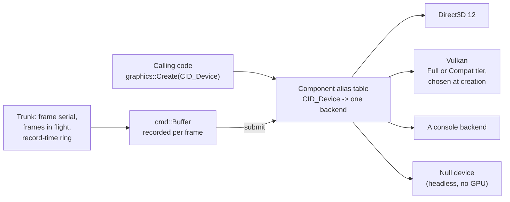

# Render Devices & Backends

The renderer never names a graphics API. Calling code records commands into a
buffer, and one device interface replays that buffer on whichever backend the
build carries: Direct3D 12, Vulkan, a console backend, or a headless `Null`
device that draws nothing and makes the whole path testable with no GPU. The
backend is a package plus a one-line runtime alias, so adding one fills in a seam
that already exists.

This page covers how a device is chosen, the two tiers the Vulkan backend picks
between, who owns the frame's clock and its record-time memory, and how a
texture reaches the device. It is part of the [Rendering](README.md) set.



---

## One device interface, any number of backends

The GPU is behind a single interface, `IDevice`. Every rendering call the rest of
the engine makes goes through it, and nothing above it knows which graphics API
the concrete device speaks. Direct3D 12 and Vulkan ship today, and a console
backend, a package of its own, draws the scene on a console devkit. The Vulkan
backend also runs on Android: on a Meta Quest headset, where OpenXR supplies the
swapchain and the camera draws two eye views into it, and on an Android phone:

```cpp
// IDevice.h
struct IDevice : component::IComponentSingleton
{
    virtual ConstStr                 getName() const                                                                                                                 = 0;
    virtual material::shader::Format getShaderType() const                                                                                                           = 0;
    virtual Result                   beginFrame()                                                                                                                    = 0;
    virtual void                     endFrame()                                                                                                                      = 0;
    virtual void                     resize()                                                                                                                        = 0;
    virtual Result                   createPrimitive(const primitive::Desc& Desc, const uint32_t NumVerts, const uint32_t NumIndices, primitive::Handle& hPrimitive) = 0;
    virtual void                     destroyPrimitive(const primitive::Handle hPrimitive)                                                                            = 0;
    // mapPrimitiveData reads a STATIC primitive's geometry back, from the buffers' CPU copies or from memory
    // the CPU can map, so a read-back needs no fence.  Studio's entity-selection narrow phase reads geometry
    // back this way (paired with unmapPrimitiveData); the counts it needs come from the surface row + the
    // shape.  A dynamic primitive keeps no bytes of its own, so mapping one fails.
    virtual Result mapPrimitiveData(const primitive::Handle hPrimitive, void** ppVertexData, void** ppIndexData)                 = 0;
    virtual void   unmapPrimitiveData(const primitive::Handle hPrimitive, const uint32_t NumVertices, const uint32_t NumIndices) = 0;
```

Lower down, the interface declares `submit(cmd::Buffer& Buffer)`, and the free
function `GetDevice()` returns the device that the alias selects.

`IDevice` is itself script-exported. Every virtual on it goes through the C / C#
/ Lua binding generator (see [Script Generation](../Core/ScriptGeneration.md)), which
emits a wrapper for each one, the reference-out and `void**` parameters
included. A default body that returns a C++-only result keeps that result away
from the generator's parse behind `CE_USE_SCRIPTING`, as the pipeline-build
virtuals in [Materials](Materials.md#pipelines-built-when-a-draw-asks-compiled-on-a-worker)
do.

Which backend answers `GetDevice()` is decided by the **component alias**, the
generic-CID pattern documented in [Components](../Core/Components.md#the-trunk-and-backends-pattern).
The trunk (`Graphics`) declares a generic device id alongside a no-op fallback:

```cpp
// Graphics/Module.h
// CID_Device is the generic device CID; each backend's Initializer aliases it
// to its own concrete CID (CID_DeviceD3D12 / CID_DeviceVk). CID_DeviceNull is
// the trunk's default fallback -- a no-op, no-GPU device for headless tests and
// dedicated servers. The trunk Initializer sets CID_Device -> CID_DeviceNull so
// the package works with no backend DLL loaded; real backends overwrite it.
// The CPU texture codec: a generic id, and the software backend that answers it by default.
// Trunk + backends, so a platform with a hardware decode path can take the alias without any
// caller changing.
CE_DECLARE_COMPONENT_ID(TextureCodec)
CE_DECLARE_COMPONENT_ID(TextureCodecBcdec)

CE_DECLARE_COMPONENT_ID(Device)
CE_DECLARE_COMPONENT_ID(DeviceNull)
```

Three layers then compete to resolve that alias, exactly as the pattern
prescribes. The trunk sets a default, and each backend overwrites it when it
loads:

```cpp
// Graphics/ModuleFactories.cpp: the trunk default, so the package works alone.
// Default device alias -> the trunk's own no-op DeviceNull, plus its
// companion shader provider. This makes the package work standalone
// (headless tests, dedicated servers) with no GraphicsD3D12 / GraphicsVk
// linked. Real backends overwrite the alias in their own Initializer
// (they init after this trunk one); config.lua has the final say for
// Studio. See the "generic CID + alias" pattern in CLAUDE.md.
// The software codec answers unless a platform overrides the alias.  Set here so the
// package works standalone: a Studio with no backend loaded still decodes its own textures.
component::SetComponentAlias(CID_TextureCodec, CID_TextureCodecBcdec);

component::SetComponentAlias(CID_Device, CID_DeviceNull);
```

```cpp
// GraphicsD3D12/ModuleFactories.cpp: this DLL, when loaded, claims the device.
Initializer::Initializer()
{
    if (g_InitializerRefCount++ == 0)
    {
        char pkg_path[file::kMaxNameLen + 1];
        core::path::PathCombine(pkg_path, core::path::GetPackagesPath(), core::path::packages::kPrefix, core::path::packages::kGraphicsD3D12);
        core::path::AddPackagePath(core::path::packages::kGraphicsD3D12, pkg_path);

        component::SetComponentAlias(CID_Device, CID_DeviceD3D12);

        material::shader::IResourceProvider* p_shader_provider = nullptr;
        component::Create(&p_shader_provider, CID_ShaderResourceProviderD3D12);
        CE_ASSERT(p_shader_provider != nullptr)
    }
}
```

The Vulkan package's initializer does the same with `CID_DeviceVk`, and the
console backend's initializer with its own id. Then `config.lua` has the last
word, picked by a `-graphicsBackend` command-line argument. With no argument, the
default is D3D12, or Vulkan in a build that has no D3D12 backend (Android). A
build with neither keeps the alias its own backend set, or the `Null` device:

```lua
-- Resources/Scripts/config.lua: the last word, picked by the CLI arg.
if ceili.core.platform.hasCommandLineArgValue("-graphicsBackend", "vk") then
    ceili.core.component.setComponentAlias(ceili.graphics.CID_Device, ceili.graphics.vk.CID_DeviceVk)
elseif ceili.core.platform.hasCommandLineArgValue("-graphicsBackend", "d3d12") then
    ceili.core.component.setComponentAlias(ceili.graphics.CID_Device, ceili.graphics.d3d12.CID_DeviceD3D12)
elseif ceili.core.component.getComponentFactory(ceili.graphics.d3d12.CID_DeviceD3D12, ceili.graphics.IID_Device) ~= nil then
    --ceili.core.component.setComponentAlias(ceili.graphics.CID_Device, ceili.graphics.vk.CID_DeviceVk)
    ceili.core.component.setComponentAlias(ceili.graphics.CID_Device, ceili.graphics.d3d12.CID_DeviceD3D12)
elseif ceili.core.component.getComponentFactory(ceili.graphics.vk.CID_DeviceVk, ceili.graphics.IID_Device) ~= nil then
    -- No D3D12 in this build (Android): Vulkan is the only backend.
    ceili.core.component.setComponentAlias(ceili.graphics.CID_Device, ceili.graphics.vk.CID_DeviceVk)
end
-- Neither backend in this build (a console before its own backend exists): the trunk's default alias stands, the
-- Null device, rather than an alias to a backend nothing registered.
```

The `Null` fallback is what makes the whole engine testable without a GPU: unit
tests and headless servers load no backend DLL, the alias
stays on `CID_DeviceNull`, and rendering calls become no-ops that still exercise
every code path above the device line. This is why the headless smoke test in
[Core's build workflow](../Core/Core.md) can validate scene teardown with no window and no
adapter. The commercial heavyweights tend to bury the backend selection in a build
configuration or a platform abstraction layer compiled per-target; here it is a
one-line runtime alias, swappable in a config script, and one binary carries every
backend it was linked with.

**Adding a backend adds no seam.** A new device is a package with its own
`IDevice` implementation and one line aliasing `CID_Device` to itself. Nothing
above the device line is edited, and nothing needs to know how many backends
exist. The console backend is that case: a package with its own device and its
own initializer. The sections below talk about "the backends" in the plural for
that reason. Where this page names Direct3D 12 and Vulkan, it names the two
desktop backends, and the shape has room for more.

### Vulkan's two tiers

A backend can also hold more than one path behind its one `IDevice`. The Vulkan
device picks a **tier** once, when it is created, and keeps it for the device's
life. **Full** is the bindless path: synchronization2 barriers, a timeline
semaphore frame clock, and one global descriptor heap that the engine writes
while frames are in flight. **Compat** runs the same shaders and the same heap
indices on an older driver. The one check before `vkCreateDevice` states the
spec:

```cpp
// GraphicsVk/Src/Device.cpp
// CEILI'S MINIMUM SPEC AND ITS TWO TIERS, and this is the one place that says so (Vulkan.h, Tier).
//   Full:   synchronization2 (every barrier), timeline semaphores (the frame clock) and descriptor indexing (the
//           bindless heap, and every tex[NonUniformResourceIndex(i)] sample).  Core from 1.3 / 1.2; on a 1.1
//           device (the Quest 2) the extensions requested above.
//   Compat: the same shaders and heap indices on core Vulkan: dynamic indexing of the three descriptor arrays,
//           and per-stage limits that hold the whole heap.  The S20 FE's Adreno 650 driver (1.1.128) has these
//           and none of Full's three (Docs/MobilePerformanceStrategies.md section 8, "Phones", 2026-10-22).
// A device with neither is told so in ONE line naming every gap, then refused.
//
// A SECOND PATH MUST NOT SHIP UNTESTED: the objection to a sync1 fallback was that it could not run on any
// machine that has sync2.  graphics::SetForceCompatTier answers it: the desktop smokes force Compat here.
```

Each difference between the tiers goes through one funnel, so no caller tests
the tier. Every barrier goes through `CmdDependency`, which Compat records with
the core `vkCmdPipelineBarrier`. Every submit to the graphics queue goes through
`SubmitSignallingQueueValue`, which signals the timeline on Full and a pooled
fence on Compat, and every wait goes through `WaitQueueValue`. Every heap write
goes through `WriteHeapDescriptor`. On Compat a CPU shadow of the heap is the
truth, and each command buffer binds its own copy, brought up to date when the
command buffer begins. The shaders need no second compile:
`graphics::shader::spirv::RewriteForBoundHeap` gives each heap array a fixed
length and removes the descriptor-indexing decorations, capabilities and
extension when a module loads, so one set of blobs serves both tiers.

A device that lacks a Full feature takes Compat by itself, and `-vkCompat`
(`graphics::SetForceCompatTier`) forces it on a desktop, which is how the
validation smokes test it. A device whose Compat gaps are open too is refused
with one log line that names every missing feature. A **driver deny-list**
refuses a driver that meets the spec but whose shader compiler fails on the
engine's shaders. It names the vendor and the last bad driver build, with the
measurement that put it there. `-vkIgnoreDenyList` runs such a driver anyway, for
a test.

Measured on 2026-10-22: on the desktop, Full against Compat captures (Volcano,
DirtBox, the Quest profile) differ no more than Full against itself. On a Galaxy
S20 FE (driver 1.1.128, which has none of Full's three features) the device takes
Compat by itself and `base.scene` runs at 247 fps with a 1.3 ms GPU frame. How a
build reaches an Android device is in [XR and Quest](Xr.md#reaching-the-device).

---

## Who owns the frame: the clock and the ring

Recording a frame and running it on the GPU overlap. The recording thread writes
command buffers while the GPU is still executing what was recorded one or two
frames ago, so anything the recording writes has to outlive the frames still in
flight. The trunk owns the answer: one frame counter and one ring of buffers for
every backend.

```cpp
// Include/FrameClock.h
// The trunk numbers every frame it records, so a backend reads one frame serial and one frame slot
// instead of keeping a counter of its own.  cmd::Swap hands each recording to the replay, at the one
// point where no thread records and no replay runs.
//
// Frames in flight is how many submitted frames the GPU may still run when a replay begins.  A backend
// keeps one frame context for each slot.  Before a replay reuses a context, it waits for what that
// context submitted last, and then publishes that serial as completed.  A replay that submits nothing
// leaves the GPU no work, so the swap publishes it once everything submitted before it has completed.
```

One number falls out of that and is worth stating, because several buffer
rotations depend on it:

```cpp
// Include/FrameClock.h
// The most frames in flight a device can run.
constexpr uint32_t kMaxFramesInFlight = 2;

// The frames that a buffer written while recording must outlast, at the most frames in flight: the frames
// in flight, the replay that overlaps the recording, and the recording itself.  A record-time rotation of
// this many buffers never rewrites one that the GPU may still read.
constexpr uint32_t kMaxFramesPendingGpu = kMaxFramesInFlight + 2;
```

The **frame ring** is mapped GPU memory the recording thread writes into
directly. A payload placed there is copied once, at record time, and the replay
binds the bytes where they lie. Each recorded frame bump-allocates from a chain
of blocks of its own, and that chain stays with the frame until the GPU reports
it complete. The swap frees every completed chain and hands the next recording a
free one.

Dynamic geometry goes through it. The UI and the debug line drawer write their
vertices once, into the ring, with no staging buffer and no copy.

Two properties make the accounting simple. A block index belongs to one chain for
good, so no index a pending frame binds is handed out again before that frame
completes. And when every chain is pending, because the GPU has stalled, the
recording gets no chain, its allocations fail, and the swap logs it. The failure
is loud, and no memory the GPU is reading gets overwritten.

The trunk owns the policy and the block indices. The device owns what a block
actually is. With no device at all, a block is plain memory from the bootstrap
scope, so the headless path exercises the same allocator.

---

## Texture creation: off the lock, and in place where the device can

During a scene load the loader workers and the main thread create textures at
the same time. The trunk's create lock (`texture::g_CreateMutex`) guards the heap
indices and the trunk's rows, and the device call runs outside it:

```cpp
// Src/Textures/Texture.cpp
// Staged BEFORE g_CreateMutex: staging touches no device state, and a worker that has to wait for ring space must
// not hold the lock every other creator - including the main thread - takes.
PendingUpload pending;
const bool    staged = !WritesBytesAtCreate(Desc) && StageTextureBytes(pending, *p_device, Desc);

// THE DEVICE CALL RUNS OUTSIDE g_CreateMutex: the heap index is taken under it before, and the trunk's rows are
// written under it after.  The call is the slow part of a create - the driver making the resource, and with
// DeviceCaps::Flags::TextureBytesAtCreate the texture's bytes written and swizzled - and under the lock the main
// thread's own creates waited for every loader worker's (1.0-1.2 s of one Prospector load, measured 2026-10-20).  A
// device keeps its own stores safe (IDevice::createTexture says what it owes).
//
// Two workers can now take heap indices in one order and handles in the other, so handle N may sit at a higher heap
// slot than handle N+1.  That is consistent: g_TextureHeapIndices[N] says where N's descriptor is.
const HeapIndex heap_index = AllocHeapIndex();
Result          res        = p_device->createTexture(Desc, hTexture, heap_index);

LockGuard<mutex::Mutex> lock(g_CreateMutex);
```

Two recreates of one handle still need one order, because a device keeps only
the last image it parked for a handle. A recreate holds its handle's stripe (one
of 64) from before the device call to after the trunk's record, so different
handles still recreate in parallel. On Vulkan, every heap descriptor write goes
through one locked helper, because Vulkan requires a set's writes to be
externally synchronized. Measured on `ProspectorNative.scene` (474 DDS
textures, an RTX 3080 with ReBAR, Profile, five interleaved runs a backend,
medians, 2026-10-21): with the device call outside the lock, D3D12 is ready
3274 ms after the open against 4126 ms, and the longest load frame falls from
2.27 s to 1.76 s.

**Bytes at create.** By default a texture's bytes go through the upload ring,
and the replay copies them into the image a frame later. A device that claims
`DeviceCaps::Flags::TextureBytesAtCreate` writes the bytes into the image when it
creates it, so the trunk stages nothing, keeps no heap copy and records no copy.
One function decides it for the trunk and the device in the same call:

```cpp
// Include/Textures/Texture.h
// Whether the device writes this texture's bytes into its image when Create or Recreate makes it, so the trunk stages
// nothing (DeviceCaps::Flags::TextureBytesAtCreate).  THE ONE ANSWER: the trunk decides whether to stage from it and a
// desktop device decides where to place the image from it, in the same call, so the two cannot disagree.  Yes only when
// the device claims the flag, the Desc carries bytes, and the GPU only samples the texture: a render target or a
// writable image stages on every device.  C++-only.
CE_API bool WritesBytesAtCreate(const Desc& Desc);
```

A unified-memory console device always claims the flag. Staged bytes wait on the
heap for a frame, so during a scene load the heap holds the level's textures a
second time: about 2 GB of BC7 in Prospector, more than the console's CPU heap
holds. The desktop backends claim it only with
`display::StrategySettings::textureBytesAtCreate` (`CEILI_TEXTURE_BYTES_AT_CREATE`
in `config.lua`), which is off by default. D3D12 places the image in a GPU upload
heap and writes it with `WriteToSubresource` (ReBAR only). Vulkan writes it with
a host image copy (core 1.4, else `VK_EXT_host_image_copy`). Either way the
driver swizzles the bytes on the CPU, on the loader worker.

The desktop default stays off because of one measured cost. Same scene, ring
against in place (2026-10-21): ready 3274 -> 2997 ms on D3D12 and
3539 -> 3207 ms on Vulkan, peak commit 5726 -> 4321 MB and 5808 -> 4411 MB, and
the GPU frame unchanged. The longest load frame grows, 1757 -> 2518 ms on D3D12
and 1705 -> 2007 ms on Vulkan. While the workers write in place, the main
thread's own texture creates slow down inside the driver (1.1 s against 0.37 s
on D3D12), and no engine lock causes it.

---

Next: [Render Passes & Visibility](RenderPasses.md) for what the recorded commands
draw, [XR and Quest](Xr.md) for the headset's frame loop inside this record and
replay, or [Components](../Core/Components.md) for the alias mechanism every backend
rides on. Back to [Rendering](README.md) or the
[documentation index](../README.md).
