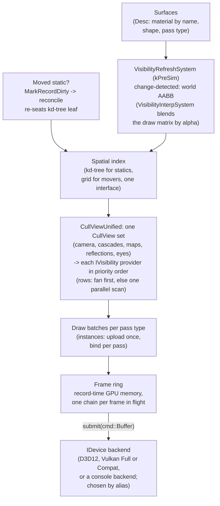

# Render Passes & Visibility

Two questions shape every frame: what is visible, and what draws it. Ceili
answers both through interfaces that a package can implement. A pass is a
component that implements `IRender`, registered under a pass type whose priority
places it in the frame. A visible-set provider is a component that implements
`IVisibility`, one of a per-scene set ordered by its own priority. Neither the
frame loop nor the cull knows the concrete classes it calls.

This page lists the implementations that exist, shows how a new one plugs in, and
follows one view from the cull to the last pass. It is part of the
[Rendering](README.md) set.

---

## Passes are components: `IRender`

Every draw in the frame comes from an `IRender`. The interface is small:

```cpp
// Include/Draw.h
struct IRender : component::IComponent
{
    // Active state is the inherited component::IComponentBase flag (ComponentFlags::Active);
    // draw::Process skips a render whose Active bit is clear.
    virtual pass::Type getPassType() const = 0;

    // THE PRODUCER STAGE.  draw::Process calls this for every active render, in band order, BEFORE any render's
    // process(), so what a render PUBLISHES for others to read in the same view (the shadow atlas, the overhead and
    // weather maps, the decal grid, the aerial volume) is final before the first one records, and the per-view values
    // derived from it are set once for the whole view rather than per draw.  A render that records commands here
    // opens its own pass's GPU zone, because draw::Process zones only process().  Not called
    // by draw::ProcessNested: a nested view reads what its outer view's producers published.
    virtual void preProcess([[maybe_unused]] const ViewDesc& View) {}
```

A render names its pass type, may publish data in a producer stage, and records
its draws in `process()`. The rest of the interface answers one question for
stereo, and resets per-view state:

```cpp
// Include/Draw.h
// MULTIVIEW (Include/EyeView.h): true when every draw this render records for View places its vertices through the
// eye block (eyeView.hlsli), so one draw serves both eyes of a multiview stereo view.  A render that answers false is
// SKIPPED in a multiview scene half, and named once in the log, rather than drawing both eyes through one eye's
// matrices.  Its producer stage (preProcess) still runs.
virtual bool supportsMultiview([[maybe_unused]] const ViewDesc& View) const { return false; }

virtual Result process(const ViewDesc& View) = 0;
virtual void   processComplete()             = 0;
virtual void   viewReset()                   = 0;
```

### Registration: any package can add a pass

A render is an ordinary [component](../Core/Components.md). The Graphics package creates
every factory registered under `IID_Render` at start-up and registers each
instance with the frame:

```cpp
// ModuleFactories.cpp
component::CreateAllComponentsFromInterfaceId(draw::IID_Render);

const auto renders = component::GetScopeInstances<draw::IRender>(draw::IID_Render, core::scope::GetSingleton(core::scope::Kind::Bootstrap));
for (auto* p_render : renders)
{
    draw::RegisterRender(p_render);
}
```

A render does not have to live in Graphics. The Ui package draws ImGui through a
render of its own, created and registered from its own module start-up:

```cpp
// Ui/ModuleFactories.cpp
graphics::draw::IRender* p_render_base = nullptr;
component::Create(&p_render_base, CID_RenderUi);
if (p_render_base != nullptr)
{
    graphics::draw::RegisterRender(p_render_base);
}
```

`RegisterRender` keys the render by its pass type, and one pass type can hold
several renders, which run in the order they registered. `UnregisterRender`
removes one at shutdown. A game package can add a pass the same way, with no
change to the trunk.

### Pass types: the frame's order as data

Every render serves one **pass type**. A pass type is a strong 64-bit id that
packs a priority in the high bits and a FourCC tag in the low bits, so passes sort
into a fixed pipeline order without a hand-maintained enum:

```cpp
// Graphics.h
namespace priority
{
constexpr uint32_t kShadow         = 0;
constexpr uint32_t kPreEnvironment = 50;
constexpr uint32_t kDepth          = 100;
constexpr uint32_t kGBuffer        = 200;
constexpr uint32_t kEnvironment    = 300;
constexpr uint32_t kLighting       = 400;
constexpr uint32_t kForward        = 500;
```

Finer steps follow inside the scene bands: `kOcean` (540), `kForwardTransparent`
(545), `kSfx` (550) for the emissive glow, `kParticle` (560), and more, up to the
post chain at `kPostProcess` (600).

The priority ordering (`kShadow` before `kDepth` before `kForward` before
`kPostProcess`) is the frame's pipeline written as data. Adding a pass is
registering a renderer under a new FourCC at the right priority, with no central
switch to edit. The shadow bake, the deferred G-buffer, the deferred ambient, the
light grid and the particle billboards are each a FourCC at an existing
priority.

Most pass types come in a family. A forward pass has an
instanced sibling, a skinned sibling and a temporally interpolated sibling,
because the batch shape decides how the vertex shader composes its clip position,
and every pass that draws a batch has to compose it the same way. A missing
sibling is a visible defect: a skinned model that bakes its bind pose, or a
batched surface that fails its own depth test in the low mantissa bits and shows
as a dark hatch.

Three pages cover what fills these slots:
[Lighting](Lighting.md) for the G-buffer and the light grid,
[Shadows](Shadows.md) for the bake at `kShadow`, and
[Post-Processing](PostProcessing.md) for the tail of the order. The particle
system draws its camera-facing billboards in a world-space pass of this kind: see
[Particles](../Gameplay/Particles.md).

### How `draw::Process` runs them

For each view, `draw::Process` builds the view's batches once, and then runs two
loops over the registered pass types in priority order. The first is the producer
stage:

```cpp
// Src/Draw.cpp
// THE PRODUCER STAGE (IRender::preProcess): every render publishes what other renders read before any of them
// records, in the same band order as the recording below.
CE_PROFILE_NAME("draw::Process.PreProcess")
for (auto& pass_type : g_PassTypes)
{
    for (RenderEntry& entry : pass_type.renders)
    {
        if (core::HasBitfield(entry.p_render->getComponentFlags(), core::component::ComponentFlags::Active))
        {
            entry.p_render->preProcess(View);
        }
    }
}
```

So the shadow atlas, the overhead and weather maps, the decal grid and the aerial
volume are final before the first draw records. The second loop calls `process()`
on every active render. It opens one GPU zone per pass type, so the profiler names
each pass by its type (see [Profiling](../Tools/Profiling.md)), and it counts what each
render drew:

```cpp
// Src/Draw.cpp
// WHAT THIS RENDER RECORDED, and it is the column that makes the Forward /
// Deferred switch legible.  The Active bit does NOT move with the render path -
// every render stays active for the life of the process and the ones that do
// not apply early-out INSIDE process() - so "is it active" answers yes for all
// 25 whatever the path.  "Did it draw anything" is the question that has a
// different answer, and cmd::Draw's own funnel already counts it.
```

In a multiview stereo view, a scene render that does not answer
`supportsMultiview` is skipped and named once in the log, so no render draws both
eyes through one eye's matrices (see [XR and Quest](Xr.md)).

A view can also record inside another view's draw. The ocean's planar reflection
draws a mirrored view of the scene through a chosen list of pass types:

```cpp
// Src/Draw.h
// RECORD A VIEW INSIDE ANOTHER VIEW'S DRAW through only the listed pass types: Process's loop over a subset, for a view
// Process itself cannot record there (it would begin the shared scene target, run the post chain, and reach the caller
// again). Pushes ViewKey, gathers the view's batches from the list the cull made under that key, runs every active
// render of each listed type in the order given, and pops. It restores the per-view globals Process sets, and it opens
// no GPU zone and counts no per-render work: the caller's own pass carries both. The caller begins and ends the target.
// The ocean's planar reflection is the user (Src/Render/OceanReflectionRender.cpp).
Result ProcessNested(const ViewDesc& View, const core::data::Key ViewKey, const core::Span<const pass::Type> Passes);
```

### Forward and deferred are passes, switched at runtime

The engine commits to neither lighting path. Forward and deferred lighting are
both sets of renders that stay registered for the life of the process, and
the view's pass flags decide which of them draw. The `Deferred` bit in
`display::Settings::renderPasses` is read on the next frame, so the path changes
while the game runs, and an A/B harness can interleave the two inside one run.

The two paths also share a frame. Under `Deferred`, a batch whose material has an
eligible G-buffer pass draws into the G-buffer, and every other batch stays
forward-lit in the same view:

```cpp
// Src/Render/DeferredGBuffer.cpp
// The deferred G-buffer write (draw::pass::types::kDeferredGBufferOpaque; the layout and the
// never-cleared contract are in Include/GBuffer.h).  Under ViewDescFlags::Deferred, every lit
// batch whose material carries an ELIGIBLE G-buffer pass is drawn ONCE into the G-buffer render
// target here, and RenderForwardLighting then skips it; a batch with no such pass stays forward-lit
// in the same view (the hybrid rule - SelectDeferredGBufferPass is the one decision both share).
```

The [Lighting](Lighting.md#one-frame-any-lighting-path) page covers the five
lighting paths, how one setting chooses between them, and what each one cost when
measured.

### The catalogue

There are 46 `IRender` implementations: 45 in the Graphics package and one in Ui.
Grouped by what they draw:

| Group | Renders | Where it is covered |
|---|---|---|
| Shadows and maps | `RenderShadowMapDirectional`, `RenderOverheadDepth`, `RenderWeatherMap` | [Shadows](Shadows.md), [Weather](Weather.md) |
| Prepasses | `RenderPrePassDepth`, `RenderPrePassIBL` | [Lighting](Lighting.md) |
| Environment | `RenderAtmosphere`, `RenderGradient`, `RenderCubemap`, `RenderEnvMap`, `RenderAmbientIrradiance` | [Atmosphere](Atmosphere.md) |
| Lighting | `RenderForwardBase`, `RenderForwardLighting`, `RenderDeferredGBuffer`, `RenderDeferredAmbient`, `RenderDeferredLighting` | [Lighting](Lighting.md) |
| Surfaces | `RenderDefault`, `RenderDefaultTransparent`, `RenderDecals`, `RenderSceneCapture`, `RenderRefraction`, `RenderRefractionStandIn`, `RenderScatterDerived` | [Materials](Materials.md), [Weather](Weather.md) |
| Weather and sky | `RenderClouds`, `RenderStormAbove`, `RenderStormBelow`, `RenderFogVolumes`, `RenderPrecipitation`, `RenderLightning`, `RenderLegacyFog` | [Weather](Weather.md) |
| Ocean | `RenderOcean`, `RenderOceanChop`, `RenderOceanReflection` | [Weather](Weather.md#the-ocean) |
| Effects | `RenderSfx`, `RenderParticles`, `RenderSprites` | [Particles](../Gameplay/Particles.md) |
| Scene target, post and look | `RenderSceneBegin`, `RenderPostProcess`, `RenderLookBake` | [Post-Processing](PostProcessing.md) |
| Editor and debug | `RenderWireframe`, `RenderOverlay`, `RenderOutlineMask`, `RenderOutlineComposite`, `RenderDebugLines`, `RenderGizmoOverlay`, `RenderDebugGBuffer` | [Studio](../Tools/Studio.md), [Debugging](../Tools/Debugging.md) |
| Ui (Ui package) | `RenderUi` | [Studio](../Tools/Studio.md) |

Each one is a class with its own file, and none of them is named by the frame
loop. The editor's wireframe and gizmo passes are renders like any other, which is
part of why the editor and the game draw through one renderer.

### What a new pass needs

- **A class** that implements `IRender`, and a component factory for it.
- **A pass type**: a FourCC at a priority that places it in the frame.
- **Registration**: in Graphics this is automatic; another package calls
  `RegisterRender` from its module start-up.
- **Materials** with a pass for it, if it draws scene geometry. A material builds
  a pipeline only for the passes its draws ask for (see
  [Materials](Materials.md)).
- **Optionally**: a producer stage, multiview support, a strategy toggle so the
  device can measure it, and an early-out in `process()` for views that do not
  want it.

---

## Visibility backends

Visibility has the same shape as the passes. One interface finds what to draw,
and `IRender` draws it:

```cpp
// Include/DrawVisibility.h
// IVisibility -- the per-scene BROAD-PHASE visible-set contributor: one interface finds what to draw,
// IRender (Include/Draw.h) draws it.  A provider answers "which entity keys does MY geometry source
// put in this frame's views", and contributes them through draw::BeginVisibleSet /
// draw::CommitVisibleSet.  draw::BuildBatches then consumes the visible set exactly as it does today -
// nothing new crosses the cull -> draw boundary, which is deliberate (two attempts to widen it were
// measured net-negative and reverted; see Prompts/CullDrawTypePayloadKickoff.md).
//
// NOT the narrow phase.  draw::SetDrawableItemSelector picks WHICH ITEMS of one multi-item key are
// visible, and runs later (ExpandMultiItemDrawables, inside CommitVisibleSet).  The compiled world
// uses both: this interface contributes its key, the selector picks its node ranges.  The two are
// complementary stages; folding one into the other would put a per-item cost in the broad phase.
```

### Providers: a per-scene, ordered set

Each scene holds a set of `IVisibility` providers, created in the scene's Level
scope at load and ordered by a priority of their own. The interface is five calls
beside the component basics; the first four are:

```cpp
// Include/DrawVisibility.h
// Active state is the inherited component::IComponentBase flag (ComponentFlags::Active); the cull
// skips a provider whose Active bit is clear.
virtual VisibilityPriority getPriority() const = 0;

// The provider KIND (kSourceRows / kSourceWorld / ...), so a caller can find one specific provider
// among the scene's set without naming its concrete class.
virtual VisibilitySource getSource() const = 0;

// One-time structural build, at scene-load warmup, after the spatial indices are warmed.
virtual core::Result warmup(const core::scene::Handle hScene) = 0;
```

The `prepare` call is the one that carries the cost, and its signature is the
design:

```cpp
// Include/DrawVisibility.h
// THE SET, NOT ONE VIEW, AND THAT IS THE WHOLE POINT.  A provider that scans rows must make ONE
// pass over them for all frustums: CullVisibilityParallel already tests every frustum per row
// inside a single parallel walk, because "five separate scans over a 100k swarm is four passes of
// pure waste".  A per-view signature would force that walk to run once per view - up to
// kMaxCullFrustums times - and the cull is ~4-5ms against a ~1ms draw, so it is the only part of
// the frame where that multiplier matters.  Do NOT narrow this to a single view.
```

One `CullView` is one frustum the frame must cull: the camera, each shadow
cascade, the overhead depth map, the scatter ring's ground, the ocean's
reflection and its view under the sea, and a headset's right eye. Each carries
its view key, and at most one, the primary view, holds the permission to stamp the
per-row `Visible` bit, so two frustums never fight over one shared bit.

The cull itself is now the walk. `CullViewUnified` builds the frame's set of
`CullView`s once and hands it to every provider in descending priority:

```cpp
// Src/Scene/SceneSystems.cpp
draw::IVisibility* providers[kMaxSceneVisibilities]{};
const uint32_t     num_providers = draw::GetSortedSceneVisibilities(providers, hScene, kMaxSceneVisibilities);
for (uint32_t i = 0; i < num_providers; ++i)
{
    providers[i]->prepare(hScene, core::Span<const draw::CullView>(views, num_views));
}
```

### The providers that exist

| Provider | Source | How it is created | What it contributes |
|---|---|---|---|
| `VisibilityRows` | `kSourceRows` | Unconditionally, for every scene | The scene's entity rows: the spatial-index fan first for each frustum, then one batched parallel scan for every frustum the fan declined. |
| An authored provider | its own FourCC | From a `graphics/visibility` entity in the scene, by class name | Whatever its geometry source puts in view. Priorities are reserved for the compiled world, particles and sprites. |

The rows provider is infrastructure. Every scene has rows to cull, so a scene that
forgot to author it would draw nothing; it is created the way the merged batches
are. Every other provider is data: a scene pulls it in with an entity derived from
`graphics/visibility` whose `name` is the provider's class, and the setup walk
creates and warms it after the spatial indices, so its warmup can read a built
kd-tree.

### Broad phase and narrow phase

Two more seams sit beside the providers:

- **The spatial index**, with a uniform grid and a kd-tree as its backends behind
  one interface. The rows provider queries it.
- **A drawable item selector**: a function a producer registers for its key with
  `draw::SetDrawableItemSelector`, so it chooses which of the key's items draw for
  each view. It is the narrow phase and runs later, inside `CommitVisibleSet`. The
  compiled world uses it for its kd early-out, its portal walk and its detail
  levels (see [Compiled Worlds](CompiledWorlds.md)).

A compiled world's key enters the visible set in the broad phase, and its selector
then picks its node ranges. Keeping the stages apart keeps a per-item cost out of
the broad phase.


## The spatial index: two shapes, one interface

The cull is only fast because it does not scan the world. It queries a **spatial
index**, and the index itself follows the trunk-and-backend pattern one more time:
a base interface with two specializations, selected through `getInterface` rather
than a downcast.

```cpp
// Spatial/SpatialIndex.h
struct ISpatialTree : ISpatialIndex
{
    // Build the fixed POW2 partition over the scene bounds down to a min leaf size (clears prior content),
    // then insertEntity each entity by key + world AABB at warmup.  updateEntity + removeEntity keep the
    // set LIVE afterwards (driven by ReconcileDirtySurfaces draining the surface dirty-key worklist), so
    // the cull fan tracks a moved entity instead of its stale load-time bounds.  (These are the scene's
    // NON-boid surfaces -- not necessarily static, hence "entity" not "static".)
    //   insertEntity -- add (re-seat if already present) a key; used by warmup's ingest.
    //   updateEntity -- re-seat an EXISTING key's world; a NO-OP for an absent key.  This is the boid
    //                   discriminator: boids spawn AFTER warmup so they were never ingested, and the
    //                   reconcile drain (which includes the 100k boid-surfaces -- boids ARE surfaces) calls
    //                   updateEntity, so a boid find-misses and is skipped; only warmup entities update.
    //   removeEntity -- drop a deleted key (swap-pop); a NO-OP for an absent key.
    //   containsEntity -- is the key in the entity set?  Lets a caller skip work for keys updateEntity
    //                     would find-miss anyway (e.g. the ReconcileDirtySurfaces per-row Visibility read).
    virtual void buildTree(const math::Bounds& SceneBounds, const int32_t MinLeafSize) = 0;
    virtual void insertEntity(const core::data::Key Key, const math::Bounds& World)    = 0;
    virtual void updateEntity(const core::data::Key Key, const math::Bounds& World)    = 0;
    virtual void removeEntity(const core::data::Key Key)                               = 0;
    virtual bool containsEntity(const core::data::Key Key) const                       = 0;
```

The base `ISpatialIndex` carries the verbs every backend answers: `getType`,
`buildPoints`, `queryRay`, `queryRadius`, `queryFrustum`, `applyVisibleNodes` and
`warmup`. `ISpatialGrid` adds `buildLeafCellMap` and `isMembershipValid`. A caller
reaches either specialization through `getInterface`:

```cpp
// Spatial/SpatialIndex.h
// Downcast an ISpatialIndex to a derived backend interface via the component getInterface() query (the
// scene holds all backends under one IID_SpatialIndex registry; getType() finds the KIND, getInterface()
// hands back the kind-specific interface).  nullptr if the backend is not that kind / the pointer is null.
inline ISpatialTree* AsSpatialTree(ISpatialIndex* pIndex)
{
    core::component::IComponentBase* p_iface = nullptr;
    return (pIndex != nullptr && core::Succeeded(pIndex->getInterface(IID_SpatialTree, &p_iface))) ? static_cast<ISpatialTree*>(p_iface) : nullptr;
}
inline ISpatialGrid* AsSpatialGrid(ISpatialIndex* pIndex)
{
    core::component::IComponentBase* p_iface = nullptr;
    return (pIndex != nullptr && core::Succeeded(pIndex->getInterface(IID_SpatialGrid, &p_iface))) ? static_cast<ISpatialGrid*>(p_iface) : nullptr;
}
```

The **kd-tree** is the static-geometry index. It is built once at scene-load
warmup, ingesting the static `Visibility` rows, and it answers the queries that
matter for a mostly-still world:

```cpp
// Spatial/SceneKdTree.h
// The scene's kd-tree -- the STATIC-entity index: its queryRay returns the static candidates (picking),
// queryFrustum the cull fan's frustum-tested static set, and queryFrustumNodes the visible-leaf set a
// grid expands.  Resolves the scene's Level-scope index by getType() == kTypeKdTree and hands back its
// ISpatialTree interface (via getInterface(IID_SpatialTree)); nullptr if none.  Created + warmed
// (buildTree + ingest the static Visibility rows) by the SpatialSetupSystem at scene-load warmup, BEFORE
// the boid spawn -- this only FINDS it.  The kd-tree's KIND-specific structural verbs live on ISpatialTree
// (the LeafId / VisibleNodeSet types beside it in SpatialIndex.h); the generic query verbs on the base.
CE_API ISpatialTree* GetSceneKdTree(const core::scene::Handle hScene);
```

The **grid** handles the opposite case: a large population of small movers where a
uniform cell map is cheaper to keep current than a tree of tight leaves. It even
bootstraps off the tree, calling `buildLeafCellMap(Tree, ...)` to seed its cells
from the tree's visible-leaf set. Two data structures, two performance profiles,
one interface, and the caller picks between them with `getInterface` and never
names either concrete type. This is the same swap-the-implementation seam as the
device backend, at a finer grain.

### Ray queries on the CPU

Scatter fills, decals, lightning and impacts ask where a ray meets the ground,
and much of that ground has no physics collider. The scene ray query answers from
the draw rows themselves, with the kd-tree as its broad phase:

```cpp
// Src/Scene/RayQuery.h
// Where a ray meets a scene's static surfaces, on the CPU: the ground under a lightning strike, a scatter point, an
// impact. The overhead depth map answers the same question on the GPU only, and brushes, legacy terrain and
// fixed-mesh models carry no physics collider, so this reads the draw rows themselves:
//   - the broad phase is the scene's kd-tree, or a walk of the Visibility table when the scene has none;
//   - a mesh surface casts against its resource's CPU positions and indices, and a parametric shape against the shape
//     generated for the cast, both through math::RayCastTriangleRun;
//   - a brush clips the ray against its face planes: the exact solid, with no triangles;
//   - a COMPILED WORLD (a .cscene level, Include/World/World.h) casts through its own block: its area kd trees, its
//     drawables' boxes, then their triangles (world::Cast). Its draw rows hold no CPU geometry and it is in no scene
//     kd-tree, so it answers for its own key and the walks above skip that key (Prompts/CompiledWorldRayQuery.md);
//   - every surface is placed by its entity's POSE, never the draw matrix, which carries render interpolation and the
//     display offset. A static that moved this frame re-seats in the tree a frame late, while the narrow phase reads
//     the live pose.
```

A [compiled world](Xr.md#geometry-lod-the-compiled-world) needs its own cast,
because its draw rows hold no CPU geometry and the world is in no scene kd-tree.
`world::CastView` walks the world's area kd trees near child first, prunes by
the nearest hit so far, and tests an area with no kd tree through its run of
drawables. It reads only the world's block and the positions decoded once at
load, so it runs on any thread. Equal distances keep the lower drawable and then
the lower triangle, so the order of the walk never decides the answer. The scene
cast asks `world::Cast` beside its other candidates and keeps the nearer hit.
The masks that pass a surface through (`SuppressMask`, `SkipStateFlags`) are
`VisibilityStateFlags`, the same enum the cull stamps.

The query belongs to the main thread, with one widening:
`rayQuery::BeginConcurrentReads` prepares the kd-tree, builds the triangle tree of
every mesh group the scene draws, and opens casts to workers inside the main
thread's fork-join until `EndConcurrentReads`. A scatter regenerate uses it to
cast each candidate's ground on the workers. Measured on RedMines on 2026-10-22
(47 workers, 5345 rocks, the same bits either way): an uncached regenerate takes
98 to 126 ms in parallel against 1.16 to 1.84 s on one thread.

### The compiled world selects its own items

A ported level's static geometry arrives as a compiled world, with its kd-tree,
BSP, areas and portals baked into one block. The [Compiled Worlds](CompiledWorlds.md)
page covers the block, the portal walk and the indoor and outdoor classification
it gives the rest of the engine. Its selection runs through the item selector, and
its cull mode is a setting:

```cpp
// Include/World/World.h
enum class CullMode : uint8_t
{
    Hierarchical = 0, // the legacy kd early-out with merged node ranges
    Flat,             // every drawable tested on its own: the A/B control
    Root,             // no cull: every view draws the root's merged ranges, the fewest draws and the most triangles
};

// THE OCCLUSION TEST the walk asks after its frustum test (display::StrategySettings::worldOcclusion): true when a box
// is hidden from every eye, which drops a whole node, leaf or drawable.  The world's own (RasterizeOcclusion) tests
// against occluders rasterized by Masked Occlusion Culling; a unit test supplies its own.
struct OcclusionTest
{
    bool (*hidden)(const void* pContext, const Box& Bounds) = nullptr;
    const void* pContext                                    = nullptr;
};
```

`Flat` draws exactly the triangles `Hierarchical` draws, so it is the control in
every A/B that measures the merged ranges. The occlusion test is a function
pointer, so the world's own occluder rasterizer and a unit test's stand-in plug
into the same walk.


---

## The unified cull: one fan for 3D and 2D

The camera and the [2D orthographic views](../Tools/Studio.md) share their cull code. Both
route through `CullViewUnified`, and the rows provider behind it tries the fast
spatial-index fan first and falls back to a parallel full scan only when there is
no usable index:

```cpp
// Src/Scene/SceneSystems.cpp
// The unified cull - try the O(visible) kd-tree/grid fan (descend once + applyVisibleNodes per index,
// gathers parallel), else the parallel full scan (CullVisibilityParallel).  BOTH the 3D camera
// (CullSystem, kCull) AND the 2D ortho wireframe views (the DrawSystem loop, kDraw) route here: the fan's
// gather is parallel, so it wins when it prunes and merely ties the scan when a view frames ~the whole
// swarm (no zoom-guard bail).  The fan DECLINES to the full scan only when it cannot run at all - no
// kd-tree / leafCount==0, an uncovered visible set, or a stale/absent grid membership.  CullVisibilityParallel's
// ParallelFor join auto-selects WaitParticipating on main or WaitParticipatingWorker on a worker, so it
// spreads across the pool.
```

The fan is the fast path: descend the index once, call `applyVisibleNodes` per
index to gather the leaves the frustum touches, and produce the visible-key set in
time proportional to what is *visible*, whatever the scene's total object count. The
full scan (`CullVisibilityParallel`) is the fallback, a `ParallelFor` over every
`Visibility.world`, used only when a view has no spatial index yet, and it doubles
as the direct entry point unit tests call. The important detail is that the
**camera takes the same fan-first path as the wireframe views**: there is no
privileged "real" cull and cheap "editor" cull that drift apart: one router
serves both, sharing the same set of statistics counters.

The extra frustums are the four directional [shadow cascades](Shadows.md). Each
is offered the fan first and on its own, because a kd-tree descent already costs
only what that frustum sees. The frustums the fan declines are gathered into one
list, so the full scan runs once for all of them:

```cpp
// Scene/SceneSystems.cpp
// MULTI-FRUSTUM, and that is the point of the span: the four shadow cascades need their own caster
// lists, and running this once per frustum would be a separate O(N) pass over every entity each
// time - five passes over a 100k swarm rather than one.  Each row is read ONCE and tested against
// every frustum while its bounds are still in cache.
//
// StampBitFrustum names which frustum - if any - owns the per-row Visible bit, and it is an INDEX
// rather than "the first one" on purpose.  That bit has exactly one meaning ("visible to the primary
// view") and exactly one writer, so a cascade adding itself to it would silently clobber what the
// draw gate reads; and when the primary has already been served by the fan, the frustums left for
// this scan are ALL cascades, so position 0 is no longer the camera.  kNoStampFrustum then says so.
// Every frustum gets its own visible-key list either way - that list is what the list-authoritative
// gather actually consumes.
```

Because every path writes the same per-view visible-key set, the rest of the
pipeline downstream of the cull neither knows nor cares which path produced it.

---

## The frame path, end to end

Putting the pieces in order, one frame of rendering flows like this:



<!-- MEDIA: a side-by-side capture of the same scene rendered through the Vulkan
     backend and the D3D12 backend, pixel-identical, with the config.lua alias
     line that selects each. This is the "no calling code changed" proof. -->

<!-- MEDIA: a debug-overlay screenshot of the kd-tree / grid leaf boxes with the
     camera frustum, and the cull statistics counter showing visible-set count
     versus total object count (the fan's O(visible) win made visual). -->

Read left to right, every arrow crosses a seam the engine deliberately made
swappable. Surfaces are pure data. Visibility refresh is one generic system the
scheduler parallelizes off its contract. The spatial index is an interface with
many backends. The cull is one router serving camera and editor alike. And the
device at the end is chosen by a config line.

---

## What this layer does not do yet

- **One visibility provider ships.** `VisibilityRows` carries every scene's
  entity rows. The compiled world, particles and sprites have reserved priorities
  and no provider of their own yet.
- **The pass order is fixed by priority constants.** A pass slots into an existing
  band or takes a new constant in `Graphics.h`; there is no runtime reordering.
- **Renders within one pass type run in registration order.** Nothing else
  orders them, so two renders that depend on each other belong in different pass
  types.

Next: [Surfaces & Draw Data](Surfaces.md) for the rows these passes consume,
[Render Devices & Backends](RenderDevices.md) for where the recorded commands go,
or [Lighting](Lighting.md) for the forward and deferred passes in detail. Back to
[Rendering](README.md) or the [documentation index](../README.md).
