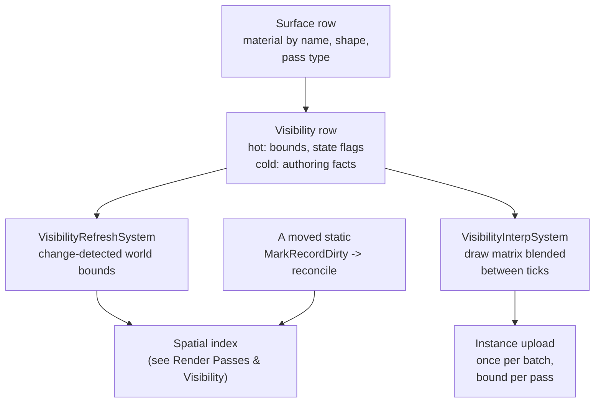

# Surfaces & Draw Data

A draw in Ceili starts as data. A surface is a row that names its material and its
shape, a visibility row carries where it is and what state it is in, and one
generic system keeps that row fresh as things move. Instances upload once and bind
in every pass that draws them, and the draw pose blends between fixed simulation
ticks while the cull pose stays on the tick.

This page covers that data path, from the authored row to the matrices a pass
binds. It is part of the [Rendering](README.md) set.



---

## Surfaces: a draw described by data

A **surface** is the authoring-side description of a renderable thing. Following
the [Desc-versus-wrapper split](../Core/Core.md), the authored `Desc` holds only data a
designer edits, and it references its material **by name**, never by handle:

```cpp
// Surface.h
struct Desc
{
    // Material referenced by name.  Resolved to the wrapper's hMaterial via
    // material::GetMaterialHandle; an empty name leaves the wrapper's hMaterial as-is
    // (so a runtime override -- the Studio preview / SetSurfaceMaterial -- isn't
    // clobbered).
    //
    // DATABASE-scoped, not a fixed char[N]: a path past the old 63-char cap used to
    // truncate SILENTLY, and since the registry resolves by hash a truncated name
    // matches nothing at all -- the surface drew the missing-material checkerboard with
    // no failed lookup to log.  ScopeDataString sizes to the name stored and dies with
    // the database arena, which is the one lifetime a row can rely on (DestroyDatabase
    // frees the arena WITHOUT running per-row destructors).  Two caller obligations come
    // with it, both on the writers: bind a core::data::DataGuard around any assign, and
    // prefer assign(ptr, len) over operator= (which reallocates unconditionally, and on
    // an arena that never gives memory back that grows it on every reconcile).
    core::ScopeDataString materialName;
```

After the name, `Desc` holds the procedural `shapeParams` (shape, tiling, UV pan)
and a `shadowDistance` cap.

The runtime handle lives on the scene wrapper, `scene::Surface`, which derives
from `Desc`. The handle is hidden from the property grid and skipped by every
serializer, because a handle is a per-process token that must never be saved:

```cpp
// Surface.h
// Runtime state -- all hidden from the property grid and serialiser
// (CE_HIDE CE_NOSERIALIZE) so users / save-load round-trips can't disturb it; the
// engine re-resolves / recomputes it each load / frame.  The raw bytes still live
// past-the-Desc for layout stability with the sparse-set storage.

// The material resolved from Desc::materialName by OnInsert / ReconcileDirtySurfaces,
// or set directly as a runtime override (Studio preview / SetSurfaceMaterial, with an
// empty materialName).  The render passes skip a surface whose hMaterial is invalid.
ceili::graphics::material::Handle hMaterial CE_HIDE CE_NOSERIALIZE;
```

The contract reduces to one line: **name resolves to handle, and an unresolved
name renders nothing.** A surface whose `materialName` does not
match a registered material has an invalid `hMaterial`, and every pass silently
skips it. This is a deliberate, checkable failure mode with no crash, and it
is verifiable in a headless run with no device at all: material identity is a
`Hash32` of the slash-name, resolved on the CPU side, so the resolution is device
independent. See [Materials](Materials.md) for how names become handles.

How a surface's pass type decides which renderer draws it is on
[Render Passes & Visibility](RenderPasses.md#pass-types-the-frames-order-as-data).


---

## Visibility: a hot-cold split

Before anything is culled, each renderable carries a small amount of
visibility state, and the engine splits it into a **hot** part (touched by the
cull every frame) and a **cold** part (the geometry math that only changes when
the object moves):

```cpp
// Scene/Visibility.h
// Composable cull component (HOT).  Pair with VisibilityGeometry + a Surface / Light
// wrapper on the same entity key.  VisibilityUpdateSystem (PreSim) composes `world` into
// this row from the cold row's local + worldMatrix each frame; CullVisibilityParallel
// tests `world` and stamps Visible.  Runtime-only -- never authored, never serialized.
struct Visibility
{
    // World AABB the cull loop tests -- composed each PreSim, and the at-rest cache once
    // dirty-gating lands.  Empty == always visible.  Also read by the kd/reconcile drain
    // (insertEntity) and the SceneBounds union.
    math::Bounds world CE_READONLY CE_NOSERIALIZE{};

    // Per-frame cull output.  Rows start un-flagged (the cull stamps Visible each pass,
    // before draw reads it within the same Update; a never-culled scene draws nothing --
    // it has no view).  Runtime-only.
    VisibleFlags flags CE_HIDE CE_NOSERIALIZE = VisibleFlags::None;
};
```

```cpp
// Scene/Visibility.h
// Composable cull component (COLD).  Sibling of Visibility on the same entity key.
struct VisibilityGeometry
{
    // World matrix the PreSim visibility compose derives from the entity Transform
    // (surface::SurfaceWorldMatrix / Mat4FromTransform) and stamps here each refresh -- the
    // per-surface world the draw path reads (BuildBatches -> surfaceWorld), so cull / draw
    // keep NO Transform dependency and stay concurrent with a Transform writer (the boids
    // flock).  Lights leave it identity (they compose `world` directly, not drawn via surfaces).
    math::Mat4 worldMatrix CE_HIDE CE_NOSERIALIZE = math::Mat4Identity();
```

After `worldMatrix`, `VisibilityGeometry` holds the `cachedPoseHash`, the
`prevTick` and `currTick` poses, the `local` bounds, the `stateFlags`, an authored
`localTransform`, and a few per-frame stamps.

The `Visibility.world` AABB is the *only* thing the cull reads. Everything else,
the world matrix used to draw, the local bounds, the previous and current tick
poses used for interpolation, lives in `VisibilityGeometry` and is recomputed only
when the object's transform changes. Keeping the cull's working set to one bounds
per object is what lets it stay cache-friendly at a hundred thousand objects.

Both structs are stored as columns in the scene's [data table store](../Core/Core.md).
`Visibility` is its own table, keyed by type hash like every other component, and
the cull's job is to fill each view's visible-key set from those rows.

---

## Keeping visibility fresh: one generic system

When an object moves, its `Visibility.world` and its `VisibilityGeometry` must be
recomputed, or the cull tests a stale box and the draw uses a stale matrix. The
naive approach is a companion updater per moving type (one for boids, one for the
player, one for every future kind). The engine rejects that. There is exactly
**one** generic, change-detected system that refreshes every renderable surface:

```cpp
// Scene/SceneSystems.cpp
using VisibilityRefreshContract =
    core::scene::system::Contract<const math::Position, const surface::scene::Surface, Visibility>;

CE_COMPONENT_FACTORY_DEFINITION(CID_VisibilityRefreshSystem, core::scene::system::ISystem, VisibilityRefreshSystem)
class VisibilityRefreshSystem final : public core::scene::system::SystemBase<VisibilityRefreshContract>
{
public:
    core::ConstStr getName() const override { return "visibilityRefreshSystem"; }

    core::scene::system::Priority getPriority() const override
    {
        // PreSim slot 4, before the flock / player (kSim).  The slot and its reasoning live with the
        // rest of the band's layout in Core/Include/Scene/System.h - including the note that its
        // position relative to the animation system is preserved rather than endorsed.
        return core::scene::system::kVisibilityRefresh;
    }
```

Read the `Contract` the way [Core's scheduler](../Core/Core.md#tasks-threading-and-the-fixed-tick-clock)
does: `const math::Position` and `const surface::scene::Surface` are reads, the
non-const `Visibility` is a write. From it the scheduler knows this system reads
position data and writes visibility, and can fan it out in parallel against any
system whose writes do not overlap, with no locks and no manual barrier. It runs
in the `kPreSim` band so the visibility set is fresh before the cull looks at it.
Rotation and Scale are optional siblings the update resolves per row, since a boid
may carry only Position while a full surface carries all three. Change detection
hashes whichever pose rows are present into a 64-bit `cachedPoseHash` on
`VisibilityGeometry`: a row whose hash still matches its last compose is skipped
entirely, so a static surface pays only the hash and an 8-byte compare, never a
matrix rebuild.

This is the single-source-of-truth rule from [Core](../Core/Core.md) applied to
visibility: one funnel refreshes every moving surface, so a new renderable type
gets correct culling and correct draw matrices for free, exactly the way a new
reflected field gets serialization for free in [Metadata](../Core/Metadata.md).

**Moved statics need one extra nudge.** A static object binned into the scene's
kd-tree has its world AABB stored *inside a tree leaf*. Recomputing its bounds is
not enough; the tree must re-seat it, or a frustum query walks past its old leaf.
The engine enqueues an editor-moved entity onto the surface table's dirty-key
worklist, and the same reconcile pass that [Core's dirty tracking](../Core/Core.md#data-the-table-store-the-engine-is-made-of)
drains re-bins it:

```cpp
// Scene/SceneSystems.cpp
// Enqueue a composed (i.e. editor-moved) entity onto the surface table's dirty-key worklist - the
// generic changed-entity queue ReconcileDirtySurfaces drains - so the scene kd-tree re-seats the
// entity's world AABB (updateEntity + leaf re-bin) before the next query.  EVERY
// ComposeVisibilityForKey caller funnels through this (the property-grid sync hook, the gizmo drag /
// transform undo-redo WriteTransform): without it a gizmo-dragged entity kept its load-time leaf
// binning, so ray picking and the cull fan read stale bounds at the OLD position.  No-op when the
// scene has no Surface table (then there is no worklist and no reconcile drain either).
void EnqueueMovedEntityForReconcile(const core::data::DatabaseId Db, const core::data::Key Key)
{
    core::data::MarkRecordDirty(Db, core::data::TableId(core::meta::TypeHash<surface::scene::Surface>()), Key);
}
```

Moving a surface in the editor is a `MarkRecordDirty` call; the reconcile drains
the worklist and calls the tree's `updateEntity`. The same dirty-key primitive
that drives the property grid and undo drives spatial re-seating.

---

## Instance transforms: upload once, bind per pass

A batch of instanced surfaces (a swarm of identical boids, say) shares one mesh
and differs only by transform. Uploading those matrices to the GPU every frame,
for every pass, is pure waste when they have not changed. The engine tags each
instanced upload with a stable id and a changed flag, and the backend keeps a
persistent buffer keyed by that id:

```cpp
// InstanceUpload.h
// The point: draw::UploadInstances routes every INSTANCED batch through UploadInstanceTransformsBatched,
// tagging it with a STABLE per-batch id + whether its transforms changed this frame.  The submit-side
// backend keeps a per-batch PERSISTENT instance buffer keyed by that id: a batch unchanged for longer than
// the backend's frames-in-flight is uploaded ONCE and thereafter only BOUND -- no per-frame re-upload of
// identical matrices (the idle-editor win layered on G1).  A moving batch (Play, or a just-edited swarm)
// falls back to the per-frame ring exactly as before.  The plain cmd::UploadInstanceTransforms path is
// unchanged; it tags stableId 0, which the backend always rings.  Assumes Module.h (math::Mat4, CE_API)
// was already included, like the other Graphics headers.
```

```cpp
// InstanceUpload.h
// Record an instanced-batch upload TAGGED with its stable id + change signal (the persistent-buffer path).
// Behaves exactly like cmd::UploadInstanceTransforms (same per-frame handle mint, same double-buffered
// record-time copy, same overflow degrade to an invalid handle) but additionally stamps the tag into the
// op (StampMeta; the backends read it back with MetaOf).  cmd::UploadInstanceTransforms forwards to this with
// {stableId 0, contentChanged true}, so untagged callers always ring.
// No CE_API: the sole caller (draw::UploadInstances, Src/Draw.cpp) lives in this same DLL, and neither
// GraphicsD3D12 nor GraphicsVk references it.
InstanceHandle UploadInstanceTransformsBatched(const math::Mat4* pData, const uint32_t Count, const InstanceBatchId StableId, const bool ContentChanged);
```

The tag travels in an `InstanceUploadMeta` (`stableId`, `contentChanged`, the
bind slot, and the element stride), and each backend reads it back with `MetaOf`
at submit.

The rule is **upload once, bind per pass.** A batch's matrices go to the GPU a
single time; each of the many passes that draw it (depth pre-pass, then the
forward pass, then any overlay) *binds* the already-resident buffer and uploads
nothing. For a static or idle scene the per-frame instance-transform traffic
collapses to nothing, which is a large part of how the boids demo holds its frame
budget. The full story of that budget is [The Road to 100k Boids](../CaseStudies/Performance_100kBoids.md).

---

## Render interpolation: smooth between fixed ticks

Simulation runs on a [fixed-tick clock](../Core/Core.md#tasks-threading-and-the-fixed-tick-clock)
so behaviour is deterministic regardless of frame rate. But if the renderer drew
the raw simulated pose, motion would visibly step at the tick rate whenever the
frame rate ran ahead of the sim rate. The fix is to interpolate the *draw* pose
between the last two simulated ticks by the frame's `alpha`, while leaving the
*cull* bounds on the live pose:

```cpp
// Scene/SceneSystems.cpp
bool GetInterpolatedRenderPose(math::Transform& Out, const VisibilityGeometry& Geom, const math::Transform& Live, const float Alpha)
{
    // Interpolate ONLY when the shadow is TRACKING: currTick == the live Transform (true in Play, where
    // RenderShadowSystem set currTick to this row's last-tick value and nothing has moved it since
    // kPreSim) AND the row actually moved (prevTick != currTick).  Otherwise - Design (the shadow
    // system is Play-only, so currTick lags), the first Play frames, a Play->Design rollback, or a
    // static - the row is drawn at the live pose and the caller keeps it.
    if (Geom.currTick != Live || Geom.prevTick == Geom.currTick)
    {
        return false;
    }
    Out = math::TransformLerp(Geom.prevTick, Geom.currTick, Alpha);
    return true;
}
```


The two tick poses (`prevTick`, `currTick` on `VisibilityGeometry`) are shifted
once per simulation tick by `RenderShadowSystem`, which runs only in Play. Every
frame, `VisibilityInterpSystem` in the `kGraphics` band calls
`ComposeInterpolatedDrawMatrix` for every item of each row that can interpolate.
That function blends the item's draw matrix by `ComponentUpdate.alpha`, or puts
the live pose back when the row does not interpolate. A model draws as several
items under one key, and only the head item (item 0) carries the entity's tick
pair, so every item takes its blend from the head's pair and places its own mesh
through its own `localTransform`. A plane of four parts then moves as one piece,
with no part stepping once a tick. The system also patches each blended item's
row in the shared world table, so a draw that indexes the table reads the
blended matrix. The result is a clean separation: **draw pose is
interpolated for the eye, cull pose stays on the tick for correctness.** This is
what lets a hundred thousand boids simulate at a fixed rate and still render
buttery-smooth on a faster display; the same decoupling underpins the remote-peer
smoothing the [multiplayer layer](../Core/Networking.md#path-a-gameplay-replication) relies
on.

One convention worth carrying into your shaders when you consume these matrices:
`math::Mat4` is row-major with row-vector semantics, so the canonical HLSL
multiply is `mul(v, M)`, vector first. `mul(M, v)` compiles and silently projects
through the transpose. The full rationale is in [Materials](Materials.md).

---

Next: [Render Passes & Visibility](RenderPasses.md) for the cull and the passes
that consume these rows, [Materials](Materials.md) for how a material name becomes
a pipeline, or [The Road to 100k Boids](../CaseStudies/Performance_100kBoids.md) for the numbers
this path was built to hit. Back to [Rendering](README.md) or the
[documentation index](../README.md).
