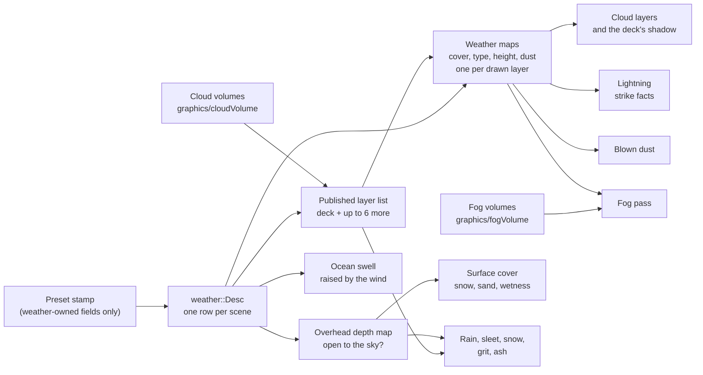

# Weather

Weather in Ceili is one row of facts on a scene's environment entity: how hard the
wind blows at the ground, what falls, how much snow lies on the ground, how much
dust the wind carries. The clouds and the low fog are entities of their own: each
cloud volume is a layer of cloud across the sky, and each fog volume is a box of
mist. Each system that reads these facts decides what to draw from them. The
clouds, the rain, the lightning, the snow on a roof's edge and the swell on the sea
all read the same facts, so they agree about the weather.

The work began with one constraint: **no artist input.** Code generates every
input at load or build time: the noise volumes, the wave spectra, the lightning
bolts, the drops and ripples. A designer picks a weather preset, places cloud
volumes and picks a cloud preset for each, and tunes the fields in Studio.

This page covers the row and its presets, the two maps every weather effect
reads, the clouds, the fog volumes, what falls, the ocean, and the scatter system
that dresses the ground. It builds on the [Atmosphere](Atmosphere.md) page, which
covers the clear sky the clouds sit in.

<!-- MEDIA: one level, TheOldGods, cycled through Clear, Overcast, Rain and
     Storm presets in Studio's property grid, about 3 s each, with a lightning
     strike in the Storm shot. -->

---

## One row of facts

The row is `env::weather::Desc`. Its fields arrive with their first reader, so
every field changes something on screen. A named preset sets a group of them:

```cpp
// Include/Env/Weather.h
// Named weathers.  When a scene's preset CHANGES, EnvUpdateSystem stamps the preset's fields into
// the Desc - the model atmosphere::Preset uses - so a designer picks a weather, then tunes its
// fields freely.  Custom stamps nothing.  kWeatherPresets[] (Weather.cpp) is indexed by
// (preset - 1), skipping Custom.  APPENDED values only: scenes save the value as an integer, so
// inserting one would renumber every saved scene.  A weather that needs a later effect (Blizzard,
// DustStorm, AshFall) is appended by the phase that adds the effect.  Storm is a THUNDERSTORM (rain and
// lightning); DustStorm is the storm of blown sand.
enum class Preset : uint8_t
{
    Custom = 0,
    Clear,
    Overcast,
    Rain,
    Snow,
    Storm,
    Blizzard,
    AshFall,
    DustStorm,
};
```

A preset is a function that returns the defaults with a few fields changed. The
table is easy to read and hard to get out of order. A weather preset sets no
cloud, because the clouds are entities that a level places:

```cpp
// Src/Env/Weather.cpp
// Weather presets indexed by (Preset - 1), skipping Custom.  Written as "the Desc's defaults, with
// these fields changed", the atmosphere preset table's form and for its reason: a positional table
// makes a mis-ordering silent.  None of these sets `preset`, so ApplyPreset keeps the caller's
// selection.
// The cloud is not here: it is the scene's cloud volumes (Include/Env/CloudVolume.h), each with its own preset, so a
// weather is paired with the clouds it wants by placing them. What a weather sets is what reaches past the clouds: the
// air's haze, the cover on surfaces, what falls, the lightning, the blown dust and the wind at the ground. Which way the
// wind blows belongs to the level, so no preset sets it.
constexpr Desc WithWind(Desc D, const float Ground)
{
    D.windSpeed = Ground;
    return D;
}
```

The Snow preset, for example, sets the snow haze, a snow cover of 0.7, a thin wet
film of 0.1, snowfall at a rate of 0.6 and a ground wind of 6 m/s. The haze is the
atmosphere's field: a snow weather also whitens and dims the sky (see
[Atmosphere](Atmosphere.md#presets-and-haze)).

### The weather's fields and the level's fields

Some fields belong to the weather, and some belong to the level. Snow cover,
wetness and wind speed change when the weather changes. The sand on a desert
floor, the wind's heading, the seed that picks the cloud pattern and the height
the dust reaches stay with the level, whatever the weather does. A preset must
never overwrite them.

One function holds the list of fields that a preset owns:

```cpp
// Src/Env/Weather.cpp
void StampPresetFields(Desc& Dst, const Desc& Src)
{
    // NOT here, because each belongs to the LEVEL and a weather preset must leave it as authored: the sand, the
    // wind's heading, the seed that picks the clouds' pattern and the height the dust reaches.
    Dst.haze              = Src.haze;
    Dst.snowCover         = Src.snowCover;
    Dst.wetness           = Src.wetness;
    Dst.windSpeed         = Src.windSpeed;
    Dst.precipitation     = Src.precipitation;
    Dst.precipitationRate = Src.precipitationRate;
    Dst.lightningRate     = Src.lightningRate;
    Dst.stormDensity      = Src.stormDensity;
    Dst.stormVisibility   = Src.stormVisibility;
    Dst.stormColor        = Src.stormColor;
}
```

A field that is missing from this list fails in a safe direction. The preset
leaves it alone, which a designer sees at once. A field that wrongly sits in the
list would destroy authored data every time someone picks a weather. The cloud
presets keep the same rule with a list of their own (see [Clouds](#clouds)).

### The wind

The row's wind is the wind at the ground. It defaults to 4 m/s:

```cpp
// Include/Env/Weather.h
// THE WIND AT THE GROUND (P3): what the sea, the drifting snow and sand, the blown dust and the rain read. How hard
// it blows belongs to the weather, so a preset sets it; which way it blows belongs to the LEVEL. Each cloud volume
// has its own wind, which turns from this one by its veer.
float windSpeed   CE_RANGE_DESC(0.0f, 100.0f, "How fast the wind blows at the ground, in metres a second. The sea, the drifting snow and sand and the blown dust follow it")     = 4.0f;
float windHeading CE_RANGE_DESC_STEP(0.0f, 360.0f, 1.0f, 15.0f, "Where the wind blows TO, in degrees: 0 is +Z and 90 is +X, clockwise seen from above. A property of the level") = 0.0f;
```

Each cloud volume and each fog volume has a wind speed of its own and a veer: how
far its wind turns clockwise from the ground's heading. So a fast, high layer can
cross the sky at an angle to a slow, low one. Everything that falls (rain, sleet,
snow, grit and ash) takes the ground wind at every height, so the drops near the
ground fall almost straight in a light breeze while the clouds above them move
fast. A debug override, `display::DebugSettings::weatherWind`, sets the ground
wind, and each layer keeps its share of it.

### A level's starting weather

A ported level has no weather row of its own, so a game can register one:

```cpp
// Include/Env/Weather.h
// A LEVEL'S STARTING WEATHER (Prompts/WeatherCloudsOcean.md, D6), by the level's SKY SOURCE (the mesh name
// env::RegisterHDRI's SkySourceName matches, the ocean::RegisterSea model): a game registers each legacy level's weather
// whole, and the legacy importer, which finds the scene's sky source, writes it into the scene's weather row as the
// level's own. Case-insensitive. Re-registering a source replaces its weather. Safe from a module's static initialiser:
// the registry is a constant-initialised table. A row the importer wrote holds every field, because EnvUpdateSystem's
// first sight records a loaded row without stamping its preset.
CE_API void  RegisterLevel(ConstStr SkySourceName, const Desc& Weather);
CE_API const Desc* FindLevel(ConstStr SkySourceName);
```

Every height in the weather accepts a negative world y, because a legacy level's
ground can lie far below zero: Shambhala's ground runs from -1099 m to 73 m. The
engine's design notes hold a starting look for each of the six ported levels,
with cloud heights set from each level's measured ground. No level registers one
yet: they wait until the cloud work settles.

The weather is fixed for each level. Nothing re-bakes in the middle of a match,
and that one decision lets several systems below bake their work once.

---

## Two maps every effect reads

Two maps, both built rarely, answer the two questions that almost every weather
effect asks.

**Is this point open to the sky?** Snow settles on a courtyard and not on the
floor under its arcade. Rain falls in the street and not inside the house. The
answer comes from the overhead depth map:

```cpp
// Src/Env/Overhead.h
// The depth of a scene's STATIC geometry seen from straight above, one map per scene. A weather
// shader asks it one question: is this point open to the sky? A point is open when nothing static
// sits above it, which is when its own depth from above reaches the map's.
```

It is built only when its key moves. In Edit a move, a spawn or a material change
rebuilds it, paced so that a gizmo drag rebuilds it a few times a second. A bake
that missed something, such as a pipeline still compiling, stores nothing and
tries again, so a half-built map never sticks.

The map is a 2048 x 2048 D32F target, 16 MB a scene. It covers at most 8 km on a
side, so a texel is about 3.9 m on the largest level and about 1 m across a 2 km
arena. A larger scene is clamped around its centre, because stretching it would
spend the precision on ground nobody plays on. Each side rounds up to a multiple
of 16 m, so a small change to the scene's bounds leaves the texel grid where it
was. Every caster draws through one material derived from the shadow-map
material, with culling off (a tunnel's ceiling faces down) and no depth bias.

The rebake pace differs by mode. In Edit, a scene can rebake every 15 frames.
In Play, a projectile spawn changes the scene's structural generations but
nothing the map holds, so once a clean map exists a scene rebakes at most every
120 frames: about one bake every two seconds during a firefight.

**Where are the clouds?** The weather map is one small RGBA8 tile that repeats
over the world:

```cpp
// Src/Env/WeatherMap.h
// One map per scene: 2D RGBA8 over one tile of the world that repeats every kPeriodMetres. R holds cloud
// cover, G the cloud type (P6), 0 flat to 1 towering, B the cloud's height (the share of the layer's thickness its
// top reaches, HeightFromNoise), and A the storm's dust (P7), 0 clear to 1 full.
//
// BUILT ON THE CPU, only when its INPUTS change (ComputeKey says what they are), and uploaded. Later CPU
// readers (rain placement, gameplay in cloud) read the same bytes the GPU reads. The wind never rebuilds
// it: the shader reads it through a UV offset that drifts (DriftUv), and the sampler wraps.
```

The wind costs nothing to animate. It moves a UV offset, and the map itself stays
put. Because the CPU keeps the same bytes, gameplay can ask whether an aircraft is
inside a cloud and get the answer that the screen shows.

The weather map belongs to the deck, the scene's main cloud layer (see
[Clouds](#clouds)). Each other cloud layer that draws gets a map of its own on a
slot keyed by its place in the layer list, with its own wind, its own cover and
type, and a seed salted by its entity, so two layers never repeat each other. A
thin sheet's map takes eight cells across the tile, so its features are about half
the deck's size.

The map is 512 texels a side, 1 MB, over a 10 km tile, so a texel is about 20 m.
Cloud shadows are soft, so the bilinear read of a 20 m texel is the look the
shadow wants. The cover is four octaves of noise over a base lattice of four
cells, which makes the largest features about 2.5 km across and the smallest
about 300 m.

One step makes the cover mean what it says. Summed octaves of noise bunch around
the middle of their range, so a plain threshold turns the field into a steep
S-curve:

```cpp
// Src/Env/WeatherMap.h
// The bins Generate equalises the noise with. Summed octaves bunch around the middle, so a threshold on the
// raw noise makes cloudCover a steep S-curve: 0.25 would cover about 3% of the map and 0.75 about 97%.
// Ranking every texel through a histogram first spreads the noise evenly over [0, 1), and cloudCover then
// reads as the share of the map under cloud.
constexpr uint32_t kHistogramBins = 4096;
```

So a designer who sets cover to 0.3 gets 30% of the sky under cloud. The cloud
type (G) is a slower noise of its own, two cells across the tile, with its seed
salted so it is not the cover's noise at a coarser scale. The storm's dust (A) is
ranked the same way, with a much harder edge, because a dust front arrives as a
wall.

The blue channel gives each cloud its own height. Without it every cloud top
would sit on one plane:

```cpp
// Src/Env/WeatherMap.h
// THE CLOUD HEIGHT in B: how far up the layer a cloud's top reaches, as a share of the layer's thickness. A cloud is
// tallest where it is deepest inside its cover (where the noise stands farthest above the cover's threshold) and
// lowest at its edge, so every cloud is a dome rather than a slab cut flat at one height. The type sets the swing: a
// flat deck varies a little, towering clouds a lot. A texel with no cover holds 0, so a map with no cloud is all
// zeros, and a filtered read across a cloud's edge pulls the edge lower still. Read by the march, the layer and the
// cloud shadow while display::StrategySettings::cloudHeightVariation is on; off, every cloud reaches the layer's top.
constexpr float kFlatHeightSwing     = 0.4f;
constexpr float kToweringHeightSwing = 0.75f;
```

The height comes with the texel that each reader already fetches, so it costs no
extra read. The storm's dust is generated first, and the cloud passes then use R,
G and B for their noise, so the four channels share one build.

The cloud shadow on the ground is one read of the deck's map per sun-lit pixel.
The CPU folds the sun's direction into two rows of constants: a shear that carries
the pixel along the sun's ray to the middle of the deck, and the deck itself. The
shader does two dot products and one texture read. A layer 400 m thick lets
through 1/e of the sun, so a 1 km layer blocks 92% of the direct light. The shear
is built for a sun no lower than 6 degrees, which caps the shadow's stretch at
about 10x near the horizon. Each cloud's shadow lowers its top, fades over its own
thickness and takes the opacity of that thickness. The toggle for that rides in
the sign of one constant, because every lit material binds those two rows and a
third row would grow all of their constant blocks.

Under the volumetric march, the deck's cumulus break into separate cells (see
[The shape of a cloud](#the-shape-of-a-cloud)), while the shadow still follows the
map's whole covered area. So the shadow's opacity takes the share of the covered
map that the cells keep (`env::clouds::ShapeKept`): x0.78 at cover 0.6 and Type 1,
x0.91 at cover 0.8, and a full overcast deck unchanged. The patches follow the
map, and their mean darkness matches the clouds above them.



### Surface cover

Snow, sand and wetness are applied to every lit PBR surface before it is lit.
Snow settles on the flattest surfaces first, and full cover reaches steep slopes
too. Wet surfaces turn darker and glossier. The overhead map keeps all three off
anything under a roof. Snow and wetness belong to the weather, and sand belongs
to the level, so a desert keeps its sand under every preset.

The rule that decides how much of a surface a cover reaches is a function of its
amount, the normal's up component and a noise value:

```hlsl
// Resources/Shaders/weatherCoverMath.hlsli
// The share of a surface a cover of Amount reaches, from its normal's up component. The flattest
// surfaces fill first: the threshold falls from above 1 (nothing) to MinUp as Amount rises, and the noise
// moves it, so the edge breaks into patches rather than tracing one contour. Exactly 0 at Amount 0.
//
// Bias lowers the threshold where the deposit map says the cover lies deeper (a drift) and raises it where the wind
// thins it (a crest), 0 without the map. It works where Amount cannot: on flat ground a thin cover is noise patches,
// and scaling a thin Amount barely moves their edges, while a drift fills them in.
WC_FN float WeatherCoverShare(float Amount, float Up, float Noise, float MinUp, float Bias)
{
    const float threshold = WC_LERP(1.05f, MinUp, Amount) + (Noise - 0.5f) * 0.25f - Bias;
    return WC_SATURATE((Up - threshold) / WEATHER_EDGE + 0.5f) * WC_STEP(0.001f, Amount);
}
```

Snow reaches slopes of about 70 degrees at full cover, and sand only ground within
about 40. Snow takes the inverted noise, so its patches are the complement of the
sand's. The noise is pure arithmetic, a hash of world X and Z, so there is no
texture to bind and every backend gives the same result.

That file has a second reader. Its text is written in the subset that HLSL and
C++ share: scalars only, `f`-suffixed literals, and every intrinsic through a
macro that the includer defines. A C++ header defines those macros and includes
the shader file as C++. The CPU impact resolver then uses the same function to
decide which impact effect a hit takes, so a hit that lands on a white patch on
screen is a snow hit. The two sides cannot disagree about a threshold or a noise patch,
because neither side keeps a copy.

### Indoors on a compiled level

The overhead map answers "open to the sky?" one point at a time. A compiled level
with portals can answer a larger question once a view: can this view see the
outdoors at all? An area is outdoor when an Area entity whose source is the
environment stands in it. `world::ClassifyView` walks the portals from the view's
eye and says whether the eye's area is outdoor and whether any outdoor area is in
sight ([Compiled Worlds](CompiledWorlds.md) covers the walk and the
classification). Four rules use that fact:

```cpp
// Include/Display.h
// THE INDOOR FACT's skip (Prompts/WeatherCloudsOcean.md 8.2).  On a compiled world with portals, a view whose portal
// walk finds no outdoor area (graphics::world::OutdoorView) draws no sky, clouds, precipitation or lightning bolt: an
// indoor area is enclosed, so nothing of them could show.  Exact for a sealed world, as legacy compiled levels are; a
// leak shows the clear colour where the sky was.  Latch: FRAME.  Appended last, after cloudLayers: the struct grows from 108 to 112.
bool indoorSkip CE_DESC("On a compiled level with portals, a view that sees no outdoor area draws no sky, clouds, rain or snow, or lightning. Takes effect on the next frame") = true;
```

- **The skip** (`indoorSkip`): a view that sees no outdoor area draws no sky,
  clouds, precipitation or bolt.
- **The cover** (`indoorCover`): the world's publish stamps
  `VisibilityStateFlags::Indoor` on each item in an indoor area, and an indoor draw
  binds a cover row of zeros, so the shader's cover step does not run. Decals sit
  outside that step and still draw.
- **The flash**: the lightning's light carries `light::Flags::FromSky`. It is a
  point light with no shadow, so it would light a tunnel's walls through the rock.
  The light gather drops it when the view's eye stands in an indoor area. This is
  a correctness rule with no toggle.
- **The doorway scissor** (`indoorScissor`): looking out from indoors, the sky,
  the clouds and the rain draw only inside the screen rectangle of the portals the
  outdoors shows through. The cloud march blends a history, so it reads that
  history only while this frame's rectangle, widened 8 texels for the
  reprojection, lies inside the rectangle the history last covered.

Measured on RedMines.cscene on 2026-10-24 (RuntimeApp RelDgbSym, 2304x1296, rain,
cloud, snow and wetness forced, 144 pairs): deep in a tunnel that sees no outdoor
area, `Frame.Gpu` falls from 2.069 to 1.247 ms on D3D12 (-39.7%) and from 2.142 to
1.383 ms on Vulkan (-35.4%). Most of it is the cloud march, which falls from 0.70
ms to 0. At the mine mouth, outdoors, nothing moves. Looking up a shaft from a
tunnel, the doorway scissor alone takes `Frame.Gpu` from 1.709 to 1.610 ms on
D3D12 (-5.8%) and 1.790 to 1.667 ms on Vulkan (-6.9%), with the cloud march from
0.171 to 0.072 ms.

---

## Clouds

The atmosphere has no clouds of its own. A cloud is a layer between two heights,
drawn per pixel over the cloudless sky. A layer baked into the sky texture would
sit at infinity, so an aircraft crossing the arena would see the clouds overhead
follow it. Drawn per pixel, the layer has parallax, drifts with its own shadows,
and is tested against the scene's depth.

Each layer is a cloud volume, an entity that a level places:

```cpp
// Include/Env/CloudVolume.h
// A CLOUD VOLUME: a layer of cloud across the whole sky, a slab centred on its entity's height, carried by its own
// wind. A scene holds any number; every system that reads clouds takes them from the published list
// (Src/Env/CloudLayers.h), which EnvUpdateSystem gathers from these rows each tick.
//
// THE DECK is the lowest volume with cover that is not a thin sheet: it shadows the sun, rain falls from under it,
// lightning strikes from it, and the in-cloud fog and the air's shade are its. A thin sheet (cirrus) is never the deck.
//
// The entity is graphics/cloudVolume (Resources/Entities/cloudVolume.entity), which derives base/pose: the layer's
// middle is the entity's height, a world y that may be negative (a legacy level's ground lies below 0). How much cloud,
// of what kind and how its wind carries it belong to the cloud, so a preset sets them; where the layer sits, how thick
// it is, how large its shapes are and which pattern it shows belong to the LEVEL, so no preset touches them.
```

A volume's fields are its cover, its type (0 a flat stratus sheet, 1 towering
cumulus), its height (how thick it is, 10 to 3000 m), its wind speed and veer, its
cell size, a thin-sheet flag, a density and a seed. The entity's height moves the
layer, and the height field thickens it, so a layer can never be inverted. The
thickness stops at 3 km because the march crosses a layer in 48 steps, and past
3 km a step would skip more than two of the base noise's voxels.

The cell size is the span that the layer's cloud shapes repeat over: 3 km by
default, from 1 to 8 km. A small cell draws many small, lumpy cumulus, and a
large one fewer, broader, smoother clouds. In a measured sweep at 2, 4 and 8 km,
it changed the clouds' character more than any other noise setting.

Each volume has a cloud preset of its own:

```cpp
// Src/Env/Weather.cpp
constexpr VolumeDesc kCloudPresets[] = {
    WithLook(0.3f, 0.1f, 12.0f, 25.0f, 1u, env::clouds::kHighLayerDensityScale), // Cirrus
    WithLook(0.6f, 0.6f, 30.0f, 30.0f, 1u, env::clouds::kHighLayerDensityScale), // Cirrostratus
    WithLook(0.4f, 0.3f, 15.0f, 15.0f, 0u, 1.0f),                                // Altocumulus
    WithLook(0.9f, 0.15f, 8.0f, 5.0f, 0u, 1.0f),                                 // Stratus
    WithLook(0.75f, 0.3f, 10.0f, 5.0f, 0u, 1.0f),                                // Stratocumulus
    WithLook(0.45f, 0.55f, 10.0f, 5.0f, 0u, 1.0f),                               // Cumulus
    WithLook(0.8f, 0.55f, 13.0f, 10.0f, 0u, 1.0f),                               // Nimbostratus
    WithLook(0.95f, 0.9f, 26.0f, 10.0f, 0u, 1.0f),                               // Cumulonimbus
};
```

The columns are cover, type, wind speed, veer, the sheet flag and the density. A
cloud preset owns those six fields. The height, the cell size, the seed and the
altitude belong to the level, and no preset touches them. A sheet such as cirrus
has 3% of a full cloud's optical depth, and its map stretches along its wind by up
to 4x at type 0, so a low type reads as fibrous streaks and a high type as a field
of small puffs.

Each tick, `EnvUpdateSystem` resolves every volume's preset and gathers the rows
into one published list, `env::cloud::Layers`, sorted bottom first, with the deck
picked. The cloud shadow, the in-cloud fog, the rain, the lightning, the ambient,
the maps and the cloud draws all read that list, so they always agree about which
layer is the deck. The list holds at most seven layers. A scene with more draws
the first seven by row order, and the log names the rest once.
`display::StrategySettings::cloudLayers` caps how many draw: the deck first, then
the lowest covered layers above it.

The layers also change the ambient light. They block a share of the sky, and
every ambient and reflection read folds that share in with one lerp, so a covered
sky darkens the world without a second lighting path. The term folds in every
drawn layer, bottom first, and under the march the deck's share takes the same
kept share of its cells as the shadow does.

<!-- MEDIA: Studio, one level at noon, a Cumulus deck at 1500 m with a Cirrus
     sheet at 7000 m above it, then the deck's Type dragged from 0 to 1 in the
     property grid over about 4 s, so the sky goes from a stratus sheet to
     towering cumulus. -->

How the clouds are drawn depends on the device. It is a strategy toggle with a
FRAME latch, so it can be A/B tested inside one run:

```cpp
// Include/Display.h
enum class CloudsMode : uint8_t
{
    // No clouds in the sky and none in the ambient: the frame is exactly the cloudless one.  The cloud shadows
    // keep their own toggle, cloudShadows.
    Off = 0,
    // A cloud layer drawn per pixel over the sky, on every device: parallax, the wind's drift and the scene's
    // depth, at the cost of one blended layer.  It fades out as the camera reaches the layer's middle, so on its own
    // it shows nothing to fly through.  What Volumetric draws until its noise volumes are ready.
    SkyOnly = 1,
    // The clouds MARCHED through a noise volume at half resolution, with a history per view: shapes with depth,
    // light through them, and a camera that flies inside them.  The desktop mode.  Until the noise volumes are
    // built, and for a view that keeps no history (the thumbnail farm), the layer draws in its place.
    Volumetric = 2,
```

The desktop marches every layer. The phone's device profile draws the flat layer
(`SkyOnly`) for two layers, with each cloud's own height and the deck's shadow. The
Quest's profile draws no clouds and no weather at all: on the headset, comfort at
90 Hz comes first, and its legacy view draws no weather in any case. The fourth
mode, `Puffs`, draws the layer and adds billboard puffs near the camera, placed on
the CPU from the weather map. It is one draw of CPU-built quads with no
render-pass break and no scene-depth read, which suits a tile-based GPU. It is
built and tested, and no device profile ships it today (see
[XR and Quest](Xr.md)).

The cloud's look follows Beer-Lambert extinction through the layer's depth. A
real cloud a kilometre deep has an optical depth in the tens, and that is what
gives it a dark base. The type sets three things at once: the share of its span a
cloud fills (the lowest 0.18 for a sheet, all of it for a tower), its density
(0.02 to 0.08 per metre) and how hard its edges erode. Through a 1 km layer at
full cover, the optical depth runs from about 2 at type 0, a grey sheet the sun
shows through, to about 58 at type 1, a dark base. The weather map varies the type
a little from place to place, so one sky holds both. The flat layer and the
ambient term take the same column as the march, so all three paths agree about how
dark a cloud is.

### The volumetric march

The desktop mode shapes its clouds from two noise volumes that tile in all three
axes:

```cpp
// Src/Env/CloudNoise.h
// The volumetric march shapes its clouds from two tiling 3D noise volumes, after Schneider's Nubis: a BASE volume
// for the shapes and a DETAIL volume that erodes their edges. Both repeat exactly across their edges, so the march
// samples them with a wrapping sampler across the whole sky, and both are built once on the CPU from the periodic
// noise in Math/Include/Noise.h, then uploaded with their mip chains (P6e, beside the march that reads them).
//
// Each voxel depends only on its own coordinates and the seed, so the volumes can be built slice by slice across
// the worker pool and the bytes do not depend on the split.
```

The base volume is 128 voxels a side. Its red channel is a broad Perlin field
for the shapes, and its other three channels are inverted Worley noise at 4, 8
and 16 cells. The march dilates the shape by the first Worley channel and erodes
it with the other two by height and cover. The detail volume is 32 voxels a
side.

The weather maps still decide where the clouds are. Inside that, the base volume
tiles over each layer's cell size and the detail volume every 500 m, and both
drift with the layer's map. The detail bites into the clouds within 12 km of the
camera. At that range its finest octave, about 31 m, still spans two pixels of the
half-resolution march.

The march crosses every drawn layer in one pass. Each ray takes every layer's
span, sorts the layers nearest first (`CloudMarchOrder` in `clouds.hlsli`, a sort
at a fixed size packed four bits a layer, so the loop indexes no array) and
marches them in that order while light still comes through. The clear air between
two layers costs nothing. The lower layer takes 48 steps a frame with six sun
samples each. A layer above it takes 8 steps and no sun samples: it is thin, so
it hides little of the sun from itself. On base.scene looking up 30 degrees
(RelDgbSym, D3D12, 2026-10-27), 24 steps and six sun samples cost 0.95 ms over
the low layer alone and 8 steps with none cost 0.15 ms, and the two captures could
not be told apart. In the same view, a deck and a cirrus sheet cost 1.21 to 1.31
ms, and four volumes 2.95 to 3.15 ms.

Each layer above the deck rides beside it as three constants. Six of them fill
the pass to the 64 constants that a layout holds, so the march crosses seven
layers at most, and the layer list and `cloudLayers` stop at seven too.

A history per view accumulates the frames. The new frame's share of that history
is 10% outside the cloud and 35% inside it, because a camera moving through the
cloud itself smears a history that lags. The march reaches 60 km. Past that, the
flat layer's model at the map's mean cover stands in, so a storm keeps its
horizon. That far slab starts where the ray reaches the layer, and its depth is
the centroid of its optical depth.

A view that keeps no history, such as a Studio thumbnail, draws the flat layer in
place of the march. So does every view until the noise volumes are built.

### The shape of a cloud

A cloud's top follows the map's height channel, and its base follows it too:
toward a cloud's rim the top falls and the base rises with it, so each underside
bows up toward its edge. A bump of detail noise, in cells of about 250 m, lifts
the base a little more, and the lowest quarter of a cloud erodes up to 1.6x
harder, so no two bases lie on one plane.

Inside the covered area, the march cuts the base shape before the cover takes
the rest. Without a cut, a covered sky is one joined mass that only the weather
map shapes:

```hlsl
// Resources/Shaders/clouds.hlsli
// The base shape a cloud of Type cuts away before the cover takes the rest, as a SHARE of the shape: none for a sheet,
// so a deck stays joined, and for a tower 1 - sqrt(cover), so cumulus breaks into cells that fill in evenly as the
// cover rises and close into a deck at full cover. Cut by share, not by value: the shape is so narrow that a fixed
// value removed half of every cloud at Type 1, and a cut that eased off near full cover popped the sky from empty to
// full between covers 0.84 and 0.95. Without any cut, a covered sky was one joined mass the weather map alone shaped.
float CloudShapeCut(float Type, float MeanCover)
{
    const float removed = saturate(Type) * (1.0 - sqrt(saturate(MeanCover)));
    return (removed > 1e-4) ? max(CloudShapeQuantile(removed), 0.0) : 0.0;
}
```

The cut turns a share into a value through a logistic fit to the base shape's
measured spread: its median is 0.784, and half of it lies within 0.04 of that. A
unit test, `CloudBaseShape_QuantilesMatchTheShaderFit`, measures the volume the
CPU builds and pins both numbers, so a change to the base noise fails a test and
cannot move every cloud's cover in silence.

The detail noise then bites into each cell's surface, centred on its own measured
mean (0.483), so it moves the surface both ways and breaks the cells into billows.
The bite runs from 0.1 for a sheet, which stays smooth, to 0.45 for a tower.

### Light through the cloud

The sun's light in the march has two parts:

```hlsl
// Resources/Shaders/clouds.hlsli
// The sun's light a sample scatters toward the eye per unit of its own extinction, over the sun's colour, through
// TauSun of cloud toward the sun. Two parts:
//   - OCTAVES: the sun's light sent on by the two-lobe phase, as Wrenninge's octaves: the first is the light that
//     reached the sample unscattered (the silver lining), and each further octave stands for a higher order of
//     scattering, with its extinction, its phase's anisotropy and its share each halved. Light scattered a few times
//     reaches deeper and spreads wider, so a cloud's body glows where one octave alone left it flat. The octaves reuse
//     TauSun, so they cost no texture read.
//   - DIFFUSE: what the cloud has scattered many times by the time the light gets this deep: the layer's own two-stream
//     model (CloudLayerShade), whose transmission 1 / (1 + DiffuseK tau) falls slowly where e^-tau falls fast. It is
//     the floor the octaves fade onto: without it a cloud a few hundred metres deep is dark inside, and the sky's blue
//     light shows through it.
// Powder (CloudPowder) scales the whole: 1 leaves it as it is. The sun's colour is E / pi, so the pi returns the
// phase's unit, and the diffuse part takes the sun's height as the layer's does.
```

The march takes three octaves. The powder effect (after Schneider) darkens a
cloud's thin edges seen from the sun's side, so the billows read as rounded. It
runs over a fixed 150 m, which a cloud's body saturates, so only the thin edges
darken, and it fades out toward the sun, where the edge glows forward.

Each segment of the sun march takes its sample at a jittered point, turned each
frame, and the history averages them. Read at a fixed point, a dense cloud's light
comes in a few flat levels, one per segment that lands in cloud, and a Type 1
cloud looks cel-shaded.

The air between the eye and a cloud also needs care. The aerial volume lights
that air as the clear sky's, but under a deck it stands in the deck's shadow:

```cpp
// Src/Env/Clouds.h
// How much of the sun's light the low layer keeps from the air under it, 0 to 1: its mean cover times the cloud shadow's
// opacity (weatherMap::CloudOpacity) times the share the shape cut keeps (Kept, ShapeKept under the march, else 1),
// in full for an eye below the layer and falling to 0 at its top. The air between the eye and a cloud is lit as the
// clear sky's when the clouds take it (AerialSkyAir, the aerial volume), but under a deck it stands in the deck's
// shadow, so the cloud shaders turn this share of the air's light into the cloud's own colour (CloudShadedAir,
// clouds.hlsli): without it a deck at 5 km took about 11% of the clear sky's bright blue over its grey underside,
// against 4% at 1.5 km, and read as blue and thin. Darkening the air instead drew the horizon black under a deck.
CE_API float AirShade(const float Cover, const float Base, const float Top, const float Kept, const float EyeY);
```

The shading fades out over the lowest 15 degrees above the horizon, where the
ground's haze is still lit as the clear sky's. Far out, the clouds take the sky's
own air where the aerial volume holds more, such as a ported level's local dust or
its [horizon seal](Atmosphere.md#the-horizon-seal). The layer, the puffs and the
march then fade into the raw sky behind them over the air's equivalent path, so a
far cloud meets the sky beside it with no black band and no seam. Measured on
DirtBox under the Standard look (2026-10-25), the horizon band sits within one
level of the sky.

### Puffs and the in-cloud fog

In `Puffs` mode the flat layer stays for the far sky. The puffs fade out over the
last quarter of their draw radius, and the layer fades in over the same band, so
near is puffs and far is the layer. When the eye is inside the deck, an in-cloud
fog closes the view to 150 m.

---

## Fog volumes

Low fog and mist sit in boxes that a level places:

```cpp
// Include/Env/FogVolume.h
// A FOG VOLUME: a box of low fog or mist the entity places and turns, drawn at full resolution by the fog pass
// (Src/Render/FogVolumes.cpp) where display::StrategySettings::fogVolumes is on. Its size is halfExtents, not a Scale
// (the decal's and the look volume's convention). It is lit by the sun and the sky; the cloud deck's shadow dims the
// sun on it. A scene holds any number; EnvUpdateSystem gathers them into the scene's published fog boxes
// (Src/Env/FogVolumes.h) each tick.
//
// The entity is graphics/fogVolume (Resources/Entities/fogVolume.entity), which derives base/pose. The legacy importer
// writes one beside each particle emitter a game registers as standing in for fog (fog::RegisterLegacyStandIn).
```

A fog volume has a density (its extinction per metre: 0.01 hides what lies 300 m
into it), a tint, how it thins toward its top and at its sides, the size and
strength of its wisps, a wind that veers from the ground's, and a seed. A scene
publishes at most 32 boxes, because each one costs the fog pass a ray-box test on
every pixel it draws.

`RenderFogVolumes` draws them in its own pass, `kFogVolumes`, after the clouds
and the storm's dust from below and before the particles. It captures the scene
once for a view that has boxes, then marches each box a pixel's ray crosses, up to
the scene's own depth, in 12 jittered steps a box. So a box that hugs the ground
fogs a near building by its own depth. Inside a box, the clouds' base noise wears
the fog into wisps. The sky's sun at the boxes' height lights it, through the
deck's cloud shadow and the fog's own depth toward the sun, and the sky lights it
from above and below. The boxes reach the shader through the light grid's
fragment slots. Measured on base.scene (RelDgbSym, D3D12, 2026-10-27): one box
costs 0.15 ms with the capture, and fourteen cost 0.51 ms.

A ported level fakes its mist with particle emitters. A game names those emitters
by the start of their entity names, and the legacy importer writes a fog volume
beside each one: a low box around the emitter, sized from its particles, with a
density equal to the extinction the live sprites give together. The emitter stays
as a stand-in. A view that draws fog volumes skips it, and a view that does not
draws the particle mist. TheOldGods carries 14 such volumes. The phone and Quest
profiles keep the particle mist until the fog pass is measured on those devices.

---

## What falls

`precipitation` picks rain, sleet, snow, grit or ash, and `precipitationRate`
scales how many drops are drawn. The drops fall around the camera, below the
deck, and the overhead depth map keeps them out from under roofs. They drift with
the ground wind at every height.

No drop has any data of its own:

```cpp
// Src/Env/Precipitation.h
// Rain, sleet, snow, grit and ash, drawn as N camera-facing quads that a vertex shader places from a hash of each
// drop's index: no per-drop data, no simulation. The functions here turn the weather row and the view into what
// that shader reads:
//   - the ROWS: a box around the camera for each thing that falls, and a PHASE for each of its fall-speed classes,
//     so every drop is fixed in the WORLD as the camera moves and wraps at the box's faces. The phase is computed
//     here in double, so the shader never sees a growing clock or a large offset;
//   - the STREAK a drop draws, stretched along its own motion through the world and clipped to the near plane: the
//     CPU mirror of the vertex shader's axis, which the tests and the gate predict from;
//   - where a drop sits: the CPU mirror of the vertex shader's placement.
```

The geometry is one static index buffer of 16,384 quads with no vertex buffer,
drawn as up to four instances for at most 65,536 drops. Each thing that falls
moves in four speed classes, spread 15% either side of its speed, so rain does
not fall as one rigid sheet. Sleet is two things at once, rain and snow. Rain
draws as a thin streak with a glint toward the sun. The others draw as soft,
round sprites, and snow, ash and grit also sway. Each fades out partway into the
deck, so an aircraft above the deck flies in clear air.

### Lightning that every peer agrees on

Lightning strikes from the deck under its densest cover, onto the highest ground
it finds. In a networked game every peer must see the same strike at the same
place, and that comes from the schedule itself, with no message sent:

```cpp
// Src/Env/Lightning.h
// When and where lightning strikes, how bright the flash is at a time, and the bolt's shape: pure functions of plain
// data, so every peer, the system that resolves strikes and the renderer that draws them agree with no messages.
//   - THE SCHEDULE: time is cut into windows of kWindowSeconds on the scene's sim clock. Each window seeds the engine's
//     one generator from its index and the weather's seed, and rolls whether it strikes, when, how hard, and how many
//     strokes the strike flashes in its duration. A window's strike never depends on another's.
//   - THE SITE: a strike rolls kSiteCandidates points across an area (the scene's content bounds, the same for every
//     peer, never a camera); a candidate counts when the cloud cover over it, at the strike's time, passes
//     kCoverThreshold; of those that reach the ground, the HIGHEST wins, so strikes favour high ground.
//   - THE COVER: the weather map's own pure generator (weatherMap::Generate) averaged down to a coarse grid, read at
//     the map's drift, exactly where the cloud layer draws its cover.
//   - THE FLASH: the multiplier the sky and the ambient take at a time from the strikes around it.
//   - THE BOLT: a branching polyline from the cloud base to the ground (midpoint displacement plus branches).
```

A window is one second. A strike lasts 0.2 to 0.5 s and flashes two to four
return strokes. It tries eight sites and keeps those under at least 60% cover.
At its peak a stroke multiplies the sky and the ambient by four, and each stroke
fades with a time constant of about 60 ms. By night a multiplier adds nothing to a dark sky, so
the flash also adds light: the cloud deck lit from inside, at its peak as bright
on an up-facing surface as ten full moons, in the faint blue-white of a
lightning channel. A scene with no deck has no lightning, whatever its rate.

The site uses the scene's content bounds, never a camera, because each peer's
camera is somewhere else. A window's strike never depends on another window's, so
a peer that joins late computes the same strikes as one that was there from the
start.

The ground under each candidate comes from the scene ray query, a CPU cast that
lightning, the scatter fills and the decals share:

```cpp
// Src/Scene/RayQuery.h
// Where a ray meets a scene's static surfaces, on the CPU: the ground under a lightning strike, a scatter point, an
// impact. The overhead depth map answers the same question on the GPU only, and brushes, legacy terrain and
// fixed-mesh models carry no physics collider, so this reads the draw rows themselves:
//   - the broad phase is the scene's kd-tree, or a walk of the Visibility table when the scene has none;
//   - a mesh surface casts against its resource's CPU positions and indices, and a parametric shape against the shape
//     generated for the cast, both through math::RayCastTriangleRun;
//   - a brush clips the ray against its face planes: the exact solid, with no triangles;
//   - a COMPILED WORLD (a .cscene level, Include/World/World.h) casts through its own block: its area kd trees, its
//     drawables' boxes, then their triangles (world::Cast). Its draw rows hold no CPU geometry and it is in no scene
//     kd-tree, so it answers for its own key and the walks above skip that key (Prompts/CompiledWorldRayQuery.md);
```

A compiled world's draw rows hold no CPU geometry, so the world casts through its
own area kd trees, nearest child first and pruned by the nearest hit. Its
positions are decoded once at load. On DirtBox.cscene (2026-10-24), a cast that
skips the world meets 0 of 16 downward rays and a fill seats 0 of 4096 marks;
with `world::Cast`, 16 of 16 rays meet the ground.

Each strike is also published as a fact on the scene:

```cpp
// Include/Env/Weather.h
// A LIGHTNING STRIKE, as a FACT the scene states for whatever reacts to it: thunder (a game package's ThunderSystem),
// gameplay, replication. A runtime row on the weather row's entity of kStrikeFacts items, item (sequence mod
// kStrikeFacts) holding the strike with that sequence, written as each strike resolves (up to a second before it
// happens). Not meta-registered, so no serializer saves it and no grid shows it.
struct Strike
{
    uint32_t     sequence = 0;    // counts up from 1; 0 is an empty item
    math::Point3 position = {};   // where it lands
    double       seconds  = 0.0;  // its first stroke, on the scene's sim clock
    float        strength = 0.0f; // 0.5 to 1
};
```

Thunder belongs to the game. A game package reads the facts and decides what a
strike means: a sound delayed by its distance, a gameplay hazard, or a
message to other players. The strike is known up to a second before its first
stroke, so a listener has time to react.

### Blown dust

Blown dust and snow are one density in the air that drifts with the ground wind:
the weather map's dust channel times a height profile that is full below the
storm's top and thins to nothing over its last 300 m. Inside a storm the view
closes in to the storm's visibility. In the `March` mode, the desktop's, the dust
is marched along each pixel's ray, so a dust front shows from outside it. In the
`Eye` mode only the dust at the eye thickens the fog, which costs no pass at all.

The optical depth of a path counts visibilities: the dust integrated along it,
divided by how far one sees in full dust. Two laws turn that depth into how much
is hidden. A legacy-fog view uses the legacy fog's linear law, so full dust hides
everything at one visibility, and the fog at the eye and the marched pass agree.
A physical-air view uses Beer's law with the Koschmieder constant, 3.912, which
leaves 2% of the contrast at one visibility. That is the meteorological
definition of visibility.

---

## The ocean

A scene can have one ocean: a sea to the horizon at one height. Its height is a
swell of Gerstner waves that the weather's ground wind raises, and its defaults
are physical values for clear seawater:

```cpp
// Include/Env/Ocean.h
    // THE WATER'S LOOK (RenderOcean): what the seabed shows through, and what the water itself sends back. Physical
    // defaults for clear seawater, which absorbs red first, so shallow water shows the seabed and deep water turns
    // blue-green.
    color::ColorF32 absorption CE_DESC("How fast the water absorbs light, per metre, in red, green and blue. Their mean sets how deep the seabed still shows through") = {0.40f, 0.07f, 0.03f, 1.0f};
    color::ColorF32 scattering CE_DESC("The colour the water itself sends back, as a linear albedo: what deep water looks like beneath its reflection")                = {0.02f, 0.07f, 0.09f, 1.0f};
    float shoreFoam            CE_RANGE_DESC(0.0f, 10.0f, "How shallow the water must be, in metres, for foam to show along the shore. 0 is none")                     = 1.5f;
```

The swell is also what gameplay tests against. `ocean::SurfaceHeight` returns the
sea's height at a world point at a given time on the scene's clock. It reads only
the scene's rows, so a simulation worker or a server with no GPU can call it,
and a splash or a floating object meets the waves that the player sees.

### The swell

The swell is one set of pure functions, shared by the hit test and the vertex
shader:

```cpp
// Src/Env/OceanSwell.h
// The sea's height is a SWELL of kSwellWaves Gerstner waves plus the FFT's CHOP. The swell is what a water hit tests
// (a plane, a bullet, a splash) and what the vertex shader displaces the ocean by; the chop is looks only (P4d). So the
// swell is ONE set of pure functions of the weather's seed and wind, the ocean's scale and cap, and the sim time:
//   - BuildSwell rolls the waves once from those inputs (a Pierson-Moskowitz peak and height, the engine's one
//     generator for the jitter);
//   - SwellPhases turns the sim time into each wave's phase in DOUBLE, so no growing clock reaches a float;
//   - SwellDisplace moves a point on the rest plane, and SwellHeightAt answers the height at a WORLD point by inverting
//     the horizontal part of that move.
// The vertex shader runs the same arithmetic (OceanSwellDisplace in Resources/Shaders/ocean.hlsli) on the rows
// SwellRows packs: keep the two in step. The answers are bit-identical within one binary (math::SinCos has no CRT
// call); co-op takes the server's answer (D9).
```

There are 12 waves. The wind sets a Pierson-Moskowitz peak frequency and height,
and the waves spread 45 degrees either side of the wind's heading. Their summed
steepness is 0.6, well under the value of 1 at which a Gerstner surface folds
over itself, because a swell is rounded. Under 0.1 m/s of wind the sea is flat.

The height query has a subtle step. A Gerstner wave moves each point of the
surface sideways as well as up, so the point that ends up over a world (X, Z) did
not start there. `SwellHeightAt` finds that rest point with Newton steps on the
move's Jacobian, then returns its height. A unit test pins it:

```cpp
// Tests/OceanUnitTests.cpp
CEILI_TEST_CASE("Ocean_Swell_HeightAtInvertsTheDisplacement")
{
    // At a steep, uncapped swell: a rest point's displaced position asks for its height, and gets the displaced height.
    OC::Swell swell;
    OC::BuildSwell(swell, Wind(25.0f));
    OC::SwellRows rows;
    OC::BuildSwellRows(rows, swell, 4321.5);
    float worst = 0.0f;
    for (int32_t gz = -8; gz <= 8; ++gz)
    {
        for (int32_t gx = -8; gx <= 8; ++gx)
        {
            const float           px     = static_cast<float>(gx) * 13.7f;
            const float           pz     = static_cast<float>(gz) * 11.3f;
            const OC::SwellSample sample = OC::SwellDisplace(rows, px, pz);
            const float           height = OC::SwellHeightAt(rows, px + sample.offset.x, pz + sample.offset.z);
            worst                        = core::Max(worst, math::Abs(height - sample.offset.y));
        }
    }
    CEILI_CHECK(worst < 0.01f);
}
```

### The chop

The short waves on top of the swell, the chop, are for looks only. Hits still
read the swell. The chop's spectrum is the swell's own sea, with the same wind
and seed, kept only where the swell is not:

```cpp
// Src/Env/OceanChop.h
//   - The spectrum is the swell's own Pierson-Moskowitz sea (the same wind and seed), kept only where the swell is not:
//     above twice the swell's peak wavenumber, and shorter than about 30 m. The sea's tail saturates there, so the
//     chop's height stays under a metre whatever the wind (D5), and a storm's ripples are no weaker than a breeze's.
//   - Each texel holds h0 and the whole number of TURNS its wave makes in kChopLoopSeconds (its angular frequency,
//     quantised), and the kernels take the time as a phase in [0, 1) of that loop: the chop loops exactly, no growing
//     clock reaches a float, and no sine sees an argument past one turn.
```

The chop runs in three cascades of 256 x 256, and each cascade owns its own band
of wavenumbers, so no wave is counted twice. Every wave makes a whole number of
turns in 200 s, so the whole sea loops exactly every 200 s. A CPU copy of the
kernels lets the tests pin the GPU's bit reversal, twiddles and stage order.

On the desktop the chop is computed every frame. On the headset it is baked
once:

```cpp
// Include/Display.h
enum class OceanSimulation : uint8_t
{
    // The analytic SWELL alone: the waves a water hit tests, drawn by the vertex shader, with no compute a frame.
    Swell = 0,
    // The swell plus the FFT CHOP: the short waves on top, three cascades of inverse FFTs in compute each frame, read
    // by the ocean's vertex and fragment shaders.  Looks only (D5): the hits still read the swell.  The desktop mode.
    Fft = 1,
    // The swell plus the chop BAKED ONCE: the same FFT run once when its inputs change, its slopes kept (1.5 MB) and
    // scrolled downwind, with no compute a frame, no displacement and no whitecaps.  The Quest mode.
    Baked = 2,
};
```

The sea reflects the sky alone, a planar reflection of the scene drawn at half
size, or a screen-space reflection made in three compute dispatches with no second
view. What shows under the surface is also a choice: nothing, a capture of the
scene before the sea, or a separate view under the sea with the water as its near
plane. `env::ocean::ViewsFor` is the one rule for which of these nested views a
view reads, so the cull, the reflection pass and the ocean draw cannot disagree.

A reflection or a view under the sea can be held across the frames that
`oceanViewPeriod` skips. Each held view records the exposure it was drawn under,
and the ocean scales each held sample by the ratio of this frame's exposure to
that one. So a change of exposure in the middle of a hold never shows a sea at a
stale brightness.

The shore foam's noise runs only where the foam band is non-zero. Against steep
rock that band is a pixel or two wide, so the shader skips the noise on almost
every sea pixel and draws the same image. At TheOldGods' default camera on a
Quest 2 (2026-10-19, two launches in one session), that guard saves about 0.84 ms
of `Frame.Gpu`.

Ported levels had their own painted sea meshes. A game registers each one by mesh
name, and the importer spawns the ocean at that sea's level and hides the old
mesh. The ocean then shades in the old sea's own style in a legacy view, so a
level looks like itself until its art is updated.

### On the headset

The ocean in place of the legacy sea on TheOldGods, looking down the bay with the
head frozen, measured on a Quest from 2026-10-15 to 2026-10-17 (36 interleaved
pairs per run):

| Arm | Frame.Gpu | Frame rate |
|---|---|---|
| The legacy sea | 13.58 ms | 68.7 fps |
| The ocean, chop computed each frame (`Fft`) | 14.86 ms | 63.5 fps |
| The ocean, chop baked once (`Baked`) | 11.88 ms | 72.1 fps |
| `Baked`, planar reflection every other frame | 13.70 ms | 68.4 fps |

With its chop baked, the ocean is 1.70 ms cheaper than the sea it replaces, and
it reaches 72 Hz. The chop's FFT each frame costs about 3.8 ms on the device, so
it stays the desktop's mode. The planar reflection is bound by its vertices: a
fifth-size target still took 1.59 ms.

The nested views are the ocean's main cost on the Quest, so a legacy view there
draws the simple ocean (`StrategySettings::oceanSimple`): the ocean's legacy mode
compiled as shaders of its own. It is opaque, shows the authored sky alone, uses
the legacy sea's law and reads chop cascades 0 and 1 on the same swell, with no
PBR body and no nested views. Measured at TheOldGods' default camera on
2026-10-19 (Quest 2, wind 12 m/s, the head frozen, 16 of 16 pairs):

| Arm | Frame.Gpu | Frame rate |
|---|---|---|
| The full ocean, planar reflection and the view under the sea | 18.16 ms | 53.4 fps |
| The full ocean, opaque, reflecting the sky | 13.53 ms | 71.7 fps |
| The simple ocean | 8.73 ms | 72.1 fps |

The shader alone is worth 4.8 ms, because the full ocean ran its whole PBR body on
every sea pixel and then returned through the legacy law. The Quest's profile
ships the simple ocean, and the reflection and the view under the sea apply only
where it is off. The near sea loses the 11 m cascade's fine ripples. The far sea
keeps its ripples from the 250 m cascade, so that cascade stays.

---

## Dressing the ground: scatter

A level also needs rocks, scrub, debris, grass and drift mounds. A scatter is one
entity that places thousands of them. A scatter never makes one entity for each
prop, and the source records why:

```cpp
// Include/Scatter/Scatter.h
// A SCATTER is one entity that places thousands of props (rocks, scrub, debris) over a level: WeatherCloudsOcean.md
// 4.13, S2.  Never one entity per prop: 2200 rocks as 2200 model entities took the shadow casters from 100 to 3624,
// passed the kd re-seat cap, and came before repeated device hangs (RedMinesX, 2026-08-30).
```

A scatter places its props by rules, and one rule schema serves two tiers:

```cpp
// Include/Scatter/Scatter.h
enum class RuleTier : uint32_t
{
    Stored = 0, // walked on the CPU when the scatter is generated, and each kept candidate saved as a placement: a rock a
                // person can move, kill, and hit
    Derived,    // walked on the GPU around the camera each time a tile comes into range, and NOTHING saved: grass and
                // pebbles, too many to store and too small for anything to touch
};
```

A rule moves between the tiers without a rewrite. The derived tier places each
16 m tile once, when the tile comes into range, and then draws it for as long as
it stays in range. Nothing it reads changes during a match, because the weather is
fixed for each level, so the compute stays off the frame. The CPU half of that
plan (which tiles, at which detail level, in which GPU slot) is pure code with no
device, so every decision it makes is a unit test.

Each derived tile takes a window of the 16 MB instance pool sized to its own
candidate count, rounded up to 64 matrices, from a free list, nearest tile first.
A rubble tile that places two rocks takes the smallest window. On RedMines, two
rules at a 256 m range need 1001 tiles in 3.9 MB, which fixed 4096-matrix slots
would have spent 250 MB on (2026-10-23). The whole ring stays resident there:
1034 derived draws in the sun's cascades.

A scatter can also carry a deposit: a drift of snow or sand laid over the ground
as a heightfield in 64 m cells, saved with the scene, and drawn with its own
material.

### Authoring at the speed of a drag

A Stored rule's cost is its ground casts and its weather terms (shelter, hollow
and sky exposure). Each candidate's casts are kept per scene and rule, sorted by
cell. They stay valid with no counter to bump: the scene's ground key hashes
every input a cast reads, so the scatter's own rocks and deposits never move it.
A regenerate then splits into three phases: a gather on the main thread in cell
order, the casts across the worker pool, and an evaluation on the main thread in
cell order. Each cast writes only its own sample, so the rocks are the same in any
order and on any number of threads.

Measured on RedMines (RelDgbSym, 47 workers, 5345 rocks, 2026-10-22):

| Regenerate | Time |
|---|---|
| Uncached, on the main thread alone | 1.16 to 1.84 s |
| Uncached, casts across the workers | 98 to 126 ms |
| Cold, cached casts filled | 161 to 176 ms |
| Warm (no casts at all) | 5.5 to 7.2 ms |

A chunk rebuild keeps every chunk whose cell hashes the same and rebuilds only the
cells that changed. A live rule edit in Studio previews every frame a slider
moves and lands as one undo entry. A 20-frame density drag on RedMines costs 8.7
to 9.5 ms a frame, with no casts after the first frame (see
[Studio](../Tools/Studio.md)).

A scatter holds up to 8 painted **mask layers** over its 64 m cells, sampled 1 m
apart. A rule reads one layer as Include or Exclude, which thins its density
before any cast, so painting moves no candidate and casts nothing. Both tiers read
a mask through the same rule text, and the derived tier reads it from an
unfiltered RG8 texture that a unit test holds equal to the stored tier's read, bit
for bit.

### Decal marks and runtime verbs

A prototype is a mesh or a decal. A **decal prototype** names a decal template,
and its marks lie square to the ground, with the yaw as their spin. Only Stored
rules place decals. The marks join the scene's decal grid as a third source,
beside the authored and the transient decals, under their own cap of 4096. Each
scatter groups its marks by its 64 m cells, and the grid takes the cells within
reach of the eye, nearest first, so the cap always drops the farthest marks.

A game script or a device spec with no Studio can dress a scatter at run time,
with no undo: `scatter::RuntimeAddDecalPrototype`, `RuntimeFill` and
`RuntimePlace`. `RuntimePlace` places one prop at an explicit pose with no ground
cast, which suits a level whose ground the script already knows. Each call is an
append, so thousands of calls pay one row each.

A scatter is Ceili's own content, so a legacy view (the compare slider's legacy
half) draws neither tier and shows the bare ground the ported level had.

---

## Built to be tested

Almost every header on this page opens with the same line: pure functions of
plain data, so every case can be built in a test. The swell, the chop's
spectrum, the drops' placement, the lightning schedule, the cloud layer's rows
and the weather map's generator take plain structs and return plain structs. No
device, scene or frame is needed to call them. Where the GPU runs the same
arithmetic, the C++ is either the shader's own text compiled as C++ (the surface
cover) or a mirror that a test holds in step with it (the swell, the chop's
kernels, the drops' streaks, the cloud shape's quantiles).

Twelve unit-test files cover these pieces, with 163 test cases between them
(counted 2026-10-28), and the environment system's tests add 13 more for the
weather and cloud preset stamps, the layer spans, the deck pick, the layer winds,
the level weathers, the fog boxes and the cloud shadow's period. Some pin a constant that C++ and HLSL both define, such as the weather
map's 10 km period. Others pin a property, such as the swell's surface never
folding over itself in a 30 m/s wind, or every wind consumer moving the clouds at
the wind's own speed.

---

## What weather does not do yet

- **No weather changes during a match.** Each level has one weather. Cover does
  not grow, melt or dry, and the derived scatter and the baked chop rely on that.
- **Only the deck casts a shadow.** A sheet or a layer above the deck shades
  nothing on the ground. The deck's shadow follows the 2D map, so its patches
  match the march's cells in mean darkness only.
- **At most seven cloud layers draw.** A scene with more draws the first seven by
  row order.
- **No level registers a starting weather yet.** The mechanism and the six
  levels' starting looks exist, and they wait for the cloud work to settle.
- **The chop does not move objects.** Hits, buoyancy and gameplay read the swell.
- **No thunder in the engine.** The engine publishes strike facts, and a game
  plays the sound. Thunder stays audible indoors.
- **One ocean a scene,** at one height. Lakes and rivers at other heights are not
  covered.
- **The headset draws no clouds or weather.** The Quest's profile turns them off
  for comfort at 90 Hz. The phone draws the flat layer, and `Puffs`, the light way
  to fly through cloud, ships on no profile yet. The fog volumes are off on both
  until the fog pass is measured there.
- **A hidden scatter rock still casts its shadow on the compare slider's legacy
  half,** because that half borrows the sun's cascades from the primary view.

Next: [XR and Quest](Xr.md) for how these numbers were measured on the device,
[Atmosphere](Atmosphere.md) for the sky the clouds sit in, or
[Lighting](Lighting.md) for the ambient term the clouds fold into. Back to the
[documentation index](../README.md).
