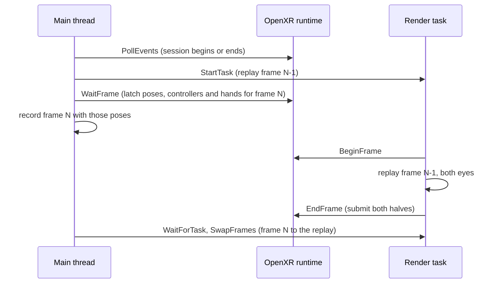

# XR and Quest

Ceili runs on a Meta Quest headset in stereo, through OpenXR, from the same
codebase that runs the editor on Windows. The Android build is a native library
with no Java in it. The headset path is part of the Graphics trunk, so every
render backend that can make a swapchain through OpenXR gets stereo, and every
scene renders in the headset without a change.

This page covers how OpenXR is loaded, how its frame loop fits the engine's
record and replay, how the controllers and the hands arrive, how one camera
becomes two eyes, how stereo is tested on a desktop with no headset, how the
runtime overlay works in the headset, how the app reaches the device and a
phone, how its cost is measured there, and the kinds of level of detail that fit
it into the frame: geometry, draw runs, shader levels and the effects the Quest
leaves out.

<!-- MEDIA: a short clip through the Quest's own capture: TheOldGods down the
     bay at 90 Hz, the head turning, the -showStats overlay on. -->

---

## The loader, opened at runtime

The engine never links the OpenXR loader. It opens it by name when a session is
wanted, and finds every entry point through `xrGetInstanceProcAddr`:

```cpp
// Src/Xr/OpenXr.cpp
#if defined(CEILI_HAS_OPENXR)
    // Every call goes through a pointer from xrGetInstanceProcAddr: the loader is opened at runtime, never linked, so a
    // build or a device without one still runs.
    #define XR_NO_PROTOTYPES
    #if defined(CE_PLATFORM_ANDROID)
        #include <jni.h>
        #define XR_USE_PLATFORM_ANDROID
    #endif
    #include <openxr/openxr.h>
    #include <openxr/openxr_platform.h>
#endif
```

The loader is `libopenxr_loader.so` on Android and `openxr_loader.dll` on
Windows. A desktop build with no headset runtime starts as usual, and
`graphics::xr::IsActive` answers false.

The trunk holds no graphics API types. It names the Vulkan binding as a string
(`XR_KHR_vulkan_enable2`), and the backend does everything that takes a Vulkan
type. The handoff is a small public API in `Include/Graphics.h`: the backend
reads the instance and system through opaque pointers, publishes its session
binding with `SetGraphicsBinding`, and hands its swapchain back with
`SetSwapchain`. A new backend that wants stereo implements those few calls.

## The frame loop, inside record and replay

The engine records a frame on the main thread while the render task replays the
previous recording to the GPU (see [Render Devices & Backends](RenderDevices.md)). OpenXR has its own
loop: wait for the compositor, begin a frame, render, end it. The trunk weaves
the two together at fixed points:

```cpp
// Src/Xr/OpenXr.h
// The frame loop. Main thread, at the start of graphics::StartTask, the render task joined: PollEvents drains the
// runtime's events and begins or ends the session. Main thread, after StartTask launched the replay: WaitFrame waits for
// the compositor and latches the frame for the recording made now. WaitForTask, the render task joined: SwapFrames
// hands that frame to the replay of that recording. Render task, around the device frame: BeginFrame and EndFrame.
void PollEvents();
void WaitFrame();
void SwapFrames();
void BeginFrame();
void EndFrame();
```

The important rule is that a frame's OpenXR state travels with its recording.
`WaitFrame` latches the predicted display time and the eye poses for the frame
the main thread is about to record. `SwapFrames` moves that state to the replay
side at the same point where the trunk swaps command buffers. So the replay always
submits the poses that its own recording was culled and drawn with, even when the
main thread has already moved on to the next frame.



The session state from the runtime also reaches the app. `IsSessionRunning`
covers the span from `READY` to `STOPPING`, and `IsExitRequested` turns the
runtime's request to exit into the app's own exit.

### A paced frame clock

The compositor paces a headset's frames. `xrWaitFrame` returns the time at which
the next frame will show, and `WaitFrame` gives that time to the engine's clock
through `core::chrono::SetPacedFrameTime`. The next frame's delta is then the
step between two display times:

```cpp
// Include/Time.h
// THE PACED FRAME CLOCK. A source that paces the frames states the time the NEXT frame will be displayed at, in
// nanoseconds of its own monotonic clock: the headset's compositor does, from xrWaitFrame's predicted display time. The
// next NewFrame then takes its delta from successive display times rather than from the wall clock, so the frame delta,
// and with it the fixed-tick alpha every interpolated pose is drawn at, advances by exactly what the display does.
// The wall clock read just after the compositor's wait wakes up wobbles by a millisecond or two, and on a Quest that
// moved a plane flying 1 m a tick by 0.54 to 0.75 m on frames the display showed exactly 11.1 ms apart (2026-10-23):
// a fore-and-aft judder against the view. A frame with no stated time, the first stated one, and a step the source
// cannot have meant (zero, backwards, or over PacedFrameDelta's cap) keep the wall delta. Main thread. C++-only.
CE_API void SetPacedFrameTime(const Time DisplayTime);
```

Only the OpenXR path states a display time, so a desktop window keeps the wall
clock. The rule itself is `PacedFrameDelta`, a pure function with its own unit
tests.

### Left-handed space

OpenXR is right-handed with -Z forward. The engine is left-handed with +Z
forward. The conversion happens once, where the views are located, so nothing
downstream sees an OpenXR pose:

```cpp
// Src/Xr/OpenXr.cpp
    // The same views in the engine's space, converted here once: OpenXR is right-handed with -Z forward, the engine
    // left-handed with +Z forward, and both have +X right and +Y up, so mirroring Z converts both pose and frustum (the
    // half-angles are about X and Y, which the mirror keeps).
    StereoViews& stereo = g_Xr.stereo;
    for (uint32_t i = 0; i < kNumViews; ++i)
    {
        const XrView& view = frame.views[i];
        EyeView&      eye  = stereo.eyes[i];
        eye.orientation    = math::QuatMirrorZ(math::Quat{view.pose.orientation.x, view.pose.orientation.y, view.pose.orientation.z, view.pose.orientation.w});
        eye.position       = math::Vec4MirrorZ(math::Vec4{view.pose.position.x, view.pose.position.y, view.pose.position.z, 1.0f});
```

### Controllers and hands

An immersive session never sees the Touch controllers as Android input events,
so they arrive through OpenXR actions. `WaitFrame` syncs them while the session
is focused, at the frame's predicted display time, and
`graphics::xr::GetControllerState` returns the result. It holds both sticks,
both triggers and both squeezes as analog values. It holds the A, B, X, Y and
Menu buttons, both grips and both stick clicks as bits, held and pressed this
frame. It also holds the right controller's aim pose and each controller's grip
pose, in the same left-handed space as the eyes. The game decides what each
input means.

The hands are facts beside the controllers. Where the runtime offers
`XR_EXT_hand_tracking`, the session makes one tracker per hand, and each frame
reports the palm and the fingertips of each free hand:

```cpp
// Include/Graphics.h
// THE HANDS, as the headset's cameras track them (XR_EXT_hand_tracking): facts beside the controllers', in the same
// space, so each reader decides what a hand stands in for. A tracked hand is a FREE hand: hands and controllers are
// tracked at once (XR_META_simultaneous_hands_and_controllers), and a hand holding its controller is not reported as
// tracked (its palm at the controller's grip), so a controller awake beside a tracked hand is one put down.
// handsActive is either hand tracked this frame; `active` above keeps meaning a controller.
bool handsActive            = false;
bool handTracked[kNumHands] = {false, false};
// The palm's centre, its +Z along the fingers.
math::Vec4 palmPosition[kNumHands]{{0.0f, 0.0f, 0.0f, 1.0f}, {0.0f, 0.0f, 0.0f, 1.0f}};
math::Quat palmOrientation[kNumHands]{};
// The fingertips, thumb first (kNumFingers).
math::Vec4 fingertipPosition[kNumHands][kNumFingers]{};
// How closed the hand is, 0 open to 1 a fist (HandGrab).
float handGrab[kNumHands] = {0.0f, 0.0f};
```

`HandGrab` turns the fingertips into one number: the mean distance of the
middle, ring and little fingertips to the palm, from about 10 cm with the hand
open to about 4 cm in a fist. The thumb and the index finger stay free to pinch.
Where the runtime also has `XR_FB_hand_tracking_aim`, each hand reports its
index pinch, the right hand reports a pointing ray, and the runtime's own menu
gesture (palm up, pinch) sets `handMenuPressed` on the frame it fires. The
Android manifest asks for the runtime's high-frequency hand tracking.

The engine resumes `XR_META_simultaneous_hands_and_controllers` with each
session, so the hands stay tracked while a controller is awake. Without it, a
controller woken by its A button took both hands away until it slept. That
leaves one question for each hand: is it free, or does it hold its controller?
The runtime's data source can say, but a Quest 2's did not, so the engine also
measures the distance:

```cpp
// Src/Xr/OpenXr.cpp
// A HAND HOLDING ITS CONTROLLER IS THAT CONTROLLER, not a free hand. The runtime says so through the hand's data
// source where it does; a Quest 2 did not (2026-10-25: the held right hand read a bare hand, and the menu pointer
// followed its smoothed ray and its pinch instead of the controller's aim and trigger), so the test that decides
// is physical: the palm within kHoldDistance of the same side's controller grip, which a controller put down is not.
constexpr float kHoldDistance   = 0.12f;
const bool      palm_located    = (joints[XR_HAND_JOINT_PALM_EXT].locationFlags & kValid) == kValid;
bool            from_controller = g_Xr.hasHandDataSource && (source.isActive == XR_TRUE) && (source.dataSource == XR_HAND_TRACKING_DATA_SOURCE_CONTROLLER_EXT);
if (palm_located && controller.gripValid[hand])
{
    math::Vec4 palm_position;
    math::Quat palm_orientation;
    ToEnginePose(palm_position, palm_orientation, joints[XR_HAND_JOINT_PALM_EXT].pose);
    from_controller = from_controller || (math::Vec4Len3(math::Vec4Sub(palm_position, controller.gripPosition[hand])) < kHoldDistance);
}
```

Haptics take one call, `graphics::xr::Vibrate(Hand, Amplitude, Seconds)`. It
drives one vibration action with the two hands as subaction paths, and each
pulse names its hand. On a Quest 2's runtime, one action per hand with no
subaction paths was accepted and never moved the motor.

---

## One camera, two eyes

One camera is enough for stereo. The camera that presents to the back buffer
draws two eye views, each into its half of a double-wide swapchain:

```cpp
// Src/Xr/StereoView.h
// Under OpenXR the camera that presents to the back buffer draws TWO eye views, each into its half of the double-wide
// swapchain. Its draw::ViewDesc row holds neither eye: CameraUpdateSystem stamps it as the UNION view, a frustum that
// contains both eyes' frustums, so the camera key's cull is a correct superset for the left eye and the shadow cascades
// are fitted to what both eyes see. Each eye is then derived from that row by ComposeEyeView, a pure function, so the
// cull (the right eye's list, under kRightEyeViewKey) and the draw build byte-identical views. The ocean reflection
// (Src/Env/OceanReflection.h) is the precedent for a derived view with a synthetic key.
```

The union view does three jobs. Its cull is a superset for both eyes. The shadow
cascades fit it, so both eyes sample the same shadow maps. Effects that need one
view for both eyes, such as the ocean's view under the sea, render once from it.

The right eye keeps its own visible set and history under a synthetic view key,
next to the other synthetic views the engine already had:

```cpp
// Src/Xr/StereoView.h
// The right eye's per-view runtime (visible set, batch cache, per-view history). The left eye draws under the camera's
// own key. Beside the cascades (0xFFFFFF00 + c), the overhead map (0xFFFFFF10) and the ocean reflection (0xFFFFFF20).
CE_INLINE core::data::Key RightEyeViewKey()
{
    return core::data::GetKey(0xFFFFFF30u);
}
```

The camera entity's world transform carries the headset's local space into the
world. The camera is the player's origin, and the head moves inside it.

On Vulkan with the multiview feature, a strategy toggle draws both eyes' scene
passes in one multiview pass into two-layer targets, and the post chain then
runs once per eye. A second toggle adds fixed foveated rendering, which shades
each lens's edge at a coarser rate where the device offers a fragment density
map. Each eye can also render at a share of the headset's recommended
resolution (`xrResolutionScale`, 0.5 to 1 per axis), which the compositor
stretches back over the lens.

### Two presents into one image

Each eye presents into its half of one swapchain image. On a tile-based GPU a
pass pays for every byte it loads and stores, so each eye's present names its
half as the render area, and the pass loads, clears and stores only that half.
The first eye clears its half. The second eye takes a third back-buffer render
pass:

```cpp
// GraphicsVk/Src/Vulkan.h
// The same pass with LOAD_OP_LOAD, for a back-buffer pass begun after the first one this frame: the first
// clears the image, and a later one must keep what the earlier ones drew (the second XR eye beside the first, a
// back-buffer scope resumed after a nested render target). Compatible with the one above, so its framebuffers and
// pipelines serve this one too.
VkRenderPass RenderPassLoad = VK_NULL_HANDLE;
// The same pass with LOAD_OP_DONT_CARE and the image's layout KEPT, for a later back-buffer pass that names a render
// area and writes all of it (the second XR eye). The CLEAR form above starts from UNDEFINED, which lets a driver
// discard the WHOLE image, the other eye's half included, whatever the area; this one discards nothing outside it.
VkRenderPass RenderPassDontCare = VK_NULL_HANDLE;
```

On the Quest 2 (2026-10-21, stereo_view, 144 interleaved pairs), the area took
Frame.Gpu from 4.788 to 4.586 ms (-4.2%), and the present stage from 1.217 to
1.000 ms an eye. A second eye that opens with the CLEAR pass over its area saves
nothing on this GPU (Frame.Gpu +1.3%), because a clear over part of the image is
not free there. The `presentRenderArea` strategy toggle turns the area off for
an A/B, and D3D12 ignores it.

### Stereo on a desktop

Most stereo work happens with no headset on. `-xrSimulate` gives the engine two
simulated eyes over the two halves of the window, shaped like a real headset's:

```cpp
// Src/Xr/OpenXr.cpp
// SetSimulatedStereo's eyes: a Quest 2's located fields of view (each eye reaches further toward the nose than the temple,
// and further down than up), 64 mm apart at the local origin, looking along +Z, each over half of the back buffer.
void SimulateStereoViews(StereoViews& Out)
{
    constexpr float kHalfIpd = 0.032f;
    const uint32_t  width    = GetWidth();
    const uint32_t  height   = GetHeight();
```

The same union view, eye views and right-eye key run as on the device, so a
stereo defect usually shows on the desktop first, where the debugger and the GPU
capture tools are (see [Debugging](../Tools/Debugging.md)). An automated stereo smoke test
uses the same flag and fails when a capture finds no stereo views.

### A head that holds still

A headset on a desk still moves a little, and one that rests tilted on a charger
looks at the floor. Neither gives a stable A/B measurement. `xrFreezeHead` keeps
the real eyes' spacing and fields of view, and puts the head at the origin, level
and facing +Z:

```cpp
// Src/Xr/StereoView.h
// THE HEAD FROZEN (display::DebugSettings::xrFreezeHead): each eye re-expressed relative to the head, and the head put
// at the local origin, level and facing +Z. The eyes keep their spacing, any cant and their fields of view, so the views
// are a real headset's, but where and how the headset rests no longer moves them: an A/B on a headset that is being
// handled, or resting tilted on a charger, measures one view. The head is the midpoint of the eyes, its orientation the
// midpoint of theirs.
CE_API void FreezeHeadPose(StereoViews& InOutViews);
```

Every headset measurement of TheOldGods and DirtBox on this page was taken with
the head frozen.

### The overlay in the headset

The runtime overlay is the menu bar and the docked panels over the game. A flat
ImGui layout across a double-wide image would split between the two eyes, so in
the headset, and under `-xrSimulate`, the overlay lays out once and draws a copy
into each eye:

```cpp
// Ui/Module.h
// THE STEREO PANEL. Under a headset, or -xrSimulate, ImGui lays out ONCE in a head-locked panel sized in eye pixels, and
// the UI render records that one layout into each eye's half of the back buffer, each copy shifted toward the nose by
// half the disparity of a point kPanelDepthMetres away, so both eyes see one image at a reading distance. The panel is
// 1:1 in eye pixels, so its text is never resampled, and its font is sized in degrees, so it reads the same at any
// display::StrategySettings::xrResolutionScale. Flat, nothing changes: ImGui lays out over the whole back buffer.
//
// C++-only: the shell and the UI render own it, and RuntimeApp only reads it.
```

The panel covers 60 by 40 degrees of the view, so each corner is a short turn of
the eyes away. It sits 2 m ahead, and its body text is 2 degrees tall. The left
Menu button or B shows and hides the overlay, so the right controller alone is
enough, and a bare hand uses the runtime's menu gesture.

While the overlay shows, the right controller's aim ray is ImGui's mouse.
`ui::stereo::PanelPointFromRay` finds where the ray meets the panel, ImGui draws
its cursor there in both eyes at the panel's depth, and the right trigger
clicks. A free right hand points with its own ray, and a pinch past 0.8 clicks.
Either stick moves the navigation highlight. While the overlay is hidden, the
pointer is off, so the trigger belongs to the game.

<!-- MEDIA: a clip through the Quest's own capture: the overlay opened with the
     left Menu button, the right controller's cursor moving over the profiler
     panel, a trigger click on a menu item. -->

---

## Reaching the device

The Android entry point is a `NativeActivity`. The platform glue gives
`android_main` an `android_app`, and the App package's Android shell drives the
looper from inside `app::Run`, as the desktop shells drive their message loop.
Before `graphics::Create`, the shell passes the Java VM and the activity to
`graphics::xr::SetAndroidContext`, which the OpenXR loader on Android needs.

One script builds, packages, installs and runs the app, and captures its log.
Its header is its documentation:

```powershell
# Claude_AndroidApk.ps1 - build, package, install and launch Ignition's APK on an Android device, and capture its log.
#
# The APK has no Java: libIgnition.so (the NativeActivity) packaged by the Build app's Package task
# (Pkg/Engine/StudioPlugins.Net/Plugins/Documents/Build/Tasks/Package.cs), signed with the per-user debug key.
#   -Config   NDK_ARM64d (debug, default) or NDK_ARM64rds
#   -AppArgs  the app's command line, passed through the debug.ceili.args system property
#   -Seconds  how long the app runs before the script presses Back (default 8). The immersive app gets no key events,
#             so it ends itself instead (-exitAfterSeconds, which ClearApp and RuntimeApp take); the panel app still exits on Back
```

Three of its options shape the daily loop:

- **`-Panel`** packages a flat 2D panel app in place of the immersive one, and
  runs it with `-noxr`. It is the off-head debug loop, with no OpenXR session
  to begin.
- **`-SyncData`** copies the runtime data (Lua, bindings, materials, SPIR-V,
  fonts) into the app's files directory. Only changed files cross `adb`, so a
  material edit reaches the device without a new APK.
- **`-Manifest`** brings a scene's textures. The Quest cannot sample the BC
  formats the desktop uses, so `AstcBakeApp` bakes each texture a scene needs to
  ASTC in `.ktx2` files and writes the scene's device file list.

The log (logcat, tag `Ceili`) goes to `Logs/Android/`, and a crash also saves the
crash buffer beside it, so a failure on the device leaves the same kind of record
that a failure on the desktop does (see [Debugging](../Tools/Debugging.md)). Because the
script is one command with an exit code, an agent can run the whole round trip,
build to log, on its own (see [AI Integration](../Tools/AiIntegration.md)).

### Phones

The same script runs the panel app on an Android phone (`-Panel`). A phone has
no OpenXR runtime, and its Vulkan driver can be much older than the Quest's. The
first phone measured, a Galaxy S20 FE, has the Quest 2's GPU (an Adreno 650) and
a Vulkan 1.1.128 driver with none of synchronization2, timeline semaphores and
descriptor indexing. The Quest 2's driver (1.1.295) offers all three as
extensions. Four parts of the engine let such a phone run.

**Two tiers.** The Vulkan device picks a tier at creation:

```cpp
// GraphicsVk/Src/Device.cpp
// CEILI'S MINIMUM SPEC AND ITS TWO TIERS, and this is the one place that says so (Vulkan.h, Tier).
//   Full:   synchronization2 (every barrier), timeline semaphores (the frame clock) and descriptor indexing (the
//           bindless heap, and every tex[NonUniformResourceIndex(i)] sample).  Core from 1.3 / 1.2; on a 1.1
//           device (the Quest 2) the extensions requested above.
//   Compat: the same shaders and heap indices on core Vulkan: dynamic indexing of the three descriptor arrays,
//           and per-stage limits that hold the whole heap.  The S20 FE's Adreno 650 driver (1.1.128) has these
//           and none of Full's three (Docs/MobilePerformanceStrategies.md section 8, "Phones", 2026-10-22).
// A device with neither is told so in ONE line naming every gap, then refused.
//
// A SECOND PATH MUST NOT SHIP UNTESTED: the objection to a sync1 fallback was that it could not run on any
// machine that has sync2.  graphics::SetForceCompatTier answers it: the desktop smokes force Compat here.
```

The compat tier records core `vkCmdPipelineBarrier` barriers, runs its frame
clock on pooled fences, and gives each command buffer its own bound copy of the
texture heap. It loads the same shader blobs:
`graphics::shader::spirv::RewriteForBoundHeap` gives the heap arrays fixed
lengths and removes the descriptor-indexing decorations, so no texture index
moves. `-vkCompat` forces the compat tier on a desktop. On a device that fails
both tiers, the Android shell closes after the one log line.

**The view index folded.** Every engine shader compiles for multiview, so a
stage that picks its eye reads the `ViewIndex` built-in. The S20 FE's driver
crashes or hangs when it compiles such a stage in a pipeline with no multiview.
Outside a multiview pass the specification gives 0 for that built-in, so a
device that draws no multiview pass takes the constant:

```cpp
// GraphicsVk/Src/Material.cpp
// A DEVICE THAT DRAWS NO MULTIVIEW PASS takes view 0 for the ViewIndex built-in, which the specification gives it
// anyway: an old Adreno driver crashes or hangs compiling any stage that reads it (Graphics/Include/Shaders/
// SpirvViewIndex.h).  An OpenXR device draws multiview passes, and so does any device under simulated stereo
// (-xrSimulate): folded there, both eyes of a multiview pass drew view 0 (the mobile profile's StereoSmoke).
core::Array<uint32_t> view_words;
if (!IsXrDevice() && !graphics::xr::GetSimulatedStereo())
{
    const Result res = graphics::shader::spirv::FoldViewIndexToZero(view_words, static_cast<const uint32_t*>(info.pCode), static_cast<uint32_t>(info.codeSize / 4u));
    if (Failed(res))
    {
        CE_LOG(log::Type::Error, "material '%s' pass '%s': %s shader '%s' reads its view index in a way the single-view fold cannot rewrite", MaterialName, PassName, StageLabel, (ShaderName != nullptr && ShaderName[0] != 0) ? ShaderName : "<unnamed>");
        return VK_NULL_HANDLE;
    }
    info.codeSize = view_words.size() * 4u;
    info.pCode    = view_words.data();
}
```

**A driver deny-list.** A driver that meets the spec but fails on the engine's
shaders is refused at device creation, with the measured reason in the log. The
list holds Qualcomm builds up to 502, the S20 FE's. The view-index fold removes
the cause that the entry records, and the entry still refuses the driver.
`-vkIgnoreDenyList` runs it anyway for a test. With it, on 2026-10-22, DirtBox
built all 792 of its pipelines on the S20 FE and rendered at 87 fps (GPU frame
11.5 ms).

**The device profile.** `config.lua` picks a profile from facts the engine
reports. `core::platform::IsHeadMountedDevice` is true on an Android device whose
manufacturer is Oculus or Meta, and such a device takes the `quest` profile. A
`phone` profile exists (the PBR frame, the cloud slab for both layers, forward
clustered lighting), but on the S20 FE it ran DirtBox far too slowly. So a phone
runs the Quest's profile until its own is measured, and `-deviceProfile phone`
runs the phone's.

A phone also pays more for each pipeline: a compile takes about 45 ms on the S20
FE. Two material features keep that cost small at load. A material builds a
pipeline only for the passes its draws ask for, and the compiles run on pipeline
workers (two by default), so the thread that asks never waits. Built for every
pass on the main thread, DirtBox on the S20 FE took 950 pipelines (2026-10-25),
28 of them for a terrain material whose view drew two, and the scene never
settled. `-passesOnDemand 0` and `-pipelineCompileWorkers 0` bring that eager
build back for an A/B. The [Materials](Materials.md) page covers how a material
builds its passes.

---

## Measuring on the device

Before September 2026 every performance verdict in the engine came from one
development PC. A headset changes almost every property that a verdict depends
on, so the engine keeps a separate record, the mobile performance strategies
file, of each strategy a desktop number could get wrong. Its comparison starts
like this:

| Property | Development PC | Quest 2 / Quest 3 |
|---|---|---|
| GPU memory | Discrete VRAM across PCIe | Unified memory, shared with the CPU |
| Rendering model | Immediate mode | Tile-based deferred rendering |
| Vulkan version | 1.4 | Quest 2: 1.1 (instance 1.3). Quest 3: 1.3 |
| Frame budget | Unlocked | 72, 90 or 120 Hz (13.9, 11.1 or 8.3 ms), two eye views |

A desktop win can be a device loss. A G-buffer and extra render-pass boundaries
cost more on a tiler. A staging copy that pays for itself across PCIe is pure
overhead on unified memory. The Quest 2's Vulkan 1.1 means a feature from 1.2 or
1.3 must be checked for as an extension.

So each strategy stays behind a runtime toggle, and each toggle records its
latch point, which decides how it can be A/B tested:

- **FRAME:** takes effect on the next frame, so it can be interleaved inside one
  run.
- **REBUILD:** takes effect at the next merged-batch rebuild.
- **SCENE_LOAD:** decided when resources are created.
- **RESTART:** decided at device or pipeline creation.

A FRAME toggle suits a headset well, because a thermal governor lowers
the clocks over minutes. Interleaved blocks in one run see the same clocks, and
two runs minutes apart do not. The device records also note the clocks they
saw.

A measurement must also start on the frame the scene will keep drawing. Its
pipelines build on workers as its draws ask for them, so the frame count at
which that happens differs by device:

```cpp
// Src/RuntimeApp.cpp
// THE SETTLE: Play, -spawnAtCamera, the stats, every capture and the A/B begin once the scene has settled. That is at
// least kSettleFrames after the open (a scene's brushes merge in that time), and then the first frame after
// kSettleQuietFrames in a row with no pass pipeline pending (material::GetNumPipelineBuildsPending), so the camera draws
// what it will keep drawing. Builds follow the draws that ask for them, so a fixed count was a guess: on a phone it
// passed with half the passes still compiling. Several frames in a row, because a pass a draw asks for becomes a build
// only at the next pump. kSettleMaxFrames bounds the wait, so a build that never lands cannot hold the run forever.
constexpr uint64_t kSettleFrames      = 180;
constexpr uint32_t kSettleQuietFrames = 3;
constexpr uint64_t kSettleMaxFrames   = 1800;
```

### A worked example

The TheOldGods level, looking down its bay with the head frozen, measured on a
Quest on 2026-10-17 over 81 interleaved pairs. Arm B draws the terrain's first
material layer alone, with no layer blend:

| Arm | Frame.Gpu | CPU frame | fps |
|---|---|---|---|
| A, the shipping terrain | 13.82 ms | 14.92 ms | 67.0 |
| B, no terrain blend | 12.00 ms | 14.16 ms | 70.6 |
| C, A again | 13.80 ms | 14.92 ms | 67.0 |

The blend costs 1.82 ms of GPU, and B was faster in all 81 pairs. The third arm
repeats the first, so the drift across the run is visible: here it is 0.02 ms.
The table also showed a second limit. With the blend gone, the GPU fits the
13.9 ms budget of 72 Hz and the frame still does not. That gap was the GPU
waiting on a serial replay with one frame in flight. The Quest's device profile
runs two frames in flight, so the replay records while the GPU runs the frame
before. On the same view (2026-10-18), that took the frame from 15.43 to
14.66 ms with Frame.Gpu unchanged.

The [Profiling](../Tools/Profiling.md) page covers the zones and the interleaved A/B
harness behind these numbers, and the [Weather](Weather.md) page has the ocean's
device measurements.

---

## Fitting the frame

A headset frame has three costs that a desktop frame hides: triangles, draws and
shader instructions. The engine has a level-of-detail answer for each one, and
each sits behind its own runtime toggle, so the device measures it with the
interleaved A/B harness.

The Quest's profile asks the runtime for 90 Hz through
`XR_FB_display_refresh_rate` (`strategy.xrRefreshRate`, or `-xrRefreshRate N`),
which leaves 11.1 ms a frame. On 2026-10-20 every compiled scene and pose held
90 Hz at 8.6 to 9.9 ms of GPU, except Volcano, at 88.7 fps and 10.9 ms.

### Geometry LOD: the compiled world

The ported levels arrive as a compiled world. Its geometry sits in shared vertex
pools, and every draw is a range of a pool's index buffer: a node wholly in view
draws its whole subtree with one draw per material. Detail levels are more index
runs in the same pools, so the same hierarchical draws work at every level. One set
of levels, free to crack, serves the shadow cascades, the planar reflection and the
view under the sea. A second, crack-free set serves the camera and both eyes, and
each kd node takes the coarsest level whose projected error stays under
`worldLodPixels`. The [Compiled Worlds](CompiledWorlds.md#detail-levels-more-runs-in-the-same-pools)
page covers the format, the bake and the pick. This section covers what they buy
on the headset.

On TheOldGods, looking down the bay with the head frozen (2026-10-17, 36 pairs):

| Main view | Triangles | Draws | Frame.Gpu |
|---|---|---|---|
| Full detail | 365k | 71 | 15.26 ms |
| Picked at 1 px | 274k | 129 | 14.50 ms |

The pick saves 0.76 ms for 58 more draws, and the index memory roughly doubles
(TheOldGods' compiled scene goes from 16.5 to 30.9 MB). On the desktop, at the
same pose, the image differs in 0.07% of its pixels beyond run-to-run noise, all
in the distant band. The Quest's profile turns it on at 1 px.

A grid of every combination of the four level settings, with the ocean's nested
views drawn every frame or every other frame, took the same view from 18.09 ms
and 600k triangles to 14.32 ms and 237k. Each factor's mean effect:

| Factor | Mean effect on Frame.Gpu |
|---|---|
| The ocean's nested views every other frame | -1.67 ms |
| The main view's levels at 1 px | -0.82 ms |
| The reflection at level 2 | -0.71 ms |
| The view under the sea at level 2 | -0.51 ms |
| The shadow cascades at level 2 | -0.01 ms |

The shadows gain nothing at this pose because the cascades are cached and the
head is frozen, so they rarely rebake. A moving camera would rebake them, and this
grid cannot show that case. With every cascade re-baked each frame, the stepped
levels halve the shadow bake, from 1.03 to 0.50 ms (see
[Compiled Worlds](CompiledWorlds.md#the-levels-for-views-nobody-looks-at-directly)).

### Geometry LOD: meshes

Meshes outside the compiled world have a lighter mechanism. A submesh can carry
a detail ladder that costs nothing but a smaller number at the draw:

```cpp
// Include/Meshes/Mesh.h
    // DETAIL LEVELS, as index counts into this submesh's OWN run - so level k draws the first
    // lodIndexCounts[k] indices starting at firstIndex, and nothing else changes.  That works
    // because the reduction that produced them is ISLAND REMOVAL: every level's triangles are a
    // strict SUBSET of level 0's, and the exporter emits the run largest-island-first, so a level
    // is a PREFIX.  No second vertex buffer, no second index buffer, no second primitive - a level
    // costs one smaller number at the draw.  MeshBake slices `pIndices + firstIndex` verbatim
    // (MeshBake.cpp), so the ordering survives the bake and the prefix stays a prefix.
```

Island removal reduces geometry made of separate pieces, such as foliage, and does
nothing for a welded mesh such as terrain. The compiled world's levels come from
a full simplifier, which reduces welded geometry too. The same ladder drives a foliage draw distance measured in
projected pixels. A cut in metres would remove the cheap distant grass and keep
the expensive near saplings. A cut in projected size removes what is too small to
see. A shadow cascade takes that cut in the camera's projection, so a caster
leaves the shadow map exactly when it leaves the image.

### Draw runs

A draw has a fixed cost. At the bottom of the shader ladder below, on the Quest,
one draw costs about 1.9 microseconds of GPU and 0.6 microseconds of submit CPU.
The compiled world's sort already puts each material's ranges next to each other
in the index buffer, so many batches that the cull keeps separate are touching
ranges of one buffer. A draw run joins them:

```cpp
// Src/Draw.h
// THE DRAW RUNS (Batch::runNumIndices, display::StrategySettings::drawRuns): may Next's range extend Head's draw?
// Both one static, non-instanced surface with the same world matrix, and every key field but the range equal.  The
// ranges touching is the caller's check.  CE_API for the unit test.
CE_API bool CanJoinDrawRun(const Batch& Head, const Batch& Next);
// Stamp Batches' runs in their sorted order: clear every batch, then (when Enabled) extend a head over each following
// batch that CanJoinDrawRun and starts where the head's run ends.  Run by BuildBatches on every exit; CE_API for the
// unit test, which drives it on a hand-built array.
CE_API void AnnotateDrawRuns(Batch::SortedArray& InOutBatches, const bool Enabled);
```

The cull does not change, and neither does the image. The run is stamped on the
batches after they are sorted, and it is not part of their key, so merging never
disturbs batch reuse. A pass honours runs only inside a `DrawRunScope`. A pass
that picks batches by something that the members of a run do not share, such as
a local light's bounds, must not open one, or it would draw a member it meant to
skip.

On DirtBox (2026-10-13, 36 pairs at each pose):

| Pose | Draws | Frame.Gpu | CPU frame |
|---|---|---|---|
| Start, runs off | 321 | 13.84 ms | 14.88 ms |
| Start, runs on | 60 | 13.31 ms | 14.18 ms |
| Overview, runs off | 215 | 13.18 ms | 14.18 ms |
| Overview, runs on | 43 | 12.94 ms | 13.99 ms |

At the start pose, runs also beat drawing the kd root's merged ranges with no
cull at all, and they draw no culled triangle. Draw runs are on by default. The
shadow bake can also join touching ranges across materials, since every caster
draws through one shadow material, and that stays off: it saved three draws and
no time.

### Shader LOD

The third cost is the fragment shader. The Quest's GPU allocates registers for
every path a shader carries, whether it runs or not, so a branch that skips a
feature still costs occupancy. A shader level therefore compiles the feature out:

```hlsl
// Resources/Shaders/shaderFeatures.hlsli
// THE SHADER FEATURES a lit pass may compile OUT, for a device that cannot afford them (the Quest 2's shader levels,
// Docs/MobilePerformanceStrategies.md section 8).
//
// ONE define selects them, CEILI_FEATURE_MASK, because a shader compile takes at most eight definitions
// (shader::compiler kMaxDefines) and the material compiler drops the rest without a word.  Unset, the mask is every
// feature and none of the OPT-IN trims (0x1000000 and up), so a shader that says nothing compiles exactly as it always
// has.  Each CEILI_FEATURE_<NAME> below is 0 or 1; test it with `#if`, never `#ifdef`, since every one is always defined.
//
// COMPILED OUT, NOT BRANCHED AROUND.  The Adreno 650 allocates registers for every path a shader carries, run or not:
// a cookie branch no light took cost a third of the grid shader's occupancy.  So a feature that is off has no code in
// the binary, rather than a uniform that skips it.
```

The mask names features such as the weather cover, decals, the aerial
perspective, the cloud shadow, the sun's cascaded shadow and the terrain's layer
blend. Other bits trade precision for speed: a level that drops the full-precision
bit runs its shading in half precision.

The material system writes the levels. A pass marked for shader levels gets one
level copy for each configured level, beside the authored pass:

```lua
-- Resources/Materials/core.material
-- THE SHADER LEVELS (Docs/MobilePerformanceStrategies.md section 8). A pass marked `shaderLevels = true` gets one LEVEL
-- COPY per configured level, written beside it when a recipe is written (collectRecipePasses): the same pass, its
-- fragment shader compiled with that level's CEILI_FEATURE_MASK (shaderFeatures.hlsli), so the features the level drops
-- have no code in it. The mark deep-merges like any pass key, so every derive of a marked base inherits it.
--
-- [level] = feature mask, for levels 1 to 8; nil leaves that level unbuilt, so an unused level costs no shader. lightCommon.material sets them
-- (LC.shaderLevels through M.setShaderLevels), the one place the masks are authored.
M.shaderLevelMasks = {}
```

Each copy carries a pass flag for its level, and the device profile enables one
level. A pass that carries no level flag serves every level, so content that
never opted in draws as before. The mark also deep-merges into every material
derived from a marked base, so one line in a base material gives a whole family
its levels.

The levels came from a ladder. Each rung adds one feature to the sun's pass, and
each step is measured as rung N against rung N+1 with a null arm. On DirtBox
(2026-10-14, 36 pairs a step, both eyes in one multiview pass):

| Step | Feature added | Cost |
|---|---|---|
| 1 | Diffuse texture | +1.36 ms |
| 2 | Normal map and the sun's lighting | +1.29 ms |
| 3 | Specular map | +0.40 ms |
| 4 | Ambient | +0.11 ms |
| 5 | Sun shadows | +3.12 ms |
| 6 | Terrain layer blend | +2.91 ms |
| 7 | Shadow coordinate from the vertex shader | -1.69 ms |

Shadows and the terrain blend are the two large costs, and the shadow cost is in
the sampling. On an earlier run of the same ladder, the cascade select, project
and filter took a surface's fragment shader from 177 to 430 instructions, and its
occupancy from 75% to 50%. The last rung moves the shadow coordinate into the
vertex shader and wins back 1.69 ms. That rung is shader level 8, which the Quest's
profile draws, at 11.29 ms here.

The terrain blend is the next target. The [worked example](#a-worked-example)
prices it at 1.82 ms on TheOldGods. One form of terrain shader LOD is
built: past the blend's distance fade, every terrain material has a far twin
that reads only the distance maps, and the camera's world pick draws a distant
item with it. It is exact, and on that pose it saved only 0.05 ms, because the
blend already skipped its layer reads past the fade. So it stays off. Most of the
blend's cost is in near terrain.

### Effects the Quest leaves out

The Quest's profile turns some effects off, or draws a cheaper form of them. Each
verdict comes from a Quest 2 A/B:

| Effect | Scene and date | Measured | The Quest's profile |
|---|---|---|---|
| The simple ocean | TheOldGods' default camera, 2026-10-19, 16 pairs | 18.16 -> 8.73 ms, 53 -> 72 fps | On |
| The lens flare | stereo_view, post chain on, 2026-10-22, 36 pairs | +12.84 ms for both eyes | Off |
| Post-stage fusion | stereo_view, post chain on, 2026-10-22, 36 pairs | 41.69 -> 31.34 ms (-24.8%) | On, with the chain off |
| Decals, 64 craters | DirtBox, PBR, 2026-10-24, 36 pairs | 29.77 -> 32.26 ms (+2.50 ms) | Off |

The simple ocean draws the water opaque, with only the authored sky in it and no
nested views (see [Weather](Weather.md) for the full ocean on the device).

The lens flare costs 6.4 ms an eye. Its shader branches on its dials, so a zero
dial skips its taps, and a ladder of dials prices each part. The ghosts' bloom
samples (18 taps a pixel of a 1/8-size image) are 60% of the cost, and the
full-size pass itself is 38%. Fusion removes the pass and keeps the samples, so
the flare still costs 10.6 ms for both eyes inside the fused pass. The flare's
ghosts drawn at the bloom's size (`strategy.flareGhostsAtBloomSize`) are the
lever for a headset that turns the flare back on, and they are not yet measured
on the Quest. See [Post-Processing](PostProcessing.md) for the chain and its
fusion.

The shipped Quest frame cannot show a decal. Its Blinn-Phong materials never run
the decal step, and shader level 8 compiles the step out of the PBR bodies. So
the decal A/B switches the frame to PBR and the full shaders first. The
`strategy.decalAlbedoOnly` toggle makes each decal paint its albedo only, which
skips the normal and metalRough samples for every decal pixel. On the device it
measured +0.04% against every channel, inside the null arm's spread, so it stays
off.

---

## What XR does not do yet

- **D3D12 has no OpenXR binding.** The trunk's handoff is API-neutral, and today
  only the Vulkan backend implements it, so a headset session on Windows needs
  the Vulkan backend.
- **Multiview is Vulkan only**, and it turns itself off while a pass that cannot
  draw two layers is on, such as depth of field.
- **One controller profile, and no rebinding.** The actions suggest bindings
  for the Touch controller profile alone, and the map is fixed in code.
- **The hands depend on the runtime.** The pinch, the pointing ray and the menu
  gesture need `XR_FB_hand_tracking_aim`. Without it a tracked hand gives its
  palm, its fingertips and its grab only. Only the right hand has a ray.
- **A phone has no measured profile of its own.** It runs the Quest's profile,
  in one view, until the `phone` profile is measured on a device. One phone
  model is measured, and the driver deny-list still refuses its driver.
- **One headset family is measured.** Every headset number comes from Quest
  hardware. No other OpenXR runtime has a recorded verdict yet.

Next: [Weather](Weather.md) for the sky, rain and sea the headset looks at,
[Render Devices & Backends](RenderDevices.md) for the record and replay this loop sits inside, or
[Profiling](../Tools/Profiling.md) for the A/B harness. Back to the
[documentation index](../README.md).
