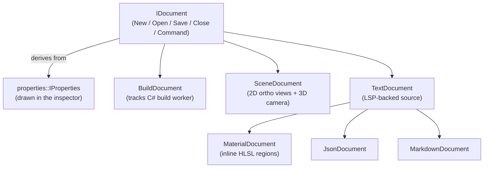

# Studio

Studio is the editor. It is also the engine: the same code, the same component
system, the same [data table store](Core.md#data-the-table-store-the-engine-is-made-of),
and the same render path, wearing an editor UI, not two applications that
happen to share a rendering library. When Ceili says
[runtime == tools](Philosophy.md), Studio is where that bet gets cashed.

This page walks the editor from the top down: the document model that organises
its windows, the text documents backed by real language servers, the property
grid that draws itself, the cross-language plugin system that lets you extend the
editor in C#, and the selection and gizmo path that manipulates a live scene. The
recurring theme is that almost everything here rides the engine's own primitives,
viewed through an editing lens, rather than being bespoke editor machinery.

---

## The editor is the runtime

The first thing to internalise is that Studio does not run a scene in a sandbox
and marshal changes back into a "real" runtime later. The scene you are editing is
a live scene, ticked by the same fixed-tick scheduler that ticks a shipping game,
drawn by the same passes. Editor behaviour is authored as ordinary components and
systems that happen to only run in the editor scope.

Selection is the cleanest example. There is no special "selection subsystem" bolted
onto the renderer: the system that picks, highlights, and bounds the selection is a
`core::scene::system::SystemBase<>` ISystem, ticked on the same substrate as any
gameplay producer. A scene gets selection just
by being ticked, because the selection system is a component gathered by the same
scheduler that gathers a flocking system or a culling system. If you understand
[how Core schedules systems](Core.md#tasks-threading-and-the-fixed-tick-clock),
you already understand how the editor's own logic runs.

The Properties panel makes the same point from the UI side. It does not special-case
"documents" versus "entities" versus "materials." It draws every hosted provider of
an `IProperties` interface each frame, in descending priority. An app hosts an
interface id once, and each provider of that interface then appears through the
generic component registry, with no per-provider registration:

```cpp
// App/Include/Properties.h
// A contributor of Properties-panel content: it draws its section into the current window and returns Ok, or draws
// nothing when it has nothing this frame. An app HOSTS the interface ids whose providers it shows (Host below), as it
// hosts panels: a runtime hosts IID_Properties, and Studio hosts it and studio::properties::IID_Properties, the
// editor-only subtype its documents implement.
struct IProperties : component::IComponent
{
    virtual Priority getPriority() const                                                 = 0;
    virtual Result   updateProperties(const component::ComponentUpdate& ComponentUpdate) = 0;
};
CE_DECLARE_INTERFACE_ID(Properties)
```

New content in the inspector is a new component that implements `IProperties`, not a
wider panel. The interface lives in the App package, so a runtime shows the same
panel content without the editor. This is the
[component architecture](Components.md) applied to the editor's own surface area:
extend by adding a component, never by editing the host.

<!-- MEDIA: a full Studio screenshot -- the complete editor: menu bar, docked
     panels (Explorer, Properties, Console), a 3D camera viewport with a scene,
     and the 2D ortho views. The "this is one application" establishing shot. -->

---

## The document model

Everything you open in Studio is a **document**. A build, a scene, a Lua script, a
material, a JSON file, a markdown note: each is an `IDocument`, and each is drawn,
saved, and closed through the same interface (`openNew`, `open`, `save`, `saveAs`,
`close`, and `command`).

```cpp
// Documents/Document.h
// A document IS a properties provider (getPriority + updateProperties come from
// properties::IProperties).  Open documents are not individually enumerated by
// properties::Update, though -- the properties::Documents component forwards the ACTIVE
// document's grid, so only the focused document draws.
struct IDocument : properties::IProperties
{
    enum class Flags : uint32_t
    {
        None  = 0,
        New   = 1u << 0,
        Open  = 1u << 1,
        Dirty = 1u << 2,
        Close = 1u << 3,
    };

    virtual Flags     getFlags() const                  = 0;
    virtual ConstStr  getName() const                   = 0;
    virtual IActions& getActions() const                = 0;
    virtual ConstStr  getExtensions() const             = 0;
    virtual void      setHandle(const Handle hDocument) = 0;
```

Notice the base class. `IDocument` derives from `studio::properties::IProperties`,
the editor-only subtype of App's `IProperties`: a document *is* a properties
provider. A document already satisfies the inspector's contract, so the focused
document draws its grid in the Properties panel with no separate registration
step. That is the funnel discipline from
[Metadata](Metadata.md) showing up structurally: fewer interfaces, each doing more.

Document types specialise the base where they need to. A **build document** tracks
the C# build worker so the C++ orchestrator can block-wait it before shutting down:

```cpp
// Documents/Build.h: the C++ orchestrator holds a handle to the C# build worker.
CE_API void                SetActiveWorker(const core::tasks::Handle Handle);
CE_API core::tasks::Handle GetActiveWorker();
```



### Scene documents: 2D and 3D of the same scene

A scene document is the richest case. It hosts the familiar 3D camera viewport, and
alongside it three orthographic views: Top, Front, and Side. Both are windows onto
the *same* live scene database: the 2D views are a different projection of the
identical data, not a separate representation kept in sync.

```cpp
// Documents/SceneDocument.h
// Which orthographic direction a 2D scene view looks down.  The enum value also
// indexes the SceneDocument's per-direction 2D-camera array on the C# side.
enum class ViewDirection : uint32_t
{
    Top,   // looks down -Y: horizontal axis = X, vertical axis = Z
    Front, // looks down -Z: horizontal axis = X, vertical axis = Y
    Side   // looks down -X: horizontal axis = Z, vertical axis = Y
};
```

The grid under each 2D view is authored, not hard-coded. A `Grid` struct carries the
colours, spacing, and adaptive behaviour, and a single interop call emits every grid
line for the active view:

```cpp
// Documents/SceneDocument.h: one call renders the whole grid for a view.
CE_API void DrawGrid(const ViewDirection Direction,
                     const float         OriginX,
                     const float         OriginY,
                     const float         Width,
                     const float         Height,
                     const float         PanX,
                     const float         PanY,
                     const float         PixelsPerUnit);
```

The C# scene-document plugin drives the three tabs and hands the pan/zoom state
straight back down to C++. The same direction, pan, and zoom go to `DrawGrid` and to
the wireframe view, so the grid and the wireframe geometry drawn on top of it use one
world-to-screen mapping:

```cs
// SceneDocument.cs
// The SceneDocument's own window hosts the 2D ortho views (Top / Side /
// Front tabs).  The 3D render belongs to the Camera window (the render
// delegate set above), so the tabs here and the camera image are
// simultaneous views of the one scene.  Each tab drives its own 2D camera;
// DrawGrid (C++) emits every grid line for the active view in one interop call.
if (UI.BeginTabBar("##SceneViews2D"))
{
    this.DrawView2D("Top", Studio.Scene.ViewDirection.Top);
    this.DrawView2D("Front", Studio.Scene.ViewDirection.Front);
    this.DrawView2D("Side", Studio.Scene.ViewDirection.Side);
    UI.EndTabBar();
}
```

Inside `DrawView2D`, the pan/zoom from the view state flows into both calls:

```cs
// SceneDocument.cs
Studio.Scene.DrawGrid(Direction, cursor.x, cursor.y, avail.x, avail.y, v.panX, v.panY, v.pixelsPerUnit);

// GPU wireframe overlay: point the shared wireframe view at this tab (matching the
// grid's direction + pan + zoom), then blit last frame's rendered RT over the grid.
// The RT clears transparent, so the grid shows through the gaps.  One-frame latency,
// like the Camera window (the DrawSystem renders the view on the next scene tick).
if (this.hWireframeView.Value != Scene.Entity.GetInvalidHandle().Value)
{
    uint vw = (uint)avail.x;
    uint vh = (uint)avail.y;
    Graphics.Scene.ResizeViewportTarget(this.hScene, this.hWireframeView, vw, vh, Graphics.Texture.Format.RGBA8);

    // Selection highlight rides graphics::scene::VisibilityFlags now (set by
    // studio::SelectionSystem, read by RenderWireframe per batch) -- the
    // wireframe view no longer carries a selectedKey.
    Graphics.Scene.SetWireframeView(this.hWireframeView, (Graphics.Scene.WireframeDirection)(int)Direction,
                                    v.panX, v.panY, v.pixelsPerUnit, vw, vh, (byte)1);
```

Keeping the world-to-screen transform in one place (matched between `DrawGrid` and
the wireframe render, as the package's own design note spells out) is the same
"single source of truth on state mutation" rule from [Core](Core.md) applied to a
coordinate mapping: two paths that must agree funnel through one implementation
rather than drifting.

<!-- MEDIA: the 2D + 3D dual view -- a scene shown simultaneously in the 3D camera
     viewport and in a Top/Front/Side ortho tab, so the reader sees the same
     entities projected two ways from one database. -->

---

## Text documents backed by real language servers

Ceili does not ship a toy syntax highlighter. When you open a Lua script, a C#
file, or a material with inline HLSL, Studio speaks the Language Server Protocol to
a real server for that language, and you get go-to-definition, hover, references,
completion, and document symbols, the same features a full IDE gives you.

A text document exposes the editing surface plus the LSP query positions. The same
header also holds the embedded-region functions (`SetEmbeddedRegions`,
`IsInEmbeddedRegion`) that mark HLSL inside a Lua file:

```cpp
// Documents/Text.h
CE_API Handle Open(core::ConstStr FileName);
CE_API core::Result Reload(const Handle hText);
CE_API core::Result Save(const Handle hText);
CE_API bool         IsLoaded(const Handle hText);
CE_API void         Update(const Handle hText);
CE_API void         Close(const Handle hText);
CE_API core::file::Handle GetFileHandle(const Handle hText);
CE_API core::ConstStr GetFileName(const Handle hText);
CE_API core::ConstStr GetText(const Handle hText);
CE_API core::Language GetLanguage(const Handle hText);
CE_API bool           GetHoverPosition(const Handle hText, uint32_t& Line, uint32_t& Character);
CE_API bool           GetDefinitionRequest(const Handle hText, uint32_t& Line, uint32_t& Character);
// Returns the fully-qualified C++ name when the most recent GetDefinitionRequest sat on a
// "ceili::a::b::Type" string literal, else an empty string. UpdateLspDefinition reads this
// right after GetDefinitionRequest: non-empty -> resolve via the C++ LSP by name.
CE_API core::ConstStr GetDefinitionSymbol(const Handle hText);
```

Behind it sits a small `ILsp` interface with the standard LSP verbs:

```cpp
// Documents/Lsp/Lsp.h
struct ILsp : component::IComponent
{
    virtual core::Language getType() const               = 0;
    virtual Result         start(ConstStr WorkspacePath) = 0;
    virtual Result         stop()                        = 0;
    virtual bool           isRunning() const             = 0;

    // Document synchronization
    virtual Result didOpen(ConstStr Uri, ConstStr LanguageId, int32_t Version, ConstStr Text) = 0;
    virtual Result didClose(ConstStr Uri)                                                     = 0;
    virtual Result didChange(ConstStr Uri, int32_t Version, ConstStr Text)                    = 0;

    // Queries
    virtual Result hover(ConstStr Uri, uint32_t Line, uint32_t Character, Str Output, size_t OutputSize)                               = 0;
    virtual Result definition(ConstStr Uri, uint32_t Line, uint32_t Character, Location* pLocations, size_t& Count, size_t MaxCount)   = 0;
    virtual Result declaration(ConstStr Uri, uint32_t Line, uint32_t Character, Location* pLocations, size_t& Count, size_t MaxCount)  = 0;
    virtual Result references(ConstStr Uri, uint32_t Line, uint32_t Character, Location* pLocations, size_t& Count, size_t MaxCount)   = 0;
    virtual Result completion(ConstStr Uri, uint32_t Line, uint32_t Character, CompletionItem* pItems, size_t& Count, size_t MaxCount) = 0;
    virtual Result documentSymbol(ConstStr Uri, SymbolInfo* pSymbols, size_t& Count, size_t MaxCount)                                  = 0;
    virtual Result semanticTokensFull(ConstStr Uri, SemanticToken* pTokens, size_t& Count, size_t MaxCount)                            = 0;
```

One free function in the same header adds a lookup by name:

```cpp
// Documents/Lsp/Lsp.h
// Resolve a symbol by NAME (LSP `workspace/symbol`) rather than by document position --
// the Go-To-Definition path for a fully-qualified C++ type name referenced as a string in
// a non-C++ document. Forwards to the backend's LspBase::workspaceSymbol; pLocations gets
// the matching declarations, best match first.
CE_API Result WorkspaceSymbol(core::Language Language, ConstStr Query, Location* pLocations, size_t& Count, size_t MaxCount);
```

`WorkspaceSymbol` is the seam that lets a Lua or material document jump into C++:
a name resolves to a C++ symbol without a source position, so go-to-definition on a
`"ceili::a::b::Type"` string in a script lands you on the C++ declaration of that
type. The
backends live side by side, one per language:

```
Src/Documents/Lsp/
    LspBase.cpp     -- shared transport + lifecycle
    LspCpp.cpp      -- clangd, for C++
    LspCSharp.cpp   -- csharp-ls, for C#
    LspLua.cpp      -- lua-language-server
    LspShader.cpp   -- clangd again, for HLSL
```

The shader backend literally shells out to `clangd`, the same tool driving the C++
experience, pointed at the HLSL region:

```cpp
// LspShader.cpp:27
StrPrintf(executable, sizeof(executable), "%s/Tools/clangd/clangd.exe", WorkspacePath);
```

This is why a material's inline HLSL gets the full clangd experience:
go-to-definition, hover, *and* inline colour swatches. That last one is the small
delight, a live colour chip rendered inline next to a colour literal in the
shader, so a `float3(0.8, 0.1, 0.1)` shows the red it stands for right where you
type it, with no round trip to the running scene. It all flows through clangd, not
the Lua server: a `MaterialDocument` is a text document whose HLSL regions are
detected, promoted to virtual documents, and handed to the shader LSP, so editing a
shader inside a `.material` feels like editing a standalone shader file. See [Materials](Materials.md) for the material
side and [Rendering](Rendering.md) for where those shaders end up.

### The async-load gate

There is one subtlety that the engine learned the hard way, and it is instructive
because it is a direct consequence of documents loading asynchronously. A text
document's buffer loads on a worker, so it is not available the instant you open
it. If you push the buffer to the language server before it has loaded, you send the
server a placeholder ("Loading...") and it indexes garbage.

Every text document therefore carries a `lspPending` gate: it defers starting the
LSP until the real buffer is confirmed loaded, and only then pushes it via
`DidOpen`:

```cs
// TextDocument.cs
// Once the deferred async file read lands, kick off the LSP so the
// server sees the real contents via DidOpen.
if (this.lspPending && Studio.Document.Text.IsLoaded(this.hText))
{
    // StartLsp returns false while another caller is still bringing the
    // server up -- keep lspPending so we retry next frame (no UI block).
    if (this.StartLsp())
    {
        this.lspPending = false;
        this.FireOpenComplete(Results.Success.Ok);
    }
}
```

This gate is easy to miss when you add a new text-document subtype. A subtype that
overrides `Update()` must keep it: skip it, and inline shader colours and HLSL
go-to-definition fail with no error. The same rule holds for any
[async-loaded document override](Metadata.md): honour the `lspPending` /
`IsLoaded` / `StartLsp` sequence, and never start the server eagerly.

Two more robustness details round this out. At startup, `WarmupLspServers` spins one
task per discovered `ILsp` instance, so a single hung server (csharp-ls has been the
culprit) cannot starve clangd or the Lua server behind a serial init. And
`WarmupCppLsp()` brings clangd up on a worker ahead of the first request, so the
first go-to-definition into C++ is not paying cold-start latency.

<!-- MEDIA: an LSP interaction -- a hover tooltip or a go-to-definition jump in a
     Lua or material document, ideally the inline-HLSL case showing a colour swatch
     next to a float3 literal. Demonstrates "real IDE features on engine data." -->

---

## The property grid, briefly

The inspector in Studio is the `ui::propertiesGrid` widget, and it is worth being
precise about where it lives: the real implementation is in the **Ui** package, not
in Studio. Studio only provides the `IProperties` glue that feeds it. The grid
itself is driven end to end off `core::meta::Info` reflection: annotations like
`CE_RANGE_DESC` and `CE_DESC` are parsed straight from the reflected `Info` and turn
into slider bounds and tooltips. A caller opens the grid with `Start`, feeds it
instances with `Add` or `AddContainer`, and draws it with `Finish`:

```cpp
// PropertiesGrid.h (Ui package)
CE_API void Finish(Flags& Flags);

// Annotation parsers take the raw CE_RANGE_DESC / CE_DESC string. Callers
// holding a meta::Info pass Info.annotation. (Single signature: the C binding
// layer can't overload extern "C" symbols, and there are no external callers
// passing meta::Info today.)
CE_API Result GetRangeAnnotation(const ConstStr Annotation, Str RangeStart, Str RangeEnd, Str RangeStep, Str RangeStepFast, const Index MaxStrLen);
CE_API Result GetDescriptionAnnotation(const ConstStr Annotation, Str Description, const Index MaxStrLen);
```

Because the grid walks the metadata tree and renders a widget per field, a new field
on any struct becomes editable in Studio with no editor code at all. That story is
told in full, including how a field edit becomes an undoable action for free, in
[Metadata & Reflection](Metadata.md#the-property-grid-builds-itself). The point for
Studio is only that the inspector is a reflection feature that Studio surfaces,
not a Studio feature of its own.

---

## Cross-language plugins

Studio is extensible, and the extension seam is deliberately language-neutral. Every
editor panel, tool, and document handler is an `IPlugin`, a C++-side contract that a
plugin implemented in either C++ or C# satisfies. The contract itself is `ui::IPanel`
from the Ui package (`DockPreferences`, `Flags`, name, and priority). `IPlugin` adds
no method; its interface id keeps an editor-only panel out of a runtime:

```cpp
// Plugin.h
// AN EDITOR-ONLY PANEL. The whole panel contract is ui::IPanel (Ui/Include/Panel.h); this subtype adds no method. It
// exists for its interface id: Studio hosts IID_Plugin as well as ui::IID_Panel, and a runtime hosts IID_Panel only,
// so a panel registered here is never created where Studio's APIs are not there to serve it (a runtime app, a console).
// A panel that needs nothing from Studio registers ui::IPanel instead and can be shown anywhere.
struct IPlugin : ui::IPanel
{
};
CE_DECLARE_INTERFACE_ID(Plugin)
```

Most of Studio's own UI is authored in C#, in the `EngineStudioPlugins.Net` package.
A C# plugin registers itself through a generic factory that plugs into the same
component registry the C++ side uses:

```cs
// PluginBase.cs: a C# plugin self-registers into the engine's component factories.
public class PluginFactory<T> : Studio.IPlugin.Factory<T>
    where T : Studio.IPlugin, new()
{
    public PluginFactory() : base(Studio.IID_Plugin)
    {
        Core.Component.Factories.Add(this);
    }
}
```

The plugin catalogue is broad, and reading it is a good way to see how much of the
editor is "just plugins": `Explorer.cs`, `Console.cs`, `Camera.cs`, `Menu.cs`,
`MaterialPreview.cs`, `ViewportInteraction.cs`, the whole `Documents/`
family, an `Entity/` group, an `AiAssistant/` group, and an `Mcp/` launcher. The
[in-engine AI assistant](AiIntegration.md) is a plugin like the console, not
privileged infrastructure. This is the [script generation](ScriptGeneration.md) layer
paying off: the C# bindings that let a plugin call `Studio.Scene.DrawGrid` or
`Core.Component.Factories.Add` are generated from the same headers the C++ engine
compiles, so a C# plugin is a first-class citizen, not a scripting afterthought.

---

## Selection and the gizmo: O(selected), not O(scene)

Manipulating a scene means selecting entities and dragging a gizmo. The naive
implementation walks every renderable every frame to find the selected ones and to
compute the manipulation bounds. Ceili refuses that: selection is cached, and the
gizmo iterates the cache.

The App package keeps the selected set per scene: `app::selection::Get(hScene)`
returns a sorted array of the selected entity handles, shared by every selection
surface in Studio and in a runtime. Studio's selection system mirrors that set onto
the highlight and caches a per-frame union bounds, computed once, so the gizmo and
the visual-highlight pass share a single recompute:

```cpp
// Studio/Src/Selection/Selection.cpp
// The selected SET lives in App (app::selection), shared with a runtime; this system mirrors it onto the
// Visibility Selected bits and draws the highlight.

// The cached per-frame union AABB of hScene's selected set + OutCount (rows with non-empty world
// bounds).  update() (PICK band) refreshes it dirty-gated; GizmoSystem (PVOT, ticks after) reads it
// for the group pivot -- so the former O(selected) gizmo walk + the Pass D walk collapse to ONE
// recompute.  A mismatched scene (only the ticking scene's bounds are cached) or nothing selected
// yields an empty AABB + 0.
math::Bounds selectedBounds(uint32_t& OutCount, const core::scene::Handle hScene) const
```

Where the gizmo needs each selected entity, it iterates the selected set directly,
reading each entity's visibility row by key. It touches exactly the selected
entities, never a full scan of every visibility row in the scene:

```cpp
// Gizmo.cpp
// O(selected): SelectionSystem's cached Selected set, not a per-frame scan of every Visibility row.
for (const core::scene::entity::Handle h_sel : app::selection::Get(currentScene()))
{
    const core::data::Key key   = core::scene::entity::GetKey(h_sel);
    const auto* const     p_vis = static_cast<const graphics::scene::Visibility*>(core::data::ReadRecordItem(Db, VisTable, key));
    if (p_vis == nullptr)
    {
        continue; // no Visibility row -> no usable frame (unchanged)
    }
```

For a scene of a hundred thousand entities with three selected, that is three row
reads, not a hundred thousand. It is the same performance instinct that runs
through [the 100k boids work](Performance_100kBoids.md): make the cost proportional
to the thing you are actually touching.

The gesture side lives in C#. `ViewportInteraction.cs` publishes the pick ray, the
gizmo hover and drag state, and the axis routing, which `Gizmo.cpp` consumes. Hover,
drag, and marquee selection are a gesture pipeline on the C# side feeding a
C++ manipulator, cleanly split across the interop boundary the same way the scene
document's 2D views are.

<!-- MEDIA: the gizmo manipulating a selection -- a translate/rotate gizmo on one or
     more selected entities in the 3D viewport, with the selection highlight visible.
     Ideally a short capture of a drag so the interaction reads. -->

---

## Undo/redo, from the editor's side

The metadata layer owns the *capture*; App owns the undo *history* the property
grid runs on. The two meet at the `IAction` interface. Any editor operation that
can be reversed is an `IAction` with a `run()` and an `undo()`:

```cpp
// App/Include/Action/Action.h
struct IAction : component::IComponent
{
    enum class State : uint8_t
    {
        Init = 0,
        Running,
        Done
    };

    virtual State    getState() const       = 0;
    virtual ConstStr getDescription() const = 0;
    virtual Result   run()                  = 0;
    virtual Result   undo()                 = 0;
    virtual bool     drawPreview() { return false; }
};
CE_DECLARE_INTERFACE_ID(Action)
```

The same header holds the history functions: `action::Run(hAction, AllowUndo)`
pushes an action, and `Undo` and `Redo` move the cursor. Each entry carries the
scene it edits (`SetActionScene`), so Studio's undo controls call `UndoInScene` and
`RedoInScene` and act on the focused document's entries alone.

The crucial part is that property-grid edits do not each write a bespoke action.
Because every field edit routes through `meta::Write`, a write tagged as an action
snapshots the old and new bytes straight from `core::meta::WriteActionParams` and
turns them into a generic `MetaWriteAction`, with no per-type code. App wires this
at startup: its `Initializer` installs a write-action delegate that creates a
`CID_MetaWriteAction` and runs it through `action::Run()`, pushing it onto App's
own undo/redo history, a fixed-depth array with a cursor. Any field that is
editable is undoable, automatically. The full mechanism is documented in
[Metadata: undo/redo is the funnel watching itself](Metadata.md#undoredo-is-the-funnel-watching-itself).

That App-level history is not the only undo stack in the editor. `studio::SimpleActions`
is a separate, per-plugin linear undo stack: a single history array with an undo/redo
cursor that truncates the redo tail whenever a new action runs (standard linear-undo
semantics) and owns the actions it holds, deleting them on truncate, clear, or destroy.
The post-process chain editor uses it to undo its own local edits, entirely separate
from the property grid's App-level history:

```cpp
// Studio/Include/SimpleActions.h
// Plugin-local IActions implementation. Maintains a single linear history with
// a cursor splitting it into undo (entries before the cursor) and redo
// (entries at and after). run() truncates the redo tail before pushing a new
// action so a fresh edit replaces any prior redo branch -- standard linear
// undo semantics. Takes ownership of every IAction* passed to run() with
// AllowUndo=true; ceDelete-s on truncate / clearHistory / destructor. With
// AllowUndo=false the action runs once and is destroyed immediately.
class SimpleActions : public component::Component<IActions>
```

So the division of labour is: reflection captures *what changed* into an action;
App's `action::` history decides *when* the property grid's edits are undone. A
handful of plugins keep their own local `SimpleActions` stack for edits that never
touch that funnel at all.

---

## Upgrading old art: islands, grades and the derive

Ceili inherits a large body of art authored for a specular-gloss pipeline. The
meshes convert cleanly. The textures do not: a diffuse map and a specular map
carry different information from the metallic, roughness and ambient-occlusion
map a physically based material wants. Making those by hand, for hundreds of
assets, is not work anyone would finish.

Studio grew a tool chain for it, and the interesting part is that the tool chain
is three separable stages.

**Segmentation finds the parts.** An atlas is cut into regions by reading the
normal map:

```cpp
// Include/Islands/Segment.h
// Segment an atlas into the ISLANDS its NORMAL MAP already draws - the C++ port of
// Tools/Legacy/legacy_uv_islands.py, so Discover needs no Python, no numpy and no Pillow.
//
// WHY IT IS THE NORMAL MAP AND NOT THE COLOUR.  A legacy plane's normal map draws its own part
// boundaries: panel seams, ribs, cowl lips and fairing edges are RIDGES, and everything between
// them is FLAT.  Segmenting the flat regions recovers the structure directly and without ever
// looking at livery, which every colour route fails at - the white tri-plane reads as chrome and
// the dark planes read as nothing.  The Python's header carries those measurements.
```

**A grade says what a region is made of.** Copper, concrete, fabric, painted
metal. A grade carries the parameters a physical material needs, and it can carry
an albedo tint, so classifying a region also corrects its colour.

**The derive composes the map.** It reads the spec, normal and diffuse maps, the
island classification and a merged parameter set, and writes the result.

The derive's pixel path is deliberately free of everything else:

```cpp
// Include/Derive/Rma.h
// THIS IS PURE PIXEL MATH.  No file I/O, no JSON, no graphics device.  It takes planes and a
// parameter struct and returns planes, and every stage of it is therefore checkable against the
// Python on a fixture built out of integer arithmetic - which is what the tests do, and the only
// reason a 550-line port can be brought over a stage at a time without the earlier stages drifting
// under the later ones.
```

The layer above it handles files, and that is where the policy lives. Parameters
merge from five sources in order: a global default class, path-matching rules,
a chain of folder sidecars from the textures root down, the texture's own
sidecar, and the island edits Studio itself holds.

That merge order had to be stated precisely, because the Python reference it was
ported from records its own bug in it. Naming a class is a full
reclassification rather than a delta: it resets to the default and then applies
the class. Without the reset a class silently inherits keys from whatever matched
earlier, and the reference shipped exactly that. A set of panel files matched a
general `panel` rule, which is wood, before a specific `corrpanel` rule, which is
painted metal and declares only roughness and metallic. They kept wood's
roughness variation on a painted-metal base and came out as a near-mirror, while
an identically built material whose filename lacked "panel" was correct.

A paint brush sits on top of the same data. It sprays coverage with a flow rate
and build-up while held, flood-fills a region by its albedo, and blends at the
edge rather than stepping. What it paints is a mask the derive consumes, so the
brush is an input to the pipeline rather than a layer over the output. The
painted skin saves and loads on its own, and carries its mask with it.

The derive keeps a receipt for what it wrote, keyed by content rather than by a
modification time, so a rebuild can tell a file it produced from a file someone
edited.

<!-- MEDIA: a before-and-after of one aircraft: the legacy spec/gloss render, the
     island segmentation overlay, and the derived PBR result. Three frames of the
     same asset says more than the section does. -->

---

## Studio is the payoff of runtime == tools

Step back and the pattern is consistent. Selection is a system on the normal
scheduler. The inspector is a reflection feature Studio surfaces, not a Studio
feature. Documents are properties providers. Plugins, including the AI assistant,
are components in the same registry the engine uses everywhere. Undo is a flag on
the same `Write` that saves and networks the same field. The editor is the engine,
plus a UI, not something built *on* it.

That is a leverage argument, not an aesthetic preference. The property grid
that draws any type, the language servers over live source, the undo that captures
any field: none of them cost per-feature editor code, because each one rides a
primitive the runtime already needed. The clearest proof is what the editor can do
without flinching: a hundred thousand boids simulate and render live inside a Studio
viewport, the same scene you can select into, inspect, and undo edits on. See
[The Road to 100k Boids](Performance_100kBoids.md). And because a plugin is a
first-class component, the [in-engine AI assistant](AiIntegration.md) sits inside
that same editor as one more panel, editing the same data through the same funnels.

Next: [The Road to 100k Boids](Performance_100kBoids.md) for what that viewport
holds, or [Meshes and Animation](MeshesAndAnimation.md) for the content the
derive pipeline feeds. Back to the [documentation index](README.md).
