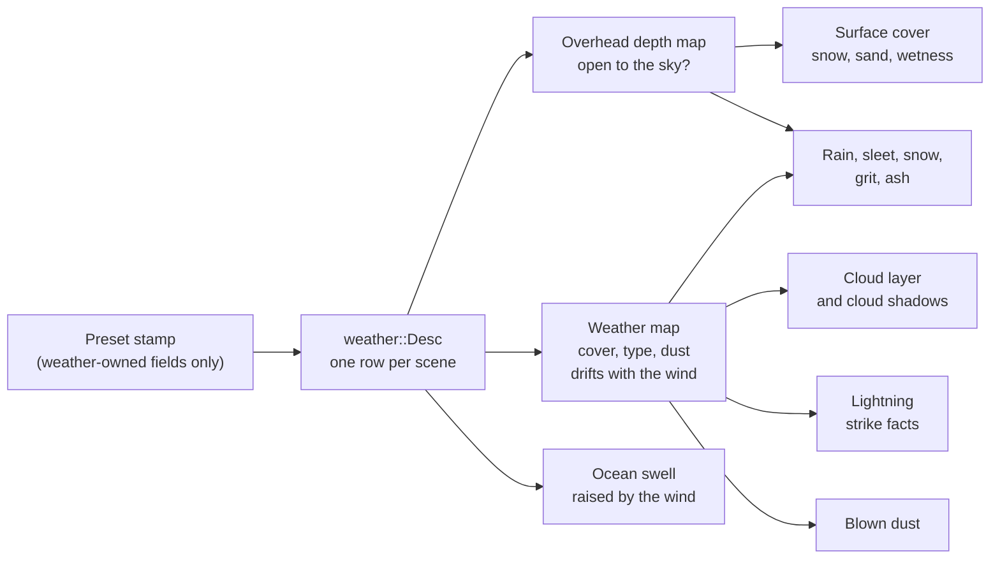

# Weather

Weather in Ceili is one row of facts on a scene's environment entity: how much
cloud, how hard the wind blows, what falls, how much snow lies on the ground.
Each system that reads the row decides what to draw from it. The clouds, the
rain, the lightning, the snow on a roof's edge and the swell on the sea all read
the same row, so they agree about the weather.

The work began with one constraint: **no artist input.** Code generates every
input at load or build time: the noise volumes, the wave spectra, the lightning
bolts, the drops and ripples. A designer picks a preset and tunes the row's
fields in Studio.

This page covers the row and its presets, the two maps every weather effect
reads, the clouds, what falls, the ocean, and the scatter system that dresses the
ground. It builds on the [Atmosphere](Atmosphere.md) page, which covers the clear
sky the clouds sit in.

<!-- MEDIA: one level, TheOldGods, cycled through Clear, Overcast, Rain and
     Storm presets in Studio's property grid, about 3 s each, with a lightning
     strike in the Storm shot. -->

---

## One row of facts

The row is `env::weather::Desc`. Its fields arrive with their first reader, so
every field changes something on screen. A named preset sets a group of them:

```cpp
// Include/Env/Weather.h
// Named weathers.  When a scene's preset CHANGES, EnvUpdateSystem stamps the preset's fields into
// the Desc - the model atmosphere::Preset uses - so a designer picks a weather, then tunes its
// fields freely.  Custom stamps nothing.  kWeatherPresets[] (Weather.cpp) is indexed by
// (preset - 1), skipping Custom.  APPENDED values only: scenes save the value as an integer, so
// inserting one would renumber every saved scene.  A weather that needs a later effect (Blizzard,
// DustStorm, AshFall) is appended by the phase that adds the effect.  Storm is a THUNDERSTORM (rain and
// lightning); DustStorm is the storm of blown sand.
enum class Preset : uint8_t
{
    Custom = 0,
    Clear,
    Overcast,
    Rain,
    Snow,
    Storm,
    Blizzard,
    AshFall,
    DustStorm,
};
```

A preset is a function that returns the defaults with a few fields changed. The
table is easy to read and hard to get out of order:

```cpp
// Src/Env/Weather.cpp
// Snow lies thick and the ground under it is damp: a thin wet film shows where the snow thins out.
constexpr Desc Snow()
{
    Desc d{};
    d.haze              = atmosphere::Haze::Snow;
    d.snowCover         = 0.7f;
    d.wetness           = 0.1f;
    d.cloudCover        = 0.75f;
    d.cloudType         = 0.3f;
    d.windSpeed         = 6.0f;
    d.precipitation     = Precipitation::Snow;
    d.precipitationRate = 0.6f;
    return d;
}
```

The first field, `haze`, is the atmosphere's: a snow weather also whitens and
dims the sky (see [Atmosphere](Atmosphere.md#presets-and-haze)).

### The weather's fields and the level's fields

Some fields belong to the weather, and some belong to the level. Snow cover,
wetness, cloud cover and wind speed change when the weather changes. The sand on
a desert floor, the wind's heading, the cloud layer's heights and the seed that
picks the cloud pattern stay with the level, whatever the weather does. A preset
must never overwrite them.

One function holds the list of fields that a preset owns:

```cpp
// Src/Env/Weather.cpp
void StampPresetFields(Desc& Dst, const Desc& Src)
{
    // NOT here, because each belongs to the LEVEL and a weather preset must leave it as authored: the sand, the
    // wind's heading, the cloud layer's heights, the seed that picks its pattern and the height the dust reaches.
    Dst.haze              = Src.haze;
    Dst.snowCover         = Src.snowCover;
    Dst.wetness           = Src.wetness;
    Dst.cloudCover        = Src.cloudCover;
    Dst.cloudType         = Src.cloudType;
    Dst.windSpeed         = Src.windSpeed;
    Dst.precipitation     = Src.precipitation;
    Dst.precipitationRate = Src.precipitationRate;
    Dst.lightningRate     = Src.lightningRate;
    Dst.stormDensity      = Src.stormDensity;
    Dst.stormVisibility   = Src.stormVisibility;
    Dst.stormColor        = Src.stormColor;
}
```

A field that is missing from this list fails in a safe direction. The preset
leaves it alone, which a designer sees at once. A field that wrongly sits in the
list would destroy authored data every time someone picks a weather.

The weather is fixed for each level. Nothing re-bakes in the middle of a match,
and that one decision lets several systems below bake their work once.

---

## Two maps every effect reads

Two maps, both built rarely, answer the two questions that almost every weather
effect asks.

**Is this point open to the sky?** Snow settles on a courtyard and not on the
floor under its arcade. Rain falls in the street and not inside the house. The
answer comes from the overhead depth map:

```cpp
// Src/Env/Overhead.h
// The depth of a scene's STATIC geometry seen from straight above, one map per scene. A weather
// shader asks it one question: is this point open to the sky? A point is open when nothing static
// sits above it, which is when its own depth from above reaches the map's.
```

It is built only when its key moves. In Edit a move, a spawn or a material change
rebuilds it, paced so that a gizmo drag rebuilds it a few times a second. A bake
that missed something, such as a pipeline still compiling, stores nothing and
tries again, so a half-built map never sticks.

The map is a 2048 x 2048 D32F target, 16 MB a scene. It covers at most 8 km on a
side, so a texel is about 3.9 m on the largest level and about 1 m across a 2 km
arena. A larger scene is clamped around its centre, because stretching it would
spend the precision on ground nobody plays on. Each side rounds up to a multiple
of 16 m, so a small change to the scene's bounds leaves the texel grid where it
was. Every caster draws through one material derived from the shadow-map
material, with culling off (a tunnel's ceiling faces down) and no depth bias.

The rebake pace differs by mode. In Edit, a scene can rebake every 15 frames.
In Play, a projectile spawn changes the scene's structural generations but
nothing the map holds, so once a clean map exists a scene rebakes at most every
120 frames: about one bake every two seconds during a firefight.

**Where are the clouds?** The weather map is one small RGBA8 tile that repeats
over the world:

```cpp
// Src/Env/WeatherMap.h
// One map per scene: 2D RGBA8 over one tile of the world that repeats every kPeriodMetres. R holds cloud
// cover, G the cloud type (P6), 0 flat to 1 towering, and A the storm's dust (P7), 0 clear to 1 full. B stays
// 0: the precipitation reads the cover.
//
// BUILT ON THE CPU, only when its INPUTS change (ComputeKey says what they are), and uploaded. Later CPU
// readers (rain placement, gameplay in cloud) read the same bytes the GPU reads. The wind never rebuilds
// it: the shader reads it through a UV offset that drifts (DriftUv), and the sampler wraps.
```

The wind costs nothing to animate. It moves a UV offset, and the map itself stays
put. Because the CPU keeps the same bytes, gameplay can ask whether an aircraft is
inside a cloud and get the answer that the screen shows.

The map is 512 texels a side, 1 MB, over a 10 km tile, so a texel is about 20 m.
Cloud shadows are soft, so the bilinear read of a 20 m texel is the look the
shadow wants. The cover is four octaves of noise over a base lattice of four
cells, which makes the largest features about 2.5 km across and the smallest
about 300 m.

One step makes `cloudCover` mean what it says. Summed octaves of noise bunch
around the middle of their range, so a plain threshold turns the field into a
steep S-curve:

```cpp
// Src/Env/WeatherMap.h
// The bins Generate equalises the noise with. Summed octaves bunch around the middle, so a threshold on the
// raw noise makes cloudCover a steep S-curve: 0.25 would cover about 3% of the map and 0.75 about 97%.
// Ranking every texel through a histogram first spreads the noise evenly over [0, 1), and cloudCover then
// reads as the share of the map under cloud.
constexpr uint32_t kHistogramBins = 4096;
```

So a designer who sets cover to 0.3 gets 30% of the sky under cloud. The cloud
type (G) is a slower noise of its own, two cells across the tile, with its seed
salted so it is not the cover's noise at a coarser scale. The storm's dust (A) is
ranked the same way, with a much harder edge, because a dust front arrives as a
wall.

The cloud shadow on the ground is one read of this map per sun-lit pixel. The
CPU folds the sun's direction into two rows of constants: a shear that carries
the pixel along the sun's ray to the middle of the cloud layer, and the layer
itself. The shader does two dot products and one texture read. A layer 400 m
thick lets through 1/e of the sun, so a 1 km layer blocks 92% of the direct
light. The shear is built for a sun no lower than 6 degrees, which caps the
shadow's stretch at about 10x near the horizon.



### Surface cover

Snow, sand and wetness are applied to every lit PBR surface before it is lit.
Snow settles on the flattest surfaces first, and full cover reaches steep slopes
too. Wet surfaces turn darker and glossier. The overhead map keeps all three off
anything under a roof. Snow and wetness belong to the weather, and sand belongs
to the level, so a desert keeps its sand under every preset.

The rule that decides how much of a surface a cover reaches is a function of its
amount, the normal's up component and a noise value:

```hlsl
// Resources/Shaders/weatherCoverMath.hlsli
// The share of a surface a cover of Amount reaches, from its normal's up component. The flattest
// surfaces fill first: the threshold falls from above 1 (nothing) to MinUp as Amount rises, and the noise
// moves it, so the edge breaks into patches rather than tracing one contour. Exactly 0 at Amount 0.
//
// Bias lowers the threshold where the deposit map says the cover lies deeper (a drift) and raises it where the wind
// thins it (a crest), 0 without the map. It works where Amount cannot: on flat ground a thin cover is noise patches,
// and scaling a thin Amount barely moves their edges, while a drift fills them in.
WC_FN float WeatherCoverShare(float Amount, float Up, float Noise, float MinUp, float Bias)
{
    const float threshold = WC_LERP(1.05f, MinUp, Amount) + (Noise - 0.5f) * 0.25f - Bias;
    return WC_SATURATE((Up - threshold) / WEATHER_EDGE + 0.5f) * WC_STEP(0.001f, Amount);
}
```

Snow reaches slopes of about 70 degrees at full cover, and sand only ground within
about 40. Snow takes the inverted noise, so its patches are the complement of the
sand's. The noise is pure arithmetic, a hash of world X and Z, so there is no
texture to bind and every backend gives the same result.

That file has a second reader. Its text is written in the subset that HLSL and
C++ share: scalars only, `f`-suffixed literals, and every intrinsic through a
macro that the includer defines. A C++ header defines those macros and includes
the shader file as C++. The CPU impact resolver then uses the same function to
decide which impact effect a hit takes, so a hit that lands on a white patch on
screen is a snow hit. The two sides cannot disagree about a threshold or a noise patch,
because neither side keeps a copy.

---

## Clouds

The atmosphere has no clouds of its own. The clouds are a layer between two
heights, drawn per pixel over the cloudless sky. A layer baked into the sky
texture would sit at infinity, so an aircraft crossing the arena would see the
clouds overhead follow it. Drawn per pixel, the layer has parallax, drifts with
its own shadows, and is tested against the scene's depth.

The layer also changes the ambient light. It blocks a share of the sky, and every
ambient and reflection read folds that share in with one lerp, so a covered sky
darkens the world without a second lighting path.

How the clouds are drawn depends on the device. It is a strategy toggle with a
FRAME latch, so it can be A/B tested inside one run:

```cpp
// Include/Display.h
enum class CloudsMode : uint8_t
{
    // No clouds in the sky and none in the ambient: the frame is exactly the cloudless one.  The cloud shadows
    // keep their own toggle, cloudShadows.
    Off = 0,
    // A cloud layer drawn per pixel over the sky, on every device: parallax, the wind's drift and the scene's
    // depth, at the cost of one blended layer.  It fades out as the camera reaches the layer's middle, so on its own
    // it shows nothing to fly through.  What Volumetric draws until its noise volumes are ready.
    SkyOnly = 1,
    // The clouds MARCHED through a noise volume at half resolution, with a history per view: shapes with depth,
    // light through them, and a camera that flies inside them.  The desktop mode.  Until the noise volumes are
    // built, and for a view that keeps no history (the thumbnail farm), the layer draws in its place.
    Volumetric = 2,
```

The fourth mode, `Puffs`, is the headset's. It draws the layer and adds billboard
puffs near the camera, placed on the CPU from the weather map. It is one draw of
CPU-built quads with no render-pass break and no scene-depth read, which suits a
tile-based GPU (see [XR and Quest](Xr.md)).

The cloud's look follows Beer-Lambert extinction through the layer's depth. A
real cloud a kilometre deep has an optical depth in the tens, and that is what
gives it a dark base. The `cloudType` field moves between a flat, thin layer with
bright bases and towering clouds with dark ones, and the weather map varies it a
little from place to place, so one sky holds both.

### The volumetric march

The desktop mode shapes its clouds from two noise volumes that tile in all three
axes:

```cpp
// Src/Env/CloudNoise.h
// The volumetric march shapes its clouds from two tiling 3D noise volumes, after Schneider's Nubis: a BASE volume
// for the shapes and a DETAIL volume that erodes their edges. Both repeat exactly across their edges, so the march
// samples them with a wrapping sampler across the whole sky, and both are built once on the CPU from the periodic
// noise in Math/Include/Noise.h, then uploaded with their mip chains (P6e, beside the march that reads them).
//
// Each voxel depends only on its own coordinates and the seed, so the volumes can be built slice by slice across
// the worker pool and the bytes do not depend on the split.
```

The base volume is 128 voxels a side. Its red channel is a broad Perlin field
for the shapes, and its other three channels are inverted Worley noise at 4, 8
and 16 cells. The march dilates the shape by the first Worley channel and erodes
it with the other two by height and cover. The detail volume is 32 voxels a
side, and it erodes edges only within 4 km of the camera. Farther out, its
features would be smaller than a pixel of the half-resolution march.

The weather map still decides where the clouds are. Inside that, the base volume
tiles every 4 km and the detail volume every 500 m, and both drift with the map.
Each frame marches 48 steps through the layer, and a history per view
accumulates them. The new frame's share of that history is 10% outside the
cloud and 35% inside it, because a camera moving through the cloud itself smears
a history that lags. The march reaches 60 km. Past that, the flat layer's model at
the map's mean cover stands in, so a storm keeps its horizon.

A view that keeps no history, such as a Studio thumbnail, draws the flat layer in
place of the march. So does every view until the noise volumes are built.

On the headset, `Puffs` keeps the flat layer for the far sky. The puffs fade out
over the last quarter of their draw radius, and the layer fades in over the same
band, so near is puffs and far is the layer. When the eye is
inside the cloud, an in-cloud fog closes the view to 150 m.

---

## What falls

`precipitation` picks rain, sleet, snow, grit or ash, and `precipitationRate`
scales how many drops are drawn. The drops fall around the camera, below the
cloud layer, and the overhead depth map keeps them out from under roofs.

No drop has any data of its own:

```cpp
// Src/Env/Precipitation.h
// Rain, sleet, snow, grit and ash, drawn as N camera-facing quads that a vertex shader places from a hash of each
// drop's index: no per-drop data, no simulation. The functions here turn the weather row and the view into what
// that shader reads:
//   - the ROWS: a box around the camera for each thing that falls, and a PHASE for each of its fall-speed classes,
//     so every drop is fixed in the WORLD as the camera moves and wraps at the box's faces. The phase is computed
//     here in double, so the shader never sees a growing clock or a large offset;
//   - the STREAK a drop draws, stretched along its own motion through the world and clipped to the near plane: the
//     CPU mirror of the vertex shader's axis, which the tests and the gate predict from;
//   - where a drop sits: the CPU mirror of the vertex shader's placement.
```

The geometry is one static index buffer of 16,384 quads with no vertex buffer,
drawn as up to four instances for at most 65,536 drops. Each thing that falls
moves in four speed classes, spread 15% either side of its speed, so rain does
not fall as one rigid sheet. Sleet is two things at once, rain and snow. Rain
draws as a thin streak with a glint toward the sun. The others draw as soft,
round sprites, and snow, ash and grit also sway. Each fades out partway into the
cloud layer, so an aircraft above the deck flies in clear air.

### Lightning that every peer agrees on

Lightning strikes from the cloud layer under its densest cover, onto the highest
ground it finds. In a networked game every peer must see the same strike at the
same place, and that comes from the schedule itself, with no message sent:

```cpp
// Src/Env/Lightning.h
// When and where lightning strikes, how bright the flash is at a time, and the bolt's shape: pure functions of plain
// data, so every peer, the system that resolves strikes and the renderer that draws them agree with no messages.
//   - THE SCHEDULE: time is cut into windows of kWindowSeconds on the scene's sim clock. Each window seeds the engine's
//     one generator from its index and the weather's seed, and rolls whether it strikes, when, how hard, and how many
//     strokes the strike flashes in its duration. A window's strike never depends on another's.
//   - THE SITE: a strike rolls kSiteCandidates points across an area (the scene's content bounds, the same for every
//     peer, never a camera); a candidate counts when the cloud cover over it, at the strike's time, passes
//     kCoverThreshold; of those that reach the ground, the HIGHEST wins, so strikes favour high ground.
//   - THE COVER: the weather map's own pure generator (weatherMap::Generate) averaged down to a coarse grid, read at
//     the map's drift, exactly where the cloud layer draws its cover.
//   - THE FLASH: the multiplier the sky and the ambient take at a time from the strikes around it.
//   - THE BOLT: a branching polyline from the cloud base to the ground (midpoint displacement plus branches).
```

A window is one second. A strike lasts 0.2 to 0.5 s and flashes two to four
return strokes. It tries eight sites and keeps those under at least 60% cover.
At its peak a stroke multiplies the sky and the ambient by four, and each stroke
fades with a time constant of about 60 ms. By night a multiplier adds nothing to a dark sky, so
the flash also adds light: the cloud deck lit from inside, at its peak as bright
on an up-facing surface as ten full moons, in the faint blue-white of a
lightning channel.

The site uses the scene's content bounds, never a camera, because each peer's
camera is somewhere else. A window's strike never depends on another window's, so
a peer that joins late computes the same strikes as one that was there from the
start.

Each strike is also published as a fact on the scene:

```cpp
// Include/Env/Weather.h
// A LIGHTNING STRIKE, as a FACT the scene states for whatever reacts to it: thunder (a game package's ThunderSystem),
// gameplay, replication. A runtime row on the weather row's entity of kStrikeFacts items, item (sequence mod
// kStrikeFacts) holding the strike with that sequence, written as each strike resolves (up to a second before it
// happens). Not meta-registered, so no serializer saves it and no grid shows it.
struct Strike
{
    uint32_t     sequence = 0;    // counts up from 1; 0 is an empty item
    math::Point3 position = {};   // where it lands
    double       seconds  = 0.0;  // its first stroke, on the scene's sim clock
    float        strength = 0.0f; // 0.5 to 1
};
```

Thunder belongs to the game. A game package reads the facts and decides what a
strike means: a sound delayed by its distance, a gameplay hazard, or a
message to other players. The strike is known up to a second before its first
stroke, so a listener has time to react.

### Blown dust

Blown dust and snow are one density in the air that drifts with the wind like the
clouds: the weather map's dust channel times a height profile that is full below
the storm's top and thins to nothing over its last 300 m. Inside a storm the view
closes in to the storm's visibility. On the desktop the dust is marched along
each pixel's ray, so a dust front shows from outside it. On the headset only the
dust at the eye thickens the fog, which costs no pass at all.

The optical depth of a path counts visibilities: the dust integrated along it,
divided by how far one sees in full dust. Two laws turn that depth into how much
is hidden. A legacy-fog view uses the legacy fog's linear law, so full dust hides
everything at one visibility, and the fog at the eye and the marched pass agree.
A physical-air view uses Beer's law with the Koschmieder constant, 3.912, which
leaves 2% of the contrast at one visibility. That is the meteorological
definition of visibility.

---

## The ocean

A scene can have one ocean: a sea to the horizon at one height. Its height is a
swell of Gerstner waves that the weather's wind raises, and its defaults are
physical values for clear seawater:

```cpp
// Include/Env/Ocean.h
    // THE WATER'S LOOK (RenderOcean): what the seabed shows through, and what the water itself sends back. Physical
    // defaults for clear seawater, which absorbs red first, so shallow water shows the seabed and deep water turns
    // blue-green.
    color::ColorF32 absorption CE_DESC("How fast the water absorbs light, per metre, in red, green and blue. Their mean sets how deep the seabed still shows through") = {0.40f, 0.07f, 0.03f, 1.0f};
    color::ColorF32 scattering CE_DESC("The colour the water itself sends back, as a linear albedo: what deep water looks like beneath its reflection")                = {0.02f, 0.07f, 0.09f, 1.0f};
    float shoreFoam            CE_RANGE_DESC(0.0f, 10.0f, "How shallow the water must be, in metres, for foam to show along the shore. 0 is none")                     = 1.5f;
```

The swell is also what gameplay tests against. `ocean::SurfaceHeight` returns the
sea's height at a world point at a given time on the scene's clock. It reads only
the scene's rows, so a simulation worker or a server with no GPU can call it,
and a splash or a floating object meets the waves that the player sees.

### The swell

The swell is one set of pure functions, shared by the hit test and the vertex
shader:

```cpp
// Src/Env/OceanSwell.h
// The sea's height is a SWELL of kSwellWaves Gerstner waves plus the FFT's CHOP. The swell is what a water hit tests
// (a plane, a bullet, a splash) and what the vertex shader displaces the ocean by; the chop is looks only (P4d). So the
// swell is ONE set of pure functions of the weather's seed and wind, the ocean's scale and cap, and the sim time:
//   - BuildSwell rolls the waves once from those inputs (a Pierson-Moskowitz peak and height, the engine's one
//     generator for the jitter);
//   - SwellPhases turns the sim time into each wave's phase in DOUBLE, so no growing clock reaches a float;
//   - SwellDisplace moves a point on the rest plane, and SwellHeightAt answers the height at a WORLD point by inverting
//     the horizontal part of that move.
// The vertex shader runs the same arithmetic (OceanSwellDisplace in Resources/Shaders/ocean.hlsli) on the rows
// SwellRows packs: keep the two in step. The answers are bit-identical within one binary (math::SinCos has no CRT
// call); co-op takes the server's answer (D9).
```

There are 12 waves. The wind sets a Pierson-Moskowitz peak frequency and height,
and the waves spread 45 degrees either side of the wind's heading. Their summed
steepness is 0.6, well under the value of 1 at which a Gerstner surface folds
over itself, because a swell is rounded. Under 0.1 m/s of wind the sea is flat.

The height query has a subtle step. A Gerstner wave moves each point of the
surface sideways as well as up, so the point that ends up over a world (X, Z) did
not start there. `SwellHeightAt` finds that rest point with Newton steps on the
move's Jacobian, then returns its height. A unit test pins it:

```cpp
// Tests/OceanUnitTests.cpp
CEILI_TEST_CASE("Ocean_Swell_HeightAtInvertsTheDisplacement")
{
    // At a steep, uncapped swell: a rest point's displaced position asks for its height, and gets the displaced height.
    OC::Swell swell;
    OC::BuildSwell(swell, Wind(25.0f));
    OC::SwellRows rows;
    OC::BuildSwellRows(rows, swell, 4321.5);
    float worst = 0.0f;
    for (int32_t gz = -8; gz <= 8; ++gz)
    {
        for (int32_t gx = -8; gx <= 8; ++gx)
        {
            const float           px     = static_cast<float>(gx) * 13.7f;
            const float           pz     = static_cast<float>(gz) * 11.3f;
            const OC::SwellSample sample = OC::SwellDisplace(rows, px, pz);
            const float           height = OC::SwellHeightAt(rows, px + sample.offset.x, pz + sample.offset.z);
            worst                        = core::Max(worst, math::Abs(height - sample.offset.y));
        }
    }
    CEILI_CHECK(worst < 0.01f);
}
```

### The chop

The short waves on top of the swell, the chop, are for looks only. Hits still
read the swell. The chop's spectrum is the swell's own sea, with the same wind
and seed, kept only where the swell is not:

```cpp
// Src/Env/OceanChop.h
//   - The spectrum is the swell's own Pierson-Moskowitz sea (the same wind and seed), kept only where the swell is not:
//     above twice the swell's peak wavenumber, and shorter than about 30 m. The sea's tail saturates there, so the
//     chop's height stays under a metre whatever the wind (D5), and a storm's ripples are no weaker than a breeze's.
//   - Each texel holds h0 and the whole number of TURNS its wave makes in kChopLoopSeconds (its angular frequency,
//     quantised), and the kernels take the time as a phase in [0, 1) of that loop: the chop loops exactly, no growing
//     clock reaches a float, and no sine sees an argument past one turn.
```

The chop runs in three cascades of 256 x 256, and each cascade owns its own band
of wavenumbers, so no wave is counted twice. Every wave makes a whole number of
turns in 200 s, so the whole sea loops exactly every 200 s. A CPU copy of the
kernels lets the tests pin the GPU's bit reversal, twiddles and stage order.

On the desktop the chop is computed every frame. On the headset it is baked
once:

```cpp
// Include/Display.h
enum class OceanSimulation : uint8_t
{
    // The analytic SWELL alone: the waves a water hit tests, drawn by the vertex shader, with no compute a frame.
    Swell = 0,
    // The swell plus the FFT CHOP: the short waves on top, three cascades of inverse FFTs in compute each frame, read
    // by the ocean's vertex and fragment shaders.  Looks only (D5): the hits still read the swell.  The desktop mode.
    Fft = 1,
    // The swell plus the chop BAKED ONCE: the same FFT run once when its inputs change, its slopes kept (1.5 MB) and
    // scrolled downwind, with no compute a frame, no displacement and no whitecaps.  The Quest mode.
    Baked = 2,
};
```

The sea reflects the sky alone, a planar reflection of the scene drawn at half
size, or a screen-space reflection made in three compute dispatches with no second
view. What shows under the surface is also a choice: nothing, a capture of the
scene before the sea, or a separate view under the sea with the water as its near
plane.

Ported levels had their own painted sea meshes. A game registers each one by mesh
name, and the importer spawns the ocean at that sea's level and hides the old
mesh. The ocean then shades in the old sea's own style in a legacy view, so a
level looks like itself until its art is updated.

### On the headset

The ocean in place of the legacy sea on TheOldGods, looking down the bay with the
head frozen, measured on a Quest from 2026-10-15 to 2026-10-17 (36 interleaved
pairs per run):

| Arm | Frame.Gpu | Frame rate |
|---|---|---|
| The legacy sea | 13.58 ms | 68.7 fps |
| The ocean, chop computed each frame (`Fft`) | 14.86 ms | 63.5 fps |
| The ocean, chop baked once (`Baked`) | 11.88 ms | 72.1 fps |
| `Baked`, planar reflection every other frame | 13.70 ms | 68.4 fps |

With its chop baked, the ocean is 1.70 ms cheaper than the sea it replaces, and
it reaches 72 Hz. The chop's FFT each frame costs about 3.8 ms on the device, so
it stays the desktop's mode. The planar reflection is bound by its vertices: a
fifth-size target still took 1.59 ms. So the device profile draws it every other
frame.

---

## Dressing the ground: scatter

A level also needs rocks, scrub, debris, grass and drift mounds. A scatter is one
entity that places thousands of them. A scatter never makes one entity for each
prop, and the source records why:

```cpp
// Include/Scatter/Scatter.h
// A SCATTER is one entity that places thousands of props (rocks, scrub, debris) over a level: WeatherCloudsOcean.md
// 4.13, S2.  Never one entity per prop: 2200 rocks as 2200 model entities took the shadow casters from 100 to 3624,
// passed the kd re-seat cap, and came before repeated device hangs (RedMinesX, 2026-08-30).
```

A scatter places its props by rules, and one rule schema serves two tiers:

```cpp
// Include/Scatter/Scatter.h
enum class RuleTier : uint32_t
{
    Stored = 0, // walked on the CPU when the scatter is generated, and each kept candidate saved as a placement: a rock a
                // person can move, kill, and hit
    Derived,    // walked on the GPU around the camera each time a tile comes into range, and NOTHING saved: grass and
                // pebbles, too many to store and too small for anything to touch
};
```

A rule moves between the tiers without a rewrite. The derived tier places each
16 m tile once, when the tile comes into range, and then draws it for as long as
it stays in range. Nothing it reads changes during a match, because the weather is
fixed for each level, so the compute stays off the frame. The CPU half of that
plan (which tiles, at which detail level, in which GPU slot) is pure code with no
device, so every decision it makes is a unit test.

A scatter can also carry a deposit: a drift of snow or sand laid over the ground
as a heightfield in 64 m cells, saved with the scene, and drawn with its own
material.

---

## Built to be tested

Almost every header on this page opens with the same line: pure functions of
plain data, so every case can be built in a test. The swell, the chop's
spectrum, the drops' placement, the lightning schedule, the cloud layer's rows
and the weather map's generator take plain structs and return plain structs. No
device, scene or frame is needed to call them. Where the GPU runs the same
arithmetic, the C++ is either the shader's own text compiled as C++ (the surface
cover) or a mirror that a test holds in step with it (the swell, the chop's
kernels, the drops' streaks).

Ten unit-test files cover these pieces, with 126 test cases between them. Some
pin a constant that C++ and HLSL both define, such as the weather map's 10 km
period. Others pin a property, such as the swell's surface never folding over
itself in a 30 m/s wind.

---

## What weather does not do yet

- **No weather changes during a match.** Each level has one weather. Cover does
  not grow, melt or dry, and the derived scatter and the baked chop rely on that.
- **The chop does not move objects.** Hits, buoyancy and gameplay read the swell.
- **No thunder in the engine.** The engine publishes strike facts, and a game
  plays the sound.
- **One ocean a scene,** at one height. Lakes and rivers at other heights are not
  covered.
- **The headset modes look simpler.** `Puffs`, the eye-only dust and the baked
  chop are chosen to fit the frame budget, and each shows less than its desktop
  mode.

Next: [XR and Quest](Xr.md) for how these numbers were measured on the device,
[Atmosphere](Atmosphere.md) for the sky the clouds sit in, or
[Lighting](Lighting.md) for the ambient term the clouds fold into. Back to the
[documentation index](README.md).
